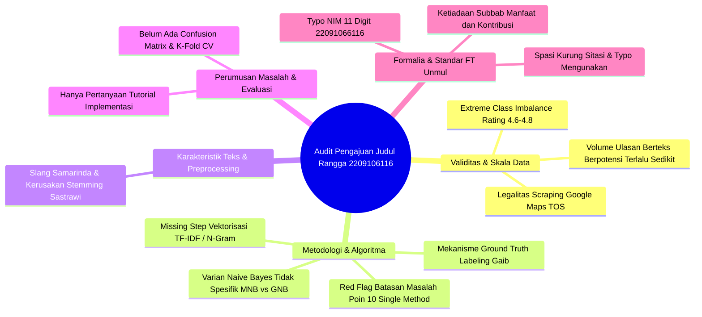

# 📋 LAPORAN AUDIT AKADEMIK & PANDUAN PENGEMBANGAN PENGAJUAN JUDUL SKRIPSI
## EVALUASI FORENSIK DRAF AWAL & ROADMAP REKONSTRUKSI RISET S1 INFORMATIKA FT UNMUL

**Mahasiswa:** Rangga Kristiawan  
**NIM:** 2209106116 *(Koreksi: di naskah tertulis 22091066116 - kelebihan 1 digit)*  
**Program Studi:** S1 Informatika, Jurusan Teknik Elektro dan Informatika, Fakultas Teknik, Universitas Mulawarman  
**Dosen Pembimbing:** Anton Prafanto, S.Kom., M.T. (NIP: 199310222019031016)  
**Koordinator Program Studi:** Awang Harsa Kridalaksana, S.Kom., M.Kom. (NIP: 19731229 200501 1 002)  
**Judul Naskah Diajukan:**  
> *"ANALISIS SENTIMEN ULASAN WARUNG GRESIK SUROBOYO BAKSO DAN SOTO AYAM PAK MULKAN SAMARINDA PADA GOOGLE MAPS MENGGUNAKAN METODE NAIVE BAYES"*

**Dokumen yang Diaudit:** `draft_pengajuan_judul_rangga_kristiawan.pdf` (3 Halaman, asal berkas `C:\Users\anton\Downloads\Pengajuan Judul Rangga Kristiawan_2209106116.pdf`)  
**Tanggal Evaluasi:** 26 Oktober 2026  
**Status Naskah:** ⚠️ **DITERIMA DENGAN REVISI MAYOR (MAJOR REVISION) — WAJIB REKONSTRUKSI METODOLOGI & PERLUASAN DATA SEBELUM PENYUSUNAN PROPOSAL LENGKAP**

---

> [!NOTE]
> ### 💡 Pengantar & Catatan Konsultasi Akademik dari Dosen Pembimbing:
> *"Halo Rangga, selamat atas inisiatifmu mengajukan judul penelitian skripsi ini. Analisis sentimen berbasis ulasan pengguna di platform digital seperti Google Maps merupakan topik terapan Pemrosesan Bahasa Alami (Natural Language Processing / NLP) yang sangat relevan dan menarik untuk diteliti.*  
>  
> *Namun demikian, sebagai calon Sarjana Informatika di Fakultas Teknik Universitas Mulawarman, sebuah karya skripsi dituntut memiliki **kedalaman keilmuan komputer (scientific & engineering depth)**, validitas data yang kuat, serta metodologi yang teruji secara statistik. Naskah 3 halaman yang kamu ajukan masih memiliki kelemahan mendasar: mulai dari risiko kelangkaan data (data scarcity), ketidakseimbangan kelas ekstrem (class imbalance), tidak adanya pembobotan fitur (feature extraction), mekanisme pelabelan data yang belum didefinisikan, hingga pembatasan single-method yang membuat bobot penelitianmu masih selevel tugas mata kuliah.*  
>  
> *Laporan audit ini disusun secara rinci untuk membantumu menyempurnakan penelitian agar siap bersaing dan tangguh saat diuji di Seminar Proposal nanti. Pelajari setiap poin evaluasi di bawah ini dengan seksama."*

---

## 🌟 1. Apresiasi & Potensi Positif Ide Penelitian

Ada beberapa poin positif dari draf pengajuan judul yang kamu serahkan:
1. **Pemilihan Ranah NLP & Analisis Teks:** Pengolahan teks bahasa alami dari ulasan konsumen merupakan topik inti keilmuan Informatika di bidang *Data Science & Artificial Intelligence*.
2. **Konteks Lokalitas Samarinda:** Mengangkat studi kasus entitas kuliner lokal di Kota Samarinda menunjukkan kepedulian terhadap digitalisasi dan persepsi reputasi bisnis UMKM lokal.
3. **Penggunaan Referensi Terkini:** Naskah mengutip literatur tahun 2023 dan 2025 (*Aksoy, 2025; Bisono & Zulherry, 2025; Idris et al., 2023*), yang menunjukkan mahasiswa sudah mulai melacak publikasi ilmiah kontemporer.

---

## 🚨 2. Rangkuman 10 Temuan Kritis (*10 Critical Red Flags*)



### Tabel Rangkuman Temuan Kritis:

| No | Kategori | Tingkat Urgensi | Lokasi di Draf | Deskripsi Masalah Kritis |
| :---: | :--- | :---: | :---: | :--- |
| **1** | **Data Scarcity** | 🚨 **Sangat Fatal** | Judul & Latar Belakang | **Jumlah Ulasan Teks 1 Warung Berisiko Terlalu Sedikit:** Model Naive Bayes membutuhkan ratusan/ribuan data teks untuk *training*. Jika ulasan berteks di warung tersebut sedikit, pembagian *data split* akan gagal menghasilkan generalisasi model yang valid. |
| **2** | **Distribusi Data** | 🚨 **Sangat Fatal** | Judul & Objek Riset | **Tantangan Ekstrem *Class Imbalance*:** Warung Pak Mulkan memiliki rating sangat tinggi (4.6–4.8 bintang). Artinya, ~90% ulasan adalah POSITIF. Model Naive Bayes standar akan bias parah (*Accuracy Paradox*), di mana akurasi tinggi semu namun *Recall* kelas negatif mendekati 0%. |
| **3** | **Metodologi S1** | 🚨 **Sangat Fatal** | Hal. 2 (Batasan Masalah Poin 10) | **Kelemahan *Single Method*:** Tertulis *"Metode yang digunakan hanya Naive Bayes dan tidak membandingkannya dengan algoritma lain"*. Tanpa komparasi (misal vs SVM) atau optimasi fitur, bobot riset dinilai sangat minim kebaruan untuk standar skripsi S1 Informatika FT Unmul. |
| **4** | **Ground Truth Data** | 🚨 **Sangat Fatal** | Hal. 1 & 2 (Batasan Poin 8) | **Mekanisme Pelabelan Data Belum Ada:** Naive Bayes adalah algoritma *Supervised Learning* yang wajib ada label. Jika data rating tidak dijadikan penentu utama, siapa dan bagaimana teks dilabeli positif/netral/negatif? Anotasi manual? Kamus leksikon? Validitas *Inter-Annotator Agreement* belum disinggung. |
| **5** | **Alur NLP Hilang** | ⚠️ **Mayor (Kritis)** | Hal. 2 (Batasan Masalah Poin 7) | **Tahap Ekstraksi Fitur / Vektorisasi Teks Hilang:** Alur teks langsung dari stemming ke klasifikasi. Komputer tidak dapat memproses kata mentah tanpa representasi numerik (**TF-IDF, Bag-of-Words, N-Gram**). Tahap fundamental ini wajib dicantumkan. |
| **6** | **Spesifikasi Model** | ⚠️ **Mayor** | Judul & Metodologi | **Varian Naive Bayes Tidak Spesifik:** Naive Bayes memiliki varian Multinomial (MNB), Bernoulli (BNB), dan Gaussian (GNB). Untuk data frekuensi kata / teks, varian yang tepat adalah **Multinomial Naive Bayes (MNB)**, bukan sekadar "Naive Bayes". |
| **7** | **Linguistik Lokal** | ⚠️ **Mayor** | Hal. 1 & 2 (Batasan Poin 7) | **Bahasa Ulasan Samarinda & Risiko Stemming:** Ulasan kuliner lokal sarat bahasa gaul, singkatan, dan dialek (*bumbunya nampol, pentolnya kenyal bnr*). *Stemmer* baku seperti Sastrawi akan merusak kata slang jika tidak didahului tahap **Normalisasi Kata (Slang Word Normalizer)**. |
| **8** | **Rumusan Masalah** | ⚠️ **Mayor** | Hal. 2 (Rumusan Masalah) | **Rumusan Masalah Hanya Bertaraf Tutorial:** Pertanyaan *"Bagaimana menerapkan..."* hanya menanyakan langkah kerja instalasi/coding. Wajib menambahkan pertanyaan evaluasi performa kuantitatif: *Confusion Matrix* (Accuracy, Precision, Recall, F1-Score). |
| **9** | **Sistematika Unmul** | ⚠️ **Sedang** | Hal. 2 & 3 | **Struktur Belum Memenuhi Pedoman FT Unmul:** Belum ada subbab **1.5 Manfaat Penelitian** (bagi Penulis, Akademik, dan Masyarakat) serta subbab **1.6 Kontribusi Penelitian** (*Novelty*), serta kalimat penutup Latar Belakang belum mengikuti formula baku Unmul. |
| **10** | **Tipografi & Formalia** | ⚠️ **Sedang** | Hal. 1, 2, 3 | **Typo NIM 11 Digit & Sitasi Menempel:** NIM di cover tertulis `22091066116` (kelebihan satu digit angka 6); spasi sitasi hilang `pengguna(Aksoy, 2025)`; typo daftar pustaka `Mengunakan`; tanda baca rumusan masalah diakhiri titik bukan tanda tanya. |

---

## 🔍 3. Bedah Detail & Solusi Perbaikan Akademis

### A. Evaluasi Objek Riset & Kesiapan Dataset
1. **Risiko Fatal *Data Sparsity*:**
   * Algoritma *Supervised Learning* seperti Naive Bayes membutuhkan korpus kata yang kaya dalam vocabulary-nya.
   * Warung makan tunggal di Google Maps sering kali hanya memiliki puluhan ulasan teks panjang, sementara ratusan lainnya hanya berupa rating bintang tanpa teks.
   * **Instruksi untuk Rangga:** Lakukan inventarisasi riil sekarang juga. Scraping / unduh seluruh ulasan Warung Pak Mulkan di Google Maps. Hitung berapa jumlah ulasan yang memiliki teks minimal 3 kata. Jika jumlah teks bersih < 500 ulasan, **objek penelitian ini WAJIB diperluas** (lihat Opsi Rekomendasi di Bab 4).
2. **Bahaya *Accuracy Paradox* Akibat *Class Imbalance*:**
   * Di Google Maps, restoran legendaris dengan rating 4.7 memiliki distribusi sentimen yang sangat timpang: Positif (85–90%), Netral (5–10%), Negatif (2–5%).
   * Jika model Naive Bayes dilatih pada data seperti ini tanpa perlakuan khusus, model akan memiliki *prior probability* kelas positif yang sangat dominan. Akibatnya, model cenderung memprediksi seluruh data uji sebagai "Positif".
   * Hasil akurasinya mungkin tampak tinggi (misal 88%), tetapi model tersebut **gagal total mendeteksi komplain pelanggan (Recall kelas negatif = 0%)**. Padahal nilai bisnis terbesar dari analisis sentimen adalah mendeteksi keluhan pelanggan!
   * **Solusi Wajib:** Terapkan teknik penanganan ketidakseimbangan kelas, seperti **SMOTE (Synthetic Minority Over-sampling Technique)** pada ruang fitur, atau lakukan teknik *resampling* / *class-weighting*.

---

### B. Penguatan Metodologi Keilmuan Informatika
1. **Hapus Batasan Masalah Poin 10 (Hindari *Single Method*):**
   * Di hadapan dewan penguji seminar proposal FT Unmul, mahasiswa yang hanya menggunakan 1 algoritma standar tanpa pembanding akan ditanya: *"Mengapa harus Naive Bayes? Mengapa bukan SVM, Logistic Regression, atau Random Forest? Apakah Naive Bayes memang yang paling optimal untuk ulasan lokal ini?"*.
   * Kamu tidak bisa menjawab pertanyaan tersebut jika kamu membatasi penelitian hanya pada 1 metode.
   * **Solusi:** Lakukan penelitian komparatif: **Multinomial Naive Bayes (MNB) vs. Support Vector Machine (SVM)** dengan kernel Linear/RBF, atau tambahkan eksperimen optimasi seleksi fitur seperti **Chi-Square ($X^2$)** atau **Information Gain (IG)**.
2. **Kejelasan Mekanisme *Ground Truth Labeling*:**
   * Pada naskah tertulis: *"Data rating tidak digunakan sebagai penentu utama kategori sentimen, karena penentuan sentimen berfokus pada isi ulasan"*.
   * Pernyataan ini menimbulkan lubang metodologis: **Siapa yang melabeli teks menjadi Positif, Netral, dan Negatif?**
   * Pilihan yang dapat kamu pertahankan:
     * **Pendekatan Anotasi Manual:** Ulasan dilabeli oleh 2 atau 3 orang annotator independen, lalu diuji tingkat kesepakatannya menggunakan **Cohen's Kappa Coefficient** atau **Fleiss' Kappa** ($K \ge 0.70$).
     * **Pendekatan *Lexicon-Based Labeling*:** Menggunakan kamus sentimen bahasa Indonesia (misal: *InSet Lexicon* atau *VADER Multi-language*) untuk menghasilkan label awal secara terprogram.
     * **Pendekatan Hybrid Rating-Threshold:** Menggunakan rating sebagai *proxy label* dengan filter validasi (misal rating 4-5 = positif, 1-2 = negatif, rating 3 dibuang untuk menghindari noise kelas netral).
3. **Tambahkan Tahap Ekstraksi Fitur & Vektorisasi:**
   * Sempurnakan alur pada Batasan Masalah Poin 7 menjadi:
     $$\text{Ulasan Mentah} \rightarrow \text{Cleansing} \rightarrow \text{Case Folding} \rightarrow \text{Tokenizing} \rightarrow \text{Slang Normalization} \rightarrow \text{Stopword Removal} \rightarrow \text{Stemming} \rightarrow \mathbf{TF\text{-}IDF / N\text{-}Gram} \rightarrow \text{Klasifikasi}$$

---

### C. Sistematika Penulisan Sesuai Buku Pedoman FT Unmul
Berdasarkan `pedoman_skripsi_unmul.md`, naskah usulan penelitian wajib memuat komponen terstruktur:
1. **Latar Belakang:** Wajib disusun dalam alur piramida terbalik (7–10 paragraf). Paragraf terakhir wajib ditutup dengan kalimat baku:
   > *"Oleh sebab itu, penelitian ini mengangkat judul [JUDUL LENGKAP] menggunakan metode [METODE] pada [OBJEK]. Hal ini bertujuan agar dapat [TUJUAN UTAMA]."*
2. **Rumusan Masalah:** Perbaiki redaksi menjadi 2 atau 3 butir kalimat tanya:
   * *1. Bagaimana menerapkan algoritma Multinomial Naive Bayes dan pembobotan TF-IDF untuk klasifikasi sentimen ulasan pelanggan...?*
   * *2. Bagaimana performa akurasi, presisi, recall, dan F1-Score model yang dihasilkan dalam mengklasifikasikan sentimen ulasan...?*
   * *3. Bagaimana kecenderungan sentimen dan aspek utama ulasan pelanggan berdasarkan hasil klasifikasi...?*
3. **Manfaat Penelitian (Subbab 1.5):** Wajib dibagi 3:
   * Bagi Penulis (penerapan keilmuan data science/NLP).
   * Bagi Akademik/Informatika (rujukan efektivitas MNB pada korpus ulasan kuliner lokal).
   * Bagi Pelaku Usaha / Pengguna (bahan evaluasi peningkatan layanan kuliner).
4. **Kontribusi Penelitian (Subbab 1.6):** Jelaskan *novelty* atau kebaruan yang diberikan (misal: perancangan kamus normalisasi slang lokal Samarinda untuk ulasan kuliner).

---

## 🎯 4. Tiga Opsi Rekomendasi Rekonstruksi Judul

Pilihlah salah satu dari 3 opsi judul di bawah ini untuk meningkatkan kelayakan dan bobot akademik skripsimu:

```
                                      ┌──► Opsi A (Komparasi Algoritma)
                                      │    MNB vs SVM pada Wisata Kuliner Samarinda
                                      │
Rekomendasi Rekonstruksi Judul ───────┼──► Opsi B (Optimasi Fitur & Imbalance)
                                      │    MNB + SMOTE + Chi-Square Feature Selection
                                      │
                                      └──► Opsi C (Aspect-Based Sentiment Analysis)
                                           Analisis Sentimen Berbasis Aspek (Rasa, Layanan, Harga)
```

### Opsi A: Komparasi Algoritma pada Klaster Kuliner Samarinda (SANGAT DIREKOMENDASIKAN)
> **"Komparasi Kinerja Algoritma Multinomial Naive Bayes dan Support Vector Machine (SVM) pada Analisis Sentimen Ulasan Wisata Kuliner Kota Samarinda di Google Maps"**
* **Keunggulan:** Objek tidak hanya 1 warung (diambil 5–10 tempat kuliner legendaris Samarinda), dataset melimpah (> 1.500 ulasan), dan ada kontribusi komparatif yang sangat disukai dewan penguji.

### Opsi B: Optimasi Ketidakseimbangan Data & Seleksi Fitur (Fokus Teknik Informatika)
> **"Penerapan Algoritma Multinomial Naive Bayes dengan Pembobotan TF-IDF dan Synthetic Minority Over-sampling Technique (SMOTE) untuk Mengatasi Ketidakseimbangan Kelas pada Analisis Sentimen Ulasan Konsumen"**
* **Keunggulan:** Memiliki kedalaman teoritis dalam memecahkan masalah nyata *class imbalance* pada rating tinggi.

### Opsi C: Analisis Sentimen Berbasis Aspek (*Aspect-Based Sentiment Analysis / ABSA*)
> **"Analisis Sentimen Berbasis Aspek pada Ulasan Restoran Lokal Samarinda Menggunakan Kombinasi Algoritma Naive Bayes dan Latent Dirichlet Allocation (LDA)"**
* **Keunggulan:** Menghasilkan wawasan spesifik: bukan hanya tahu sentimen positif/negatif, tetapi tahu sentimen pada aspek *rasa makanan, kebersihan, kecepatan pelayanan, dan harga*.

---

## 📋 5. Action Items (Tugas Mahasiswa Menuju Bimbingan Lanjutan)

1. [ ] **Verifikasi Jumlah Data Riil:** Buka Google Maps, periksa total ulasan Warung Pak Mulkan. Catat: berapa total ulasan berbintang dan berapa yang memiliki **teks komentar**. Bawa data ini saat menghadap dosen.
2. [ ] **Koreksi Typo NIM:** Perbaiki penulisan NIM di dokumen dari `22091066116` menjadi `2209106116`.
3. [ ] **Pilih Salah Satu Rekomendasi Judul:** Tentukan apakah akan mengambil jalur komparasi (Opsi A) atau penanganan imbalance (Opsi B).
4. [ ] **Rancang Skema Pelabelan Data:** Buat alur tertulis bagaimana teks ulasan akan dilabeli (anotasi manual / leksikon).
5. [ ] **Perluas Tinjauan Pustaka:** Tambahkan minimal 5 jurnal terakreditasi SINTA atau prosiding IEEE/Scopus terbaru terkait analisis sentimen ulasan Google Maps berbahasa Indonesia.
6. [ ] **Susun Bab I Lengkap:** Tulis draf Bab I utuh sesuai struktur baku `pedoman_skripsi_unmul.md` (Latar Belakang piramida terbalik, Rumusan Masalah 2–3 poin, Batasan Masalah yang realistis, Tujuan, Manfaat 3 pihak, dan Kontribusi).

---

> *"Rangga, jangan berkecil hati dengan banyaknya catatan audit ini. Skripsi yang baik bukanlah skripsi yang tanpa revisi, melainkan skripsi yang kelemahannya sudah diperbaiki sejak di meja bimbingan, bukan dibantai saat seminar proposal. Bapak siap membimbingmu sampai tuntas. Silakan dikerjakan tugas-tugas di atas dan temui bapak kembali untuk diskusi draf revisinya."*  
>  
> **Dosen Pembimbing,**  
> **Anton Prafanto, S.Kom., M.T.**  
> *NIP: 199310222019031016*
