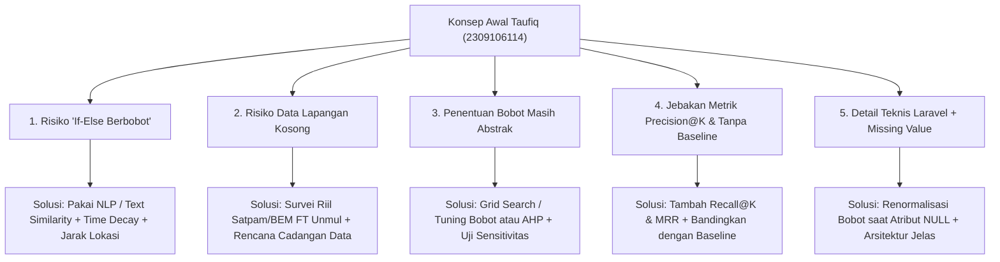

# 📋 LAPORAN AUDIT AKADEMIK & PANDUAN PENGEMBANGAN TOPIK SKRIPSI
## EVALUASI KONSEP AWAL & *ROADMAP* PENYUSUNAN PROPOSAL S1 INFORMATIKA FT UNMUL

**Mahasiswa:** Taufiqurrahman Al Baihaqi  
**NIM:** 2309106114 (Semester 7 — Mahasiswa Bimbingan Akademik)  
**Program Studi:** S1 Informatika, Jurusan Teknik Elektro dan Informatika, Fakultas Teknik, Universitas Mulawarman  
**Dosen Pembimbing:** Anton Prafanto, S.Kom., M.T. (NIP: 199310222019031016)  
**Koordinator Program Studi:** Awang Harsa Kridalaksana, S.Kom., M.Kom. (NIP: 19731229 200501 1 002)  
**Topik yang Diajukan:**  
> *"Pengembangan Sistem Informasi Lost & Found Berbasis Web di Lingkungan Fakultas Teknik Universitas Mulawarman Menggunakan Metode Weighted Similarity"*

**Dokumen yang Diaudit:** `ringkasan_konsep_skripsi_taufiqurrahman_al_baihaqi.docx` (berkas asal `1.docx`, 3 bagian ringkasan konsep sebagai jawaban arahan pra-bimbingan)  
**Tanggal Evaluasi:** 23 November 2026  
**Status Konsep:** 🌱 **LAYAK DIKEMBANGKAN DENGAN REKONSTRUKSI TEKNIS & VALIDASI DATA — BELUM SIAP ACC JUDUL SEBELUM 4 PRASYARAT UTAMA TERPENUHI**

---

> [!NOTE]
> ### 💡 Pengantar & Catatan Konsultasi dari Dosen Pembimbing
> *"Halo Taufiq, terima kasih sudah menyusun ringkasan 3 poin pertanyaan yang Bapak berikan kemarin dengan cepat dan terstruktur. Sikapmu yang langsung menindaklanjuti arahan dan berani melanjutkan proyek PKL agar tidak memulai dari nol adalah langkah yang bagus dan strategis.*
>
> *Namun, perlu kamu pahami bahwa standar **Skripsi S1 Informatika** berbeda dengan laporan PKL atau tugas mata kuliah pemrograman web. Di meja seminar proposal nanti, dewan penguji tidak hanya menilai apakah website-nya berjalan (CRUD), tetapi menilai **kedalaman algoritma, kejujuran serta kecukupan data, dan ketepatan metode evaluasinya**.*
>
> *Dokumen audit ini Bapak susun bukan untuk mempersulitmu, melainkan sebagai **peta jalan (roadmap) belajar dan perbaikan langkah demi langkah** agar kamu memahami secara utuh apa yang harus disiapkan sebelum menulis Bab I–III dan menghadap bimbingan tatap muka. Baca pelan-pelan setiap bagian beserta contoh hitungan nyatanya di bawah ini."*

---

## 🌟 1. Apresiasi: Apa yang Sudah Bagus dari Ringkasanmu?

Sebelum masuk ke catatan kritis, ada 3 hal positif dari dokumen [ringkasan_konsep_skripsi_taufiqurrahman_al_baihaqi.docx](ringkasan_konsep_skripsi_taufiqurrahman_al_baihaqi.docx) yang sudah berada di jalur yang tepat:

1. **Pemisahan PKL vs. Skripsi Sudah Mulai Terlihat:**  
   Kamu sudah bisa membedakan bahwa proyek PKL (`Laravel`, `PHP`, `SQLite`) baru sebatas pengelolaan data barang temuan oleh admin, pencarian/filter manual, verifikasi klaim manual, dan masih memakai *data dummy*. Sedangkan Skripsi difokuskan pada penambahan fitur pencocokan otomatis berbasis *Weighted Similarity* beserta pengujian ketepatan hasilnya.
2. **Pemahaman Ruang Lingkup Sistem yang Realistis (*Human-in-the-Loop*):**  
   Keputusanmu membatasi sistem sebagai **alat bantu rekomendasi pencocokan**—sementara keputusan akhir kepemilikan dan penyerahan barang tetap melalui verifikasi petugas—adalah keputusan desain yang sangat matang, aman secara etika, dan realistis diterapkan di kampus.
3. **Pemilihan Fokus Atribut Berbasis Teks Terlebih Dahulu:**  
   Menempatkan foto barang sebagai informasi pendukung (belum masuk ke perhitungan algoritma) di tahap awal adalah langkah bijak agar cakupan skripsimu tetap fokus pada pencocokan multi-atribut berbasis teks/metadata dan tidak melebar terlalu jauh ke *Computer Vision* (kecuali nanti kamu memang ingin menjadikannya nilai tambah).

---

## 🚨 2. Ringkasan 5 Temuan Kritis (*Critical Red Flags*)

Diagram berikut merangkum 5 titik rawan yang **paling sering membuat skripsi bertema rekomendasi/matching ditolak atau direvisi berat saat Seminar Proposal S1 Informatika**:

### Tabel Ringkasan Audit

| No | Aspek yang Diaudit | Tingkat Urgensi | Temuan pada Dokumen (`1.docx`) | Dampak Jika Tidak Diperbaiki |
| :---: | :--- | :---: | :--- | :--- |
| **1** | **Kedalaman Algoritma per Atribut** | 🚨 **Sangat Kritis** | Sudah menyebut 7 atribut, tetapi **belum ada metode perhitungan kemiripan** untuk masing-masing atribut (*"akan dikaji lebih lanjut"*). | Penguji akan menganggap metode hanya berupa *if-else* pencocokan kata biasa yang bobot ilmiahnya terlalu tipis untuk S1 Informatika. |
| **2** | **Ketersediaan Data Riil FT Unmul** | 🚨 **Sangat Kritis** | Baru berupa rencana: *"akan mencoba mengajukan izin ke pihak fakultas/satpam"*. Belum diketahui apakah arsip datanya ada dan berpasangan. | Risiko skripsi mandek di tengah jalan jika ternyata catatan satpam tidak lengkap, tidak digital, atau jumlahnya sangat sedikit (< 30 kasus). |
| **3** | **Penentuan Bobot ($w_i$)** | ⚠️ **Mayor** | Penentuan bobot masih abstrak (*"berdasarkan literatur dan pengujian"*), belum ada mekanisme optimasi/eksperimen bobot. | Penguji akan bertanya: *"Kenapa bobot kategori misalnya 0,25 dan warna 0,15? Angka itu dapat dari mana, apakah hasil tebakan saja?"* |
| **4** | **Metrik Evaluasi & *Baseline*** | ⚠️ **Mayor** | Menyebut `Precision`, `Recall`, dan `Precision@K`, tetapi belum menjelaskan **pembanding (*baseline*)** dan skenario *ground truth*. | `Precision@5` pada kasus 1-lawan-1 maksimal hanya bernilai `0,20` (20%)—rawan salah tafsir saat sidang! Tanpa *baseline*, tidak terbukti *Weighted Similarity* lebih baik dari SQL biasa. |
| **5** | **Atribut Kosong & Tata Tulis** | ⚠️ **Sedang** | Menyebut atribut opsional (*"merek apabila tersedia"*), tetapi belum ada penanganan *missing value*. Terdapat juga minor typo/huruf kapital di dokumen & chat. | Pelapor yang tidak mengisi merek/ciri khusus akan mendapat skor lebih rendah secara tidak adil jika bobot tidak dinormalisasi ulang. |

---

## 🔍 3. Bedah Mendalam & Panduan Teknis (Agar Mudah Kamu Pahami & Terapkan)

Bagian ini menjelaskan **apa yang harus kamu ubah dan bagaimana cara kerjanya secara konkret**, lengkap dengan contoh hitungan sederhana.

---

### A. Perjelas Batas PKL vs. Skripsi (Tabel Pembanding untuk Bab I & III)

Saat presentasi nanti, penguji pasti bertanya: *"Apa bedanya sistem PKL kamu dengan Skripsi ini?"* Siapkan jawaban tegas seperti matriks berikut:

| Aspek | Proyek PKL (Sudah Selesai) | Penelitian Skripsi (Yang Akan Dikerjakan) |
| :--- | :--- | :--- |
| **Fokus Utama** | Digitalisasi pencatatan barang temuan dan proses klaim manual. | Otomatisasi pencocokan laporan barang hilang dengan daftar barang temuan + evaluasi akurasi algoritma. |
| **Aktor & Alur Baru** | Admin input barang temuan $\rightarrow$ User mencari/filter manual $\rightarrow$ User ajukan klaim. | User input **laporan barang hilang** $\rightarrow$ Sistem menjalankan **mesin pencocokan (*Weighted Similarity*)** $\rightarrow$ Sistem menampilkan **Top-K rekomendasi barang temuan** paling mirip. |
| **Kecerdasan / Metode** | Query database standar (`WHERE`, `LIKE`, filter kategori/tanggal). | *Text preprocessing* Bahasa Indonesia + fungsi kemiripan per tipe atribut + *Weighted Similarity* + penanganan atribut kosong. |
| **Data yang Digunakan** | Data *dummy* buatan sendiri. | Data riil/tervalidasi kasus *Lost & Found* (dengan pasangan *ground truth* hilang–temuan). |
| **Pengujian Utama** | Uji fungsionalitas sistem (*Blackbox / UAT*). | **Evaluasi eksperimental metode pencocokan** (`Recall@K`, `MRR`, `Precision@K`, perbandingan terhadap *baseline*, dan uji sensitivitas bobot), ditambah uji sistem sebagai pelengkap. |

---

### B. Jangan Sampai Jadi *"If-Else Berbobot"*: Rancang Metode Kemiripan Tiap Atribut

Kamu sudah memilih **7 atribut** di dokumenmu. Di Informatika, setiap tipe data **tidak boleh** dicocokkan dengan cara yang sama. Berikut rancangan yang disarankan untuk tiap atribut:

| No | Atribut | Tipe Data | Masalah di Dunia Nyata | Metode Kemiripan yang Disarankan ($\text{sim}_i$) |
| :---: | :--- | :--- | :--- | :--- |
| **1** | **Kategori Barang** | Kategorikal / Terstruktur | Pilihan *dropdown* tetap (Dompet, Tas, HP, Kunci, Botol Minum, Kartu/KTM). | **Exact Match** (`1` jika sama, `0` jika beda) atau *taxonomy similarity* (misal "HP" dan "Elektronik Lainnya" diberi skor parsial). |
| **2** | **Nama Barang** | Teks Pendek | Penulisan beda tapi maksud sama atau *typo*: `"iPhone 13"` vs `"Hp Iphone13"`, `"Tumbler Corkcicle"` vs `"Botol Minum"` | Kombinasi **Token Similarity (TF-IDF / Jaccard)** + **String Similarity (Jaro-Winkler atau Levenshtein)** untuk menangkap salah ketik (*typo*). |
| **3** | **Warna** | Kategorikal / Teks Pendek | Pelapor menulis `"biru tua"`, penemu menulis `"navy"` atau `"biru dongker"`. | **Kamus Normalisasi Sinonim Warna** $\rightarrow$ kemudian *Exact Match* atau matriks kemiripan kelompok warna (misal warna senada `0,5`). |
| **4** | **Merek** | Teks Pendek (Opsional) | Sering kosong (`NULL`) atau ada *typo* (`"Logitech"` vs `"Logitek"`). | **Jaro-Winkler / Levenshtein Normalized Similarity**. Jika salah satu kosong, masuk aturan **Renormalisasi Bobot** (lihat Bagian C). |
| **5** | **Ciri Khusus** *(+ Deskripsi)* | Teks Bebas (*Unstructured Text*) | Kalimat bebas sangat bervariasi: *"ada stiker anime di casing, sudut kanan pecah"* vs *"casing ada gambar kartun dan retak di pojok"*. | **Wajib NLP Preprocessing** (*case folding, cleaning, tokenizing, normalisasi slang/singkatan, stopword removal, stemming* Sastrawi) $\rightarrow$ **TF-IDF + Cosine Similarity** (atau BM25 / *Semantic Embedding* jika ingin lebih canggih). |
| **6** | **Lokasi** | Spasial (Lingkungan FT Unmul) | Barang bisa hilang di `Gedung D` tapi ditemukan petugas di `Parkiran Gedung D` atau `Kantin FT`. | **Matriks/Graf Kedekatan Lokasi FT Unmul**: Lokasi sama persis = `1,0`; lokasi bersebelahan/satu klaster gedung = `0,5`–`0,7`; berjauhan = `0,0`–`0,2`. |
| **7** | **Tanggal** | Temporal (Tanggal Kejadian) | Pelapor sering lupa jam/tanggal persis, atau barang ditemukan 1–3 hari setelah hilang. | **Logika Kausalitas + Peluruhan Waktu (*Time Decay*)**: Jika selisih hari $\Delta t$ makin besar, skor makin turun (misal $\text{sim}_{\text{tgl}} = \max(0, 1 - \frac{\Delta t}{T_{\max}})$ atau $e^{-\lambda \Delta t}$). Perhatikan juga batas toleransi jika tanggal temuan tercatat lebih dulu karena salah ingat tanggal hilang. |

---

### C. Rumus *Weighted Similarity* & Cara Menangani Atribut Kosong (*Missing Value*)

Secara matematis, skor kemiripan total antara **Laporan Barang Hilang ($L$)** dan **Data Barang Temuan ($F$)** dirumuskan sebagai:

$$\text{Sim}_{\text{total}}(L, F) = \frac{\sum_{i \in A_{\text{tersedia}}} w_i \cdot \text{sim}_i(L_i, F_i)}{\sum_{i \in A_{\text{tersedia}}} w_i}$$

**Mengapa penyebutnya menggunakan $\sum_{i \in A_{\text{tersedia}}} w_i$ (bukan selalu $1,0$)?**  
Misalkan total semua bobot $w_1 + w_2 + \dots + w_7 = 1,00$, dan bobot atribut **Merek** adalah `0,10`.
* Jika pelapor **mengisi merek**, maka semua 7 atribut dihitung dan dibagi `1,00`.
* Jika pelapor **tidak tahu/mengosongkan merek** (`NULL`), maka atribut Merek tidak diikutkan dalam penjumlahan, dan pembaginya otomatis menjadi `0,90` (`1,00 - 0,10`).  
Dengan teknik **renormalisasi bobot** ini, laporan yang tidak mencantumkan merek tetap bisa meraih skor maksimal `1,00` (100%) jika atribut lainnya cocok—tidak terhukum secara tidak adil!

#### 💡 Contoh Hitungan Nyata (Simulasi Sederhana)
Misalkan di database ada **1 Laporan Hilang ($L$)** dan **2 Barang Temuan ($F_1, F_2$)** dengan contoh bobot sementara:  
`Kategori (0,20)`, `Nama Barang (0,20)`, `Warna (0,10)`, `Merek (0,10)`, `Ciri Khusus (0,25)`, `Lokasi (0,10)`, `Tanggal (0,05)`.

* **Laporan Hilang ($L$):**  
  Kategori: `Dompet` | Nama: `Dompet kulit` | Warna: `Coklat` | Merek: *(kosong)* | Ciri khusus: `ada kartu atm bni dan stiker nama di dalam` | Lokasi: `Gedung C FT` | Tanggal: `10 Nov 2026`
* **Barang Temuan 1 ($F_1$ — Pasangan Benar):**  
  Kategori: `Dompet` | Nama: `Dompet lipat` | Warna: `Coklat tua` | Merek: `Eiger` | Ciri khusus: `berisi kartu bank bni` | Lokasi: `Parkiran Gedung C` | Tanggal: `11 Nov 2026`
* **Barang Temuan 2 ($F_2$ — Barang Lain / Pengecoh):**  
  Kategori: `Dompet` | Nama: `Dompet kanvas` | Warna: `Hitam` | Merek: `Consina` | Ciri khusus: `resleting rusak, ada uang koin` | Lokasi: `Kantin FT` | Tanggal: `11 Nov 2026`

Karena atribut `Merek` pada $L$ kosong, pembagi bobot menjadi $1,00 - 0,10 = \mathbf{0,90}$.

| Atribut | Bobot ($w_i$) | Skor $\text{sim}_i(L, F_1)$ | Kontribusi $F_1$ | Skor $\text{sim}_i(L, F_2)$ | Kontribusi $F_2$ |
| :--- | :---: | :---: | :---: | :---: | :---: |
| Kategori | `0,20` | `1,00` (sama) | `0,200` | `1,00` (sama) | `0,200` |
| Nama Barang | `0,20` | `0,50` (sama-sama "dompet") | `0,100` | `0,50` (sama-sama "dompet") | `0,100` |
| Warna | `0,10` | `0,75` (coklat vs coklat tua) | `0,075` | `0,00` (coklat vs hitam) | `0,000` |
| Merek | ~~`0,10`~~ | *(diabaikan / NULL)* | `—` | *(diabaikan / NULL)* | `—` |
| Ciri Khusus | `0,25` | `0,60` (kata "kartu", "bni") | `0,150` | `0,10` (hanya kata "ada") | `0,025` |
| Lokasi | `0,10` | `0,70` (area Gedung C) | `0,070` | `0,20` (berjauhan) | `0,020` |
| Tanggal | `0,05` | `0,95` (selisih 1 hari) | `0,048` | `0,95` (selisih 1 hari) | `0,048` |
| **Total Skor** | **$\sum w = 0,90$** | **$\frac{0,643}{0,90} = \mathbf{0,714}$** | **(Peringkat #1)** | **$\frac{0,393}{0,90} = \mathbf{0,437}$** | **(Peringkat #2)** |

Dari simulasi di atas terlihat jelas:
1. Jika hanya pakai filter SQL/PKL (`Kategori = Dompet`), baik $F_1$ maupun $F_2$ tampil tanpa urutan relevansi.
2. Dengan *Weighted Similarity* yang tepat, $F_1$ naik ke **Peringkat #1 (`0,714`)** jauh di atas $F_2$ (`0,437`), meskipun nama barangnya sedikit berbeda (`Dompet kulit` vs `Dompet lipat`), warnanya sedikit berbeda (`Coklat` vs `Coklat tua`), dan mereknya dikosongkan pelapor.

---

### D. Bagaimana Cara Menentukan Bobot ($w_i$) Secara Ilmiah?

Hindari menentukan angka bobot hanya berdasarkan perasaan pribadi (*"kayaknya ciri khusus 0,3 deh"*). Pilih salah satu dari 2 pendekatan ilmiah ini yang paling realistis untuk S1 Informatika:

1. **Pendekatan 1 — *Parameter Tuning / Grid Search* Berbasis Data (Sangat Direkomendasikan):**
   * Bagi data berpasangan menjadi **Data Latih/Validasi** dan **Data Uji** (misal menggunakan *K-Fold Cross Validation*).
   * Uji beberapa kombinasi bobot (atau optimasi otomatis dengan *Grid Search* / *Random Search* / *Logistic Regression*) pada Data Validasi untuk mencari kombinasi bobot $w_1 \dots w_7$ yang menghasilkan **MRR** dan **Recall@K** paling tinggi.
   * Uji bobot terbaik tersebut pada Data Uji, lalu bandingkan hasilnya dengan **bobot seragam (*Unweighted*, semua bobot sama `1/7`)**. Jika *Weighted* lebih unggul daripada *Unweighted*, maka kontribusi metode pembobotanmu terbukti secara eksperimental!
2. **Pendekatan 2 — *Analytical Hierarchy Process (AHP)* / Pembobotan Pakar + Uji Sensitivitas:**
   * Lakukan wawancara/kuesioner berpasangan (*pairwise comparison*) dengan petugas keamanan/pengelola *Lost & Found* FT Unmul untuk menentukan bobot prioritas atribut (misal ciri khusus & kategori lebih penting daripada tanggal).
   * Wajib tetap disertai **uji sensitivitas** (membandingkan bobot AHP vs bobot seragam vs variasi skenario bobot) pada dataset uji.

---

### E. Risiko Terbesar: Ketersediaan Data Riil & Skenario Cadangan

Di Bagian 3 dokumenmu, kamu menulis akan *"mencoba mengajukan izin"* ke fakultas/petugas keamanan. **Peringatan keras dari pengalaman pembimbingan:**
> Di banyak fakultas, laporan *Lost & Found* sering tidak tersimpan dalam database terstruktur—melainkan berupa **tumpukan chat WhatsApp, unggahan Instagram Story BEM/Himpunan, atau buku catatan pos satpam** yang mungkin isinya sedikit atau tidak mencatat pasangan barang hilang-ketemu secara lengkap.

**Yang wajib kamu lakukan dalam 1 minggu ke depan (sebelum membuat Bab I–III):**
1. Lakukan **audit ketersediaan data riil** ke:
   * Pos Satpam / Unit Keamanan FT Unmul.
   * Bagian Umum / Kemahasiswaan FT Unmul.
   * Admin media informasi mahasiswa (BEM FT / Himpunan Jurusan / grup info mahasiswa FT Unmul).
2. Catat fakta lapangan: Ada berapa total laporan **barang hilang**, berapa total laporan **barang temuan**, dan berapa pasang yang **diketahui pasangannya (*ground truth*)**?
3. **Jika data berpasangan di FT Unmul kurang dari 50–100 pasang**, siapkan **Rencana Cadangan yang Sah Secara Ilmiah**:
   * **Opsi A (Perluasan Objek):** Perluas sumber data historis ke tingkat **Universitas Mulawarman** (misal akun/kanal *Lost & Found* se-Unmul atau beberapa fakultas berdekatan) dengan tetap menjaga *deploy* sistem untuk studi kasus FT Unmul.
   * **Opsi B (*Controlled Paraphrase Dataset*):** Kumpulkan daftar barang riil dari data temuan/kampus, lalu minta 20–30 responden mahasiswa FT Unmul membuat laporan kehilangan fiktif berdasarkan foto/objek barang tersebut (tanpa melihat teks deskripsi milik admin/penemu). Cara ini sangat bagus karena menghasilkan variasi bahasa alami mahasiswa yang benar-benar realistis untuk menguji ketangguhan algoritma pencocokan teks!

---

### F. Perbaiki Desain Evaluasi: Jebakan `Precision@K` & Kewajiban *Baseline*

Pada Bagian 3 dokumenmu, kamu berencana memakai `Precision`, `Recall`, dan `Precision@K`. Ada **2 hal teknis yang wajib kamu pahami** agar tidak terjebak saat presentasi hasil nanti:

1. **Jebakan `Precision@K` pada Kasus Pencocokan 1-Lawan-1:**
   * Pada umumnya, 1 laporan barang hilang hanya memiliki **1 barang temuan yang benar** di database.
   * Misalkan kamu menguji `Precision@5` (sistem menampilkan 5 rekomendasi teratas). Meskipun sistem bekerja sempurna dan menaruh barang yang benar di **Peringkat #1**, nilai `Precision@5`-nya hanya $\frac{1 \text{ barang benar}}{5 \text{ rekomendasi}} = \mathbf{0,20}$ **(20%)**!
   * Jika kamu tidak paham konsep ini, kamu akan bingung melihat nilai `Precision@5` maksimal cuma 20%.
   * **Solusi — Gunakan Metrik Ranking Berikut:**
     * **`Recall@K` (atau `Hit Rate@K`) untuk $K = 1, 3, 5$:** Mengukur persentase laporan hilang yang barang aslinya berhasil masuk ke dalam $K$ rekomendasi teratas. (Contoh: `Recall@1 = 65%`, `Recall@3 = 85%`, `Recall@5 = 92%` — ini sangat jelas dibaca penguji!).
     * **`MRR` (*Mean Reciprocal Rank*):** Mengukur seberapa dekat posisi barang benar ke peringkat #1. Jika barang benar ada di peringkat ke-$r$, skornya adalah $\frac{1}{r}$ (rank 1 = `1,0`; rank 2 = `0,5`; rank 3 = `0,33`). Nilai rata-rata di seluruh data uji adalah MRR.
     * **`Precision`, `Recall`, `F1-Score` berbasis *Threshold* ($\tau$):** Dipakai jika sistem juga memberi label biner "Kandidat Cocok / Tidak Cocok" berdasarkan ambang batas skor tertentu (misal $\text{Sim}_{\text{total}} \ge 0,60$).
2. **Wajib Ada Pembanding (*Baseline*):**
   * Bagaimana cara membuktikan bahwa metode *Weighted Similarity*-mu benar-benar berguna? Bandingkan minimal 3 skenario pada dataset uji yang sama:
     1. **Baseline 1 (Metode PKL / Pencarian Eksak SQL):** Pencocokan kategori + kata kunci persis (`LIKE`).
     2. **Baseline 2 (*Unweighted Similarity*):** Metode kemiripan yang sama, tetapi semua atribut diberi bobot sama rata ($w_i = \frac{1}{7}$).
     3. **Metode Usulan (*Weighted Similarity*):** Menggunakan bobot teroptimasi + normalisasi atribut kosong.

---

### G. Catatan Arsitektur Implementasi (`Laravel + PHP + SQLite`)

Karena proyek PKL sudah memakai **Laravel + PHP + SQLite**, kamu punya dua pilihan arsitektur implementasi mesin pencocokannya:

* **Opsi 1 — *Pure PHP* di dalam Laravel (Lebih Sederhana untuk Deployment):**  
  Cocok jika algoritma yang dipakai adalah **TF-IDF + Cosine Similarity**, **Jaccard**, dan **Jaro-Winkler / Levenshtein** (dengan library *stemming* Bahasa Indonesia di PHP seperti `sastrawi/sastrawi`). Untuk skala ratusan hingga ribuan data laporan kampus, perhitungan di PHP masih sangat cepat.
* **Opsi 2 — Arsitektur *Hybrid* (Laravel Web + Python Microservice via FastAPI/Flask):**  
  Cocok jika kamu ingin memakai pustaka riset NLP Python (`scikit-learn`, `Sastrawi`, atau model *IndoBERT / Sentence-Transformers*) sekaligus mempermudah proses eksperimen *tuning* bobot dan perhitungan metrik evaluasi (`MRR`, `Recall@K`) di Jupyter Notebook/Python. Laravel tetap menjadi antarmuka web utama dan database, lalu memanggil endpoint REST API lokal Python saat melakukan pencocokan.

---

## 🎯 4. Tiga Opsi Rumusan Judul Skripsi yang Lebih Kuat

Saat ini kamu baru menyebut topik umum (*Sistem Informasi Lost & Found... menerapkan metode Weighted Similarity*). Agar lebih tajam dan mencerminkan kontribusi ilmiah S1 Informatika, pertimbangkan salah satu dari 3 arah judul berikut:

1. **Opsi A — Fokus *Multi-Attribute Weighted Similarity* & NLP Teks (Direkomendasikan — Seimbang & Realistis):**  
   > *"Pengembangan Sistem Informasi Lost & Found Berbasis Web dengan Metode Multi-Attribute Weighted Similarity dan TF-IDF untuk Pencocokan Laporan Barang Hilang (Studi Kasus: Fakultas Teknik Universitas Mulawarman)"*
2. **Opsi B — Fokus Komparasi Metode Pembobotan / Kemiripan Teks (Kuat di Evaluasi Eksperimental):**  
   > *"Implementasi Metode Weighted Similarity dengan Optimasi Pembobotan Atribut pada Sistem Rekomendasi Pencocokan Barang Hilang dan Temuan di Fakultas Teknik Universitas Mulawarman"*
3. **Opsi C — Fokus Kemiripan Semantik Modern (Jika Ingin Nilai Riset AI Lebih Tinggi):**  
   > *"Penerapan Multi-Attribute Weighted Similarity Berbasis Semantic Textual Similarity untuk Pencocokan Otomatis Laporan Lost & Found di Lingkungan Fakultas Teknik Universitas Mulawarman"*

*(Catatan: Penulisan final judul tetap harus mengikuti kaidah tata bahasa dan format cover pada [pedoman_skripsi_unmul.md](../pedoman_skripsi_unmul.md).)*

---

## ✍️ 5. Catatan Minor Tata Tulis & Komunikasi Akademik

Hal-hal kecil berikut juga perlu kamu perbaiki sejak dini agar terbiasa rapi sebelum menyusun naskah Proposal resmi:
1. **Huruf kapital & tipografi pada dokumen:** Di bagian 3 dokumen `1.docx`, masih tertulis `"saya akan mencoba mengajukan izin..."` dengan huruf kecil `"saya"` di awal kalimat setelah titik. Juga pada chat sebelumnya sempat ada salah ketik `"melanjuktkan"`. Biasakan membaca ulang (*proofread*) sebelum mengirim berkas ke dosen.
2. **Efisiensi komunikasi bimbingan:** Pada pesan lanjutan di WhatsApp (13 November 2026), kamu tidak perlu menyalin-ulang paragraf perkenalan lengkap (`"Perkenalkan nama... saya sebagai mahasiswa bimbingan akademik bapak"`) jika masih dalam satu utas percakapan yang sama. Cukup salam pembuka singkat yang sopan dan langsung sampaikan progres atau file yang dikirim.
3. **Persiapkan format baku FT Unmul sejak Bab I:** Saat nanti mulai menyusun proposal, ikuti seluruh aturan di [pedoman_skripsi_unmul.md](../pedoman_skripsi_unmul.md) (kertas A4, margin 3,5–3,5–2,5–2,5 cm, Times New Roman 12 pt spasi 1,5, Latar Belakang piramida terbalik 7–10 paragraf dengan kalimat penutup baku, serta subbab lengkap 1.1 s.d. 1.6 termasuk **Manfaat 3 pihak** dan **Kontribusi Penelitian**).

---

## 📋 6. Daftar Tugas Mahasiswa (*Action Items*) Sebelum Bimbingan Tatap Muka

Sebelum kita menjadwalkan diskusi tatap muka di kampus, silakan selesaikan **5 langkah persiapan** berikut agar pertemuan kita langsung fokus pada keputusan final dan penyusunan Bab I–III:

1. [ ] **Survei Fakta Data di FT Unmul:** Datangi Pos Satpam / Pengelola Keamanan FT Unmul dan cek arsip info *Lost & Found* BEM/Himpunan. Catat angka riilnya: ada berapa laporan hilang, berapa laporan temuan, dan apakah ada data berpasangan. Jika kurang memadai, pilih rencana cadangan data (Bagian 3.E).
2. [ ] **Tentukan Formula Detail 7 Atribut:** Buat tabel rancangan metode kemiripan untuk masing-masing dari 7 atribut (`kategori`, `nama barang`, `warna`, `merek`, `ciri khusus`, `lokasi`, `tanggal`) termasuk aturan *text preprocessing* Bahasa Indonesia dan rumus *renormalisasi* jika ada atribut kosong.
3. [ ] **Tentukan Cara Penentuan Bobot:** Pilih apakah bobot akan dicari lewat **eksperimen tuning / grid search** pada data latih atau **AHP + uji sensitivitas**.
4. [ ] **Lengkapi Desain Evaluasi:** Siapkan skenario uji yang membandingkan **Baseline 1 (SQL/Exact)** vs **Baseline 2 (Unweighted)** vs **Weighted Similarity**, menggunakan metrik utama **`Recall@K` ($K=1,3,5$)**, **`MRR`**, serta **`Precision@K`** dan **`F1-Score`**.
5. [ ] **Pilih Arsitektur Teknis & Opsi Judul:** Putuskan apakah mesin pencocokan dijalankan *pure PHP* di Laravel atau *Laravel + Python API*, lalu pilih salah satu opsi judul pada Bagian 4.

---

## 💬 7. Contoh Pertanyaan Latihan Persiapan Seminar Proposal

Jika konsep ini sudah kamu matangkan, coba uji pemahamanmu sendiri dengan menjawab 4 pertanyaan berikut (ini pertanyaan klasik penguji S1 Informatika):
1. *"Mengapa kamu menggunakan Weighted Similarity, bukan langsung model klasifikasi atau search engine biasa?"*
2. *"Kalau pelapor menulis `dompet kulit coklat` dan petugas menulis `dompet cokelat bahan kulit sintetis`, bagaimana programmu bisa tahu kedua teks itu mirip?"*
3. *"Dari mana kamu mendapatkan angka bobot tiap atribut? Apakah bobot itu tidak subjektif?"*
4. *"Kalau data barang hilang di FT Unmul ternyata hanya ada 20 kasus dalam setahun, apakah hasil pengujian Precision dan Recall kamu valid secara ilmiah?"*

---

> *"Taufiq, kamu sudah memulai dengan langkah yang tepat dengan merespons arahan Bapak secara terstruktur. Jangan merasa terbebani oleh banyaknya catatan teknis di atas—justru catatan ini Bapak berikan lebih awal supaya fondasi skripsimu kuat dan kamu tidak kesulitan saat Seminar Proposal nanti. Segera cek ketersediaan data di lapangan dan matangkan rancangan formula 7 atributnya, lalu kabari Bapak untuk jadwal bimbingan tatap muka."*
>
> **Dosen Pembimbing Akademik,**  
> **Anton Prafanto, S.Kom., M.T.**  
> *NIP: 199310222019031016*
