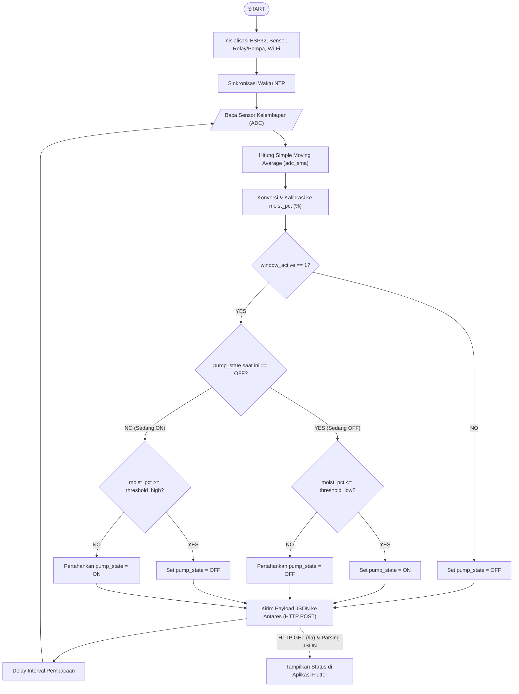

# 📋 LAPORAN AUDIT AKADEMIK & PANDUAN REVISI PROPOSAL SKRIPSI
## EVALUASI FORENSIK SUBSTANSI, ALGORITMA, REFERENSI, & FORMAT MENUJU SEMINAR PROPOSAL S1 INFORMATIKA FT UNMUL

**Mahasiswa Bimbingan:** Muhammad Adam Fathurrizky  
**NIM:** 2209106112  
**Program Studi:** S1 Informatika, Jurusan Teknik Elektro dan Informatika, Fakultas Teknik, Universitas Mulawarman  
**Dosen Pembimbing I:** Anton Prafanto, S.Kom., M.T. (NIP: 199310222019031016)  
**Dosen Pembimbing II:** Gubtha Mahendra Putra, S.Kom., M.Eng.  
**Koordinator Program Studi:** Awang Harsa Kridalaksana, S.Kom., M.Kom. (NIP: 19731229 200501 1 002)  
**Judul pada Sampul:**  
> *"RANCANG BANGUN SISTEM IRIGASI PINTAR BERBASIS IOT BERDASARKAN KELEMBAPAN TANAH DAN WAKTU PENYIRAMAN"*

**Dokumen yang Diaudit:** `Draft_Bab1-3_MuhammadAdamFathurrizky.pdf` (Diarsipkan sebagai `draft_proposal_muhammad_adam_fathurrizky.pdf` — 74 Halaman Total PDF / 64 Halaman Bernomor Bab)  
**Tanggal Evaluasi:** 23 November 2026  
**Status Evaluasi:** 🚨 **REVISI MAYOR (BELUM SIAP ACC SEMINAR PROPOSAL — WAJIB PERBAIKI 24 SITASI HANTU, RUMUS & FLOWCHART, SISA KODULAR, DAN FORMAT FT UNMUL)**

---

> [!NOTE]
> ### 💡 Pengantar & Catatan Pembimbing untuk Adam:
> *"Halo Adam, Bapak sudah membaca dan memeriksa seluruh 74 halaman draf proposalmu dari halaman sampul sampai Daftar Pustaka. Dari sisi **ide dan rancangan teknis IoT**, konsep penelitianmu sebenarnya sudah sangat bagus dan memiliki bobot keilmuan Informatika yang jelas—kamu tidak sekadar membuat alat penyiram otomatis dengan satu ambang batas, tetapi menggabungkan filter derau **Simple Moving Average (SMA)**, gerbang jadwal **Time Window (NTP)**, dan logika kontrol **Histeresis dua ambang** untuk mencegah chattering.*
>
> *Namun demikian, sebagai naskah akademik yang akan dibawa ke meja Seminar Proposal, draf ini masih memiliki **cacat forensik yang sangat fatal**—mulai dari 24 sitasi yang hilang dari Daftar Pustaka, rumus SMA yang salah secara matematis, flowchart proses utama yang justru menghilangkan metode SMA dan Histeresis, sisa-sisa teks dan diagram 'Kodular' yang bertabrakan dengan klaim 'Flutter', hingga kode LaTeX mentah yang ikut tercetak.*
>
> *Laporan audit ini disusun langkah demi langkah agar kamu bisa memahami di mana letak kesalahannya dan langsung memperbaikinya dengan tepat. Kerjakan seluruh daftar perbaikan di bawah ini sebelum mengajukan ACC Seminar Proposal."*

---

## 🌟 1. Apresiasi: Kekuatan Substansi yang Sudah Bagus

Sebelum masuk ke daftar perbaikan, ada 4 keunggulan konseptual pada proposalmu yang wajib dipertahankan:

1. **Kombinasi 3 Lapisan Logika Kontrol yang Kuat:**  
   Menggabungkan **SMA** (meredam fluktuasi ADC sensor), **Time Window via NTP** (*gating function* agar tidak menyiram di jam terik dengan evaporasi tinggi), dan **Histeresis 2 ambang** (*deadband* anti-*chattering* pada relay/pompa) adalah arsitektur kontrol IoT yang matang dan jauh di atas proyek IoT dasar.
2. **Pemisahan Tanggung Jawab (*Edge Autonomy*):**  
   Keputusan menempatkan logika kontrol sepenuhnya di **ESP32** sementara aplikasi **Flutter** bersifat *read-only* (memantau data dari **Antares**) sangat tepat secara arsitektur IoT—penyiraman tetap berjalan aman meskipun koneksi internet atau aplikasi sedang terganggu.
3. **Metrik Pengujian Terukur di Bab III (`Subbab 3.6`, `Hal. 58`):**  
   Kamu sudah merancang evaluasi yang terukur secara kuantitatif, bukan sekadar "alat berjalan": membandingkan simpangan baku (`SD`) `adc_baca` vs `adc_sma`, menghitung kepatuhan *Time Window*, dan mengukur kestabilan *switching* (*chattering*).
4. **Rancangan Skema Telemetri & Variabel Jelas (`Tabel 2.4`, `Tabel 3.1`, `Tabel 3.2`):**  
   Struktur JSON (`timestamp`, `adc`, `moist_pct`, `window_active`, `pump_state`), format log pengujian, dan tabel variabel sudah terdefinisi dengan rapi.

---

## 🚨 2. Peta 5 Temuan Kritis (*Critical Red Flags*)

```mermaid
flowchart TD
    Root["Audit Proposal Adam (2209106112) - 74 Halaman"] --> A["A. Bencana Daftar Pustaka"]
    Root --> B["B. Migrasi Kodular ke Flutter Setengah Matang"]
    Root --> C["C. Cacat Rumus SMA, Flowchart & Raw LaTeX"]
    Root --> D["D. Placeholder Gambar, Judul & Nilai Setpoint"]
    Root --> E["E. Format Cover, Kata Pengantar & Jadwal Unmul"]

    A --> A1["24 Sitasi di Teks HILANG dari Daftar Pustaka"]
    A --> A2["1 Pustaka Nyasar Tidak Dikutip (Alda et al., 2026)"]
    A --> A3["4 Entri Daftar Pustaka Jurnal/Judul Terpotong"]

    B --> B1["Gambar 2.1 (Hal. 22) & Flowchart (Hal. 52) masih KODULAR"]
    B --> B2["Bab III (Hal. 47 & 51) masih menyebut Kodular"]
    B --> B3["Hal. 56 pakai komponen Web & Clock/Timer milik Kodular"]

    C --> C1["Rumus SMA (Hal. 29) salah: ada 'n' di depan X_t"]
    C --> C2["Flowchart (Hal. 52) tanpa SMA, tanpa TH_high & panah putus"]
    C --> C3["Raw LaTeX \\(ADC_{kering}\\) tercetak di Hal. 33-34"]

    D --> D1["Hal. 36 'Gambar 2.X' & Gambar 2.4 pakai NodeMCU+Blynk"]
    D --> D2["Judul Cover vs Latar Belakang (Tanaman Bawang Dayak)"]
    D --> D3["Time Window Sore 16:00-18:30 vs 16:00-18:00 & Setpoint Kosong"]

    E --> E1["Cover Luar bernomor '1', Logo Cover Dalam B&W, NIM nempel"]
    E --> E2["Kata Pengantar template Dekan kosong & Jadwal Jan-Jun 2026"]
```



---

## 🔍 3. Bedah Detail Masalah & Panduan Perbaikan

### 📚 BAGIAN A: Bencana Daftar Pustaka — 24 Sitasi Hantu & 1 Pustaka Nyasar (`Hal. 62–64`)

Dari hasil pemeriksaan silang (*cross-check*) antara seluruh kutipan di Bab I–II dengan **15 entri** di **Daftar Pustaka (`Hal. 62–64`)**, ditemukan ketimpangan yang sangat serius:

1. **24 Sitasi Dikutip di Naskah, Tetapi TIDAK ADA di Daftar Pustaka (*Sitasi Hantu*):**  
   Seluruh sitasi berikut muncul di Bab I atau Bab II, tetapi sama sekali hilang dari halaman Daftar Pustaka:
   * **Bab I & II:** `Abdelmoneim et al. (2025)`, `Agustirandi et al. (2024)`, `Aminpour et al. (2023)`, `Atikah & Purwanti (2023)`, `FAO (2003)`, `FAO (2015)`, `Gamage et al. (2024)`, `Hou et al. (2022)`, `Kisekka et al. (2023)`, `Kumar et al. (2024)`, `Lim Junior et al. (2023)` *(juga ditulis `Putu Edward Lim Junior et al., 2023`)*, `Nazareta et al. (2022)`, `Obaideen et al. (2022)`, `Padilla-Nates et al. (2025)`, `Pereira et al. (2023)`, `Pramanik et al. (2022)`, `R. Mehta et al. (2023)`, `Ramli & Jabbar (2022)`, `Saragih & Kurniawan (2025)`, `Sudaryana & Ekayana (2022)`, `Suhendi & Saputro (2021)`, `Susila et al. (2023)`, `Tace et al. (2022)`, dan `Tarigan et al. (2023)`.
   * **Catatan khusus:** Di `Hal. 17` (`Subbab 2.2`), kamu menulis sitasi dengan tanda baca rusak: `Atikah & Purwanti, (2023).` dan `...Eleutherine bulbosa (Mill.) Urb (Shi et al., 2019). dan dalam...` (titik nyasar sebelum kata `dan`).

2. **1 Pustaka Nyasar di Daftar Pustaka (`Hal. 62`):**  
   * Entri pertama di Daftar Pustaka adalah **`Alda, M., Hapsari, F., Fadhilah, K. K., & Maharan, S. (2026). Aplikasi Inventori Barang Berbasis Mobile Menggunakan Airtable Untuk Monitoring Stok Otomatis...`**. Artikel inventori Airtable ini **tidak pernah dikutip di naskah** dan tidak relevan dengan sistem irigasi IoT. **Hapus dari Daftar Pustaka!**

3. **4 Entri Daftar Pustaka Tidak Lengkap / Rusak (`Hal. 62–64`):**
   * **`Chotimah et al. (2021)` (`Hal. 62`):** Judul terpotong: *"Utilizing Organic Fertilizers on Two Types of Soil to Improve Growth and Yield **of.**"* (lengkapi judul aslinya: *...of Shallot* / *Eleutherine...* sesuai jurnal Agrivita!).
   * **`Fauzi et al. (2023)` (`Hal. 63`):** Nama jurnal hilang, langsung tertulis `...Penerangan Jalan Umum. 8(1), 1–8.` (seharusnya mencantumkan nama jurnalnya, misal *JTERA*).
   * **`Hunduma & Kebede (2020)` (`Hal. 63`):** Nama jurnal hilang, langsung tertulis `...Using Different Sensors. 12(3), 37–55.` (lengkapi nama jurnalnya, *AJBAS*).
   * **`Lutfiyya & Oteafy (2014)` (`Hal. 63`):** Tidak mencantumkan nomor halaman maupun DOI/tautan.
   * **`Zalfa et al. (2026)` (`Hal. 64`):** Typo nama jurnal `Tekonologi` $\rightarrow$ **`Teknologi`**, serta kata `The Perancangan` (cek judul asli artikelnya).

> **✅ Solusi Wajib Bagian A:**  
> Gunakan **Mendeley / Zotero** secara konsisten untuk mengelola seluruh sitasi. Pastikan **100% sitasi yang disebut di Bab I–III** muncul otomatis di Daftar Pustaka, dan **hapus `Alda et al. (2026)`**.

---

### 📱 BAGIAN B: Inkonsistensi Migrasi **Kodular $\rightarrow$ Flutter** & **Android vs. Web**

Terlihat jelas bahwa draf awal penelitian ini menggunakan **Kodular**, lalu diubah ke **Flutter**, tetapi proses *Find & Replace* belum selesai:

| No | Lokasi di Naskah | Tertulis Saat Ini | Seharusnya Diperbaiki Menjadi |
| :---: | :--- | :--- | :--- |
| **1** | **`Gambar 2.1` (`Hal. 22`)** | Blok paling kanan tertulis **`KODULAR`** | Ubah gambar diagram menjadi **`FLUTTER`** (atau `Aplikasi Flutter`). |
| **2** | **`Subbab 3.3` (`Hal. 47`)** | *"...hingga tampil pada aplikasi **Kodular**."* | Ganti menjadi **"...pada aplikasi Flutter."** |
| **3** | **`Subbab 3.3.2` Poin 2 & 3 (`Hal. 51`)** | **3 kali** tertulis **`Kodular`** (*"Pada sisi aplikasi, Kodular mengambil..."*, *"sedangkan Kodular berperan..."*, *"Pembaruan data pada Kodular..."*) | Ganti seluruhnya menjadi **`Flutter`**. |
| **4** | **`Gambar 3.2 Flowchart` (`Hal. 52`)** | Kotak alur kanan tertulis **`AMBIL DATA TERBARU UNTUK KODULAR`** dan **`TAMPILKAN DI UI KODULAR`** | Ganti menjadi **`AMBIL DATA TERBARU UNTUK FLUTTER`** dan **`TAMPILKAN DI UI FLUTTER`**. |
| **5** | **`Subbab 3.5` (`Hal. 56`, Paragraf 2)** | *"Implementasi di Flutter memanfaatkan komponen **Web** untuk melakukan HTTP GET ... menggunakan komponen **Clock/Timer**"* | **Salah istilah!** Komponen `Web` dan `Clock/Timer` adalah milik **Kodular/App Inventor**. Pada **Flutter (Dart)**, ubah menjadi: **"...memanfaatkan pustaka `http` (atau `Dio`) untuk melakukan permintaan HTTP GET ... secara periodik menggunakan `Timer.periodic`."** |
| **6** | **`Hal. 5, 6, 7, 17`** (`1.2`, `1.3 Poin 8`, `1.4`, `2.1`) | Masih tertulis *"aplikasi/**web**"*, *"smartphone atau **web browser**"* | Di seluruh rancangan Bab II–III tidak ada pembuatan website—hanya **aplikasi mobile Android (Flutter)** (dan Antares sebagai cloud platform). Hapus kata `/web` atau `web browser` agar konsisten, atau jelaskan bahwa akses web hanya melalui dashboard Antares. |

---

### 🧮 BAGIAN C: Kesalahan Fatal Rumus, Flowchart (`Gambar 3.2`), & Raw LaTeX

#### 1. Rumus *Simple Moving Average* (SMA) di `Hal. 29` SALAH Secara Matematis!
* **Tertulis di `Hal. 29`:**
  $$SMA_t = \frac{\mathbf{n X_t} + X_{t-1} + X_{t-2} + \dots + X_{t-(n-1)}}{n}$$
* **Mengapa Salah Fatal?** Karena ada huruf **`n`** di depan $X_t$! Jika $n = 5$ dan $X_t = 2000$, rumus tersebut mengalikan data terbaru dengan 5 sehingga hasilnya tidak lagi menjadi rata-rata (bisa 2x lipat nilai ADC sebenarnya!).
* **✅ Rumus yang Benar:**
  $$\text{SMA}_t = \frac{X_t + X_{t-1} + X_{t-2} + \dots + X_{t-(n-1)}}{n} = \frac{1}{n} \sum_{i=0}^{n-1} X_{t-i}$$

#### 2. `Gambar 3.2 Flowchart Rancangan Proses Irigasi` (`Hal. 52`) Kehilangan SMA & Histeresis!
Setelah memeriksa `Gambar 3.2` di `Hal. 52` secara teliti, ditemukan **4 cacat alur logika serius**:
1. **Tahap SMA Hilang:** Dari `BACA SENSOR (ADC)` panah langsung menuju `KONVERSI & KALIBRASI -> moist_pct (%)`. Padahal seharusnya melewati proses **`HITUNG SMA (adc_sma)`** terlebih dahulu!
2. **Metode Histeresis (`threshold_high`) Hilang!** Pada belah ketupat kedua, flowchart hanya mengecek `moist_pct < threshold low?`. Jika `NO`, panah langsung menuju `SET POMPA = OFF`! **Logika seperti ini adalah kontrol 1 ambang biasa, BUKAN Histeresis!** Akibatnya, jika kelembapan berada di antara `threshold_low` dan `threshold_high` saat pompa sedang menyala, pompa langsung dimatikan.
3. **Panah Buntu setelah `SET POMPA = ON`:** Kotak `SET POMPA = ON` di bagian paling bawah **tidak tersambung** ke proses `KIRIM DATA KE ANTARES` maupun ke loop `DELAY`! Artinya menurut gambar tersebut, ketika pompa menyala, program berhenti dan tidak mengirim telemetri ke Antares!
4. **Label Masih `KODULAR` dan Bentuk Simbol Tidak Konsisten:** `AMBIL DATA TERBARU UNTUK KODULAR` & `TAMPILKAN DI UI KODULAR`, serta `time_window = window_active?` (penamaan kondisi janggal; seharusnya `window_active == 1?`).

* **✅ Panduan Alur Flowchart yang Benar untuk Menggambar Ulang `Gambar 3.2`:**


#### 3. Raw LaTeX Mentah Tercetak & Typo Persamaan (`Hal. 33–34`, `Hal. 53–55`)
* **`Hal. 33–34` (`Subbab 2.8` & `Tabel 2.3`):** Kode LaTeX mentah tidak dikonversi menjadi *Equation* Microsoft Word sehingga tercetak harfiah: `\(ADC_{kering}\)`, `\(ADC_{basah}\)`, `\(a=-0.025\)`, `\(b=66.967\)`, dan di **Tabel 2.3 (`Hal. 34`)** tertulis dobel `ADCkeringADC_{kering}` dan `ADCbasahADC_{basah}`! Segera bersihkan dan ketik memakai **Insert $\rightarrow$ Equation** (atau teks subscript rapi $ADC_{\text{kering}}$).
* **Penulisan Kode Mentah di `Hal. 34`:** `moist_pct = (adc_kering - adc_baca) / ...` dan `Clamp: jika ...` sebaiknya diformat sebagai persamaan matematika yang rapi, bukan *pseudocode* satu baris.
* **Persamaan `(3.3)` (`Hal. 55`):**
  * Nama variabel tertulis **`Pump_Stake (k)`** $\rightarrow$ perbaiki menjadi **`Pump_State(k)`**.
  * Pada baris kedua tertulis **`mois_pct(k)`** $\rightarrow$ kurang huruf `t`: **`moist_pct(k)`**.
* **Ketidakkonsistenan Operator Pembanding & Penomoran Aturan (`Hal. 41`, `53`, `55`):**
  * Di `Hal. 41` tertulis `<` dan `>`, sedangkan di `Hal. 53` dan `Hal. 55` tertulis `<=` dan `>=`. Seragamkan keduanya!
  * Di `Hal. 53`, poin 3, 4, 5 adalah anak poin dari poin 2 (`Jika window_active = 1:`). Gunakan indentasi `a, b, c` di bawah poin `2` agar struktur logikanya jelas.

#### 4. Inkonsistensi *Time Window* Sore, *Setpoint* Bawang Dayak, & Catatan Pin `ADC1` ESP32
* **Rentang Sore Tidak Konsisten:** Di `Tabel 2.1` (`Hal. 24`) dan `Tabel 3.2` (`Hal. 48`) rentang sore adalah **`16:00–18:30`**, sedangkan di `Subbab 3.4.2` (`Hal. 54`) tertulis **`16:00–18:00`**. Pilih satu dan seragamkan!
* **Nilai Awal `threshold_low` & `threshold_high` Belum Ditetapkan:** Di Bab III kamu belum mencantumkan **nilai target persentase awal** untuk tanaman **bawang dayak** (misal: menyala saat $\le 40\%$ dan mati saat $\ge 70\%$, beserta dasar agronomisnya). Ini pasti ditanyakan penguji saat Sempro!
* **Catatan Penting Hardware ESP32 (`Tabel 2.2`, `Hal. 28`):** Pada ESP32, ketika modul **Wi-Fi aktif** (untuk NTP & kirim data ke Antares), kanal **`ADC2` tidak dapat digunakan secara bersamaan dengan Wi-Fi** dan akan gagal membaca nilai analog. Pastikan dalam rancangan rangkaian nanti sensor *Capacitive Soil Moisture* dihubungkan ke pin **`ADC1`** (misalnya GPIO `32`, `33`, `34`, `35`, `36`, atau `39`).

---

### 🖼️ BAGIAN D: Placeholder, Gambar Tidak Sesuai Sistem, & Ketidaksesuaian Bab I–II

1. **Placeholder `Gambar 2.X.` & Ketidaksesuaian `Gambar 2.4` (`Hal. 36–37`):**
   * Di akhir `Hal. 36`, tertulis: *"dapat diilustrasikan pada **Gambar 2.X.**"* — ganti `2.X` menjadi **`2.4`**.
   * Namun, **`Gambar 2.4` (`Hal. 37`)** yang diambil dari `Ramli & Jabbar (2022)` menampilkan **Solar Panel + 4-Channel Relay + NodeMCU + Blynk**! Padahal penelitianmu memakai **ESP32 + 1 Relay + Antares + Flutter** tanpa panel surya. **Solusi:** Gambar sendiri diagram blok/wiring sederhana sistemmu (ESP32 + Capacitive Soil Moisture Sensor + Relay 1-Channel + Pompa DC 5V/12V + Catu Daya) agar tidak membingungkan penguji!
2. **Caption `Gambar 2.2` Hilang Kata `Gambar` (`Hal. 35`):**
   * Tertulis `2. 2 Diagram Prinsip Sinkronisasi Waktu NTP` (kata `Gambar` hilang di awal caption). Perbaiki menjadi `Gambar 2. 2 Diagram Prinsip Sinkronisasi Waktu NTP`.
3. **Ketidaksesuaian Judul (`Hal. 1–3` vs `Hal. 4`):**
   * Cover luar, cover dalam, pengesahan, dan Kata Pengantar menulis judul: *`Rancang Bangun Sistem Irigasi Pintar Berbasis IoT Berdasarkan Kelembapan Tanah dan Waktu Penyiraman`*.
   * Paragraf penutup Latar Belakang (`Hal. 4`) menulis: *`Rancang Bangun Sistem Irigasi Pintar (Tanaman Bawang Dayak) Berbasis IoT Berdasarkan Kelembapan Tanah dan Waktu Penyiraman`*.
   * **Solusi:** Putuskan satu judul resmi (disarankan mencantumkan *Tanaman Bawang Dayak* atau *Studi Kasus: Tanaman Bawang Dayak* jika memang spesifik diuji pada bawang dayak) dan seragamkan di seluruh halaman!
4. **Parameter Pengujian Belum Sinkron (`Hal. 7` vs `Hal. 58`):**
   * Di `Tujuan Penelitian` Poin 3 (`Hal. 7`) tertulis: *"...berdasarkan **waktu respon aktivasi pompa**, keberhasilan penyiraman sesuai time window, serta keberhasilan monitoring real-time..."*.
   * Namun di `Subbab 3.6 Metode Perhitungan Error dan Parameter Kinerja` (`Hal. 58`), parameter **waktu respon aktivasi pompa** tidak dijelaskan cara pengukurannya! Tambahkan poin ke-4 di `Hal. 58` (misal cara mengukur waktu tunda dari saat sensor melewati ambang hingga pompa menyala, serta latensi pengiriman ESP32 $\rightarrow$ Antares $\rightarrow$ Flutter).
5. **Penyempurnaan `Subbab 2.1 Penelitian Terkait` (`Hal. 9–15`):**
   * Kalimat pembuka 10 penelitian masih kaku (`"1. Metode yang digunakan: ... Temuan Penelitian: ..."`). Ubah menjadi paragraf mengalir yang menyebut nama penulis & tahun di awal kalimat.
   * Tambahkan **Tabel 2.1 Matriks Perbandingan Penelitian Terkait** di akhir Subbab 2.1 sebelum bagian `Perbedaan dengan Penelitian Sebelumnya`.

---

### 📘 BAGIAN E: Kepatuhan Pedoman Skripsi FT Unmul & Kebersihan Tata Tulis

Berdasarkan [pedoman_skripsi_unmul.md](../pedoman_skripsi_unmul.md), perbaiki hal-hal berikut:

1. **Halaman Sampul & Halaman Dalam (`Hal. 1–3`):**
   * **Cover Luar (`Hal. 1`):** Hapus nomor halaman **`1`** di pojok kanan bawah! Halaman sampul luar tidak boleh bernomor halaman, dan Bab I (`Hal. 1`) baru dimulai setelah Daftar Istilah/Singkatan.
   * **Cover Dalam (`Hal. 2`):** Ganti logo Unmul hitam-putih menjadi **logo Unmul berwarna** yang tajam dan sama dengan cover luar. (Sesuai pedoman, halaman judul dalam dihitung sebagai `i` tetapi nomornya tidak perlu dicetak).
   * **Format Penulisan Nama & NIM (`Hal. 1–3`):** Saat ini tertulis `MUHAMMAD ADAM FATHURRIZKY 2209106112` menyatu di baris kedua. Pisahkan NIM menjadi baris tersendiri di bawah nama lengkap (tanpa kata "NIM"), yaitu:
     ```text
     MUHAMMAD ADAM FATHURRIZKY
     2209106112
     ```
2. **Kata Pengantar (`Hal. iii` / PDF Hal. 4):**
   * Poin 2 masih berisi teks template: **`Nama dan gelar akademik lengkap Dekan selaku Dekan Fakultas Teknik`** $\rightarrow$ isi dengan **`Bapak Prof. Dr. Ir. H. Tamrin, ST., MT., IPU., ASEAN Eng., APEC Eng`** (sesuai pedoman resmi FT Unmul).
   * Poin 3: typo `selaku K Program Studi` $\rightarrow$ **`selaku Koordinator Program Studi S1 Informatika`**.
   * Poin 4 & 5: tambahkan titik di akhir gelar **`M.T.`** dan **`M.Eng.`**, serta ubah kata **`masukkan`** menjadi **`masukan`** (berlaku juga di Poin 6 & 7).
   * Poin 6 & 7: Perhatikan bahwa nama Penguji I dan Penguji II sudah tertulis (`Ibu Ramadiani...` dan `Masna Wati...` tanpa sapaan `Ibu`). Pastikan apakah dosen penguji memang sudah ditetapkan resmi atau masih sisa template orang lain; jika belum ditetapkan untuk Sempro, gunakan format placeholder netral atau samakan sapaan (`Ibu Masna Wati, S.Si., M.T.`).
   * Tanggal di kanan bawah masih `Samarinda,. ......................... 2026` $\rightarrow$ isi menjadi **`Samarinda, November 2026`** (atau bulan pengajuan resmi).
3. **Daftar Istilah & Daftar Singkatan (`Hal. viii–ix`):**
   * **Urutan abjad salah:** Pada `Hal. viii`, **`Flutter`** diletakkan setelah **`JSON`**! Urutkan alfabetis A–Z.
   * **Daftar Singkatan terpisah belum ada:** Tambahkan halaman **DAFTAR SINGKATAN** (untuk `ADC`, `API`, `DC`, `GPIO`, `HTTP`, `IoT`, `JSON`, `NTP`, `REST`, `SMA`, `SoC`, `Wi-Fi`) terpisah dari `DAFTAR ISTILAH` (atau beri judul `DAFTAR ISTILAH/LAMBANG` jika memuat simbol rumus).
4. **Jadwal Penelitian Kadaluwarsa & Typo Bab III (`Hal. 60–61`):**
   * Pada `Subbab 3.7` (`Hal. 60`), tertulis penelitian dilaksanakan **`Februari sampai bulan Juni tahun 2026`**, sedangkan **Tabel 3.3** mengarsir **`Januari sampai Mei 2026`**. Karena saat ini sudah **November 2026**, segera perbarui rentang bulan di narasi dan **Tabel 3.3** sesuai jadwal riilmu (misal `November 2026 – April 2027`), dan pastikan **Tahap II (Pengumpulan Data & Perancangan/Implementasi Sistem) diarsir SETELAH Seminar Proposal**.
   * Perbaiki tanda baca di `Hal. 60`: `tahun 2026 Adapun` $\rightarrow$ **`tahun 2026. Adapun`**; `disana` $\rightarrow$ **`di sana`**.
5. **Daftar Typo Tambahan untuk `Find & Replace`:**
   * `Hal. 10` (Poin 3): `pada aplikasi aplikasi monitoring` $\rightarrow$ **`pada aplikasi monitoring`**.
   * `Hal. 13` (Poin 7): `yaitu KKN` $\rightarrow$ **`yaitu KNN`** (*K-Nearest Neighbors*).
   * `Hal. 49` (`3.3.2` Poin 1): `ESP32 ESP32 membaca` $\rightarrow$ **`ESP32 membaca`**.
   * `Hal. 50` (item 1 bawah): spasi berlebih sebelum `misalnya` (`field con        misalnya:`).
   * `Hal. 51` (payload JSON): `"pum p_stat e":1` $\rightarrow$ **`"pump_state":1`** (tanpa spasi di dalam nama key JSON!).
   * `Hal. 56` (`Subbab 3.5`) & `Hal. 59` (`Subbab 3.6.1`): kata `waktu` (`Hal. 50` baris 7) dan `uji sensor & konversi`, `uji time window`, `uji kontrol hibrida`, `uji komunikasi & monitoring` (`Hal. 59`) diawali huruf kecil setelah nomor urut—gunakan huruf kapital di awal kalimat (`Uji sensor & konversi:`).
   * `Hal. 57` (`Gambar 3.3 Rancangan Tampilan`): tambahkan keterangan/komponen **`Timestamp Pembaruan`** secara eksplisit pada kotak desain UI (atau jelaskan di narasi bahwa bagian `KETERANGAN` memuat `timestamp`).

---

## ✅ 4. Checklist Wajib Adam Sebelum Mengajukan ACC Seminar Proposal

Kerjakan seluruh poin berikut secara berurutan:

- [ ] **Langkah 1 — Bereskan Daftar Pustaka (Prioritas Tertinggi):**
  - [ ] Masukkan seluruh **24 sitasi hantu** ke dalam Daftar Pustaka melalui Mendeley/Zotero.
  - [ ] Hapus referensi nyasar **`Alda et al. (2026)`** dan lengkapi nama jurnal/judul yang terpotong pada `Chotimah (2021)`, `Fauzi (2023)`, `Hunduma (2020)`, `Lutfiyya (2014)`, dan typo `Zalfa (2026)`.
- [ ] **Langkah 2 — Bersihkan Sisa `Kodular` & Konsistensi Platform:**
  - [ ] Ubah **`KODULAR` $\rightarrow$ `FLUTTER`** pada **`Gambar 2.1` (`Hal. 22`)**, **`Subbab 3.3` (`Hal. 47`)**, **`Subbab 3.3.2` (`Hal. 51`)**, dan **`Gambar 3.2` (`Hal. 52`)**.
  - [ ] Perbaiki narasi **`Subbab 3.5` (`Hal. 56`)** dari komponen `Web` & `Clock/Timer` (Kodular) menjadi paket `http` & `Timer.periodic` (Flutter).
  - [ ] Hapus penyebutan `web` / `web browser` di `Hal. 5–7, 17` agar konsisten dengan aplikasi Android Flutter.
- [ ] **Langkah 3 — Perbaiki Rumus, Flowchart, & Raw LaTeX:**
  - [ ] Hapus faktor `n` di depan $X_t$ pada rumus **SMA (`Hal. 29`)**.
  - [ ] Gambar ulang **`Gambar 3.2 Flowchart` (`Hal. 52`)** dengan memasukkan langkah **SMA**, logika **Histeresis 2 ambang (`threshold_low` & `threshold_high`)**, dan menyambungkan panah `SET POMPA = ON` ke `KIRIM DATA KE ANTARES` $\rightarrow$ `DELAY`.
  - [ ] Ubah seluruh kode mentah `\(ADC_{kering}\)`, `ADCkeringADC_{kering}`, dll. di `Hal. 33–34` menjadi Equation rapi; perbaiki `Pump_Stake` $\rightarrow$ `Pump_State` dan `mois_pct` $\rightarrow$ `moist_pct` di Persamaan `(3.3)` (`Hal. 55`).
  - [ ] Seragamkan **Time Window Sore** (`16:00–18:30` vs `16:00–18:00`), tetapkan **nilai awal `threshold_low` & `threshold_high`** untuk bawang dayak, dan catat penggunaan pin **`ADC1`** ESP32 agar tidak bentrok dengan Wi-Fi.
- [ ] **Langkah 4 — Gambar, Judul, & Parameter Uji:**
  - [ ] Ganti `Gambar 2.X.` (`Hal. 36`) menjadi `Gambar 2.4`, buat diagram wiring **ESP32 + Relay + Pompa DC** sendiri (jangan pakai gambar `NodeMCU + Blynk + Solar Panel`), dan perbaiki caption `Gambar 2.2` (`Hal. 35`).
  - [ ] Seragamkan judul antara **Cover** dengan **Paragraf Penutup Latar Belakang (`Hal. 4`)**, tambahkan pengukuran **waktu respon aktivasi pompa** di `Subbab 3.6` (`Hal. 58`), dan tambahkan **Tabel 2.1 Matriks Penelitian Terkait** di Subbab 2.1.
- [ ] **Langkah 5 — Format Resmi FT Unmul & Typo:**
  - [ ] Hapus nomor `1` pada Cover Luar, ganti logo berwarna pada Cover Dalam, pisahkan NIM ke baris baru di bawah nama, lengkapi **Kata Pengantar** (nama Dekan, tanggal, typo `masukkan`), urutkan abjad `Daftar Istilah` & buat `Daftar Singkatan`, perbarui **Jadwal Penelitian (`Hal. 60–61`)** ke periode terkini (setelah Sempro), lalu bersihkan seluruh typo (`KKN`, `aplikasi aplikasi`, `pum p_stat e`, `disana`, dll.) dan lakukan **Update Field** pada Daftar Isi/Tabel/Gambar.

---

## 💬 5. Pertanyaan Latihan Persiapan Seminar Proposal

Setelah memperbaiki naskah, pastikan kamu siap menjawab 4 pertanyaan teknis berikut di hadapan Dewan Penguji:
1. *"Mengapa kamu memilih metode **Simple Moving Average (SMA)** dengan jendela 3–5 data dan **Histeresis dua ambang**, bukan langsung memakai Fuzzy Logic atau Kalman Filter?"*
2. *"Dari literatur pertanian atau uji pendahuluan mana kamu menentukan angka batas bawah (`threshold_low`) dan batas atas (`threshold_high`) kelembapan untuk tanaman bawang dayak?"*
3. *"Pada mikrokontroler ESP32, mengapa sensor kelembapan tanah tidak boleh sembarangan dipasang di pin ADC mana saja ketika Wi-Fi sedang aktif mengirim data ke Antares?"* (Hint: Jelaskan perbedaan `ADC1` vs `ADC2` saat Wi-Fi aktif!)
4. *"Apa yang terjadi pada keputusan penyiraman jika koneksi Wi-Fi / server NTP atau layanan Antares terputus sementara?"*

---

> *"Adam, secara konsep riset IoT-mu sudah berada di jalur yang tepat dan menarik. Jangan terburu-buru mengejar tanggal seminar sebelum seluruh kesalahan dasar di atas—terutama 24 sitasi hantu, rumus SMA, flowchart histeresis, dan sisa kata Kodular—dibersihkan sampai tuntas. Kerjakan checklist di atas satu per satu dengan teliti, lalu kirimkan naskah revisinya ke Bapak untuk pemeriksaan ulang."*
>
> **Dosen Pembimbing I,**  
> **Anton Prafanto, S.Kom., M.T.**  
> *NIP: 199310222019031016*
