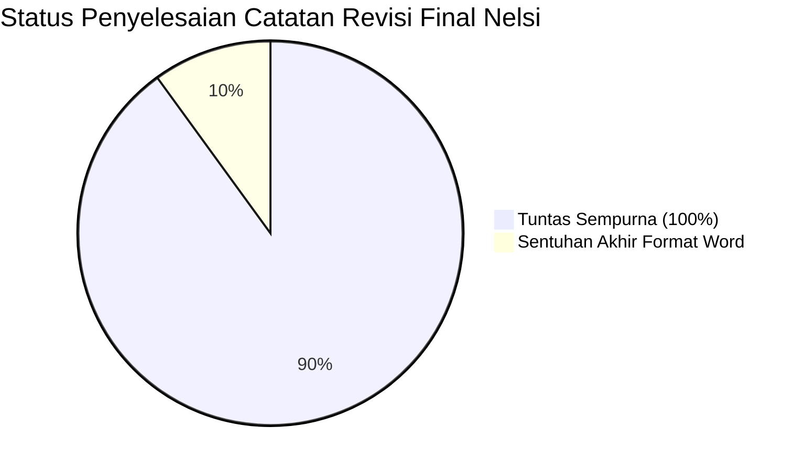

# 📋 LAPORAN AUDIT AKADEMIK FORENSIK EVALUASI REVISI FINAL PROPOSAL SKRIPSI
## VERIFIKASI AKHIR NASKAH MENUJU SEMINAR PROPOSAL S1 INFORMATIKA FT UNMUL

**Mahasiswa Bimbingan:** Nelsi  
**NIM:** 2309106120  
**Program Studi:** S1 Informatika, Jurusan Teknik Elektro dan Informatika, Fakultas Teknik, Universitas Mulawarman  
**Dosen Pembimbing I:** Anton Prafanto, S.Kom., M.T. (NIP: 199310222019031016)  
**Dosen Pembimbing II:** Gubtha Mahendra Putra, S.Kom., M.Eng. (NIP: 199004042025061005)  
**Koordinator Program Studi:** Awang Harsa Kridalaksana, S.Kom., M.Kom. (NIP: 19731229 200501 1 002)  
**Judul Naskah:**  
> *"IMPLEMENTASI ALGORITMA PRIORITY SCHEDULING PADA SISTEM INFORMASI PELAYANAN SURAT ADMINISTRASI KAMPUNG SAMBAKUNGAN BERBASIS WEB"*

**Dokumen yang Diaudit:** `draft_proposal_nelsi_revisi2_final_acc.pdf` (66 Halaman / 78 Halaman Total PDF, berkas asal: `Proposal Skripsi Nelsii Hasil Revisi.pdf`)  
**Tanggal Evaluasi:** 26 Oktober 2026  
**Status Evaluasi:** 🟢 **ACC FINAL 100% UNTUK DAFTAR SEMINAR PROPOSAL (SIAP CETAK & REGISTRASI UJIAN SETELAH MERAPIKAN 3 HALAMAN PRELIMINER)**

---

> [!IMPORTANT]
> ### 🎓 Keputusan Dosen Pembimbing I (Anton Prafanto, S.Kom., M.T.):
> *"Selamat untuk Nelsi! Naskah proposal skripsi hasil revisi terbaru ini telah menunjukkan kematangan substansi akademik, kelengkapan pemodelan perangkat lunak, serta ketepatan metodologi ilmiah yang sangat memuaskan.*  
>  
> *Seluruh catatan revisi diagram UML (Use Case, Activity, Sequence, Class), pembenahan atribut ERD, penyelarasan identitas mockup antarmuka Figma (SIPAS Kampung Sambakungan), hingga **penyertaan bukti empiris hasil wawancara riil lapangan (Lampiran 5 - lembar wawancara tertulis bertanda tangan narasumber)** telah kamu selesaikan secara tuntas dan bertanggung jawab.*  
>  
> *Dengan ini, naskah dinyatakan **RESMI DI-ACC UNTUK MAJU KE UJIAN SEMINAR PROPOSAL SKRIPSI**. Sebelum naskah digandakan untuk diserahkan ke Program Studi dan Tim Dosen Penguji, rapikan 3 sentuhan akhir tipografi/penomoran halaman preliminer yang tercantum pada Bagian 2 dokumen ini (dapat diselesaikan dalam waktu kurang dari 15 menit)."*

---

## 📊 1. Matriks Verifikasi Tindak Lanjut Catatan Revisi



| No | Komponen Naskah | Catatan Audit Sebelumnya | Realisasi pada Draf Revisi Terbaru | Status Hasil Audit |
|:---:|:---|:---|:---|:---:|
| **1** | **Lembar Pengesahan (Hal. ii)** | Lengkapi NIP resmi Pembimbing I, Pembimbing II, dan Koorprodi. | • NIP Pembimbing I: `19931022 201903 1 016` (Lengkap)<br>• NIP Pembimbing II: `19900404 202506 1 005` (Lengkap)<br>• NIP Koorprodi: `19731229 200501 1 002` (Lengkap). | 🟢 **TUNTAS SEMPURNA** |
| **2** | **Kata Pengantar (Hal. iii)** | Hapus placeholder ucapan terima kasih untuk Penguji I & II yang belum definitif. | Ucapan terima kasih telah dibersihkan secara tertib (Poin 1 Keluarga, 2 Mitra Kampung, 3 Dekan FT, 4 Koorprodi, 5 Pembimbing I, 6 Pembimbing II, 7 Dosen, 8 Rekan Mahasiswa). | 🟢 **TUNTAS SEMPURNA** |
| **3** | **Atribut ERD (Gambar 3.2 Hal. 33)** | Atribut `Status_Permohonan` duplikat dan `Status_Pemohon` hilang pada entitas `permohonan_surat`. | Entitas `permohonan_surat` telah diperbaiki: atribut `Status_Pemohon` telah hadir dan duplikasi `Status_Permohonan` telah dihilangkan. | 🟢 **TUNTAS SEMPURNA** |
| **4** | **Use Case Diagram (Gambar 3.3 Hal. 35)** | Koreksi nama aktor *"Petugas Kelurahan"*, pasang *System Boundary Box*, dan rapikan stereotipe `<<include>>`. | • Boundary box berjudul *"Sistem Informasi Pelayanan Surat Kampung Sambakungan"* terpasang rapi.<br>• Label aktor kanan telah diganti menjadi **"Petugas Kampung"**.<br>• Stereotipe `<<include>>` telah benar 100%. | 🟢 **TUNTAS SEMPURNA** |
| **5** | **Activity Diagram (Gambar 3.4 Hal. 36)** | Typo *"From"* dan istilah *"Status Permohonan"* pada aktivitas pengisian formulir. | Teks telah dikoreksi menjadi: *"Mengisi form (jenis surat, urgensi, disabilitas bila ada) & mengunggah berkas bukti"*. | 🟢 **TUNTAS SEMPURNA** |
| **6** | **Mockup Antarmuka Figma (Gambar 3.8 & 3.10)** | Teks branding masih tertulis *"SIPAS Kelurahan"* dan profil *"Admin Kelurahan"*. | • Gambar 3.8: Branding sidebar kiri telah berubah menjadi **"SIPAS Kampung Sambakungan"**.<br>• Gambar 3.10: Header profil kanan atas telah berubah menjadi **"Petugas: Admin Kampung"**. | 🟢 **TUNTAS SEMPURNA** |
| **7** | **Terminator Flowchart (Gambar 3.1 Hal. 26)** | Simbol awal dan akhir kerangka penelitian belum berbentuk kapsul terminator (*Start/End*). | Kotak *Mulai* dan *Selesai* pada diagram kerangka penelitian kini telah berbentuk oval/kapsul sesuai standar Tabel 2.6. | 🟢 **TUNTAS SEMPURNA** |
| **8** | **Bukti Empiris Wawancara (Lampiran 5 Hal. 60–66)** | Lampiran wawancara belum menyertakan lembar instrumen hasil wawancara riil di lapangan. | **Sangat Baik!** Nelsi telah melampirkan 7 halaman scan instrumen wawancara bertuliskan tangan narasumber (Bapak Ilmansyah, Kasi Pemerintahan) bertanggal **13 Oktober 2026**. | 🟢 **TUNTAS SEMPURNA** |
| **9** | **Pengujian Black Box & Alur Usia NIK** | Pastikan skenario pengujian mencakup verifikasi batas usia NIK dan mitigasi starvation. | Tabel 3.4 memuat 16 skenario komprehensif, mencakup pengujian NIK perempuan, kasus batas usia (44, 45, 59, 60 tahun), serta verifikasi kenaikan skor *aging* $\lambda = 0.12$. | 🟢 **TUNTAS SEMPURNA** |
| **10** | **Sinkronisasi Penomoran Preliminer** | Penomoran halaman pada Daftar Isi, Daftar Lampiran, dan Daftar Istilah masih bergeser. | Masih ditemukan pergeseran penomoran akibat pemisahan halaman Kata Pengantar. | 🟡 **SENTUHAN AKHIR (15 Menit)** |

---

## 🔍 2. Tiga Sentuhan Akhir Format Dokumen Sebelum Digandakan (*Final Touch-ups*)

Mahasiswa wajib membuka dokumen Microsoft Word (`.docx`) dan merapikan 3 hal berikut sebelum berkas diubah kembali ke PDF final untuk pendaftaran ujian:

```text
┌────────────────────────────────────────────────────────────────────────┐
│               CHECKLIST SENTUHAN AKHIR DOKUMEN (15 MENIT)               │
├────────────────────────────────────────────────────────────────────────┤
│ 1. Satukan Tanggal & Penulis Kata Pengantar ke Halaman iii             │
│    (Perbarui tanggal menjadi Oktober 2026 agar sinkron wawancara)     │
│ 2. Update Seluruh Bidang (Field Code) Daftar Isi (Tekan F9 di Word)    │
│ 3. Perbarui Nomor Halaman Fisik di Daftar Lampiran & Daftar Istilah    │
└────────────────────────────────────────────────────────────────────────┘
```

### 1. Rapatkan Tanda Tangan Kata Pengantar (Eliminasi Halaman Kosong `iv`)
* **Kondisi Saat Ini:**  
  * Halaman `iii` memuat isi Kata Pengantar (poin 1–8).  
  * Teks penutup:  
    ```text
    Samarinda, 20 Juni 2026
    Penulis
    ```  
    terdorong ke halaman baru (Halaman `iv`), sehingga Halaman `iv` menjadi **halaman kosong melompong (hanya berisi 2 baris)**.
* **Perbaikan Wajib:**  
  1. Kurangi spasi baris/paragraf pada Halaman `iii` (misalnya rapatkan jarak judul Kata Pengantar atau jeda antarpoin ucapan terima kasih) sehingga blok `Samarinda, ... Penulis` **naik dan muat rapi di bagian bawah Halaman iii**.
  2. **Koreksi Tanggal:** Ubah tanggal `Samarinda, 20 Juni 2026` menjadi **`Samarinda, Oktober 2026`**. Sangat tidak logis jika Kata Pengantar bertanggal Juni 2026 sementara data wawancara di Bab I, Bab III, dan Lampiran 5 baru diambil pada **13 Oktober 2026**.

### 2. Update Otomatis Daftar Isi di Word
* **Dampak Positif Penggabungan Halaman di Atas:**  
  Begitu Halaman `iv` yang kosong dieliminasi, maka:
  * Halaman `Daftar Isi` akan tepat dimulai pada halaman Romawi **`iv`** (saat ini tertulis halaman `v`).
  * Seluruh nomor halaman preliminer di Daftar Isi akan kembali sinkron dan presisi 100%.
* **Cara Pengerjaan:** Klik kanan pada area Daftar Isi di Microsoft Word $\rightarrow$ pilih **Update Field** $\rightarrow$ pilih **Update entire table** (atau tekan `Ctrl + A` lalu tekan `F9`).

### 3. Sinkronkan Angka Halaman di Daftar Lampiran (Hal. ix) & Daftar Istilah (Hal. x)
Perbarui angka halaman pada tabel statis secara manual di Word agar sesuai dengan posisi cetak fisik aktual:

* **Tabel Daftar Lampiran (Halaman ix):**
  * Lampiran 1: ubah Hal. 49 $\rightarrow$ **Hal. 52**
  * Lampiran 2: ubah Hal. 50 $\rightarrow$ **Hal. 53**
  * Lampiran 3: ubah Hal. 52 $\rightarrow$ **Hal. 55**
  * Lampiran 4: ubah Hal. 53 $\rightarrow$ **Hal. 57**
  * Lampiran 5: ubah Hal. 56 $\rightarrow$ **Hal. 60**
* **Tabel Daftar Istilah/Lambang (Halaman x):**
  * Lambang bobot $w_1, w_2, w_3$: ubah Hal. 8 $\rightarrow$ **Hal. 11**
  * Nilai prioritas $P(i)$: ubah Hal. 10 $\rightarrow$ **Hal. 11**
  * Metode *Rank Sum*: ubah Hal. 10 $\rightarrow$ **Hal. 12**
  * Aturan *Tie-breaker*: ubah Hal. 14 $\rightarrow$ **Hal. 17**
  * Koefisien aging $\lambda$: ubah Hal. 15 $\rightarrow$ **Hal. 21**

---

## 🎯 3. Kisi-Kisi & Strategi Menjawab Pertanyaan Penguji Seminar Proposal

Sebagai bekal menghadapi Dewan Penguji saat presentasi Seminar Proposal, berikut 4 pertanyaan kunci yang paling sering diajukan beserta panduan jawaban argumentatif yang telah terbangun kokoh di naskahmu:

### ❓ Pertanyaan 1: *"Mengapa memilih algoritma Priority Scheduling mode Non-Preemptive, bukan Preemptive?"*
* **Strategi Jawaban:**  
  *"Izin menjawab Bapak/Ibu Penguji. Pada pelayanan administrasi persuratan, verifikasi dokumen dan pencetakan surat bersifat transaksi atomik (*satu kesatuan proses yang utuh*). Jika diterapkan mode preemptive, proses verifikasi surat yang sedang berjalan di meja petugas akan diinterupsi dan ditunda di tengah jalan ketika ada permohonan baru yang lebih mendesak masuk. Hal ini berisiko menyebabkan inkonsistensi berkas dan inefisiensi waktu kerja petugas. Selain itu, berdasarkan hasil wawancara dengan pihak Kampung Sambakungan (Lampiran 5 poin F.4), petugas menegaskan bahwa surat yang sudah mulai dikerjakan harus diselesaikan terlebih dahulu hingga tuntas."*

### ❓ Pertanyaan 2: *"Bagaimana Anda memastikan pembobotan kriteria w₁=0.5, w₂=0.3, dan w₃=0.2 bersifat objektif dan tidak asumtif?"*
* **Strategi Jawaban:**  
  *"Izin menjawab Bapak/Ibu. Pembobotan pada penelitian ini tidak ditentukan secara asumsi pribadi peneliti, melainkan diturunkan secara matematis menggunakan metode **Rank Sum (Persamaan 2.2)** berdasarkan urutan preferensi prioritas yang ditetapkan langsung oleh Kepala Seksi Pemerintahan Kampung Sambakungan saat wawancara (Lampiran 5 poin E.1). Pihak kampung menetapkan bahwa Jenis Surat adalah prioritas peringkat 1 (karena berdampak langsung pada kebutuhan vital seperti SKTM untuk berobat/beasiswa), Tingkat Urgensi peringkat 2, dan Status Pemohon peringkat 3. Berdasarkan formula Rank Sum untuk 3 kriteria ($n=3$), diperoleh bobot terhitung sebesar 0.5; 0.3; dan 0.2 dengan total penjumlahan tepat 1.0."*

### ❓ Pertanyaan 3: *"Apa yang terjadi jika permohonan berprioritas tinggi terus berdatangan? Bagaimana sistem menjamin permohonan umum tidak mengalami kelaparan antrean (starvation)?"*
* **Strategi Jawaban:**  
  *"Penelitian ini telah mengintegrasikan mekanisme **Linear Aging (Persamaan 2.4)**. Nilai prioritas aktual suatu permohonan akan bertambah secara dinamis sebesar koefisien aging $\lambda = 0.12$ per jam kerja pelayanan (Senin–Jumat pukul 08.00–14.00). Nilai $\lambda$ ini dikalkulasikan secara rasional dari selisih skor tertinggi dan terendah ($5.0 - 1.5 = 3.5$) dibagi batas toleransi waktu tunggu maksimal yang disepakati pihak kampung, yaitu 5 hari kerja (30 jam kerja). Dengan formula ini, permohonan berprioritas paling rendah sekalipun pasti akan menyamai skor permohonan darurat dalam kurun waktu 29 jam kerja, sehingga dijamin tetap terlayani secara adil."*

### ❓ Pertanyaan 4: *"Bagaimana sistem memverifikasi bahwa pemohon benar-benar seorang lansia atau disabilitas agar skor prioritas tidak dimanipulasi?"*
* **Strategi Jawaban:**  
  *"Sistem menerapkan validasi berlapis. Untuk status Lansia ($\ge 60$ tahun) dan Pra Lansia (45–59 tahun), penentuannya diotomasi 100% oleh sistem di sisi server (*backend*) dengan mengekstraksi digit ke-7 sampai ke-12 NIK (format DDMMYY, dengan koreksi otomatis pengurangan 40 untuk wanita) dan membandingkannya dengan tanggal pengajuan, sehingga pemohon tidak dapat memanipulasi status usia. Sedangkan untuk status disabilitas, ibu hamil, dan urgensi tinggi, sistem mewajibkan pengunggahan berkas bukti (surat rujukan RS / buku KIA / kartu disabilitas) dan menahan skor tambahan tersebut sampai diverifikasi oleh petugas kampung (FR-05)."*

---

## 📋 4. Prosedur Pendaftaran Seminar Proposal di Fakultas Teknik Unmul

Setelah merapikan 3 sentuhan akhir di atas dan mengonversi berkas ke format PDF final:
1. **Mintalah Lembar Persetujuan Seminar Proposal:** Hubungi Dosen Pembimbing I dan Pembimbing II untuk pengesahan formulir izin seminar.
2. **Pengajuan Transkrip e-Surat:** Buka portal `https://e-surat.ft.unmul.ac.id`, ajukan transkrip nilai resmi dengan keterangan: *"Untuk keperluan Seminar Proposal Skripsi"* (pastikan nilai KKN dan PKL sudah tercantum).
3. **Pendaftaran ke Bagian Akademik Prodi:**
   * Kirim berkas via email ke: `informatika@ft.unmul.ac.id` dengan subjek:  
     `Seminar Proposal NELSI 2309106120`
   * Konfirmasi pendaftaran ke nomor WhatsApp Hotline Prodi S1 Informatika: **`0823 6070 8096`**.

---

**Dosen Pembimbing I,**  
**Anton Prafanto, S.Kom., M.T.**  
*NIP: 199310222019031016*
