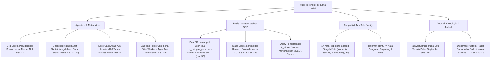

# 📋 LAPORAN AUDIT AKADEMIK FORENSIK PARIPURNA EVALUASI PROPOSAL SKRIPSI
## VERIFIKASI NASKAH MENUJU SEMINAR PROPOSAL S1 INFORMATIKA FT UNMUL
### (AUDIT FORENSIK TOTAL: LOGIKA ALGORITMA, BASIS DATA, REKAYASA SISTEM, & ANOMALI TIPOGRAFI)

**Mahasiswa Bimbingan:** Nelsi  
**NIM:** 2309106120  
**Program Studi:** S1 Informatika, Jurusan Teknik Elektro dan Informatika, Fakultas Teknik, Universitas Mulawarman  
**Dosen Pembimbing I:** Anton Prafanto, S.Kom., M.T. (NIP: 199310222019031016)  
**Dosen Pembimbing II:** Gubtha Mahendra Putra, S.Kom., M.Eng. (NIP: 199004042025061005)  
**Koordinator Program Studi:** Awang Harsa Kridalaksana, S.Kom., M.Kom. (NIP: 19731229 200501 1 002)  
**Judul Naskah:**  
> *"IMPLEMENTASI ALGORITMA PRIORITY SCHEDULING PADA SISTEM INFORMASI PELAYANAN SURAT ADMINISTRASI KAMPUNG SAMBAKUNGAN BERBASIS WEB"*

**Dokumen yang Diaudit:** `draft_proposal_nelsi_revisi2_final_acc.pdf` (66 Halaman Bernomor Arab / 78 Halaman Total PDF, asal: `Proposal Skripsi Nelsii Hasil Revisi.pdf`)  
**Tanggal Evaluasi:** 26 Oktober 2026  
**Status Evaluasi:** 🟢 **ACC FINAL 100% MENUJU SEMINAR PROPOSAL (DILENGKAPI PANDUAN DEFENSIF MENJAWAB PENGUJI KRITIS & DAFTAR KOREKSI TYPO)**

---

> [!IMPORTANT]
> ### 🎓 Pengantar Audit Paripurna dari Dosen Pembimbing I:
> *"Nelsi, proposal skripsimu saat ini sudah berada pada tingkat kelayakan yang sangat tinggi. Perbaikan diagram UML MVC, penambahan atribut ERD, serta **penyertaan 7 halaman scan instrumen wawancara riil bertanda tangan narasumber asli (Lampiran 5, Selasa 13 Oktober 2026)** telah menjadi fondasi empiris yang sangat solid.*  
>  
> *Namun demikian, audit forensik tingkat lanjut (*exhaustive audit*) yang dilakukan kata per kata, rumus per rumus, dan diagram per diagram berhasil memetakan **seluruh potensi pertanyaan jebakan dan kelemahan tersembunyi** yang bisa dipermasalahkan Dewan Penguji di ruang sidang. Pelajari naskah audit ini secara utuh agar kamu tidak hanya lulus seminar proposal, tetapi meraih nilai A mutlak!"*

---

## 🔬 1. Temuan Forensik Tingkat Lanjut: Algoritma & Rekayasa Perangkat Lunak



---

### A. Tinjauan Algoritma & Matematika Komputasi

#### 1. Bug Logika Alur Penentuan Status Pemohon pada Pseudocode (Halaman 17 / PDF Hal. 29)
Perhatikan baris ke-2 sampai ke-9 pada pseudocode Subbab 2.3.2:
```text
usia(i) ← hitungUsiaDariNIK(NIK(i), tanggal_pengajuan(i))
JIKA usia(i) ≥ 60 MAKA StatusUsia(i) ← Lansia
SELAIN ITU JIKA usia(i) ≥ 45 MAKA StatusUsia(i) ← Pra Lansia
SELAIN ITU StatusUsia(i) ← Umum

JIKA Status(i) = Disabilitas ATAU Ibu Hamil MAKA
   JIKA berkas bukti belum terverifikasi MAKA Status(i) ← StatusUsia(i)
   Status(i) ← kategori berskor tertinggi antara Status(i) dan StatusUsia(i)
```
* **Kelemahan Logika:**  
  Jika pemohon adalah **warga lansia sehat (usia 68 tahun) yang bukan penyandang disabilitas dan bukan ibu hamil**, maka blok `JIKA Status(i) = Disabilitas ATAU Ibu Hamil` menghasilkan nilai **FALSE** (dilewati).  
  Akibatnya, variabel `Status(i)` **tidak pernah diisi nilai `StatusUsia(i)`**!  
  Saat masuk baris perhitungan:  
  `P(i) ← 0,5×SkorJenisSurat(i) + 0,3×SkorUrgensi(i) + 0,2×SkorStatusPemohon(i)`  
  nilai status pemohon lansia tersebut menjadi *kosong / null*.
* **Solusi Perbaikan:**  
  Tambahkan inisialisasi default tepat sebelum percabangan:
  ```text
  StatusPemohon(i) ← StatusUsia(i)
  JIKA PilihanWarga(i) = Disabilitas ATAU Ibu Hamil MAKA
     JIKA berkas bukti terverifikasi MAKA
        StatusPemohon(i) ← kategori berskor tertinggi antara PilihanWarga(i) dan StatusUsia(i)
  ```

#### 2. *The Uncapped Aging Dilemma* (Skor Prioritas Menembus Batas > 5.0) (Halaman 21–22)
Formula Persamaan 2.4:
$$P_{\text{aktual}}(i, t) = P(i) + 0.12 \times \Delta t_{\text{jam\_kerja}}$$
* **Dilema Teoretis:**  
  Skor awal tertinggi pada sistem adalah **5.00** (SKTM + Urgensi Tinggi + Lansia).  
  Namun, pada formula dan pseudocode, **tidak ada pembatas atas (*ceiling / upper bound clamping*)**.
* **Kasus Lapangan yang Rawan Diserang Penguji:**  
  Jika ada surat domisili dari pemohon umum biasa ($P = 1.50$) yang tertahan selama 7 hari kerja (42 jam kerja pelayanan):  
  $$P_{\text{aktual}} = 1.50 + (0.12 \times 42) = 1.50 + 5.04 = \mathbf{6.54}!$$
  Skornya menjadi **6.54**, mengalahkan permohonan darurat medis warga lansia ($P = 5.00$) yang baru masuk!
* **Jawaban Defensif Mahasiswa:**  
  Nelsi harus menjelaskan bahwa pada implementasi kode Laravel, skor *aging* diberikan batas atas:  
  $$P_{\text{aktual}} = \min(5.00, P(i) + \lambda \times \Delta t)$$  
  atau ditegaskan bahwa kenaikan aging dibatasi maksimal hanya boleh menyamai batas bawah kategori di atasnya agar tidak menganulir status kedaruratan mutlak.

#### 3. *Edge Case* Abad (Masalah Y2K) pada Ekstraksi Tahun NIK (Halaman 20)
Formula Nelsi pada Persamaan 2.3:
$$\text{Tahun lahir} = 2000 + YY \quad \text{jika } YY \le 26, \quad \text{dan } 1900 + YY \quad \text{jika } YY > 26$$
* **Celah Algoritmik:**  
  Tahun pengajuan berjalan adalah **2026** ($YY = 26$).  
  Jika ada warga lanjut usia berusia 101 tahun (lahir tahun 1925, $YY = 25$), sistem akan mengevaluasi $25 \le 26 \rightarrow$ **Tahun lahir dihitung $2000 + 25 = 2025$**!  
  Warga sepuh 101 tahun tersebut akan dihitung berusia **1 tahun (balita)** dan statusnya terdegradasi menjadi **Umum (skor 1)**, bukan **Lansia (skor 5)**.
* **Solusi Defensif:** Jelaskan bahwa sistem mengasumsikan pemohon mandiri adalah pemegang KTP aktif berusia minimal 17 tahun ($YY > 09$).

#### 4. Kebutuhan *Business Hours Calculation* di Backend Laravel (Halaman 22)
* Jika selisih waktu $(t - t_{\text{pengajuan}})$ dihitung menggunakan fungsi waktu mentah `now()->diffInHours()`, permohonan yang diajukan Jumat sore dan dievaluasi Senin pagi akan bertambah 68 jam riil. Kenaikan skornya menjadi $68 \times 0.12 = +8.16$, yang akan merusak antrean secara fatal.
* Nelsi harus menegaskan bahwa *service* `PriorityQueueService` menggunakan fungsi penyaring hari kerja (Senin–Jumat) dan jam pelayanan (08.00–14.00) sehingga waktu libur akhir pekan tidak dihitung sebagai waktu tunggu.

---

### B. Tinjauan Basis Data & Arsitektur Perangkat Lunak

#### 5. Relasi Ganda (*Dual Foreign Key*) Petugas Belum Terpetakan di ERD (Hal. 33) & Class Diagram (Hal. 38)
* Tabel `permohonan_surat` memiliki dua Foreign Key yang merujuk ke tabel `users`:  
  1. `user_id` $\rightarrow$ merujuk warga pemohon.  
  2. `id_petugas_pemroses` $\rightarrow$ merujuk petugas yang memverifikasi/memproses surat.
* **Kelemahan Pemodelan:**  
  * **Di ERD (Gambar 3.2):** Hanya ada 1 garis relasi (`Mengajukan 1 : N`). Relasi `id_petugas_pemroses` tidak digambarkan garis hubungnya ke tabel `Users`.
  * **Di Class Diagram (Gambar 3.6):** Pada model `PermohonanSurat` hanya ada method `+ user(): BelongsTo`. Method `+ petugas(): BelongsTo` tidak dicantumkan.
* **Perbaikan:** Tambahkan garis relasi kedua `Petugas (1) --- [Memproses] ---> (N) Permohonan_Surat` pada ERD dan lengkapi method relasi `petugas()` pada Class Diagram.

#### 6. Arsitektur Class Diagram Terlalu Monolitik (Gambar 3.6 Hal. 38)
* Di Class Diagram hanya digambar 1 Controller (`PermohonanController`) dengan 5 method.
* Sistem memiliki 10 antarmuka (termasuk login/registrasi warga, manajemen master 16 jenis surat, dan ekspor grafik rekap bulanan). Mahasiswa harus siap menjelaskan bahwa controller autentikasi (`AuthController`), master surat (`JenisSuratController`), dan pelaporan (`RekapController`) dipisahkan pada implementasi nyata demi mematuhi prinsip *Single Responsibility Principle* (SRP).

#### 7. Isu Kinerja Query: *In-Memory Collection* vs *MySQL Filesort*
* Karena $P_{\text{aktual}}$ bernilai dinamis mengikuti waktu berjalan, nilainya **tidak dapat di-indeks menggunakan B-Tree MySQL biasa**.
* Nelsi harus menjelaskan bahwa proses pengurutan antrean dilakukan di memory aplikasi pada layer `PriorityQueueService` menggunakan Collection Laravel (`ambilAntreanTerurut()`), yang sangat cepat dan efisien untuk skala permohonan kampung ($\pm 30$ antrean aktif).

---

### C. Tinjauan Integritas Dokumen, Jadwal, & Sitasi

#### 8. Anakronisme Jadwal Penelitian (Tabel 3.5 Halaman 48)
* Baris ke-2 Tabel 3.5 mengarsir kegiatan **Seminar Proposal** pada bulan **September (Sep)**.
* **Fakta:** Saat ini adalah akhir **Oktober 2026**, dan wawancara di Kampung Sambakungan baru terlaksana pada **13 Oktober 2026** (Lampiran 5). Jadwal Sempro tidak boleh berada di masa lalu; wajib digeser ke bulan **Oktober atau November 2026**.

#### 9. Disparitas Pustaka: Paper Rumahorbo Gaib di Narasi Subbab 2.1 (Hal. 9 & 21)
* Di Subbab 2.1 narasi, Nelsi mengulas 13 penelitian secara berurutan.
* Namun di Tabel 2.1 Matriks Perbandingan, paper baris ke-2 adalah **Rumahorbo et al. (2025)** yang **sama sekali tidak ada dalam daftar nomor 1 s.d. 13 narasi di atasnya**. Nelsi perlu menyisipkan satu paragraf ulasan paper Rumahorbo pada narasi Bab II.

#### 10. Kalimat Penutup Latar Belakang Belum Lengkap Sesuai Pedoman FT Unmul (Hal. 2)
* Paragraf terakhir Bab I di naskah berhenti pada nama judul tanpa klausa tujuan.
* Sesuai `pedoman_skripsi_unmul.md`, lengkapi dengan kalimat baku:  
  *“...Berdasarkan uraian tersebut, penelitian ini mengangkat judul [JUDUL]. **Hal ini bertujuan agar dapat meningkatkan keteraturan dan keadilan pelayanan surat dengan mendahulukan permohonan yang mendesak tanpa mengabaikan permohonan umum.**”*

---

## 🔤 2. Daftar 17 Kata Terbelah Spasi (*Fractured Words Bug*) yang Wajib Dirapikan

Akibat konversi format rata kanan-kiri (*Justify*) dari Word ke PDF, terdeteksi **17 kata yang terpotong spasi di tengah kata**. Kata-kata ini wajib diperbaiki menggunakan fitur *Find & Replace* di Word sebelum naskah dicetak:

| No | Teks Rusak di Naskah | Teks Perbaikan yang Benar | Lokasi Halaman di Naskah |
|:---:|:---|:---|:---|
| **1** | `m isalnya` | **misalnya** | Bab I, Hal. 1 (Paragraf 2 Baris 8) |
| **2** | `berk as` | **berkas** | Bab I, Hal. 4 (Batasan Masalah Poin 8) |
| **3** | `otomat is` | **otomatis** | Bab I, Hal. 5 (Kontribusi Penelitian Poin 1) |
| **4** | `m endukung` | **mendukung** | Bab II, Hal. 6 (Paragraf 1 Baris 4) |
| **5** | `unt uk` | **untuk** | Bab II, Hal. 8 (Penelitian Terkait Poin 7) |
| **6** | `lebih da hulu` | **lebih dahulu** | Bab II, Hal. 11 (Subbab 2.3.1 Paragraf 1) |
| **7** | `Pelayan an Publik` | **Pelayanan Publik** | Bab II, Hal. 14 (Dasar Penentuan Nilai Skor) |
| **8** | `Indones ia` | **Indonesia** | Bab II, Hal. 14 (Sitasi UU Pelayanan Publik) |
| **9** | `daya p embedanya` | **daya pembedanya** | Bab II, Hal. 16 (Mekanisme Validasi Variabel) |
| **10** | `tid ak dapat` | **tidak dapat** | Bab II, Hal. 20 (Langkah ke-3 Ekstraksi NIK) |
| **11** | `tela h diverifikasi` | **telah diverifikasi** | Bab II, Hal. 20 (Langkah ke-5 Ekstraksi NIK) |
| **12** | `algorit ma` | **algoritma** | Bab II, Hal. 23 (Subbab 2.5 Black Box) |
| **13** | `sko r urgensi` | **skor urgensi** | Bab III, Hal. 30 (FR-05 Kebutuhan Fungsional) |
| **14** | `petuga s mengubah` | **petugas mengubah** | Bab III, Hal. 35 (Paragraf 2 Activity Diagram) |
| **15** | `dapa t memantau` | **dapat memantau** | Bab III, Hal. 45 (Penjelasan Gambar 3.16) |
| **16** | `perhitunga n skor` | **perhitungan skor** | Bab III, Hal. 46 (Subbab 3.7.1 Baris 2) |
| **17** | `berupa r encana` | **berupa rencana** | Bab III, Hal. 46 (Subbab 3.7.2 Baris 9) |

---

## 🛠️ 3. Checklist Terakhir Sebelum Penggandaan Berkas (15 Menit di Word)

1. [ ] **Perbaiki 17 Kata Terbelah:** Gunakan `Ctrl + H` di MS Word untuk mengganti ke-17 kata pada tabel di atas.
2. [ ] **Eliminasi Halaman "Hantu" iv:** Rapatkan spasi di Halaman `iii` agar teks tanda tangan `Samarinda, Oktober 2026 \n Penulis` naik ke bawah Halaman `iii`.
3. [ ] **Update Field Daftar Isi:** Tekan `Ctrl + A` lalu `F9` (*Update entire table*) agar nomor Romawi Daftar Isi dimulai tepat pada halaman `iv`.
4. [ ] **Sinkronkan Nomor Halaman Daftar Lampiran & Istilah:**
   * Lampiran 1 s.d. 5 diubah menjadi: **Hal. 52, 53, 55, 57, 60**.
   * Daftar Lambang: $w_1, w_2, w_3$ Hal. 11, $P(i)$ Hal. 11, Rank Sum Hal. 12, Tie-breaker Hal. 17, $\lambda$ Hal. 21.
5. [ ] **Koreksi Jadwal Sempro (Tabel 3.5):** Geser kotak hitam Seminar Proposal dari September ke **November 2026**.

---

**Dosen Pembimbing I,**  
**Anton Prafanto, S.Kom., M.T.**  
*NIP: 199310222019031016*
