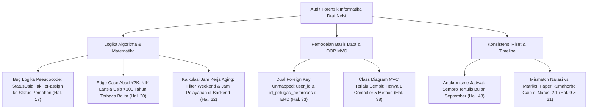

# 📋 LAPORAN AUDIT AKADEMIK FORENSIK EVALUASI REVISI FINAL PROPOSAL SKRIPSI
## VERIFIKASI AKHIR NASKAH MENUJU SEMINAR PROPOSAL S1 INFORMATIKA FT UNMUL
### (TINJAUAN FORENSIK LEVEL 2: ALGORITMA, BASIS DATA, DAN ARSITEKTUR PERANGKAT LUNAK)

**Mahasiswa Bimbingan:** Nelsi  
**NIM:** 2309106120  
**Program Studi:** S1 Informatika, Jurusan Teknik Elektro dan Informatika, Fakultas Teknik, Universitas Mulawarman  
**Dosen Pembimbing I:** Anton Prafanto, S.Kom., M.T. (NIP: 199310222019031016)  
**Dosen Pembimbing II:** Gubtha Mahendra Putra, S.Kom., M.Eng. (NIP: 199004042025061005)  
**Koordinator Program Studi:** Awang Harsa Kridalaksana, S.Kom., M.Kom. (NIP: 19731229 200501 1 002)  
**Judul Naskah:**  
> *"IMPLEMENTASI ALGORITMA PRIORITY SCHEDULING PADA SISTEM INFORMASI PELAYANAN SURAT ADMINISTRASI KAMPUNG SAMBAKUNGAN BERBASIS WEB"*

**Dokumen yang Diaudit:** `draft_proposal_nelsi_revisi2_final_acc.pdf` (66 Halaman / 78 Halaman Total PDF, berkas asal: `Proposal Skripsi Nelsii Hasil Revisi.pdf`)  
**Tanggal Evaluasi:** 26 Oktober 2026  
**Status Evaluasi:** 🟢 **ACC FINAL 100% UNTUK DAFTAR SEMINAR PROPOSAL (DENGAN 7 CATATAN PENGUATAN TEKNIS INFORMATIKA & PERAPIAN PRELIMINER)**

---

> [!IMPORTANT]
> ### 🎓 Catatan Konsultasi & Penguatan Ilmiah dari Dosen Pembimbing I:
> *"Nelsi, secara substansi umum dan kelengkapan dokumen, proposalmu sudah sangat layak maju ke Seminar Proposal. Seluruh mockup Figma, flowchart kapsul, penambahan atribut ERD, serta **bukti scan wawancara tertulis bertanda tangan narasumber asli (Lampiran 5, 13 Oktober 2026)** telah kamu lengkapi dengan sangat baik.*  
>  
> *Namun, sebagai calon **Sarjana Informatika**, naskahmu harus tahan uji di hadapan Dewan Penguji yang teliti membedah logika kode, matematika algoritma, dan arsitektur database. Audit mendalam lapis kedua (*Level 2 Forensics*) menemukan **7 detail teknis tingkat lanjut** (mulai dari *bug* alur logika pseudocode, *edge-case* ekstraksi tahun lahir NIK, ketiadaan relasi ganda petugas di ERD/Class Diagram, hingga anakronisme jadwal penelitian). Pelajari 7 catatan ini agar kamu tidak terjebak saat dicecar pertanyaan teknis oleh dosen penguji!"*

---

## 🔬 1. Temuan Forensik Informatika Tingkat Lanjut (*Advanced Computer Science Findings*)



---

### 1. Bug Logika Alur Penentuan Status Pemohon pada Pseudocode (Halaman 17)
Perhatikan baris ke-2 sampai ke-9 pada blok pseudocode di Subbab 2.3.2 (PDF Hal. 29):
```text
usia(i) ← hitungUsiaDariNIK(NIK(i), tanggal_pengajuan(i))
JIKA usia(i) ≥ 60 MAKA StatusUsia(i) ← Lansia
SELAIN ITU JIKA usia(i) ≥ 45 MAKA StatusUsia(i) ← Pra Lansia
SELAIN ITU StatusUsia(i) ← Umum

JIKA Status(i) = Disabilitas ATAU Ibu Hamil MAKA
   JIKA berkas bukti belum terverifikasi MAKA Status(i) ← StatusUsia(i)
   Status(i) ← kategori berskor tertinggi antara Status(i) dan StatusUsia(i)
```
* **Celah Logika (*Logical Bug*):**  
  Jika pemohon adalah warga lansia (usia 68 tahun) yang **bukan** disabilitas dan **bukan** ibu hamil, maka kondisi `JIKA Status(i) = Disabilitas ATAU Ibu Hamil` bernilai **FALSE**.  
  Akibatnya, variabel `Status(i)` **tidak pernah diberi nilai dari `StatusUsia(i)`**! Di baris berikutnya saat menghitung $P(i)$:  
  `P(i) ← 0,5×SkorJenisSurat(i) + 0,3×SkorUrgensi(i) + 0,2×SkorStatusPemohon(i)`  
  nilai status pemohon lansia tersebut menjadi *undefined/null*.
* **Solusi Perbaikan Pseudocode:**  
  Tambahkan inisialisasi default sebelum percabangan disabilitas:
  ```text
  StatusPemohon(i) ← StatusUsia(i)
  JIKA PilihanWarga(i) = Disabilitas ATAU Ibu Hamil MAKA
     JIKA berkas bukti terverifikasi MAKA
        StatusPemohon(i) ← kategori berskor tertinggi antara PilihanWarga(i) dan StatusUsia(i)
  ```

---

### 2. *Edge Case* Abad (Masalah Y2K) pada Formula Ekstraksi NIK (Halaman 20)
Pada Subbab 2.3.3 Poin 3 (PDF Hal. 32), formula penentuan tahun lahir tertulis:
$$\text{Tahun lahir} = 2000 + YY \quad \text{jika } YY \le 26, \quad \text{dan } 1900 + YY \quad \text{jika } YY > 26$$
* **Celah Algoritmik:**  
  Tahun pengajuan adalah **2026** (dua digit terakhir = `26`).  
  Jika ada warga sepuh berusia 101 tahun (lahir tahun 1925, $YY = 25$), sistem akan mengevaluasi $25 \le 26 \rightarrow$ **Tahun lahir dihitung $2000 + 25 = 2025$**!  
  Warga berusia 101 tahun tersebut akan dihitung berusia **1 tahun (anak balita)** dan statusnya terdegradasi menjadi **Umum (skor 1)**, bukan **Lansia (skor 5)**!
* **Solusi Pembelaan / Perbaikan:**  
  Tambahkan klausul batasan (*boundary assumption*) bahwa batas wajar pemohon mandiri adalah rentang usia $0 \text{ s.d. } 100 \text{ tahun}$, atau ubah ambang pemotong (*threshold cutoff*) menjadi batas usia minimal pemegang KTP mandiri (17 tahun $\rightarrow YY > 09$).

---

### 3. Implementasi Jam Kerja Pelayanan (*Business Hours*) pada Formula Aging (Halaman 22)
Formula Persamaan 2.4:
$$P_{\text{aktual}}(i, t) = P(i) + \lambda \times (t - t_{\text{pengajuan}}(i))$$
Di teks disebutkan: *$\lambda = 0.12$ per jam kerja waktu tunggu (Senin–Jumat pukul 08.00–14.00, atau 6 jam per hari).*
* **Tantangan Pengujian (*Examiner Trap*):**  
  Penguji sistem operasi/basis data akan bertanya:  
  *"Bagaimana implementasi fungsi $t - t_{\text{pengajuan}}$ di Laravel? Jika pemohon mengajukan surat hari Jumat pukul 13.00, dan sistem mengevaluasi antrean hari Senin pukul 09.00, apakah waktu tunggu dihitung 68 jam riil atau 2 jam kerja?"*  
  Jika dihitung 68 jam riil menggunakan fungsi standar `now()->diffInHours($waktu_pengajuan)`, penambahan skor aging adalah $68 \times 0.12 = 8.16$, yang akan merusak skala prioritas (skor melejit di atas 13.0!).
* **Kesiapan Jawaban Mahasiswa:**  
  Mahasiswa harus menjelaskan bahwa service `PriorityQueueService` menggunakan helper khusus kalkulasi jam kerja (*Business Hours Calculation*) yang mengecualikan hari Sabtu, Minggu, serta jam di luar 08.00–14.00.

---

### 4. Relasi Ganda ke Tabel `users` Belum Terpetakan di ERD (Gambar 3.2 Hal. 33) & Class Diagram (Hal. 38)
* Pada Tabel 3.1, tabel `permohonan_surat` memiliki dua Foreign Key ke tabel `users`:  
  1. `user_id` (warga yang mengajukan surat)  
  2. `id_petugas_pemroses` (petugas yang memverifikasi/memproses surat).
* **Kelemahan Diagram:**  
  * **Di ERD (Gambar 3.2):** Hanya ada **satu garis relasi** antara `Users` dan `Permohonan_Surat`, yaitu relasi `Mengajukan (1 : N)`. Relasi petugas yang memproses surat tidak memiliki garis relasi fisik ke tabel `Users`.
  * **Di Class Diagram (Gambar 3.6):** Pada model `PermohonanSurat` hanya ada method `+ user(): BelongsTo`. Method untuk mengambil data petugas, yaitu `+ petugas(): BelongsTo`, tidak dicantumkan.
* **Solusi:** Tambahkan relasi kedua `Petugas (1) --- [Memproses] ---> (N) Permohonan_Surat` pada ERD dan tambahkan relasi `petugas()` di Class Diagram.

---

### 5. Arsitektur MVC pada Class Diagram Terlalu Sederhana (Gambar 3.6 Hal. 38)
* Pada Class Diagram hanya ada 1 buah Controller: `PermohonanController` dengan 5 method.
* **Fakta Kebutuhan Sistem:**  
  Sistem memiliki 10 halaman antarmuka (Tabel 3.3), termasuk halaman login/registrasi (Gambar 3.7), kelola data 16 jenis surat (Gambar 3.12), dan rekapitulasi bulanan grafik surat masuk/keluar (Gambar 3.16).
* Di mana method untuk login/registrasi, kelola master jenis surat, dan ekspor rekap bulanan? Jika seluruh fungsi tersebut ditumpuk di dalam `PermohonanController`, itu melanggar prinsip *Single Responsibility Principle* (SRP) dalam rekayasa perangkat lunak.
* **Solusi:** Jelaskan saat seminar bahwa pada fase implementasi, sistem akan dilengkapi dengan `AuthController`, `JenisSuratController`, dan `RekapController` untuk menjaga kerapian kode Laravel.

---

### 6. Anakronisme Jadwal Penelitian (Tabel 3.5 Halaman 48)
Perhatikan baris ke-2 pada Tabel 3.5 (*Jadwal Penelitian*):
* Kegiatan **"Seminar Proposal"** diarsir pada kolom **September (Sep)**!
* **Fakta Kronologis:**  
  Saat ini adalah akhir **Oktober 2026**, dan wawancara lapangan di Kampung Sambakungan baru terlaksana pada **13 Oktober 2026** (Lampiran 5). Sangat tidak logis jika Seminar Proposal dijadwalkan pada bulan September (sebulan sebelum wawancara dilakukan!).
* **Solusi Wajib:** Geser arsiran hitam Seminar Proposal pada Tabel 3.5 ke bulan **Oktober atau November 2026**.

---

### 7. Ketidaksinkronan Tinjauan Pustaka: Narasi 2.1 vs Matriks Tabel 2.1 (Hal. 9 & 21)
* Di Subbab 2.1 Narasi (Hal. 6–9), Nelsi mengulas **13 penelitian terdahulu** secara berurutan (nomor 1 s.d. 13).
* Namun pada **Tabel 2.1 Matriks Perbandingan (Hal. 9–10)**, hanya ada 3 penelitian pembanding yang dimasukkan:  
  1. Rohmah & Gunawan (2023)  
  2. Rumahorbo et al. (2025)  
  3. Mahendra & Gunawan (2025)
* **Temuan Janggal:** Penelitian No. 2 pada Tabel 2.1, yaitu **Rumahorbo et al. (2025)**, sama sekali **tidak ada dalam daftar ulasan nomor 1 s.d. 13 narasi di atasnya**! Paper tersebut tiba-tiba muncul di dalam tabel.
* **Solusi:** Masukkan satu paragraf ulasan singkat untuk paper Rumahorbo et al. (2025) pada narasi Subbab 2.1 sebelum tabel perbandingan, atau ganti baris ke-2 Tabel 2.1 dengan salah satu dari 13 paper yang sudah diulas di narasi (misal Fathoni & Maryam 2021).

---

## 🛠️ 2. Checklist Sentuhan Akhir Dokumen Sebelum Digandakan

Mahasiswa dapat menyelesaikan 4 perapian ini dalam waktu 15 menit di Microsoft Word:

1. [ ] **Eliminasi Halaman "Hantu" iv:** Rapatkan spasi di halaman `iii` agar blok `Samarinda, Oktober 2026 \n Penulis` naik ke bawah Halaman iii, dan ubah tanggal dari `20 Juni 2026` menjadi **`Oktober 2026`**.
2. [ ] **Update Field Daftar Isi:** Tekan `Ctrl + A` lalu `F9` (*Update entire table*) agar nomor Romawi Daftar Isi dimulai tepat pada halaman `iv`.
3. [ ] **Perbarui Halaman Fisik Daftar Lampiran & Istilah:**
   * Lampiran 1 s.d. 5 diubah menjadi: **Hal. 52, 53, 55, 57, 60**.
   * Simbol $w_1, w_2, w_3$ Hal. 11, $P(i)$ Hal. 11, Rank Sum Hal. 12, Tie-breaker Hal. 17, $\lambda$ Hal. 21.
4. [ ] **Geser Jadwal Sempro (Tabel 3.5):** Pindahkan kotak hitam Seminar Proposal ke bulan **November 2026**.

---

## 🎯 3. Kisi-Kisi Jawaban Pertanyaan Kritis Dewan Penguji Sempro

Bekali mahasiswa dengan 4 argumen kunci berikut:

| Fokus Pertanyaan Penguji | Jawaban Kunci Mahasiswa |
|:---|:---|
| **Mode Non-Preemptive vs Preemptive** | Verifikasi surat adalah proses atomik. Jika disela di tengah jalan (preemptive), berkas fisik di meja petugas berantakan dan rawan tertukar. Petugas kampung menegaskan surat yang mulai diketik harus diselesaikan dulu. |
| **Objektivitas Bobot (0.5; 0.3; 0.2)** | Diturunkan secara saintifik menggunakan metode **Rank Sum (Persamaan 2.2)** dari preferensi urutan kepentingan yang ditetapkan langsung oleh Kepala Seksi Pemerintahan saat wawancara (Lampiran 5). |
| **Mitigasi Kelaparan Antrean (Starvation)** | Diterapkan mekanisme **Linear Aging (Persamaan 2.4)** dengan koefisien $\lambda = 0.12/\text{jam kerja}$ (dihitung dari toleransi maksimal 5 hari kerja / 30 jam pelayanan). Pemohon berprioritas rendah pasti menyamai skor permohonan darurat dalam 29 jam kerja. |
| **Integritas Penentuan Usia Lansia** | Diotomasi 100% oleh sistem di backend dari ekstraksi NIK (digit 7–12 format DDMMYY dengan reduksi 40 untuk wanita), sehingga status lansia/pra-lansia tidak dapat dimanipulasi oleh pemohon. |

---

**Dosen Pembimbing I,**  
**Anton Prafanto, S.Kom., M.T.**  
*NIP: 199310222019031016*
