# 📋 LAPORAN AUDIT KONTEN PROPOSAL SKRIPSI (REVISI 2)
## EVALUASI MENDALAM SUBSTANSI, ALUR LOGIKA, DAN METODOLOGI MENUJU SEMINAR PROPOSAL S1 INFORMATIKA FT UNMUL

**Mahasiswa Bimbingan:** Vandy Rizky Septiawan  
**NIM:** 2309106048 (Angkatan 2023)  
**Program Studi:** S1 Informatika, Fakultas Teknik, Universitas Mulawarman  
**Dosen Pembimbing I:** Prof. Dr. Ir. Hamdani, S.T., M.Cs., IPM  
**Dosen Pembimbing II:** Anton Prafanto, S.Kom., M.T. (NIP: 199310222019031016)  
**Koordinator Program Studi:** Awang Harsa Kridalaksana, S.Kom., M.Kom. (NIP: 19731229 200501 1 002)  
**Judul pada Naskah:** *Komparasi Kinerja Google Sheets API dan Supabase sebagai Data Provider pada Arsitektur Web Next.js*  
**Naskah yang Diaudit:** `Draft_Proposal_Vandy_rev1.pdf` (Diarsipkan sebagai `draft_proposal_vandy_rizky_septiawan_revisi2.pdf` — 59 Halaman Total PDF / 43 Halaman Bernomor)  
**Tanggal Audit:** 6 November 2026  
**Status Evaluasi:** 🟢 **HAMPIR SIAP SEMINAR PROPOSAL (APRESIASI TINGGI ATAS PERBAIKAN MAYOR — TINGGAL PENYELARASAN KONTEN & DETAIL EKSPERIMEN)**

---

> [!NOTE]
> ### 💡 Pesan Hangat dari Dosen Pembimbing untuk Vandy:
> *"Halo Vandy, terima kasih sudah bekerja keras menyelesaikan revisi proposal ini. Bapak sudah membaca dan memeriksa kembali naskah `Draft_Proposal_Vandy_rev1.pdf` halaman demi halaman secara menyeluruh.*  
>  
> *Pertama-tama, **Bapak sangat bangga dan mengapresiasi kerja kerasmu!** Hampir semua catatan besar pada audit sebelumnya sudah kamu eksekusi dengan sangat baik: judul sudah lugas dan tidak lagi redundan, istilah 'Headless CMS' untuk Supabase sudah diluruskan menjadi 'Data Provider / BaaS', penjelasan arsitektur Read-Heavy dan Error Rate sudah masuk di Bab II, wireframe UI sudah dirampingkan menjadi 3 halaman inti, dan yang paling membanggakan adalah **Subbab 3.6.2 (Pengujian Performa dengan Grafana K6)** kini sudah kamu jabarkan lengkap dengan desain variabel, rumus metrik, konfigurasi `force-no-store`, hingga mitigasi kuota HTTP 429!*  
>  
> *Agar kamu benar-benar aman, tenang, dan tidak terjebak pertanyaan sulit dari Dewan Penguji saat Seminar Proposal nanti, Bapak melakukan **audit khusus dari segi konten (substansi)** secara teliti dari halaman pertama sampai terakhir. Masih ada beberapa **ketidaksinkronan sisa draf lama** dan **detail desain eksperimen yang belum tertulis angkanya** (seperti jumlah baris data yang diuji dan durasi di Tabel 3.3). Bapak sudah merangkum semuanya dengan bahasa yang mudah diikuti beserta contoh kalimat perbaikannya di bawah ini. Yuk, kita poles sedikit lagi sampai tuntas!"*

---

## 🌟 1. Rekapitulasi Kemajuan Positif (Apa yang Sudah Berhasil Kamu Perbaiki)

Sebelum masuk ke daftar hal yang perlu disempurnakan, mari kita lihat lompatan kualitas naskahmu dibandingkan draf sebelumnya:

| No | Aspek pada Draf Sebelumnya | Kondisi pada Draf Saat Ini (`Draft_Proposal_Vandy_rev1.pdf`) | Status |
|:---:|:---|:---|:---:|
| **1** | Judul memuat pleonasme (*"Kinerja, Latensi, dan Throughput"*) dan salah istilah (*"Headless CMS"*). | Judul sudah bersih, ringkas, dan tepat secara keilmuan: ***"Komparasi Kinerja Google Sheets API dan Supabase sebagai Data Provider pada Arsitektur Web Next.js"***. | ✅ **Tuntas** |
| **2** | Halaman depan, Daftar Tabel, Daftar Gambar, Daftar Istilah, dan Daftar Singkatan masih berisi teks *template* (`Contents`). | Seluruh halaman depan sudah terisi identitas resmi, serta Daftar Istilah (21 istilah teknis) dan Daftar Singkatan (14 singkatan) sudah disusun dengan baik. | ✅ **Tuntas** |
| **3** | Pembatasan operasi hanya pada *Read* belum memiliki landasan teori di Bab II. | Sudah ditambahkan **Subbab 2.5 (*Read-Heavy Architecture dan Pola Akses Data pada CMS*)** dan **Subbab 2.19 (*Error Rate*)** yang memperkuat dasar teori penelitian. | ✅ **Tuntas** |
| **4** | Bab III terlalu berat di gambar UI (13 wireframe admin CRUD & 24 skenario Blackbox CRUD). | Wireframe sudah dipangkas menjadi **3 halaman publik (Beranda, Blog, Galeri)** dan pengujian Blackbox difokuskan pada **5 skenario operasi Read**. | ✅ **Tuntas** |
| **5** | Subbab 3.6.2 (Pengujian Performa Grafana K6) hanya 1 paragraf kosong tanpa skenario dan tanpa kontrol *caching*. | Sudah diuraikan sepanjang **4 halaman (Hal. 29–33)** mencakup desain endpoint `/api/sheets/...` vs `/api/supabase/...`, penonaktifan *cache* Next.js (`force-dynamic` & `force-no-store`), rumus *Throughput* & *Error Rate*, serta 3 skenario uji (`SK-01`, `SK-02`, `SK-03`). | ✅ **Maju Pesat** |

---

## 🧭 2. Peta Temuan Audit Konten yang Perlu Disempurnakan

Fokus perbaikan kita sekarang murni pada **keselarasan isi (konsistensi antar-bab), kelengkapan parameter eksperimen di Bab III, dan ketepatan rujukan di Bab II & Daftar Pustaka**. Berikut peta ringkasnya:

```mermaid
flowchart TD
    Root["Audit Konten Draft_Proposal_Vandy_rev1.pdf"] --> A["1. Konsistensi Ruang Lingkup (Bab I - III)"]
    Root --> B["2. Desain Eksperimen & Metodologi (Bab III)"]
    Root --> C["3. Substansi Teori & Penelitian Terkait (Bab II)"]
    Root --> D["4. Keabsahan Sitasi & Daftar Pustaka"]
    Root --> E["5. Sinkronisasi Penomoran Rujukan & Jadwal"]

    A --> A1["Sisa klaim 'Seluruh Operasi CRUD' vs Batasan 'Hanya Operasi Read'"]
    A --> A2["Metrik 'Error Rate' terlupa di Manfaat, Kontribusi & Kesimpulan"]
    A --> A3["Narasi Wireframe masih menyebut 'Halaman Manajemen Admin'"]

    B --> B1["Jumlah baris data uji (Row Count) & ukuran payload belum disebutkan"]
    B --> B2["Kontradiksi Server: Cloud PaaS Vercel vs Lokal 'next build & next start'"]
    B --> B3["Tabel 3.3 belum memuat kolom Durasi, Think Time & Thresholds"]
    B --> B4["Detail endpoint mana yang ditembak k6 belum dirinci"]

    C --> C1["Format kaku 10 Penelitian Terkait & verifikasi isi paper Rakhmansyah (2025)"]
    C --> C2["Definisi Latency (2.17) vs Response Time (2.16) perlu diselaraskan dengan k6"]

    D --> D1["4 pasang referensi kembar (duplikat a & b) di Daftar Pustaka"]
    D --> D2["Beberapa sitasi tidak sesuai topik (IoT detak jantung, Smart Door Lock, dll.)"]

    E --> E1["Salah rujuk nomor Gambar 3.3/3.4, Tabel 3.3/3.4 & Subbab 3.5.1 ganda"]
    E --> E2["Jadwal Pengumpulan Data (Okt) mendahului Seminar Proposal (Nov)"]
```

---

## 🔍 3. Uraian Detail Audit Konten & Panduan Perbaikannya (Bab demi Bab)

Mari kita bahas satu per satu secara berurutan agar kamu mudah mencarinya di dokumen Word-mu.

---

### 📘 BAGIAN A: Konsistensi Ruang Lingkup & Metrik (Bab I s.d. Bab III)

#### 1. Kontradiksi Antara Klaim "Menguji Operasi CRUD" vs Batasan "Hanya Operasi Read"
Di **Batasan Masalah Poin 4 (Hal. 4)** dan **Subbab 2.5 (Hal. 9)**, kamu sudah menetapkan dengan sangat jelas bahwa pengujian **hanya difokuskan pada operasi pembacaan data (*Read* / `HTTP GET`)**, sedangkan operasi *Create, Update, dan Delete* tidak diuji.  
Namun, karena ada paragraf lama yang belum ikut diubah, muncul pernyataan yang saling bertolak belakang:

* **Lokasi 1 — Bab I Latar Belakang, Hal. 2 (PDF Hal. 14, Paragraf 3):**  
  > *Tertulis:* "Data yang diakses melalui ekosistem Google ini kemudian digunakan untuk mendukung **seluruh operasi pengelolaan konten web**."
* **Lokasi 2 — Bab I Latar Belakang, Hal. 3 (PDF Hal. 15, Paragraf 2) [SANGAT KRITIS]:**  
  > *Tertulis:* "Seluruh pengukuran metrik kinerja tersebut **secara spesifik difokuskan pada operasi pengolahan data (CRUD)** yang dijalankan oleh web CMS (Biwarno dkk., 2025)."
* **Lokasi 3 — Bab I Latar Belakang, Hal. 3 (PDF Hal. 15, Paragraf 3):**  
  > *Tertulis:* "Implementasi web CMS, penggunaan framework Next.js, rancangan struktur data, **jenis operasi CRUD**, skenario pengujian, hingga spesifikasi komputasi lingkungan pengujian dipastikan identik."
* **Lokasi 4 — Bab III Subbab 3.4 Penjelasan Gambar 3.2, Hal. 25 (PDF Hal. 41):**  
  > *Tertulis:* "Permintaan yang membutuhkan akses **atau modifikasi data** diteruskan oleh aplikasi menuju API Routes internal... untuk menampilkan **atau memperbarui informasi** pada antarmuka pengguna."
* **Lokasi 5 — Bab III Subbab 3.5.1 & 3.5.2 (Halaman Beranda, Blog, Galeri), Hal. 26–27 (PDF Hal. 42–43):**  
  > *Tertulis:* "...dikendalikan dan disinkronkan langsung dari **Halaman Manajemen Konten Beranda**", "...dikelola via **Halaman Manajemen Blog**... **Halaman Manajemen Konten Blog**", dan "...dikonfigurasi melalui **Halaman Manajemen Galeri**... **Halaman Manajemen Konten Galeri**."

> [!IMPORTANT]
> **Mengapa Ini Harus Diperbaiki?**  
> Bayangkan jika Dosen Penguji membaca Halaman 3 (*"pengukuran metrik kinerja secara spesifik difokuskan pada operasi CRUD"*), lalu membalik ke Halaman 4 (*"Batasan Masalah Poin 4: Pengujian difokuskan pada operasi Read"*). Penguji pasti akan langsung bertanya: *"Ini sebenarnya kamu menguji CRUD atau hanya Read? Mengapa di Halaman 3 bilangnya CRUD?"*  
> Begitu juga di Halaman 26–27: jika kamu menyebut ada "Halaman Manajemen Blog/Galeri", penguji akan mencari mana rancangan halaman manajemennya.

> **✅ Solusi Perbaikan (Mudah & Cepat):**
> 1. Pada **Hal. 3 Paragraf 2 & 3**, ganti kata *"operasi pengolahan data (CRUD)"* dan *"jenis operasi CRUD"* menjadi **"operasi pembacaan data (*Read*)"** (serta tambahkan 1 kalimat singkat di Latar Belakang bahwa fokus pada operasi *Read* dipilih karena trafik publik pada web CMS berkarakteristik *read-heavy*).
> 2. Pada **Hal. 25 (Penjelasan Gambar 3.2)**, ganti *"akses atau modifikasi data"* menjadi **"pengambilan data (*read*)"**, dan ganti *"menampilkan atau memperbarui informasi"* menjadi **"menampilkan informasi konten"**.
> 3. Pada **Hal. 26–27 (Subbab 3.5.1 s.d. 3.5.3)**, ganti kalimat yang menyebut *"Halaman Manajemen Konten Beranda / Blog / Galeri"* menjadi merujuk langsung ke kelompok data pada Tabel 3.1. Contohnya: *"Konten teks yang ditampilkan pada halaman ini diambil langsung dari kelompok data `content` pada penyedia data (Google Sheets API atau Supabase)."*

---

#### 2. Metrik Ketiga (*Error Rate*) Terlupakan di Manfaat, Kontribusi, dan Penarikan Kesimpulan
Di **Rumusan Masalah (1.2)**, **Batasan Masalah (1.3 Poin 5)**, dan **Tujuan Penelitian (1.4)**, kamu sudah konsisten menyebutkan **3 parameter utama**:
1. Latensi (*response time*)
2. *Throughput*
3. Tingkat kegagalan/keberhasilan permintaan (*error rate*)

Namun, di beberapa bagian berikutnya kamu hanya menuliskan **2 parameter** (latensi dan *throughput*), sedangkan ***error rate* tertinggal**:
* **Subbab 1.5 Manfaat Penelitian Poin 1 (Hal. 5 / PDF Hal. 17):** *"...khususnya response time/latensi dan throughput."*
* **Subbab 1.6 Kontribusi Penelitian (Hal. 6 / PDF Hal. 18):** *"...khususnya berdasarkan parameter latensi (response time) dan throughput."*
* **Subbab 3.1 Poin 6 Penarikan Kesimpulan (Hal. 21 / PDF Hal. 37):** *"Kesimpulan penelitian memaparkan hasil perbandingan berdasarkan parameter latensi, dan throughput, pada setiap skenario..."*
* **Subbab 3.5 Paragraf 1 (Hal. 26 / PDF Hal. 42):** *"...mengukur kinerja, latensi, dan throughput..."*
* **Subbab 3.6.2 Paragraf 1 (Hal. 29 / PDF Hal. 45):** *"Tujuan utama dari pengujian ini adalah mengukur response time atau latensi dan throughput, di mana kedua metrik tersebut telah ditetapkan sebagai parameter utama..."* *(Padahal tepat di paragraf bawahnya pada Hal. 30 sudah benar tertulis "tiga metrik evaluasi utama, meliputi latensi respons, throughput, serta error rate"!)*.

> **✅ Solusi Perbaikan:**
> Tambahkan **", serta tingkat kegagalan permintaan (*error rate*)"** pada kelima lokasi di atas. Untuk **Subbab 3.6.2 (Hal. 29–30)**, hapus saja Paragraf 1 di Hal. 29 karena isinya mengulang (duplikat) dengan Paragraf 2 di Hal. 30 yang jauh lebih lengkap dan sudah menyebut tiga metrik!

---

#### 3. Sisa Penyebutan "Headless CMS" di Subbab 3.1 Poin 2 (Hal. 19 / PDF Hal. 35)
* Di **Hal. 19 (Poin 2 Studi Literatur)** tertulis: *"Kajian difokuskan pada konsep aplikasi web, Content Management System (CMS), **Headless CMS**, API, Next.js..."*
* Padahal di Bab II Tinjauan Pustaka tidak ada pembahasan *Headless CMS*, melainkan **Read-Heavy Architecture** dan **Data Provider**.
* **✅ Solusi:** Ganti kata `Headless CMS` di Hal. 19 menjadi `Read-Heavy Architecture, Data Provider`.

---

### 📙 BAGIAN B: Audit Metodologi & Desain Eksperimen (Bab III — Paling Penting!)

Bab III adalah jantung dari proposal komparasi kinerja. Secara umum rancanganmu di Subbab 3.6.2 sudah bagus, namun ada **5 celah teknis** yang wajib kamu lengkapi agar eksperimenmu tidak bisa dipatahkan oleh penguji:

#### 1. Berapa Jumlah Baris Data (*Row Count*) yang Diuji? (Subbab 3.3 Hal. 22–24 & Subbab 3.6.2 Hal. 31)
* **Temuan:** Di **Tabel 3.1 (Hal. 23–24)** kamu sudah merancang atribut untuk 3 kelompok data (`blog`, `galeri`, dan `content`). Di **Hal. 31** kamu juga menulis bahwa *"variabel kontrol yang dijaga konstan meliputi struktur dan **volume data**"*.  
  **Namun, di seluruh naskah belum disebutkan berapa jumlah baris data (rekaman) yang disimpan di dalam Google Sheets dan Supabase saat pengujian dilakukan!**
* **Mengapa Ini Penting?**  
  Penguji pasti akan bertanya: *"Vandy, waktu kamu uji pakai Grafana k6, isi tabel `blog` dan `galeri` di Google Sheets dan Supabase itu ada berapa baris? 5 baris? 50 baris? Atau 500 baris?"*  
  Jika datanya hanya 3 baris, beban *parsing* JSON dan pencarian baris hampir nol. Sebaliknya, jika ada misalnya **50 atau 100 baris artikel blog** (dengan teks HTML sepanjang $\pm$ 300–500 kata per artikel), barulah terlihat perbedaan nyata bagaimana Google Sheets API mengirimkan *array* sel tabular dibandingkan PostgreSQL Supabase!
* **✅ Solusi Perbaikan:**  
  Tambahkan **1 paragraf singkat tepat di bawah Tabel 3.1 (Hal. 24)** yang menetapkan jumlah rekaman data uji secara spesifik. Contoh kalimat yang bisa langsung kamu pakai:
  > *"Untuk menjamin kesetaraan volume muatan data (payload) selama pengujian performa berlangsung, jumlah rekaman data awal (seed data) pada Google Sheets dan tabel PostgreSQL di Supabase dibuat identik, yaitu terdiri atas **[misal: 50 rekaman]** pada kelompok data `blog` (dengan panjang rata-rata `isi_blog` sekitar **[misal: 300–500 kata]** berformat HTML), **[misal: 50 rekaman]** pada kelompok data `galeri`, serta **[misal: 15 pasangan key-value]** pada kelompok data `content`. Seluruh rekaman pada kedua penyedia data diisi dengan teks dan URL gambar yang sama persis."*

---

#### 2. Kontradiksi Lingkungan Server Next.js: Cloud PaaS (Vercel) vs Server Mandiri (`next build` & `next start`) + Versi Next.js (Hal. 30 vs Hal. 32)
Perhatikan dua pernyataan di Subbab 3.6.2 berikut yang saling bertabrakan secara teknis:
* **Di Hal. 30 (PDF Hal. 46) tertulis:**  
  *"Aplikasi **Next.js versi 16.3** dijalankan pada lingkungan Platform as a Service seperi **Vercel dengan spesifikasi prosesor 2vCPU, kapasitas memori (RAM) sebesar 8 GB**."*
* **Di Hal. 32 (PDF Hal. 48) tertulis:**  
  *"Setelah data terverifikasi identik, aplikasi Next.js dikompilasi dan dijalankan pada mode produksi (**next build dan next start**)..."*

> [!WARNING]
> **Mengapa Ini Berbahaya di Ruang Sidang?**
> 1. **Vercel vs `next start`:** Vercel adalah layanan *Serverless PaaS*. Jika di-deploy ke Vercel (terutama paket *Hobby/Free*), route `/api/...` dieksekusi sebagai *Serverless Function* yang memiliki batas memori fungsi (1024 MB), dipengaruhi oleh *cold start*, serta **dilindungi oleh firewall/DDoS protection Vercel** yang dapat memblokir atau membatasi *stress test* 100 VU dari 1 IP penguji! Selain itu, di Vercel kita tidak menjalankan `next start` secara manual di mesin 2 vCPU / 8 GB RAM. Sebaliknya, perintah `next build` dan `next start` pada spesifikasi 2 vCPU dan RAM 8 GB adalah prosedur ketika aplikasi dijalankan di **server mandiri (Localhost / VPS Node.js Production Server)**.
> 2. **Menjalankan Next.js di Localhost/VPS vs Cloud saat diuji dari Samarinda:**  
>    Jika aplikasi Next.js dijalankan pada mode produksi (`next build` & `next start`) di mesin penguji/server lokal yang terkontrol, maka Grafana k6 ke Next.js tidak terganggu oleh fluktuasi rute internet menuju server Vercel, sehingga **latensi yang terukur murni merepresentasikan waktu komunikasi dari server Next.js menuju Google Sheets API vs menuju Supabase (Region Singapura)**!
> 3. **Cek Versi Next.js (`16.3`):** Pastikan versi Next.js yang kamu tulis sesuai dengan rilis resmi yang kamu gunakan di `package.json` proyekmu (misalnya Next.js `15.x` atau `14.x` App Router).

> **✅ Solusi Perbaikan:**  
> Pilih dan nyatakan secara konsisten **satu** lingkungan eksekusi yang benar-benar kamu pakai.  
> * **Rekomendasi Paling Aman & Ilmiah:** Jalankan aplikasi Next.js pada mode produksi (`next build` dan `next start` di atas Node.js LTS) pada perangkat/server lokal yang spesifikasinya jelas (sebutkan CPU, kapasitas RAM 8 GB, dan OS-nya), lalu k6 menembak endpoint lokal tersebut sehingga komunikasi keluar (*outbound request*) dari Route Handler Next.js langsung menuju Google Sheets API dan Supabase (Singapura) melalui jaringan 20 Mbps di Samarinda. Dengan begitu, tidak ada faktor perancu (*confounding variable*) berupa *cold-start* atau *rate-limiter* milik Vercel!

---

#### 3. Tabel 3.3 (Skenario Pengujian Performa, Hal. 32) Belum Memuat Kolom Durasi, Think Time, dan Thresholds
Perhatikan kalimat terakhir sebelum Tabel 3.3 di **Hal. 32 (PDF Hal. 48)**:
> *"Rincian parameter jumlah VU, **durasi pengujian**, pola kenaikan beban, serta **kriteria penghentian (thresholds)** untuk ketiga skenario tersebut **disajikan pada Tabel**"*

Ada **3 masalah penting** pada bagian ini:
1. Kalimat di atas terputus di akhir (*"disajikan pada Tabel"* — belum ditulis nomor **`Tabel 3.3.`**).
2. Di kalimat pengantar kamu menjanjikan ada rincian **durasi pengujian** dan **kriteria penghentian (*thresholds*)**, tetapi di dalam **Tabel 3.3** hanya ada 4 kolom (`Kode Skenario`, `Jenis Pengujian`, `Jumlah Virtual User (VU)`, `Pola Kenaikan Beban`). **Kolom Durasi, Think Time, dan Thresholds belum ada!**
3. Tanpa menyebutkan **Durasi** (berapa detik/menit skenario dijalankan) dan **Think Time** (berapa detik jeda `sleep()` antar-permintaan pada tiap VU), pembaca tidak bisa menghitung berapa total *request* per menit yang membebani Google Sheets API (ingat kuota Google Sheets API adalah 300 *requests/menit*).

> **✅ Solusi Perbaikan:**  
> Lengkapi **Tabel 3.3** di Hal. 32 menjadi seperti tabel berikut agar selaras 100% dengan narasimu di Hal. 32–33:

| Kode Skenario | Jenis Pengujian | Jumlah Virtual User (VU) | Pola Kenaikan Beban (*Stages*) | Durasi Total | *Think Time* (`sleep`) | *Thresholds* (Kriteria Evaluasi) |
|:---:|:---|:---:|:---|:---:|:---:|:---|
| **SK-01** | *Smoke Testing* | 1 VU | Beban konstan 1 VU | 1 Menit | 1 detik | `http_req_failed < 1%`, `p(95) < 2000 ms` |
| **SK-02** | *Load Testing* | 10 – 25 VU | *Ramp-up* ke 10 VU (30 dtk), naik ke 25 VU (1 mnt), *ramp-down* ke 0 (30 dtk) | 2 Menit | 1 detik | `http_req_failed < 5%`, `p(95) < 3000 ms` |
| **SK-03** | *Stress Testing* | 25 – 100 VU | *Ramp-up* bertahap 25 $\rightarrow$ 50 $\rightarrow$ 100 VU hingga menyentuh batas kuota API | 3 Menit | 1 detik | Observasi titik degradasi & kemunculan HTTP 429 / 5xx |

*(Sekalian perbaiki typo kata **"lali"** menjadi **"lalu"** pada baris SK-03 di Tabel 3.3).*

---

#### 4. Perjelas Endpoint Mana yang Ditembak oleh Grafana K6 (Hal. 30 / PDF Hal. 46)
* **Temuan:** Di **Hal. 30** kamu menuliskan pola umum endpoint: `/api/sheets/[nama-resource]` dan `/api/supabase/[nama-resource]`.  
  Sementara di perancangan data (Tabel 3.1) ada 3 resource (`blog`, `galeri`, `content`) dan di pengujian fungsional (Tabel 3.2) ada pengambilan **daftar data (*list*)** serta **detail satu data (*detail by ID*)**.
* **Mengapa Ini Penting?**  
  Penguji akan bertanya: *"Saat menjalankan SK-01, SK-02, dan SK-03 di k6, endpoint `[nama-resource]` mana yang kamu uji? Apakah `/api/sheets/blog`, `/api/sheets/galeri`, atau `/api/sheets/content`? Atau ketiganya?"*
* **✅ Solusi Perbaikan:**  
  Tambahkan 2–3 kalimat penjelasan di **Hal. 30** untuk merinci endpoint konkret yang diuji, misalnya:
  1. `/api/{provider}/content` (mengambil data konfigurasi halaman beranda),
  2. `/api/{provider}/blog` (mengambil daftar artikel blog beserta pencariannya/detailnya), dan
  3. `/api/{provider}/galeri` (mengambil daftar koleksi dokumentasi galeri).  
  Jelaskan apakah skrip k6 menguji endpoint tersebut secara berurutan dalam satu sesi kunjungan pengguna virtual (*user journey*) atau diuji per endpoint agar hasilnya terukur secara adil.

---

#### 5. Penajaman Istilah "Observasi" pada Subbab 3.2 Pengumpulan Data (Hal. 22 / PDF Hal. 38)
* **Temuan:** Di **Subbab 3.2 Poin 1 (Hal. 22)** tertulis:  
  *"1. Observasi: Metode pengumpulan data pertama yang dilakukan dalam penelitian ini adalah observasi. Data hasil observasi ini sangat krusial dan akan digunakan sebagai landasan dalam mengonfigurasi lingkungan pengujian yang sesuai dengan standar praktek terbaik dari penyedia layanan."*
* **Mengapa Perlu Diperjelas?**  
  Dalam sidang skripsi, kata **"Observasi"** tanpa objek biasanya diartikan sebagai *pengamatan lapangan ke instansi/lokasi mitra*. Jika penguji bertanya: *"Kamu observasi ke mana dan mengamati apa?"*, kamu bisa bingung menjawab jika maksudmu sebenarnya adalah mengamati perilaku teknis API, struktur respons JSON, dan batasan kuota pada dokumentasi resmi Google Sheets API v4 serta Supabase.
* **✅ Solusi Perbaikan:**  
  Ubah istilah atau perjelas kalimatnya menjadi **"1. Observasi Teknis dan Studi Dokumentasi"**, lalu jelaskan secara spesifik bahwa yang diamati adalah: (a) struktur respons data dan mekanisme autentikasi pada Google Sheets API v4 serta Supabase PostgREST, (b) kebijakan *rate limit* dan *connection pooling* dari dokumentasi resmi kedua penyedia layanan, serta (c) perilaku *Server-Side Data Cache* pada Next.js sebelum eksperimen dijalankan.

---

### 📗 BAGIAN C: Audit Substansi Tinjauan Pustaka (Bab II)

#### 1. Gaya Penulisan Subbab 2.1 Penelitian Terkait & Verifikasi Klaim Paper No. 8 (Hal. 3–6 / PDF Hal. 19–22)
Ada 3 hal penting pada **Subbab 2.1 Penelitian Terkait**:
1. **Format Penulisan Masih Berpola Kaku Bawaan Template:**  
   Kesepuluh penelitian terkait (No. 1 s.d. 10) masih diawali dengan kalimat kaku:  
   `1. Metode yang digunakan: Waterfall. Temuan Penelitian: Penelitian ini berhasil... (Nama Penulis, Tahun).`  
   Akibatnya, pembaca tidak mengetahui **siapa penulisnya dan apa judul/objek penelitiannya** sampai membaca kalimat paling akhir!  
   * **Saran Perbaikan:** Ubahlah kalimat pembuka tiap poin agar lebih mengalir secara akademik, misalnya:  
     *"1. Penelitian oleh Puan Maharani (2025) yang berjudul 'Pengembangan Website PT. Rantangin Digital Indonesia Menggunakan Framework Next.js dan Tailwind CSS' menggunakan metode pengembangan Waterfall. Hasil penelitian ini menunjukkan bahwa..."*
2. **⚠️ Verifikasi Kritis Penelitian Terkait Nomor 8 (`Rakhmansyah dkk., 2025` — Hal. 5–6 / PDF Hal. 21–22):**  
   * Di **Hal. 5–6 (Poin 8)** kamu menulis:  
     *"Dalam konteks pengembangan arsitektur sistem, penelitian ini mengonfirmasi bahwa penggunaan **Supabase sebagai backend (mencakup Supabase PostgreSQL untuk manajemen basis data dan Supabase Storage untuk manajemen berkas yang terenkripsi)** terbukti sangat efektif ketika dipadukan dengan arsitektur serverless Next.js API Routes... mampu menangani 100 pengguna virtual secara bersamaan... rata-rata waktu respons 64.5 milidetik (Rakhmansyah dkk., 2025)."*
   * Namun jika kita lihat **Daftar Pustaka No. 53 (Hal. 41 / PDF Hal. 57)**, judul paper `Rakhmansyah dkk. (2025)` adalah:  
     ***"Development Digital Payment Application Using Next.js and Xendit with Prototyping-Agile Approach"*** (fokus pada pembayaran digital Next.js dan *payment gateway* Xendit, serta DOI-nya terpotong `https://doi.org/10.69533`).
   * **Tindakan Wajib:** Cek kembali file PDF asli jurnal `Rakhmansyah dkk. (2025)`! Pastikan apakah benar di dalam jurnal tersebut mereka menggunakan **Supabase + berkas terenkripsi + uji beban 100 VU (64,5 ms)**, ataukah ringkasan di Poin 8 tersebut tertukar dengan paper lain saat kamu merangkum literatur. Jangan sampai penguji membuka paper Rakhmansyah lalu mendapati isinya membahas Xendit tanpa Supabase!
3. **Tambahkan Tabel Ringkasan Perbandingan Penelitian Terkait (Hal. 6–7):**  
   Narasi pada subbagian **"Perbedaan dengan Penelitian Sebelumnya"** di Hal. 6–7 sudah sangat bagus dan jelas. Akan jauh lebih kuat lagi jika tepat di bawah narasi tersebut kamu tambahkan **Tabel 2.1 Ringkasan Perbandingan Penelitian Terkait** (berisi kolom: *No, Penulis & Tahun, Objek/Teknologi, Metode Pengujian, dan Fokus/Temuan*) yang ditutup dengan baris ke-11 yaitu **Penelitian Ini (Vandy, 2026)**. Tabel ini akan sangat memudahkan dosen penguji melihat kebaruan (*research gap*) penelitianmu.

---

#### 2. Penyelarasan Definisi *Response Time* (Subbab 2.16) vs *Latency* (Subbab 2.17) (Hal. 15–16 / PDF Hal. 31–32)
* **Temuan Konten:**  
  * Di **Bab I (Hal. 3)** dan **Bab III (Hal. 20, 29, 31)**, kamu menyamakan istilah *response time* dan *latensi* (*"Parameter response time atau latensi digunakan untuk mengukur durasi waktu yang dibutuhkan oleh sistem sejak permintaan dikirimkan oleh klien hingga respons utuh diterima"*).
  * Namun di **Bab II Subbab 2.17 Latency (Hal. 16)**, kamu menulis:  
    *"Berbeda dengan waktu respons yang mencakup durasi unduhan seluruh ukuran muatan data, latensi secara spesifik mengukur penundaan komunikasi pada tingkat paket transmisi dasar (Aljawarneh dkk., 2026)."*
* **Mengapa Ini Perlu Dijembatani?**  
  Jika penguji membaca Subbab 2.17 yang mengatakan *"latensi berbeda dengan waktu respons"*, lalu melihat di Bab III kamu menyebut waktu dari pengiriman HTTP request hingga payload diterima utuh sebagai *"latensi respons"*, penguji bisa bertanya: *"Mengapa di Bab II kamu bedakan, tapi di Bab III kamu samakan?"*
* **✅ Solusi Perbaikan:**  
  Tambahkan 2 kalimat penjelas di akhir **Subbab 2.17 (Hal. 16)** yang menghubungkan konsep tersebut dengan instrumen **Grafana k6**:  
  > *"Dalam konteks pengujian performa aplikasi web berbasis HTTP menggunakan Grafana k6, durasi tunggu pemrosesan awal peladen direpresentasikan oleh metrik `http_req_waiting` (Time to First Byte / TTFB), sedangkan total waktu respons hingga seluruh muatan data diterima secara utuh direpresentasikan oleh metrik `http_req_duration` yang secara umum dalam evaluasi kinerja API juga diacu sebagai latensi respons end-to-end (end-to-end request latency)."*  
  Penjelasan ini menunjukkan pemahaman teknis yang sangat matang!

---

#### 3. Penjelasan Rumus *Throughput* di Subbab 3.6.2 (Hal. 31 / PDF Hal. 47) — Nilai Plus Keilmuan
* Pada **Hal. 31**, kamu mendefinisikan rumus *Throughput* sebagai:
  $$\text{Throughput} = \frac{N_{\text{sukses}}}{T_{\text{total}}}$$
  di mana $N_{\text{sukses}}$ adalah **total permintaan HTTP yang berhasil dengan status 200**.
* **Catatan Penting untuk Kamu Ketahui Saat Sidang:**  
  Secara bawaan (*default*), metrik `http_reqs` pada output terminal Grafana k6 menghitung **seluruh request per detik (termasuk request yang gagal karena error 429)**!  
  Ketika Google Sheets API menolak permintaan dengan kode `429 Too Many Requests`, server Google membalas pesan error tersebut dengan cepat, sehingga jika hanya melihat total `http_reqs`, angkanya bisa terlihat tinggi padahal isinya gagal semua!  
  Dengan mendefinisikan *Throughput* menggunakan $N_{\text{sukses}}$ (hanya status `200 OK` dibagi total durasi $T_{\text{total}}$, atau dalam istilah jaringan disebut *Goodput / Successful RPS*), rumusmu di Hal. 31 **sudah sangat tepat secara ilmiah**. Pastikan nanti saat mengolah data k6 di Bab IV, kamu benar-benar menghitung jumlah request berstatus `200 OK` dibagi durasi pengujian, bukan mengambil angka `http_reqs` mentah jika terdapat error!

---

### 📚 BAGIAN D: Audit Daftar Pustaka & Ketepatan Konteks Sitasi (Hal. 35–42 / PDF Hal. 51–58)

Bapak memeriksa satu per satu ke-63 daftar referensi yang kamu gunakan. Ada **3 temuan penting** terkait referensi yang wajib kamu bersihkan di Mendeley/Zotero:

#### 1. Terdapat 4 Pasang Referensi Kembar / Duplikat (Total 8 Nomor untuk 4 Artikel yang Sama)
Karena terinput dua kali di aplikasi referensi (Mendeley/Zotero), muncul sufiks `a` dan `b` atau tahun ganda untuk artikel yang sebenarnya **100% sama**:

| No di Daftar Pustaka | Artikel yang Terduplikasi | Lokasi Sitasi di Naskah | Tindakan Perbaikan di Mendeley/Zotero |
|:---:|:---|:---|:---|
| **No. 8 & No. 9** (Hal. 35–36) | **Alma Christie C. Reyna (2023a & 2023b)** — *Visualizing Google Sheets Data in Web Applications with Laravel* (`DOI: 10.48175/IJARSCT-12193`) | Hal. 2 (`2023a`) & Hal. 11 (`2023b`) | Gunakan fitur *Merge Duplicates* di Mendeley/Zotero, dan perbaiki format nama penulis menjadi **`Reyna, A. C. C. (2023)`**. |
| **No. 23 & No. 24** (Hal. 37–38) | **Fibrian dkk. (2025 & 2026)** — *Architectural Consideration for Gamified Learning Systems...* (`Register, 11(2), 139–150`, `DOI: 10.26594/register.v11i2.5087`) | Hal. 5 (`2026`) & Hal. 13 (`2025`) | Paper yang sama persis tercatat dengan tahun berbeda (2025 dan 2026). Gabungkan menjadi satu sesuai tahun terbit resmi jurnalnya (**2025**). |
| **No. 40 & No. 41** (Hal. 40) | **Palupi, R., & Prasetya, A. E. (2022a & 2022b)** — *Pengaruh Implementasi Content Management System Terhadap Kecepatan Kinerja Menggunakan One Way Anova* | Hal. 2 (`2022a`) & Hal. 9 (`2022b`) | Gabungkan duplikatnya di Mendeley/Zotero sehingga menjadi **`(Palupi & Prasetya, 2022)`** tanpa huruf `a/b`. |
| **No. 48 & No. 49** (Hal. 41) | **Prilyansyah, Y., & Susanto (2025a & 2025b)** — *Optimasi Performa API Aplikasi E-Commerce Menggunakan Redis Caching* | Hal. 9 (`2025a`) & Hal. 14 (`2025b`) | Gabungkan duplikatnya di Mendeley/Zotero sehingga menjadi **`(Prilyansyah & Susanto, 2025)`** tanpa huruf `a/b`. |

---

#### 2. Beberapa Sitasi di Bab II Kurang Relevan dengan Kalimat yang Dikutip (*Contextual Mismatch*)
Ada beberapa referensi di Bab II yang topik papernya jauh dari kalimat teori yang sedang kamu jelaskan:
1. **No. 4 (`Alghaffaru dkk., 2026` — *"Monitoring Detak Jantung dan Kadar Oksigen Berbasis IoT"*):**  
   Disitasi di **Subbab 2.16 Response Time** dan **2.17 Latency** (Hal. 16) untuk mendefinisikan waktu respons antarmuka aplikasi web dan latensi jaringan klien-peladen. Sebaiknya ganti dengan referensi pengujian performa web/API yang sudah ada di daftar pustakamu (misalnya `Niswar dkk., 2024`, `Fuady & Sutisna, 2026`, atau `Khamdani dkk., 2025`).
2. **No. 57 (`Suasneda dkk., 2026` — *"Rancang Bangun Smart Door Lock Berbasis IoT Menggunakan ESP32-S3 dan ESP32-CAM dengan Monitoring Blynk"*):**  
   Disitasi di **Subbab 2.12 Cloudinary** (Hal. 13) untuk kalimat pemisahan beban media gambar web (*separation of concerns*) pada Cloudinary. Padahal paper tersebut membahas kunci pintu pintar IoT dengan aplikasi Blynk.
3. **No. 16 (`Aydos dkk., 2022` — *"Security testing of web applications: A systematic mapping of the literature"*):**  
   Disitasi di **Subbab 2.15 Performance Testing** (Hal. 15) untuk menjelaskan tujuan *performance testing* dan *bottleneck*, padahal paper tersebut membahas **security testing** (pengujian celah keamanan web).
4. **No. 54 (`Reyhan Rafaidhil dkk., 2026` — *"Penerapan Metode SAW untuk Rekomendasi Kost Berbasis Mobile"*):**  
   Disitasi di **Subbab 2.14 Black-box Testing** (Hal. 14–15), padahal kamu sudah punya referensi **No. 45 (`Prameswari dkk., 2026` — *"Pengujian Fungsionalitas dan Usabilitas... Menggunakan Black Box Testing"*)** yang jauh lebih tepat!

---

#### 3. Kelengkapan Metadata Daftar Pustaka yang Perlu Dirapikan di Mendeley/Zotero
* **Nama Jurnal Belum Terisi:**  
  * **No. 2 (`Aditya, W. F. P., 2024`):** Tertulis hanya `. 2(2).` tanpa nama jurnal.
  * **No. 46 (`Prasad, S., & Yadav, R., 2025`):** Tertulis hanya `. 12(1).` tanpa nama jurnal.
* **Penulisan URL DOI Ganda (`https://doi.org/https://doi.org/...`):**  
  Terdapat pada **No. 11** (`Anugerah & Kosasi, 2024`), **No. 18** (`Chakraborty & Aithal, 2023`), **No. 19** (`Chimezie dkk., 2025`), dan **No. 52** (`Putra, I. G. W. W. dkk., 2026`). Cukup hapus teks `https://doi.org/` dari kolom *DOI* di Mendeley (isikan angkanya saja `10.xxxx/...`).
* **Nama Penulis Pertama Belum Dibalik (*Last Name, First Initials*):**  
  Perbaiki metadata penulis di Mendeley untuk **No. 1** (`A Jartarghar, H.` $\rightarrow$ `Jartarghar, H. A.`), **No. 8** (`Alma Christie C. Reyna` $\rightarrow$ `Reyna, A. C. C.`), dan **No. 50** (`Puan Maharani` $\rightarrow$ `Maharani, P.`).

---

### 🔗 BAGIAN E: Sinkronisasi Penomoran Rujukan, Jadwal, dan Koreksi Salah Ketik (Typo)

Walaupun terlihat kecil, kesalahan penunjukan nomor tabel/gambar dan jadwal di bawah ini akan langsung terlihat saat penguji membaca naskahmu:

#### 1. Tabel Kesalahan Rujukan Silang (*Cross-Reference*) & Penomoran Subbab

| No | Lokasi Halaman | Tertulis Saat Ini di Naskah | Seharusnya Diperbaiki Menjadi |
|:---:|:---|:---|:---|
| **1** | **Daftar Isi (Hal. 4–5)** & **Bab I–II** | Bab I berakhir di halaman **6**, tetapi Bab II dimulai lagi dari halaman **3** (`BAB II TINJAUAN PUSTAKA ... 3`). | Atur *Page Number Format* pada awal Bab II menjadi **Continue from previous section** agar Bab II dimulai dari halaman **7**, lalu *Update Table* pada Daftar Isi, Daftar Tabel, dan Daftar Gambar. |
| **2** | **Hal. 26 (PDF Hal. 42)** & **Daftar Isi (Hal. 4)** | Subbab Halaman Blog bernomor **`3.5.1 Halaman Blog`** (ganda dengan `3.5.1 Halaman Beranda`). | Ubah menjadi **`3.5.2 Halaman Blog`**, dan ubah subbab berikutnya (`Halaman Galeri`) menjadi **`3.5.3 Halaman Galeri`**. |
| **3** | **Hal. 27 (PDF Hal. 43, Paragraf 1 Baris 9)** | *"Rancangan halaman blog dapat dilihat pada **gambar 3.3**."* | Ubah menjadi **"...pada Gambar 3.4."** (karena Gambar 3.3 adalah Halaman Beranda). |
| **4** | **Hal. 27 (PDF Hal. 43, Paragraf 2 Baris 8)** | *"Rancangan halaman galeri dapat dilihat pada **gambar 3.4**."* | Ubah menjadi **"...pada Gambar 3.5."** (karena Gambar 3.4 adalah Halaman Blog). |
| **5** | **Hal. 31 (PDF Hal. 47)** | Rumus *Throughput* dan *Error Rate* belum diberi nomor persamaan. | Beri nomor **`(3.1)`** dan **`(3.2)`** di tepi kanan rumus. |
| **6** | **Hal. 32 (PDF Hal. 48, Baris 13)** | *"...untuk ketiga skenario tersebut disajikan pada **Tabel**"* (kalimat menggantung tanpa nomor). | Lengkapi menjadi **"...disajikan pada Tabel 3.3."** |
| **7** | **Hal. 33 (PDF Hal. 49, Subbab 3.7 Baris 6)** | *"...disusun dalam suatu jadwal penelitian yang dapat dilihat pada **Tabel 3.3**."* | Ubah menjadi **"...pada Tabel 3.4."** (karena Tabel 3.3 adalah Skenario Pengujian Performa, sedangkan Jadwal Penelitian adalah Tabel 3.4). |

---

#### 2. Logika Urutan Waktu pada Tabel 3.4 Jadwal Penelitian (Hal. 33–34 / PDF Hal. 49–50)
Perhatikan arsiran bulan pada **Tabel 3.4 Jadwal Penelitian**:
* **Tahap I (Persiapan):**
  * `1. Pembuatan Proposal`: September – Oktober 2026
  * `2. Seminar Proposal`: **November 2026**
  * `3. Perbaikan Seminar Proposal`: **November 2026**
* **Tahap II (Pelaksanaan):**
  * `1. Pengumpulan Data`: Diarsir mulai **Oktober, November, Desember 2026**!
  * `2. Mengolah Data dan analisis`: Diarsir mulai **Oktober, November, Desember 2026**!

> **Mengapa Ini Perlu Diperbaiki?**  
> Secara prosedur akademik, **Tahap Pelaksanaan (Pengumpulan Data & Pengolahan Data)** baru boleh berjalan **setelah** proposal diseminarkan pada **Seminar Proposal (November 2026)**. Jika kamu mengarsir Pengumpulan Data dan Pengolahan Data sudah dimulai sejak **Oktober 2026** (sebelum Seminar Proposal di bulan November), penguji akan menegur: *"Lho, kamu belum Seminar Proposal di bulan Oktober kok sudah mengumpulkan dan mengolah data duluan?"*  
> **✅ Solusi:** Geser arsiran `1. Pengumpulan Data` dan `2. Mengolah Data dan analisis` pada Tabel 3.4 agar dimulai pada bulan **November – Desember 2026 (atau Desember 2026 – Januari 2027)**, menyesuaikan dengan rentang waktu penelitianmu (September 2026 s.d. Februari 2027). Perbarui juga tanggal Kata Pengantar dari `5 Oktober 2026` menjadi **`November 2026`**.

---

#### 3. Daftar Salah Ketik (*Typo*) & Simbol Markdown Mentah yang Perlu Dibersihkan

Gunakan fitur `Find & Replace` (`Ctrl + H`) di Microsoft Word untuk memperbaiki daftar salah ketik berikut:

| No | Lokasi Halaman | Tertulis di Naskah | Perbaikan yang Benar |
|:---:|:---|:---|:---|
| **1** | Hal. 3 (Kata Pengantar Poin 4, 5, 6, 7) | `masukkan terhadap penelitian ini` | **`masukan terhadap penelitian ini`** *(kata benda = masukan; kalau 'masukkan' adalah kata kerja perintah)* |
| **2** | Hal. 4 (Daftar Isi) & Hal. 10 (Subbab 2.7) | `2.7 Aplication Programing Interface (API)` | **`2.7 Application Programming Interface (API)`** *(kurang huruf 'p' dan 'm')* |
| **3** | Hal. 5, 6, 29, & 32 (Subbab 3.6.2 & Tabel 3.3) | `Pengujian Peforma` | **`Pengujian Performa`** *(kurang huruf 'r')* |
| **4** | Hal. 17 (Subbab 2.18 Baris 5) | `ekskalasi latensi` | **`eskalasi latensi`** |
| **5** | Hal. 19 (Subbab 3.1 Poin 1) | `(*request*)`, `*throughput*`, `(*success rate*)` | Hapus tanda bintang `*` Markdown dan cetak miring (*italic*): **`(request)`**, ***`throughput`***, **`(success rate)`** |
| **6** | Hal. 22 (Subbab 3.2 Poin 1) | `standar praktek terbaik` | **`standar praktik terbaik`** *(kata baku KBBI: praktik)* |
| **7** | Hal. 27 (Subbab 3.5.2 Baris 2) | `berupa sekumpulan gamba.` | **`berupa sekumpulan gambar.`** |
| **8** | Hal. 30 (Subbab 3.6.2 Paragraf 2 Baris 4) | `Platform as a Service seperi Vercel` | **`Platform as a Service seperti Vercel`** |
| **9** | Hal. 32 (Tabel 3.3 Baris SK-03) | `Beban awal 25 VU lali naik bertahap` | **`Beban awal 25 VU lalu naik bertahap`** |
| **10** | Hal. 33 (Subbab 3.7 Paragraf 1) | `tahun 2027 Adapun ... di Universitas Mulawaman , sedangkan` | **`tahun 2027. Adapun ... di Universitas Mulawarman, sedangkan`** *(tambahkan titik, perbaiki nama kampus kita, dan hapus spasi sebelum koma)* |

---

#### 4. Saran Penguatan Isi Lampiran (Hal. 43 / PDF Hal. 59)
* Saat ini **Lampiran 1 (Hal. 43)** hanya berisi sebuah gambar QR Code besar bertuliskan *"Lampiran 1 Wireframe Website"*, padahal gambar wireframe untuk ketiga halaman yang diuji (Beranda, Blog, dan Galeri) sudah ditampilkan langsung di Bab III (Gambar 3.3, 3.4, dan 3.5).
* **Saran Terbaik:**  
  1. Jika tetap mencantumkan QR Code di Lampiran 1, tuliskan juga **tautan URL singkatnya** di bawah QR Code (dan pastikan di dalam desain Figma tersebut tidak menampilkan halaman Admin CRUD agar tidak bertentangan dengan Batasan Masalah Poin 4).
  2. Akan jauh lebih berbobot jika kamu menambahkan **Lampiran 2: Rancangan Skrip Pengujian Beban Grafana k6 (`script.js`)** yang memperlihatkan konfigurasi `stages`, `thresholds`, dan pemanggilan `http.get()` terhadap kedua endpoint! Dosen penguji akan sangat terkesan melihat kesiapan instrumen pengujianmu.

---

## ✅ 4. Checklist Mandiri Vandy Sebelum Cetak & Maju Seminar Proposal

Gunakan daftar periksa (*checklist*) sederhana ini saat kamu mengedit file Word-mu. Centang satu per satu:

- [ ] **Langkah 1 — Penyelarasan Ruang Lingkup & Metrik (10 Menit):**
  - [ ] Mengubah kata *"operasi pengolahan data (CRUD)"* / *"jenis operasi CRUD"* di Latar Belakang (Hal. 3) menjadi **"operasi pembacaan data (*Read*)"**.
  - [ ] Menghapus kata *"modifikasi data"* / *"memperbarui informasi"* pada penjelasan Gambar 3.2 (Hal. 25) dan menghapus penyebutan *"Halaman Manajemen..."* pada penjelasan wireframe (Hal. 26–27).
  - [ ] Menambahkan metrik **tingkat kegagalan permintaan (*error rate*)** di Manfaat Penelitian (Hal. 5), Kontribusi Penelitian (Hal. 6), dan Penarikan Kesimpulan (Hal. 21).
  - [ ] Menghapus Paragraf 1 yang duplikat di Subbab 3.6.2 (Hal. 29) dan mengganti kata `Headless CMS` di Subbab 3.1 Poin 2 (Hal. 19).
- [ ] **Langkah 2 — Kelengkapan Parameter Eksperimen Bab III (15 Menit):**
  - [ ] Menambahkan 1 paragraf di bawah Tabel 3.1 (Hal. 24) yang menyebutkan **jumlah baris data (*row count*)** yang diuji pada kelompok data `blog`, `galeri`, dan `content`.
  - [ ] Menyelaraskan penjelasan lingkungan server Next.js antara Hal. 30 dan Hal. 32 (konsisten menggunakan mode produksi `next build` & `next start` dengan spesifikasi perangkat yang jelas, serta memastikan versi Next.js akurat).
  - [ ] Melengkapi kolom **Durasi**, **Think Time**, dan **Thresholds** pada **Tabel 3.3 (Hal. 32)** serta melengkapi kalimat *"disajikan pada Tabel 3.3."*.
  - [ ] Merinci endpoint `[nama-resource]` yang diuji (`/api/{provider}/blog`, `/galeri`, `/content`) di Hal. 30 dan memperjelas istilah *"Observasi Teknis & Studi Dokumentasi"* di Subbab 3.2 (Hal. 22).
- [ ] **Langkah 3 — Tinjauan Pustaka & Daftar Pustaka (15 Menit):**
  - [ ] Memperbaiki kalimat pembuka 10 Penelitian Terkait di Subbab 2.1 agar tidak kaku, mengecek ulang isi paper `Rakhmansyah dkk. (2025)` (Poin 8), dan menambahkan Tabel Ringkasan Penelitian Terkait.
  - [ ] Menambahkan 1–2 kalimat di Subbab 2.17 (Hal. 16) yang menghubungkan *Latency* dan *Response Time* dengan metrik `http_req_waiting` dan `http_req_duration` pada Grafana k6.
  - [ ] Menggabungkan **4 pasang referensi duplikat** di Mendeley/Zotero (`Reyna 2023a/b`, `Fibrian 2025/2026`, `Palupi 2022a/b`, `Prilyansyah 2025a/b`), mengganti sitasi IoT/Security yang tidak relevan di Bab II, dan merapikan DOI ganda.
- [ ] **Langkah 4 — Penomoran, Jadwal, dan Typo (10 Menit):**
  - [ ] Memperbaiki penomoran subbab `3.5.1 / 3.5.2 / 3.5.3` serta rujukan `Gambar 3.4`, `Gambar 3.5`, `Tabel 3.3`, dan `Tabel 3.4`.
  - [ ] Menggeser arsiran *Pengumpulan Data* dan *Mengolah Data* pada **Tabel 3.4 Jadwal Penelitian (Hal. 34)** agar dimulai **setelah** Seminar Proposal (November/Desember 2026).
  - [ ] Memperbaiki 10 salah ketik (*typo*) dan menghapus tanda bintang `*` Markdown di Hal. 19.
  - [ ] Mengatur *Continue from previous section* pada nomor halaman Bab II agar berlanjut dari halaman 7, lalu *Update Field* pada Daftar Isi, Daftar Tabel, dan Daftar Gambar.

---

## 🎯 5. Kesimpulan Evaluasi Dosen Pembimbing

> **Vandy, kamu sudah menyelesaikan 85%–90% pekerjaan terberat dalam merombak proposal ini!**  
> Kerangka berpikir ilmiahmu sekarang sudah sangat jelas, terstruktur, dan layak untuk diujikan pada level Sarjana (S1) Informatika. Seluruh catatan di atas bukan lagi merombak konsep dari nol, melainkan **menambal celah-celah konsistensi dan melengkapi angka parameter eksperimen** agar tidak ada celah bagi penguji untuk menjatuhkan argumenmu saat Seminar Proposal.  
>  
> Silakan kerjakan perbaikan berdasarkan *Checklist* 4 langkah di atas. Begitu beres, segera kabari Bapak untuk pengecekan akhir dan penandatanganan lembar persetujuan maju Seminar Proposal. Tetap semangat, sedikit lagi tuntas! 🚀

---

**Samarinda, 6 November 2026**  
**Dosen Pembimbing II,**  
**Anton Prafanto, S.Kom., M.T.**  
*NIP: 199310222019031016*
