# 📋 LAPORAN AUDIT KONTEN PROPOSAL SKRIPSI (REVISI 2 — EDISI FORENSIK LENGKAP)
## EVALUASI MENDALAM SUBSTANSI, ALUR LOGIKA, ARSITEKTUR TEKNIS, DAN METODOLOGI MENUJU SEMINAR PROPOSAL S1 INFORMATIKA FT UNMUL

**Mahasiswa Bimbingan:** Vandy Rizky Septiawan  
**NIM:** 2309106048 (Angkatan 2023)  
**Program Studi:** S1 Informatika, Fakultas Teknik, Universitas Mulawarman  
**Dosen Pembimbing I:** Prof. Dr. Ir. Hamdani, S.T., M.Cs., IPM  
**Dosen Pembimbing II:** Anton Prafanto, S.Kom., M.T. (NIP: 199310222019031016)  
**Koordinator Program Studi:** Awang Harsa Kridalaksana, S.Kom., M.Kom. (NIP: 19731229 200501 1 002)  
**Judul pada Naskah:** *Komparasi Kinerja Google Sheets API dan Supabase sebagai Data Provider pada Arsitektur Web Next.js*  
**Naskah yang Diaudit:** `Draft_Proposal_Vandy_rev1.pdf` (Diarsipkan sebagai `draft_proposal_vandy_rizky_septiawan_revisi2.pdf` — 59 Halaman Total PDF / 43 Halaman Bernomor)  
**Tanggal Audit:** 6 November 2026  
**Status Evaluasi:** 🟢 **HAMPIR SIAP SEMINAR PROPOSAL (APRESIASI TINGGI ATAS PERBAIKAN MAYOR — TINGGAL PENYELARASAN KONTEN, DETAIL EKSPERIMEN, & PEMBERSIHAN SITASI)**

---

> [!NOTE]
> ### 💡 Pesan Hangat dari Dosen Pembimbing untuk Vandy:
> *"Halo Vandy, terima kasih sudah bekerja keras menyelesaikan revisi proposal ini. Bapak sudah membaca dan membedah kembali naskah `Draft_Proposal_Vandy_rev1.pdf` dari halaman 1 sampai halaman 59 secara menyeluruh—termasuk memeriksa setiap rumus, setiap atribut tabel, setiap skenario k6, seluruh 63 daftar pustaka, hingga memindai QR Code di Lampiran 1.*  
>  
> *Pertama-tama, **Bapak sangat bangga dan mengapresiasi kerja kerasmu!** Hampir semua catatan besar pada audit sebelumnya sudah kamu eksekusi dengan sangat baik: judul sudah lugas dan tidak lagi redundan, istilah 'Headless CMS' untuk Supabase sudah diluruskan menjadi 'Data Provider / BaaS', penjelasan arsitektur Read-Heavy dan Error Rate sudah masuk di Bab II, wireframe UI sudah dirampingkan menjadi 3 halaman publik, dan yang paling membanggakan adalah **Subbab 3.6.2 (Pengujian Performa dengan Grafana K6)** kini sudah kamu jabarkan lengkap dengan desain variabel, rumus metrik, konfigurasi `force-no-store`, hingga mitigasi kuota HTTP 429!*  
>  
> *Agar kamu benar-benar aman, tenang, dan tidak terjebak pertanyaan sulit dari Dewan Penguji saat Seminar Proposal nanti, Bapak menyusun **Audit Konten Forensik Lengkap** ini. Di dalamnya Bapak petakan seluruh celah logika, perhitungan kuota API, desain eksperimen, skema data, hingga ketepatan 63 sitasi yang masih perlu kamu poles. Semuanya Bapak tuliskan dengan bahasa yang mudah dipahami beserta contoh kalimat perbaikannya. Yuk, kita tuntaskan bersama!"*

---

## 🌟 1. Rekapitulasi Kemajuan Positif (Apa yang Sudah Berhasil Kamu Perbaiki)

Sebelum masuk ke daftar hal yang perlu disempurnakan, mari kita lihat lompatan kualitas naskahmu dibandingkan draf sebelumnya:

| No | Aspek pada Draf Sebelumnya | Kondisi pada Draf Saat Ini (`Draft_Proposal_Vandy_rev1.pdf`) | Status |
|:---:|:---|:---|:---:|
| **1** | Judul memuat pleonasme (*"Kinerja, Latensi, dan Throughput"*) dan salah istilah (*"Headless CMS"*). | Judul sudah bersih, ringkas, dan tepat secara keilmuan: ***"Komparasi Kinerja Google Sheets API dan Supabase sebagai Data Provider pada Arsitektur Web Next.js"***. | ✅ **Tuntas** |
| **2** | Halaman depan, Daftar Tabel, Daftar Gambar, Daftar Istilah, dan Daftar Singkatan masih berisi teks *template* (`Contents`). | Seluruh halaman depan sudah terisi identitas resmi, serta Daftar Istilah (21 istilah teknis) dan Daftar Singkatan (14 singkatan) sudah disusun dengan baik. | ✅ **Tuntas** |
| **3** | Pembatasan operasi hanya pada *Read* belum memiliki landasan teori di Bab II. | Sudah ditambahkan **Subbab 2.5 (*Read-Heavy Architecture dan Pola Akses Data pada CMS*)** dan **Subbab 2.19 (*Error Rate*)** yang memperkuat dasar teori penelitian. | ✅ **Tuntas** |
| **4** | Bab III terlalu berat di gambar UI (13 wireframe admin CRUD & 24 skenario Blackbox CRUD). | Wireframe sudah dipangkas menjadi **3 halaman publik (Beranda, Blog, Galeri)** dan pengujian Blackbox difokuskan pada **5 skenario operasi Read**. | ✅ **Tuntas** |
| **5** | Subbab 3.6.2 (Pengujian Performa Grafana K6) hanya 1 paragraf kosong tanpa skenario dan tanpa kontrol *caching*. | Sudah diuraikan sepanjang **4 halaman (Hal. 29–33)** mencakup desain endpoint `/api/sheets/...` vs `/api/supabase/...`, penonaktifan *cache* Next.js (`force-dynamic` & `force-no-store`), rumus *Throughput* & *Error Rate*, serta 3 skenario uji (`SK-01`, `SK-02`, `SK-03`). | ✅ **Maju Pesat** |

---

## 🧭 2. Peta Temuan Audit Konten yang Perlu Disempurnakan

Seluruh temuan konten pada naskah 59 halaman ini terbagi ke dalam **6 fokus perbaikan utama**:

```mermaid
flowchart TD
    Root["Audit Konten Forensik Draft_Proposal_Vandy_rev1.pdf"] --> A["A. Konsistensi Ruang Lingkup & Metrik (Bab I - III)"]
    Root --> B["B. Metodologi, Kuota API & Desain Eksperimen K6 (Bab III)"]
    Root --> C["C. Skema Data Tabel 3.1, Diagram Arsitektur & Blackbox"]
    Root --> D["D. Substansi Tinjauan Pustaka & Penelitian Terkait (Bab II)"]
    Root --> E["E. Audit Silang 63 Daftar Pustaka & Konteks Sitasi"]
    Root --> F["F. Penomoran Rujukan, Daftar Istilah/Singkatan, Jadwal & Lampiran"]

    A --> A1["Sisa klaim 'Seluruh Operasi CRUD' vs Batasan 'Hanya Operasi Read'"]
    A --> A2["Metrik 'Error Rate' terlupa di Manfaat, Kontribusi & Kesimpulan"]
    A --> A3["Narasi Wireframe masih menyebut 'Halaman Manajemen Admin'"]

    B --> B1["Perhitungan Kuota Service Account (60 req/mnt): SK-02 (10-25 VU) sudah kena 429!"]
    B --> B2["Jebakan Distorsi Latensi k6 saat Error 429 (Fast-Fail Distortion)"]
    B --> B3["Kontradiksi Server: Cloud PaaS Vercel vs Lokal 'next build & next start'"]
    B --> B4["Volume Baris Data Uji (Row Count) & Kolom Tabel 3.3 belum lengkap"]
    B --> B5["Singleton Auth Client (OAuth 2.0) & Kebijakan RLS Supabase"]

    C --> C1["Gambar 3.2 belum memuat Grafana k6 & Cloudinary"]
    C --> C2["Tabel 3.1 mencampur Format Teks (YYYY-MM-DD, URL) dengan Tipe Data DB"]
    C --> C3["Atribut 'shortcode' & 'max_length' belum dijelaskan; Blackbox #5 hanya Modal UI"]

    D --> D1["4 Paper Benchmarking/k6 di Daftar Pustaka belum masuk ke Subbab 2.1"]
    D --> D2["Verifikasi isi paper Rakhmansyah (2025): Xendit vs klaim Supabase 100 VU"]
    D --> D3["Jembatan definisi Latency (2.17) vs Response Time (2.16) & 0 sitasi di 2.19"]

    E --> E1["4 pasang referensi duplikat (a & b) di Daftar Pustaka"]
    E --> E2["11 sitasi tidak sesuai topik (IoT detak jantung, Smart Contract, POS Mie Gaok, dll.)"]

    F --> F1["Simbol Rumus belum ada di Daftar Lambang & 13 singkatan belum masuk Daftar Singkatan"]
    F --> F2["Salah rujuk Gambar 3.3/3.4, Tabel 3.3/3.4, Jadwal Okt vs Nov & QR Figma 'Untitled'"]
```

---

## 🔍 3. Uraian Detail Audit Konten & Panduan Perbaikannya (Tidak Ada yang Terlewat)

Mari kita bahas satu per satu secara berurutan lengkap dengan nomor halaman, alasan mengapa hal tersebut penting di mata penguji, dan solusi kalimat siap pakainya.

---

### 📘 BAGIAN A: Konsistensi Ruang Lingkup & Metrik (Bab I s.d. Bab III)

#### 1. Kontradiksi Antara Klaim "Menguji Operasi CRUD" vs Batasan "Hanya Operasi Read"
Di **Batasan Masalah Poin 4 (Hal. 4)** dan **Subbab 2.5 (Hal. 9)**, kamu sudah menetapkan dengan sangat jelas bahwa pengujian **hanya difokuskan pada operasi pembacaan data (*Read* / `HTTP GET`)**, sedangkan operasi *Create, Update, dan Delete* tidak diuji.  
Namun, karena ada paragraf dari draf lama yang belum ikut diubah, muncul **5 lokasi pernyataan yang saling bertolak belakang**:

* **Lokasi 1 — Bab I Latar Belakang, Hal. 2 (PDF Hal. 14, Paragraf 3):**  
  > *Tertulis:* "Data yang diakses melalui ekosistem Google ini kemudian digunakan untuk mendukung **seluruh operasi pengelolaan konten web**."
* **Lokasi 2 — Bab I Latar Belakang, Hal. 3 (PDF Hal. 15, Paragraf 2) [SANGAT KRITIS]:**  
  > *Tertulis:* "Seluruh pengukuran metrik kinerja tersebut **secara spesifik difokuskan pada operasi pengolahan data (CRUD)** yang dijalankan oleh web CMS (Biwarno dkk., 2025)."
* **Lokasi 3 — Bab I Latar Belakang, Hal. 3 (PDF Hal. 15, Paragraf 3):**  
  > *Tertulis:* "Implementasi web CMS, penggunaan framework Next.js, rancangan struktur data, **jenis operasi CRUD**, skenario pengujian, hingga spesifikasi komputasi lingkungan pengujian dipastikan identik."
* **Lokasi 4 — Bab III Subbab 3.4 Penjelasan Gambar 3.2, Hal. 25 (PDF Hal. 41):**  
  > *Tertulis:* "Permintaan yang membutuhkan akses **atau modifikasi data** diteruskan oleh aplikasi menuju API Routes internal... untuk menampilkan **atau memperbarui informasi** pada antarmuka pengguna."
* **Lokasi 5 — Bab III Subbab 3.5.1 & 3.5.2 (Halaman Beranda, Blog, Galeri), Hal. 26–27 (PDF Hal. 42–43):**  
  > *Tertulis:* "...dikendalikan dan disinkronkan langsung dari **Halaman Manajemen Konten Beranda**", "...dikelola via **Halaman Manajemen Blog**... **Halaman Manajemen Konten Blog**", dan "...dikonfigurasi melalui **Halaman Manajemen Galeri**... **Halaman Manajemen Konten Galeri**."

> [!IMPORTANT]
> **Mengapa Ini Harus Diperbaiki?**  
> Jika Dosen Penguji membaca Halaman 3 (*"pengukuran metrik kinerja secara spesifik difokuskan pada operasi CRUD"*), lalu membalik ke Halaman 4 (*"Batasan Masalah Poin 4: Pengujian difokuskan pada operasi Read"*), penguji pasti akan langsung bertanya: *"Ini sebenarnya kamu menguji seluruh CRUD atau hanya Read? Mengapa di Halaman 3 bilangnya CRUD?"*  
> Begitu pula di Halaman 26–27: menyebut adanya "Halaman Manajemen Blog/Galeri" akan membuat penguji menagih mana halaman adminnya.

> **✅ Solusi Perbaikan:**
> 1. Pada **Hal. 3 Paragraf 2 & 3**, ganti kata *"operasi pengolahan data (CRUD)"* dan *"jenis operasi CRUD"* menjadi **"operasi pembacaan data (*Read*)"** (serta tambahkan 1 kalimat singkat di Latar Belakang bahwa fokus pada operasi *Read* dipilih karena trafik pengunjung pada web CMS didominasi oleh pembacaan konten atau *read-heavy*).
> 2. Pada **Hal. 25 (Penjelasan Gambar 3.2)**, ganti *"akses atau modifikasi data"* menjadi **"pengambilan data (*read*)"**, dan ganti *"menampilkan atau memperbarui informasi"* menjadi **"menampilkan informasi konten"**.
> 3. Pada **Hal. 26–27 (Subbab 3.5.1 s.d. 3.5.3)**, ganti kalimat yang menyebut *"Halaman Manajemen Konten Beranda / Blog / Galeri"* menjadi merujuk langsung ke kelompok data pada Tabel 3.1. Contohnya: *"Konten teks yang ditampilkan pada halaman ini diambil langsung dari kelompok data `content` pada penyedia data (Google Sheets API atau Supabase)."*

---

#### 2. Metrik Ketiga (*Error Rate*) Terlupakan di Manfaat, Kontribusi, dan Penarikan Kesimpulan
Di **Rumusan Masalah (1.2)**, **Batasan Masalah (1.3 Poin 5)**, dan **Tujuan Penelitian (1.4)**, kamu sudah konsisten menetapkan **3 parameter utama**: (1) Latensi (*response time*), (2) *Throughput*, dan (3) Tingkat kegagalan/keberhasilan permintaan (*error rate*).  
Namun, di **5 lokasi berikut**, kamu hanya menuliskan **2 parameter** (latensi dan *throughput*), sedangkan ***error rate* tertinggal**:
1. **Subbab 1.5 Manfaat Penelitian Poin 1 (Hal. 5 / PDF Hal. 17):** *"...khususnya response time/latensi dan throughput."*
2. **Subbab 1.6 Kontribusi Penelitian (Hal. 6 / PDF Hal. 18):** *"...khususnya berdasarkan parameter latensi (response time) dan throughput."*
3. **Subbab 3.1 Poin 6 Penarikan Kesimpulan (Hal. 21 / PDF Hal. 37):** *"Kesimpulan penelitian memaparkan hasil perbandingan berdasarkan parameter latensi, dan throughput, pada setiap skenario..."*
4. **Subbab 3.5 Paragraf 1 (Hal. 26 / PDF Hal. 42):** *"...mengukur kinerja, latensi, dan throughput..."*
5. **Subbab 3.6.2 Paragraf 1 (Hal. 29 / PDF Hal. 45):** *"Tujuan utama dari pengujian ini adalah mengukur response time atau latensi dan throughput, di mana kedua metrik tersebut telah ditetapkan sebagai parameter utama..."* *(Padahal tepat di Paragraf 2 pada Hal. 30 sudah benar tertulis "tiga metrik evaluasi utama, meliputi latensi respons, throughput, serta error rate"!)*.

> **✅ Solusi Perbaikan:**
> Tambahkan **", serta tingkat kegagalan permintaan (*error rate*)"** pada lokasi 1 s.d. 4 di atas. Untuk **Subbab 3.6.2 (Hal. 29)**, hapus saja Paragraf 1 di Hal. 29 karena isinya merupakan paragraf sisa draf lama yang mengulang isi Paragraf 2 di Hal. 30!

---

#### 3. Sisa Penyebutan "Headless CMS" di Subbab 3.1 Poin 2 (Hal. 19 / PDF Hal. 35)
* Di **Hal. 19 (Poin 2 Studi Literatur)** masih tertulis: *"Kajian difokuskan pada konsep aplikasi web, Content Management System (CMS), **Headless CMS**, API, Next.js..."* padahal di Bab II tidak ada pembahasan *Headless CMS*.
* **✅ Solusi:** Ganti kata `Headless CMS` di Hal. 19 menjadi `Read-Heavy Architecture, Data Provider`.

---

### 📙 BAGIAN B: Audit Metodologi, Matematika Kuota API, & Desain Eksperimen K6 (Bab III)

Ini adalah bagian paling krusial yang menentukan kualitas ilmiah skripsimu. Perhatikan **7 temuan teknis mendalam** pada Bab III berikut ini:

#### 1. 🧮 Hitungan Matematika Kuota Service Account Google Sheets API vs Beban VU pada `SK-02` (Hal. 30 & Hal. 32)
* **Temuan di Naskah:**  
  * Di **Hal. 30**, kamu menulis dengan benar bahwa: *"integrasi Google Sheets API menggunakan pustaka `googleapis` dengan autentikasi **Service Account (OAuth 2.0)**... Google Sheets API v4 menerapkan batas kuota pembacaan sebesar **300 permintaan per menit per proyek dan 60 permintaan per menit per pengguna**."*
  * Lalu di **Hal. 32**, kamu menulis: *"Load Testing (SK-02: 10–25 VU) diterapkan untuk mengevaluasi konsistensi latensi dan throughput ketika sistem menerima jumlah pengguna virtual yang merepresentasikan kondisi trafik operasional normal. Sementara itu, Stress Testing (SK-03: 25–100 VU) dilaksanakan... guna mengidentifikasi titik degradasi performa serta ambang batas munculnya penolakan permintaan akibat limitasi kuota API."*
* **Fakta Teknis yang Wajib Kamu Ketahui:**  
  Ketika backend Next.js mengakses Google Sheets API menggunakan **1 akun Service Account**, server Google menghitung seluruh permintaan dari Next.js tersebut berasal dari **1 pengguna yang sama (1 akun Service Account)**!  
  Artinya, batas kuota yang akan tertabrak lebih dulu bukanlah 300 *requests/menit*, melainkan **60 *requests/menit per pengguna* (hanya $\approx 1$ *request* per detik / 1 RPS)!**  
  Mari kita hitung: jika pada **`SK-02 (Load Testing)`** kamu menjalankan **10 hingga 25 VU** dengan *think time* 1 detik selama 1 menit saja, sistem akan mengirimkan sekitar **200 hingga 600 permintaan per menit**!  
  Artinya, **bahkan pada skenario `SK-02 (Load Testing, 10–25 VU)`, Google Sheets API PASTI SUDAH MENGHASILKAN ERROR `HTTP 429 (Too Many Requests)`**, tidak menunggu sampai `SK-03 (25–100 VU)`!
* **✅ Solusi Perbaikan (Bisa Pilih Salah Satu):**
  * **Cara 1 (Menyesuaikan Narasi di Hal. 32 — Sangat Cerdas):** Tambahkan penjelasan di Hal. 32 bahwa karena autentikasi terpusat menggunakan satu *Service Account* dibatasi oleh kuota 60 permintaan/menit/pengguna (dan 300 permintaan/menit/proyek), maka pada skenario *Load Testing* (`SK-02: 10–25 VU`) sistem diperkirakan sudah mulai memperlihatkan gejala *rate-limiting* (`HTTP 429`) pada Google Sheets API, sementara *Stress Testing* (`SK-03: 25–100 VU`) digunakan untuk menguji ketahanan puncak Supabase sekaligus mengamati perilaku *throttling* ekstrem pada Google Sheets API.
  * **Cara 2 (Menyesuaikan Rentang VU di Tabel 3.3):** Jika ingin `SK-02` tetap berada di dekat ambang batas kuota 60–300 req/menit, gunakan `SK-01: 1 VU`, `SK-02: 5–15 VU`, dan `SK-03: 25–100 VU`.

---

#### 2. ⚠️ Jebakan Distorsi Latensi Saat Terjadi Banjir Error `HTTP 429` (*Fast-Fail Latency Distortion*) (Hal. 31 / PDF Hal. 47)
* **Temuan Teknis:**  
  Di **Hal. 31**, kamu menjelaskan bahwa latensi diukur menggunakan median (`p50`), `p95`, dan `p99`, sedangkan *Throughput* hanya menghitung permintaan yang **berhasil dengan status `200 OK`** ($N_{\text{sukses}} / T_{\text{total}}$).  
  Rumus *Throughput* milikmu sudah sangat bagus karena memisahkan transaksi sukses (*goodput*) dari transaksi gagal.  
  **Namun bagaimana dengan metrik Latensi (`http_req_duration`) di Grafana k6?**
* **Mengapa Ini Penting?**  
  Secara *default*, metrik `http_req_duration` di Grafana k6 menggabungkan durasi waktu dari **semua respons HTTP (baik yang berhasil `200 OK` maupun yang ditolak `429 Too Many Requests`)**!  
  Saat Google Sheets API menolak *request* dengan kode `429`, server Google langsung menolak di lapisan gerbang (*API Gateway*) tanpa membaca isi *spreadsheet*, sehingga waktu respons error `429` justru bisa lebih cepat daripada waktu baca data asli! Jika 80% *request* gagal (`429`), maka nilai `p50` dan `p95` dari `http_req_duration` gabungan akan terdistorsi (seolah-olah Google Sheets API cepat, padahal itu kecepatan menolak *request*!).
* **✅ Solusi Perbaikan:**  
  Tambahkan **1 kalimat penegas di Hal. 31** pada paragraf latensi:  
  > *"Agar nilai latensi tidak terdistorsi oleh respons penolakan cepat (fast-fail responses) saat terjadi error HTTP 429, analisis distribusi latensi (p50, p95, dan p99) difokuskan pada permintaan yang berhasil memperoleh muatan data utuh dengan status HTTP 200 OK (`http_req_duration{expected_response:true}`)."*  
  Kalimat ini akan membuat metodologi eksperimenmu sangat kokoh di hadapan penguji!

---

#### 3. Kontradiksi Lingkungan Server Next.js: Cloud PaaS (Vercel) vs Server Mandiri (`next build` & `next start`) + Versi Next.js (Hal. 30 vs Hal. 32)
Perhatikan dua pernyataan di Subbab 3.6.2 berikut yang saling bertabrakan secara arsitektural:
* **Di Hal. 30 (PDF Hal. 46) tertulis:**  
  *"Aplikasi **Next.js versi 16.3** dijalankan pada lingkungan Platform as a Service seperi **Vercel dengan spesifikasi prosesor 2vCPU, kapasitas memori (RAM) sebesar 8 GB**."*
* **Di Hal. 32 (PDF Hal. 48) tertulis:**  
  *"Setelah data terverifikasi identik, aplikasi Next.js dikompilasi dan dijalankan pada mode produksi (**next build dan next start**)..."*

> [!WARNING]
> **Mengapa Kedua Kalimat Ini Bertabrakan?**
> 1. **Vercel Serverless vs `next start`:** Di Vercel, aplikasi dijalankan sebagai *Serverless Functions* (bukan menjalankan proses `next start` secara terus-menerus di mesin 2 vCPU / 8 GB RAM). Selain itu, menembak URL publik Vercel dengan 100 VU dari 1 alamat IP di Samarinda berisiko terkena **Vercel Firewall / DDoS Mitigation** serta bias *cold-start* fungsi serverless!
> 2. **Menjalankan `next build` dan `next start` di Mesin Penguji / Server Lokal:** Jika aplikasi Next.js dijalankan pada mode produksi (`next build` lalu `next start`) di perangkat penguji yang terkontrol (misalnya CPU dengan alokasi 2 vCPU / prosesor perangkat penguji dan RAM 8 GB), maka Grafana k6 memanggil Route Handler lokal dan Route Handler Next.js langsung berkomunikasi melalui jaringan internet (20 Mbps di Samarinda) menuju Google Sheets API dan Supabase (Region Singapura). Cara ini **jauh lebih bersih dari bias pihak ketiga**!
> 3. **Cek Versi Next.js (`16.3`):** Pastikan versi Next.js yang kamu tulis sesuai dengan versi yang benar-benar terpasang di `package.json` (misalnya Next.js `15.x` atau `14.x`).

> **✅ Solusi Perbaikan:**  
> Selaraskan Hal. 30 dan Hal. 32! Nyatakan secara konsisten bahwa aplikasi Next.js dikompilasi dan dijalankan pada mode produksi (`next build` dan `next start`) pada lingkungan komputasi terkontrol (sebutkan spesifikasi CPU, RAM 8 GB, sistem operasi, dan versi Node.js pada perangkat yang digunakan), sehingga pengukuran murni menangkap kinerja komunikasi antara Next.js Route Handlers dengan Google Sheets API dan Supabase.

---

#### 4. Berapa Jumlah Baris Data (*Row Count*) yang Diuji? (Subbab 3.3 Hal. 23–24 & Subbab 3.6.2 Hal. 31)
* **Temuan:** Di **Hal. 31** kamu menyatakan bahwa *"variabel kontrol yang dijaga konstan meliputi struktur dan **volume data**"*. Namun di seluruh naskah **belum disebutkan berapa jumlah baris data (rekaman) yang disimpan di dalam Google Sheets dan Supabase saat pengujian dilakukan!**
* **Mengapa Ini Penting?**  
  Penguji pasti akan bertanya: *"Waktu kamu uji pakai Grafana k6, isi tabel `blog`, `galeri`, dan `content` itu ada berapa baris? 5 baris atau 100 baris?"*
* **✅ Solusi Perbaikan:**  
  Tambahkan **1 paragraf singkat tepat di bawah Tabel 3.1 (Hal. 24)** yang menetapkan jumlah rekaman data uji secara spesifik:
  > *"Untuk menjamin kesetaraan volume muatan data (payload) selama pengujian performa berlangsung, jumlah rekaman data awal (seed data) pada Google Sheets dan tabel PostgreSQL di Supabase dibuat identik, yaitu terdiri atas **[misal: 50 rekaman]** pada kelompok data `blog` (dengan panjang rata-rata `isi_blog` sekitar **[misal: 300–500 kata]** berformat HTML), **[misal: 50 rekaman]** pada kelompok data `galeri`, serta **[misal: 15 pasangan key-value]** pada kelompok data `content`. Seluruh rekaman pada kedua penyedia data diisi dengan teks dan URL gambar yang sama persis."*

---

#### 5. Lengkapi Kolom Durasi, Think Time, dan Thresholds pada Tabel 3.3 (Hal. 32 / PDF Hal. 48)
* **Temuan:** Kalimat terakhir sebelum Tabel 3.3 di **Hal. 32** berbunyi:  
  *"Rincian parameter jumlah VU, **durasi pengujian**, pola kenaikan beban, serta **kriteria penghentian (thresholds)** untuk ketiga skenario tersebut **disajikan pada Tabel**"*
  1. Kalimatnya terputus menggantung tanpa nomor **`Tabel 3.3.`**
  2. Narasi menjanjikan rincian **durasi pengujian** dan **kriteria penghentian (*thresholds*)**, tetapi di dalam **Tabel 3.3** baru ada 4 kolom (`Kode Skenario`, `Jenis Pengujian`, `Jumlah Virtual User (VU)`, `Pola Kenaikan Beban`). Kolom **Durasi**, **Think Time**, dan **Thresholds** belum ada!
* **✅ Solusi Perbaikan:**  
  Lengkapi **Tabel 3.3** di Hal. 32 menjadi seperti tabel berikut (sekaligus memperbaiki salah ketik **"lali"** menjadi **"lalu"** pada baris `SK-03`):

| Kode Skenario | Jenis Pengujian | Jumlah Virtual User (VU) | Pola Kenaikan Beban (*Stages*) | Durasi Total | *Think Time* (`sleep`) | *Thresholds* (Kriteria Evaluasi) |
|:---:|:---|:---:|:---|:---:|:---:|:---|
| **SK-01** | *Smoke Testing* | 1 VU | Beban konstan 1 VU | 1 Menit | 1 detik | `http_req_failed < 1%`, `p(95) < 2000 ms` |
| **SK-02** | *Load Testing* | 10 – 25 VU | *Ramp-up* ke 10 VU (30 dtk), naik ke 25 VU (1 mnt), *ramp-down* ke 0 (30 dtk) | 2 Menit | 1 detik | `http_req_failed < 5%`, `p(95) < 3000 ms` |
| **SK-03** | *Stress Testing* | 25 – 100 VU | *Ramp-up* bertahap 25 $\rightarrow$ 50 $\rightarrow$ 100 VU hingga menyentuh batas kuota API | 3 Menit | 1 detik | Observasi titik degradasi & kemunculan HTTP 429 / 5xx |

---

#### 6. Perjelas Endpoint Spesifik yang Ditembak oleh Grafana K6 (Hal. 30 / PDF Hal. 46)
* **Temuan:** Di **Hal. 30** kamu menuliskan pola umum endpoint: `/api/sheets/[nama-resource]` dan `/api/supabase/[nama-resource]`.  
  Jelaskan secara spesifik resource mana yang ditembak oleh k6: apakah `/api/{provider}/blog`, `/api/{provider}/galeri`, dan `/api/{provider}/content` diuji secara berurutan dalam satu iterasi VU, atau diuji secara terpisah per endpoint.
* Jelaskan pula perbedaan cara kerja di balik layar kedua endpoint tersebut: pada Supabase (`@supabase/supabase-js`), pengambilan data dilakukan melalui kueri PostgREST (`supabase.from('blog').select('*')`), sedangkan pada Google Sheets API (`googleapis`), pengambilan data dilakukan melalui pemanggilan `spreadsheets.values.get({ spreadsheetId, range: 'blog!A2:F' })` lalu dipetakan (*mapping*) dari *array* baris menjadi objek JSON yang berstruktur identik dengan respons Supabase!

---

#### 7. Inisialisasi *Singleton Client* (OAuth 2.0) & Kebijakan *Row-Level Security* (RLS) Supabase (Hal. 30)
* **Temuan Teknis:**  
  1. Pada Google Sheets API, autentikasi *Service Account* menggunakan pertukaran token OAuth 2.0. Jika objek autentikasi `GoogleAuth` dibuat ulang di dalam fungsi handler setiap kali ada *request* masuk, maka setiap *request* akan melakukan *handshake* token baru ke server autentikasi Google sehingga menambah latensi ratusan milidetik secara tidak adil.
  2. Pada Supabase, tabel PostgreSQL secara bawaan memiliki fitur *Row-Level Security* (RLS).
* **✅ Solusi Perbaikan:**  
  Tambahkan 2 kalimat di **Hal. 30** bahwa: (1) instansiasi klien `googleapis` (Service Account) dan `@supabase/supabase-js` dibuat sebagai *module-level singleton* agar koneksi dan token autentikasi dapat digunakan kembali (*reused*) antar-permintaan, dan (2) karena penelitian berfokus pada pembacaan data publik (*Read*), tabel pada Supabase dikonfigurasi dengan kebijakan akses baca publik (`SELECT` *policy*) yang setara.

---

### 🗂️ BAGIAN C: Audit Skema Data (Tabel 3.1), Diagram Sistem (Gambar 3.2), & Pengujian Blackbox

#### 1. Hubungan Antara Gambar 3.2 (Diagram Cara Kerja Sistem, Hal. 25), Halaman UI (Hal. 26–28), dan Grafana K6 (Hal. 30)
* **Temuan pada `Gambar 3.2` (Hal. 25 / PDF Hal. 41):**  
  Pada `Gambar 3.2`, alur sistem hanya digambarkan dari **Aktor Pengguna (Manusia)** $\rightarrow$ `Meminta data melalui frontend` $\rightarrow$ `Next.JS` $\rightarrow$ `Google Sheets API / Supabase`.  
  Padahal di **Subbab 3.6.2 (Hal. 30)**, **Grafana k6** menembak langsung ke *Route Handlers* (`/api/sheets/[resource]` dan `/api/supabase/[resource]`), dan aset gambar disimpan di **Cloudinary**.
* **Pertanyaan yang Pasti Muncul dari Penguji:**  
  *"Vandy, di Gambar 3.2 penggunanya lewat Frontend, dan di Subbab 3.5 kamu merancang halaman Beranda, Blog, dan Galeri. Tapi waktu uji performa pakai Grafana k6, yang kamu tembak itu halaman Frontend-nya atau langsung endpoint `/api/...`-nya? Kalau yang ditembak langsung endpoint `/api/...`, lalu untuk apa kamu membuat halaman Frontend Beranda, Blog, dan Galeri?"*
* **✅ Solusi Perbaikan:**  
  Tambahkan **1 paragraf penjelasan di Subbab 3.4 (Hal. 25) atau Subbab 3.6 (Hal. 28)** yang membedakan peran keduanya secara jernih:
  > *"Antarmuka pengguna (Halaman Beranda, Blog, dan Galeri) difungsikan pada tahap pengujian fungsional (Black-box Testing) untuk memvalidasi bahwa struktur JSON yang dikembalikan oleh kedua endpoint penyedia data benar-benar kompatibel dan dapat dirender secara identik pada sisi klien. Selanjutnya, pada tahap pengujian performa (Performance Testing), perangkat lunak Grafana k6 mengeksekusi permintaan HTTP GET secara langsung menuju endpoint Route Handlers (`/api/sheets/[nama-resource]` dan `/api/supabase/[nama-resource]`) agar metrik latensi dan throughput yang terukur murni merepresentasikan kinerja pengambilan data dari kedua data provider tanpa terdistorsi oleh waktu rendering antarmuka di peramban."*

---

#### 2. Ketidaktepatan "Tipe Data" dan Atribut pada Tabel 3.1 (`Rancangan Struktur Penyimpanan Data`, Hal. 23–24 / PDF Hal. 39–40)
Mari kita periksa **Tabel 3.1** di Hal. 23–24 baris demi baris:
1. **Pencampuran Format Teks dengan Tipe Data Basis Data:**  
   * Pada baris 4 (`isi_blog`), tertulis Tipe Data: `Teks/HTML`.
   * Pada baris 5 (`tanggal_upload`), tertulis Tipe Data: `YYYY-MM-DD`, sedangkan pada baris 11 (`tanggal_diubah`) tertulis Tipe Data: `ISO-8601`.
   * Pada baris 6 (`cover_link`), baris 8 (`link_gambar`), dan baris 13 (`value`), tertulis Tipe Data: `URL` dan `Teks/URL`.
   * **Koreksi Teknis:** `YYYY-MM-DD`, `ISO-8601`, `HTML`, dan `URL` adalah **format isi/representasi string**, bukan tipe data basis data! Di PostgreSQL (Supabase), tipe datanya adalah `TEXT` / `VARCHAR` (untuk teks, HTML, dan URL), `DATE` (untuk tanggal `YYYY-MM-DD`), dan `TIMESTAMPTZ` (untuk waktu `ISO-8601`), sedangkan di Google Sheets disimpan sebagai teks/format tanggal sel. Sebaiknya tuliskan di kolom Tipe Data: **`TEXT (Format HTML)`**, **`TEXT (Format URL)`**, **`DATE (YYYY-MM-DD)`**, dan **`TIMESTAMPTZ (ISO-8601)`** agar akurat secara basis data!
2. **Atribut `shortcode` (Baris 2 dan Baris 10) Belum Dijelaskan:**  
   Pada kelompok data `blog` dan `galeri`, terdapat atribut `shortcode` (*"Kode singkat artikel"* / *"Kode singkat data galeri"*). Jelaskan secara singkat di narasi apakah `shortcode` ini berfungsi sebagai *slug* URL artikel atau kode kategori/identitas ringkas.
3. **Atribut `max_length` pada Kelompok Data `content` (Baris 14):**  
   Pada baris 14 (`content`), terdapat atribut `max_length` dengan keterangan: *"Batas karakter untuk validasi data"*. Padahal validasi batas karakter input hanya digunakan saat operasi *Create/Update* (form admin), sementara penelitian ini hanya menguji operasi *Read*! Jika memang tetap disertakan sebagai bagian dari skema tabel konfigurasi CMS, sebutkan juga atribut mana yang menjadi *Primary Key* pada tabel `content` di Supabase (apakah atribut `key` menjadi *Primary Key*).

---

#### 3. Evaluasi Skenario Nomor 5 pada Tabel 3.2 (`Tabel Pengujian Black Box`, Hal. 29 / PDF Hal. 45)
* Pada **Tabel 3.2 Baris 5**, tertulis:  
  `5 | Galeri | Memilih salah satu data galeri | Sistem menampilkan detail data galeri yang dipilih`
* Sedangkan pada **Subbab 3.5.2 Halaman Galeri (Hal. 27)** tertulis:  
  *"Interaksi yang dapat dilakukan pengguna adalah mengklik gambar untuk melihatnya dalam ukuran penuh. Elemen antarmuka utamanya berupa grid gambar, **jendela prapapar (modal view)**..."*
* **Catatan Kritis:** Ketika pengguna membuka Halaman Galeri (Skenario 4), endpoint `/api/{provider}/galeri` sudah mengembalikan seluruh atribut galeri (`id`, `link_gambar`, `judul_singkat`, `shortcode`, `tanggal_diubah`). Saat pengguna mengklik salah satu gambar untuk membuka *modal view* (Skenario 5), apakah aplikasi memanggil endpoint API detail `/api/{provider}/galeri/[id]` ke server, atau hanya memperbesar gambar di sisi *frontend*? Jika ingin Skenario 5 benar-benar menguji fungsi pembacaan data berdasarkan ID (*single record read*), pastikan aksi tersebut memanggil endpoint detail atau pertegas keterangannya di Tabel 3.2!

---

### 📗 BAGIAN D: Audit Substansi Tinjauan Pustaka & Penelitian Terkait (Bab II)

#### 1. Empat Paper Pengujian Performa / Grafana K6 di Daftar Pustaka Belum Dimasukkan ke Subbab 2.1 (*Penelitian Terkait*)!
Ini adalah temuan yang sangat menarik:
* Di **Subbab 2.1 Penelitian Terkait (Hal. 3–6)**, kamu mengulas 10 penelitian (No. 1 s.d. 10). Namun dari 10 penelitian tersebut, **belum ada satu pun penelitian yang menggunakan Grafana k6 atau mengomparasikan performa API secara langsung**, malah ada penelitian tentang absensi RFID ESP32 (`Syahputra & Santoso, 2025` — Poin 3) dan aplikasi desktop VB.NET (`Maulana & Wismarini, 2026` — Poin 7).
* **Padahal di dalam Daftar Pustakamu sendiri, kamu SUDAH punya 4 paper yang sangat relevan dengan pengujian beban Grafana k6 dan komparasi API:**
  1. **Daftar Pustaka No. 25 (`Fuady & Sutisna, 2026`):** *"Analisis Kinerja Mikroservis dan Monolitik Menggunakan K6 pada Sistem Booking Tutor"* (Menggunakan **Grafana k6**!).
  2. **Daftar Pustaka No. 37 (`Nanda dkk., 2026`):** *"Perbandingan Performa RESTful API Menggunakan Framework Python Flask dan Go Gin pada Pengembangan Aplikasi Alumni Circle"*.
  3. **Daftar Pustaka No. 38 (`Niswar dkk., 2024`):** *"Performance evaluation of microservices communication with REST, GraphQL, and gRPC"*.
  4. **Daftar Pustaka No. 55 (`Rishwan dkk., 2025`):** *"Analisis Perbandingan Performa Server WebSocket dengan Menggunakan Payload JSON, Binary Serialization, dan Protobuf dengan Menggunakan Metode Load Testing"*.
* **✅ Solusi Perbaikan:**  
  Masukkan minimal `Fuady & Sutisna (2026)` dan `Nanda dkk. (2026)` / `Niswar dkk. (2024)` ke dalam daftar **Subbab 2.1 Penelitian Terkait** (bisa menggantikan paper RFID ESP32 atau ditambahkan sebagai poin 11 & 12), lalu rangkum seluruh penelitian terkait ke dalam sebuah **Tabel 2.1 Matriks Perbandingan Penelitian Terkait**! Ini akan membuat Bab II-mu sangat relevan dengan topik komparasi kinerja.

---

#### 2. Gaya Penulisan Subbab 2.1 & Verifikasi Kritis Klaim Paper Nomor 8 (`Rakhmansyah dkk., 2025`) (Hal. 3–6)
1. **Ubah Kalimat Pembuka yang Kaku di Subbab 2.1:**  
   Jangan memulai setiap poin dengan kalimat template `"1. Metode yang digunakan: Waterfall. Temuan Penelitian: ..."`. Awali dengan menyebutkan **nama peneliti, tahun, dan judul/objek penelitiannya**, baru jelaskan metode dan hasil temuannya.
2. **⚠️ Cek Ulang Isi Asli Paper Nomor 8 (`Rakhmansyah dkk., 2025` — Hal. 5–6 / PDF Hal. 21–22):**  
   * Di **Hal. 5–6 (Poin 8)** tertulis: *"penelitian ini mengonfirmasi bahwa penggunaan **Supabase sebagai backend (mencakup Supabase PostgreSQL untuk manajemen basis data dan Supabase Storage untuk manajemen berkas yang terenkripsi)** terbukti sangat efektif ketika dipadukan dengan arsitektur serverless Next.js API Routes... pengujian beban (load testing) membuktikan sistem mampu menangani 100 pengguna virtual secara bersamaan... rata-rata waktu respons 64.5 milidetik (Rakhmansyah dkk., 2025)."*
   * Sedangkan di **Daftar Pustaka No. 53 (Hal. 41)** judulnya adalah: ***"Development Digital Payment Application Using Next.js and Xendit with Prototyping-Agile Approach"*** (dan DOI-nya hanya tertulis `https://doi.org/10.69533`).
   * **Tindakan Wajib:** Buka kembali PDF asli jurnal `Rakhmansyah dkk. (2025)`. Pastikan apakah benar artikel tersebut membahas Supabase PostgreSQL + Supabase Storage terenkripsi + *load testing* 100 VU (64,5 ms), ataukah ringkasan di Poin 8 tersebut tidak sengaja tercampur dari hasil ringkasan AI/artikel lain!

---

#### 3. Penyelarasan Definisi *Response Time* (Subbab 2.16) vs *Latency* (Subbab 2.17) & Ketiadaan Sitasi di Subbab 2.19 (*Error Rate*)
1. **Jembatan Definisi `Response Time` vs `Latency` (Hal. 15–16):**  
   Di Subbab 2.17 kamu menulis bahwa *Latency* berbeda dengan *Response Time*, namun di Bab I dan Bab III keduanya kamu gunakan secara bergantian (*"response time/latensi"*). Tambahkan 2 kalimat di akhir **Subbab 2.17 (Hal. 16)** yang menjelaskan bahwa pada Grafana k6, waktu tunggu pemrosesan awal diwakili oleh `http_req_waiting` (*Time to First Byte* / TTFB), sedangkan total durasi waktu respons hingga seluruh muatan diterima utuh diwakili oleh `http_req_duration` (*end-to-end HTTP request latency*).
2. **Subbab 2.19 Error Rate (Hal. 17 / PDF Hal. 33) & Bab III (Hal. 18–34) Belum Memiliki Sitasi Sama Sekali (0 Sitasi):**  
   * Di **Subbab 2.19 Error Rate (Hal. 17)**, terdapat 1 paragraf penuh tanpa satu pun sitasi ilmiah. Tambahkan sitasi dari referensi pengujian performa yang sudah kamu miliki (misalnya `(Fuady & Sutisna, 2026; Niswar dkk., 2024)`).
   * Di **Bab III (Hal. 18–34)**, metode *Waterfall* (Hal. 18–19) serta rumus *Throughput* dan *Error Rate* (Hal. 31) juga belum mencantumkan sitasi rujukan. Tambahkan sitasi rujukan yang sesuai.

---

### 📚 BAGIAN E: Audit Forensik 63 Daftar Pustaka & Ketepatan Konteks Sitasi (Hal. 35–42)

Bapak telah melakukan pemeriksaan silang (*cross-check*) secara menyeluruh antara **seluruh sitasi di dalam teks (Bab I–III)** dengan **63 nomor di Daftar Pustaka**. Kabar baiknya: **tidak ada sitasi hantu** (semua yang disitasi di teks ada di Daftar Pustaka, dan semua yang ada di Daftar Pustaka disitasi di teks).  
Namun, ditemukan **3 masalah serius pada kualitas referensi** yang wajib kamu perbaiki:

#### 1. Empat Pasang Referensi Kembar / Duplikat di Daftar Pustaka (8 Nomor untuk 4 Artikel yang Sama)

| Nomor di Daftar Pustaka | Artikel yang Terduplikasi | Lokasi Sitasi di Teks | Cara Perbaikan di Mendeley / Zotero |
|:---:|:---|:---|:---|
| **No. 8 & No. 9** (Hal. 35–36) | **Alma Christie C. Reyna (2023a & 2023b)** — *Visualizing Google Sheets Data in Web Applications with Laravel* (`DOI: 10.48175/IJARSCT-12193`) | Hal. 2 (`2023a`) & Hal. 11 (`2023b`) | Gunakan *Merge Duplicates* di Mendeley/Zotero, dan perbaiki urutan nama penulis menjadi **`Reyna, A. C. C. (2023)`**. |
| **No. 23 & No. 24** (Hal. 37–38) | **Fibrian dkk. (2025 & 2026)** — *Architectural Consideration for Gamified Learning Systems...* (`Register, 11(2), 139–150`, `DOI: 10.26594/register.v11i2.5087`) | Hal. 5 (`2026`) & Hal. 13 (`2025`) | Paper yang sama persis tercatat dengan tahun berbeda (2025 dan 2026). Gabungkan menjadi satu sesuai tahun terbit jurnalnya (**2025**). |
| **No. 40 & No. 41** (Hal. 40) | **Palupi, R., & Prasetya, A. E. (2022a & 2022b)** — *Pengaruh Implementasi Content Management System Terhadap Kecepatan Kinerja Menggunakan One Way Anova* | Hal. 2 (`2022a`) & Hal. 9 (`2022b`) | Gabungkan duplikatnya sehingga menjadi **`(Palupi & Prasetya, 2022)`** tanpa huruf `a/b`. |
| **No. 48 & No. 49** (Hal. 41) | **Prilyansyah, Y., & Susanto (2025a & 2025b)** — *Optimasi Performa API Aplikasi E-Commerce Menggunakan Redis Caching* | Hal. 9 (`2025a`) & Hal. 14 (`2025b`) | Gabungkan duplikatnya sehingga menjadi **`(Prilyansyah & Susanto, 2025)`** tanpa huruf `a/b`. |

---

#### 2. Daftar 11 Sitasi yang Topik Papernya Tidak Nyambung dengan Kalimat yang Dikutip (*Contextual Mismatch*)

Perhatikan tabel berikut. Banyak kalimat teori di Bab I dan Bab II yang ditempeli sitasi paper IoT, Blockchain, atau Aplikasi Kasir yang tidak membahas teori tersebut:

| No | Sitasi & Nomor Daftar Pustaka | Judul Asli Paper di Daftar Pustaka | Kalimat yang Ditempeli Sitasi di Naskah Vandy | Rekomendasi Perbaikan |
|:---:|:---|:---|:---|:---|
| **1** | **Alghaffaru dkk. (2026)** [Ref #4] | *Monitoring Detak Jantung dan Kadar Oksigen Berbasis IoT* | Definisi *Response Time* aplikasi web frontend (Hal. 16) & definisi *Latency* jaringan (Hal. 16). | Ganti dengan `Niswar dkk. (2024)` atau `Fuady & Sutisna (2026)`. |
| **2** | **Suasneda dkk. (2026)** [Ref #57] | *Rancang Bangun Smart Door Lock Berbasis IoT Menggunakan ESP32-S3 dan ESP32-CAM dengan Monitoring Blynk* | Pemisahan beban media gambar web (*separation of concerns*) menggunakan **Cloudinary** (Hal. 13). | Ganti dengan dokumentasi resmi Cloudinary atau paper arsitektur web/CDN yang relevan. |
| **3** | **Vanisa & Sandi (2026)** [Ref #61] | *Perancangan dan Implementasi Aplikasi Kasir di Kedai Atha Langgen* | Definisi platform SaaS & CDN global **Cloudinary** (Hal. 13). | Ganti dengan rujukan yang benar-benar menggunakan/membahas Cloudinary. |
| **4** | **Misbah dkk. (2025)** [Ref #35] | *Generative AI-Driven Smart Contract Optimization for Secure and Scalable Smart City Services* | Definisi dasar **Throughput** dalam rekayasa jaringan dan API web (Hal. 16). | Ganti dengan `Niswar dkk. (2024)` atau `Khamdani dkk. (2025)`. |
| **5** | **Aljawarneh dkk. (2026)** [Ref #7] | *ContexGuard: A Modular, Context-Aware Adaptive Security Framework for Dynamic Edge Environments* | Perbedaan **Latency** paket transmisi dasar vs *Response Time* (Hal. 16). | Ganti dengan buku/jurnal jaringan komputer atau benchmarking API (`Niswar dkk., 2024`). |
| **6** | **Aydos dkk. (2022)** [Ref #16] | *Security testing of web applications: A systematic mapping of the literature* | Tujuan **Performance Testing** untuk mencari titik jenuh (*bottleneck*) sistem (Hal. 15). | Paper Aydos membahas *Security Testing*, bukan *Performance Testing*. Ganti dengan `Fuady & Sutisna (2026)`. |
| **7** | **Kurnia & Huizen (2026)** [Ref #29] | *Implementasi Node.js dan Keamanan JWT untuk Sistem Informasi Manajemen Sekolah Dasar Berbasis Web* | Definisi metodologi **Performance Testing** (Hal. 15) & korelasi **Response Time** dengan UX (Hal. 16). | Ganti dengan paper pengujian performa web (`Attamimi dkk., 2025` atau `Fuady & Sutisna, 2026`). |
| **8** | **Reyhan Rafaidhil dkk. (2026)** [Ref #54] | *Penerapan Metode SAW untuk Rekomendasi Kost Berbasis Mobile di Tamalanrea Indah* | Definisi utama **Black-box Testing** (Hal. 14–15). | Gunakan `Prameswari dkk. (2026)` [Ref #45] yang memang spesifik meneliti *Black Box Testing*. |
| **9** | **D. H. Putra dkk. (2026)** [Ref #51] | *Analisis dan Pengembangan Sistem Informasi Point Of Sale (POS) Pada UMKM Mie Gaok* | Klaim bahwa **Supabase** menggunakan arsitektur basis data relasional **PostgreSQL** (Hal. 2). | Ganti dengan `I. G. W. W. Putra dkk. (2026)` [Ref #52] atau `Mushaf dkk. (2025)` [Ref #36] yang memang memakai Supabase. |
| **10** | **Grahitama dkk. (2025)** [Ref #26] | *Design and Implementation of a RESTful API-Based Point of Sale System* | Definisi utama platform open-source **Supabase BaaS** (Hal. 13). | Ganti dengan `Mushaf dkk. (2025)` [Ref #36] atau `I. G. W. W. Putra dkk. (2026)` [Ref #52]. |
| **11** | **Pangestu dkk. (2025)** [Ref #43] | *Developing an Interactive Web System for Public Service at BPS Boyolali* | Dipakai 4 kali untuk klaim berbeda: Google Sheets sebagai penyimpanan (Hal. 2 & 12), bagian halaman CMS (Hal. 9), dan definisi *Data Provider* (Hal. 10). | Untuk klaim Google Sheets di Hal. 2 & 12, gunakan `Alghifari dkk. (2024)` [Ref #5] atau `Pangesti dkk. (2026)` [Ref #42]. |

---

#### 3. Perbaikan Metadata Daftar Pustaka yang Rusak / Tidak Lengkap di Mendeley
* **Nama Jurnal Kosong:**
  * **No. 2 (`Aditya, W. F. P., 2024`):** Tertulis hanya `Tracer Study Design with WhatsApp Chatbot Integration Using Natural Language Processing. 2(2).` (Nama jurnal belum ada).
  * **No. 46 (`Prasad, S., & Yadav, R., 2025`):** Tertulis hanya `Innovating Web Development: Leveraging Next.js for Direct Database Access and Eliminating the Backend Layer. 12(1).` (Nama jurnal belum ada).
* **Penulisan URL DOI Ganda (`https://doi.org/https://doi.org/...` atau `https://doi.org/doi.org/...`):**  
  Terdapat pada **No. 11** (`Anugerah & Kosasi, 2024`), **No. 18** (`Chakraborty & Aithal, 2023`), **No. 19** (`Chimezie dkk., 2025`), dan **No. 52** (`Putra, I. G. W. W. dkk., 2026`).
* **DOI Terpotong Tanpa Suffix Artikel:**  
  Pada **No. 53** (`Rakhmansyah dkk., 2025`), tertulis hanya `https://doi.org/10.69533`.
* **Format Nama Penulis Pertama di Mendeley Belum Dibalik (*Last Name, First Initials*):**  
  Perbaiki pada **No. 1** (`A Jartarghar, H.` $\rightarrow$ `Jartarghar, H. A.`), **No. 8** (`Alma Christie C. Reyna` $\rightarrow$ `Reyna, A. C. C.`), **No. 36** (`Mushaf, Nur, M. D. J.` $\rightarrow$ rapikan nama belakang & depan penulis pertama), **No. 50** (`Puan Maharani` $\rightarrow$ `Maharani, P.`), dan **No. 54** (`Reyhan Rafaidhil` $\rightarrow$ `Rafaidhil, R.`).

---

### 🔗 BAGIAN F: Audit Daftar Istilah/Lambang, Daftar Singkatan, Penomoran Rujukan, Jadwal, & Lampiran

#### 1. Kelengkapan Daftar Istilah/Lambang (Hal. 9–10) & Daftar Singkatan (Hal. 11)
1. **Daftar Istilah/Lambang (Hal. 9–10 / PDF Hal. 10–11):**  
   Judul halamannya adalah `DAFTAR ISTILAH/LAMBANG`, dan di **Hal. 31** kamu menggunakan lambang variabel matematika pada rumus *Throughput* dan *Error Rate*, tetapi **belum ada satu pun lambang rumus yang dimasukkan ke halaman Daftar Istilah/Lambang**!  
   * **Tambahkan ke Daftar Istilah/Lambang:** $N_{\text{sukses}}$, $T_{\text{total}}$, $N_{\text{gagal}}$, $N_{\text{total}}$, serta notasi persentil `p50`, `p95`, `p99`.
2. **Daftar Singkatan (Hal. 11 / PDF Hal. 12):**  
   Banyak singkatan teknis yang dipakai di dalam naskah Bab I–III tetapi belum dicantumkan di Daftar Singkatan.  
   * **Tambahkan ke Daftar Singkatan:** `CDN` (*Content Delivery Network*), `CI/CD` (*Continuous Integration / Continuous Deployment*), `ISR` (*Incremental Static Regeneration*), `PaaS` (*Platform-as-a-Service*), `REST` (*Representational State Transfer*), `RLS` (*Row-Level Security*), `SaaS` (*Software-as-a-Service*), `SPA` (*Single Page Application*), `SSG` (*Static Site Generation*), `SSR` (*Server-Side Rendering*), `TCP` (*Transmission Control Protocol*), `TPS` (*Transactions Per Second*), dan `UUID` (*Universally Unique Identifier*).

---

#### 2. Tabel Kesalahan Rujukan Silang (*Cross-Reference*) & Penomoran Subbab

| No | Lokasi Halaman | Tertulis Saat Ini di Naskah | Seharusnya Diperbaiki Menjadi |
|:---:|:---|:---|:---|
| **1** | **Daftar Isi (Hal. 4–5)** & **Bab I–II** | Bab I berakhir di halaman **6**, tetapi Bab II dimulai lagi dari halaman **3** (`BAB II TINJAUAN PUSTAKA ... 3`). | Atur *Page Number Format* pada awal Bab II menjadi **Continue from previous section** agar Bab II dimulai dari halaman **7**, lalu *Update Table* pada Daftar Isi, Daftar Tabel, dan Daftar Gambar. |
| **2** | **Hal. 26 (PDF Hal. 42)** & **Daftar Isi (Hal. 4)** | Subbab Halaman Blog bernomor **`3.5.1 Halaman Blog`** (ganda dengan `3.5.1 Halaman Beranda`). | Ubah menjadi **`3.5.2 Halaman Blog`**, dan ubah subbab berikutnya (`Halaman Galeri`) menjadi **`3.5.3 Halaman Galeri`**. |
| **3** | **Hal. 27 (PDF Hal. 43, Paragraf 1 Baris 9)** | *"Rancangan halaman blog dapat dilihat pada **gambar 3.3**."* | Ubah menjadi **"...pada Gambar 3.4."** (karena Gambar 3.3 adalah Halaman Beranda). |
| **4** | **Hal. 27 (PDF Hal. 43, Paragraf 2 Baris 8)** | *"Rancangan halaman galeri dapat dilihat pada **gambar 3.4**."* | Ubah menjadi **"...pada Gambar 3.5."** (karena Gambar 3.4 adalah Halaman Blog). |
| **5** | **Hal. 31 (PDF Hal. 47)** | Rumus *Throughput* dan *Error Rate* belum diberi nomor persamaan, dan kata `Keterangan` di bawah rumus kedua tidak memakai titik dua. | Beri nomor **`(3.1)`** dan **`(3.2)`** di tepi kanan rumus, serta tambahkan titik dua (`Keterangan:`). |
| **6** | **Hal. 32 (PDF Hal. 48, Baris 13)** | *"...untuk ketiga skenario tersebut disajikan pada **Tabel**"* (kalimat menggantung tanpa nomor). | Lengkapi menjadi **"...disajikan pada Tabel 3.3."** |
| **7** | **Hal. 33 (PDF Hal. 49, Subbab 3.7 Baris 6)** | *"...disusun dalam suatu jadwal penelitian yang dapat dilihat pada **Tabel 3.3**."* | Ubah menjadi **"...pada Tabel 3.4."** (karena Tabel 3.3 adalah Skenario Pengujian Performa, sedangkan Jadwal Penelitian adalah Tabel 3.4). |

---

#### 3. Logika Urutan Waktu pada Tabel 3.4 Jadwal Penelitian (Hal. 33–34 / PDF Hal. 49–50)
* Pada **Tabel 3.4 Jadwal Penelitian**:
  * `Seminar Proposal` dan `Perbaikan Seminar Proposal` dijadwalkan pada bulan **November 2026**.
  * Namun, `Tahap II: 1. Pengumpulan Data` dan `2. Mengolah Data dan analisis` sudah diarsir mulai bulan **Oktober, November, Desember 2026**!
* **Mengapa Ini Perlu Diperbaiki?**  
  Secara prosedur akademik, **Tahap Pelaksanaan (Pengumpulan Data & Pengolahan Data)** baru boleh dimulai **setelah** proposal diseminarkan pada **Seminar Proposal (November 2026)**. Mengarsir Pengumpulan Data dan Pengolahan Data di bulan Oktober 2026 (sebelum Seminar Proposal) akan dipertanyakan oleh penguji.
* **✅ Solusi:** Geser arsiran `1. Pengumpulan Data` dan `2. Mengolah Data dan analisis` pada Tabel 3.4 agar dimulai pada bulan **November – Desember 2026 / Januari 2027**, serta perbarui tanggal Kata Pengantar dari `5 Oktober 2026` menjadi **`November 2026`**.

---

#### 4. Hasil Pindai QR Code pada Lampiran 1 (Hal. 43 / PDF Hal. 59)
* Bapak telah memindai QR Code pada **Lampiran 1 (Hal. 43)** yang mengarah ke:  
  `https://www.figma.com/design/CqvtS6DRvPtov50HFr1iG0/Untitled?node-id=0-1&p=f`
* **Catatan & Saran Perbaikan:**
  1. Nama proyek Figma pada tautan tersebut masih **`Untitled`** — ubahlah nama file di Figma menjadi nama yang rapi dan resmi, misalnya **`Wireframe Web CMS Next.js - Vandy Rizky Septiawan (2309106048)`**.
  2. Cantumkan juga tautan teks URL di bawah gambar QR Code pada Lampiran 1 agar dosen penguji yang membaca berkas cetak tidak kesulitan jika tidak membawa pemindai QR.
  3. Tambahkan **Lampiran 2: Rancangan Skrip Pengujian Grafana k6 (`load-test.js`)** dan contoh struktur *Route Handler* Next.js agar lampiran proposalmu benar-benar mencerminkan riset *performance benchmarking*.

---

#### 5. Daftar Lengkap Salah Ketik (*Typo*) & Simbol Markdown Mentah yang Wajib Dibersihkan

Gunakan fitur `Find & Replace` (`Ctrl + H`) di Microsoft Word untuk memperbaiki daftar salah ketik berikut:

| No | Lokasi Halaman | Tertulis di Naskah | Perbaikan yang Benar |
|:---:|:---|:---|:---|
| **1** | Hal. 3 (Kata Pengantar Poin 4, 5, 6, 7) | `masukkan terhadap penelitian ini` | **`masukan terhadap penelitian ini`** *(kata benda = masukan; 'masukkan' adalah kata kerja perintah)* |
| **2** | Hal. 4 (Daftar Isi) & Hal. 10 (Subbab 2.7) | `2.7 Aplication Programing Interface (API)` | **`2.7 Application Programming Interface (API)`** *(kurang huruf 'p' dan 'm')* |
| **3** | Hal. 5, 6, 29, & 32 (Subbab 3.6.2 & Tabel 3.3) | `Pengujian Peforma` | **`Pengujian Performa`** *(kurang huruf 'r')* |
| **4** | Hal. 11 (Subbab 2.8) & Hal. 25 (Gambar 3.2) | `Next.JS` | **`Next.js`** *(seragamkan dengan penulisan di Judul dan Bab I)* |
| **5** | Hal. 17 (Subbab 2.18 Baris 5) | `ekskalasi latensi` | **`eskalasi latensi`** |
| **6** | Hal. 19 (Subbab 3.1 Poin 1) | `(*request*)`, `*throughput*`, `(*success rate*)` | Hapus tanda bintang `*` Markdown dan cetak miring (*italic*): **`(request)`**, ***`throughput`***, **`(success rate)`** |
| **7** | Hal. 22 (Subbab 3.2 Poin 1) | `standar praktek terbaik` | **`standar praktik terbaik`** *(kata baku KBBI: praktik)* |
| **8** | Hal. 27 (Subbab 3.5.2 Baris 2) | `berupa sekumpulan gamba.` | **`berupa sekumpulan gambar.`** |
| **9** | Hal. 30 (Subbab 3.6.2 Paragraf 2 Baris 4) | `Platform as a Service seperi Vercel` | **`Platform as a Service seperti Vercel`** |
| **10** | Hal. 32 (Tabel 3.3 Baris SK-03) | `Beban awal 25 VU lali naik bertahap` | **`Beban awal 25 VU lalu naik bertahap`** |
| **11** | Hal. 33 (Subbab 3.7 Paragraf 1) | `tahun 2027 Adapun ... di Universitas Mulawaman , sedangkan` | **`tahun 2027. Adapun ... di Universitas Mulawarman, sedangkan`** *(tambahkan titik, perbaiki nama kampus kita, dan hapus spasi sebelum koma)* |

---

## ✅ 4. Checklist Mandiri Vandy Sebelum Cetak & Maju Seminar Proposal

Gunakan daftar periksa (*checklist*) terstruktur ini saat kamu menyempurnakan file Word-mu:

- [ ] **Langkah 1 — Penyelarasan Ruang Lingkup & Metrik (Bab I & III):**
  - [ ] Mengubah kata *"operasi pengolahan data (CRUD)"* / *"jenis operasi CRUD"* di Latar Belakang (Hal. 3) menjadi **"operasi pembacaan data (*Read*)"**.
  - [ ] Menghapus kata *"modifikasi data"* / *"memperbarui informasi"* pada penjelasan Gambar 3.2 (Hal. 25) dan menghapus penyebutan *"Halaman Manajemen..."* pada penjelasan wireframe (Hal. 26–27).
  - [ ] Menambahkan metrik **tingkat kegagalan permintaan (*error rate*)** di Manfaat Penelitian (Hal. 5), Kontribusi Penelitian (Hal. 6), dan Penarikan Kesimpulan (Hal. 21).
  - [ ] Menghapus Paragraf 1 yang duplikat di Subbab 3.6.2 (Hal. 29) dan mengganti kata `Headless CMS` di Subbab 3.1 Poin 2 (Hal. 19).
- [ ] **Langkah 2 — Kelengkapan Parameter Eksperimen, Skema Data, & Kuota API (Bab III):**
  - [ ] Menambahkan 1 paragraf di bawah Tabel 3.1 (Hal. 24) yang menyebutkan **jumlah baris data (*row count*)** yang diuji pada kelompok data `blog`, `galeri`, dan `content`, serta merapikan penulisan Tipe Data (`TEXT`, `DATE`, `TIMESTAMPTZ`) dan penjelasan atribut `shortcode` di Tabel 3.1.
  - [ ] Menambahkan penjelasan di Subbab 3.4/3.6 bahwa halaman Frontend digunakan untuk *Black-box Testing*, sedangkan Grafana k6 menembak langsung ke *Route Handlers* (`/api/sheets/[resource]` dan `/api/supabase/[resource]`).
  - [ ] Menyelaraskan penjelasan lingkungan server Next.js antara Hal. 30 dan Hal. 32 (konsisten menggunakan mode produksi `next build` & `next start` dengan spesifikasi perangkat yang jelas, serta memastikan versi Next.js akurat).
  - [ ] Menjelaskan implikasi kuota *Service Account* (60 req/menit/pengguna) pada skenario `SK-02` & `SK-03`, pemisahan analisis latensi khusus respons berhasil (`status 200 OK`) agar tidak terdistorsi *fast-fail* `HTTP 429`, serta penggunaan *singleton client* OAuth 2.0 & kebijakan RLS Supabase.
  - [ ] Melengkapi kolom **Durasi**, **Think Time**, dan **Thresholds** pada **Tabel 3.3 (Hal. 32)** serta melengkapi kalimat *"disajikan pada Tabel 3.3."*.
- [ ] **Langkah 3 — Tinjauan Pustaka & Daftar Pustaka (Bab II & Referensi):**
  - [ ] Memasukkan paper pengujian k6/API yang sudah ada di Daftar Pustaka (`Fuady & Sutisna, 2026`, `Niswar dkk., 2024`, `Nanda dkk., 2026`) ke dalam ulasan **Subbab 2.1 Penelitian Terkait** dan menambahkan **Tabel Matriks Penelitian Terkait**.
  - [ ] Memperbaiki kalimat pembuka 10 Penelitian Terkait di Subbab 2.1 agar tidak kaku, serta mengecek ulang isi asli paper `Rakhmansyah dkk. (2025)` (Poin 8).
  - [ ] Menambahkan kalimat jembatan *Latency* vs *Response Time* pada Grafana k6 di Subbab 2.17 (Hal. 16), serta menambahkan sitasi pada **Subbab 2.19 Error Rate (Hal. 17)** dan **Bab III**.
  - [ ] Menggabungkan **4 pasang referensi duplikat** di Mendeley/Zotero (`Reyna`, `Fibrian`, `Palupi`, `Prilyansyah`), mengganti **11 sitasi yang tidak sesuai topik** di Bab I–II (lihat Tabel Bagian E.2), dan merapikan DOI ganda serta nama jurnal yang kosong.
- [ ] **Langkah 4 — Daftar Istilah/Singkatan, Penomoran, Jadwal, Typo & Lampiran:**
  - [ ] Menambahkan simbol rumus ($N_{\text{sukses}}, T_{\text{total}}, N_{\text{gagal}}, N_{\text{total}}$) ke Daftar Istilah/Lambang dan 13 singkatan teknis ke Daftar Singkatan.
  - [ ] Memperbaiki penomoran subbab `3.5.1 / 3.5.2 / 3.5.3` serta rujukan `Gambar 3.4`, `Gambar 3.5`, `Tabel 3.3`, dan `Tabel 3.4`.
  - [ ] Menggeser arsiran *Pengumpulan Data* dan *Mengolah Data* pada **Tabel 3.4 Jadwal Penelitian (Hal. 34)** agar dimulai **setelah** Seminar Proposal (November/Desember 2026).
  - [ ] Memperbaiki 11 salah ketik (*typo*), mengubah nama file Figma dari `Untitled` menjadi nama resmi pada QR Code Lampiran 1, dan mengatur *Continue from previous section* pada nomor halaman Bab II.

---

## 🎯 5. Kesimpulan Evaluasi Dosen Pembimbing

> **Vandy, kamu sudah menyelesaikan 85%–90% pekerjaan terberat dalam merombak proposal ini!**  
> Kerangka berpikir ilmiahmu sekarang sudah sangat jelas, terstruktur, dan layak untuk diujikan pada level Sarjana (S1) Informatika. Seluruh catatan forensik di atas bukan lagi merombak konsep dari nol, melainkan **menambal celah-celah konsistensi, melengkapi angka parameter eksperimen, dan membersihkan sitasi** agar tidak ada satu pun celah bagi penguji untuk menjatuhkan argumenmu saat Seminar Proposal.  
>  
> Silakan kerjakan perbaikan berdasarkan *Checklist* 4 langkah di atas. Begitu beres, segera kabari Bapak untuk pengecekan akhir dan penandatanganan lembar persetujuan maju Seminar Proposal. Tetap semangat, sedikit lagi tuntas! 🚀

---

**Samarinda, 6 November 2026**  
**Dosen Pembimbing II,**  
**Anton Prafanto, S.Kom., M.T.**  
*NIP: 199310222019031016*
