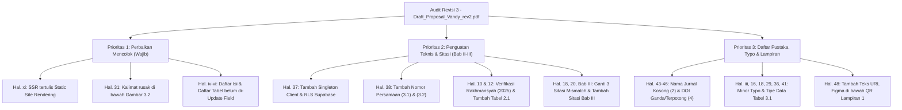

# 📋 LAPORAN AUDIT PROPOSAL SKRIPSI (REVISI 3 — FINALISASI PRA-SEMPRO)
## VERIFIKASI KELENGKAPAN EKSPERIMEN, KONSISTENSI NASKAH, DAN POLESAN AKHIR MENUJU SEMINAR PROPOSAL S1 INFORMATIKA FT UNMUL

**Mahasiswa Bimbingan:** Vandy Rizky Septiawan  
**NIM:** 2309106048 (Angkatan 2023)  
**Program Studi:** S1 Informatika, Fakultas Teknik, Universitas Mulawarman  
**Dosen Pembimbing I:** Prof. Dr. Ir. Hamdani, S.T., M.Cs., IPM  
**Dosen Pembimbing II:** Anton Prafanto, S.Kom., M.T. (NIP: 199310222019031016)  
**Koordinator Program Studi:** Awang Harsa Kridalaksana, S.Kom., M.Kom. (NIP: 19731229 200501 1 002)  
**Judul pada Naskah:** *Komparasi Kinerja Google Sheets API dan Supabase sebagai Data Provider pada Arsitektur Web Next.js*  
**Naskah yang Diaudit:** `Draft_Proposal_Vandy_rev2.pdf` (Diarsipkan sebagai `draft_proposal_vandy_rizky_septiawan_revisi3.pdf` — 60 Halaman Total PDF / 48 Halaman Bernomor Bab)  
**Tanggal Evaluasi:** 23 November 2026  
**Status Evaluasi:** 🟢 **LAYAK ACC BERSYARAT MENUJU SEMINAR PROPOSAL — TINGGAL 1 PUTARAN POLESAN AKHIR (PERBAIKAN MINOR-SEDANG)**

---

> [!NOTE]
> ### 💡 Pesan dari Dosen Pembimbing untuk Vandy:
> *"Halo Vandy, selamat dan apresiasi besar atas kerja kerasmu pada revisi kali ini! Bapak sudah memeriksa seluruh 60 halaman `Draft_Proposal_Vandy_rev2.pdf` dan membandingkannya satu per satu dengan daftar periksa audit sebelumnya.*
>
> *Lompatan kualitas naskahmu sangat luar biasa: kontradiksi `CRUD` vs `Read` dan `Vercel` vs `localhost` sudah tuntas, penjelasan `HTTP 429 fast-fail` dan kuota `Service Account` 60 req/menit sudah sangat matang, jumlah baris data uji (`8 blog, 10 galeri, 17 content`) sudah tertulis jelas, 4 pasang referensi duplikat sudah bersih (52 pustaka tanpa satu pun referensi menganggur!), serta jadwal penelitian sudah tidak mendahului Seminar Proposal.*
>
> *Laporan Revisi 3 ini sengaja Bapak buat **ringkas, langsung ke titik perbaikan, dan dilengkapi kalimat siap pakai**. Ada beberapa kesalahan kecil yang cukup mencolok (seperti kepanjangan `SSR` di Daftar Singkatan, kalimat terpotong di bawah Gambar 3.2, dan Daftar Isi yang belum di-update) serta beberapa penyempurnaan teknis di Bab II–III. Bereskan daftar periksa di bawah ini, lalu temui Bapak untuk verifikasi akhir dan ACC maju Seminar Proposal!"*

---

## 🌟 1. Rekapitulasi Capaian dari Revisi 2 ke Revisi 3

Dari total catatan besar pada Audit Revisi 2 sebelumnya, berikut ringkasan hal-hal penting yang **sudah berhasil kamu tuntaskan**:

| No | Area Perbaikan (Audit Revisi 2) | Kondisi pada `Draft_Proposal_Vandy_rev2.pdf` | Status |
| :---: | :--- | :--- | :---: |
| **1** | Sisa klaim `CRUD` dan `"Halaman Manajemen..."` (Bab I & III) | Seluruh klaim pengujian `CRUD` di Bab I dan penyebutan halaman admin pada wireframe sudah diubah konsisten menjadi operasi **`Read`**. | ✅ **Tuntas** |
| **2** | Metrik `Error Rate` terlupakan di beberapa subbab | Sudah ditambahkan di Manfaat (Hal. 5), Kontribusi (Hal. 6), Penarikan Kesimpulan (Hal. 27), dan Subbab 3.5–3.6. Paragraf duplikat di 3.6.2 juga sudah dihapus. | ✅ **Tuntas** |
| **3** | Kontradiksi Server `Vercel` vs `next start` | Sudah diselaraskan 100%: pengujian dijalankan lokal mode produksi (`next build` & `next start`) pada **Lenovo V14 G4 ABP (Ryzen 7530U, RAM 14 GB, Windows)**. | ✅ **Tuntas** |
| **4** | Kuota *Service Account* (60 req/mnt) & distorsi `HTTP 429` | Sudah dijelaskan lengkap pada Hal. 38 (`fast-fail responses` hanya mengukur `HTTP 200 OK`) dan Hal. 40 (potensi `429` mulai `SK-02`), plus jeda *cool-down* & 3x pengulangan (Hal. 41). | ✅ **Tuntas** |
| **5** | Volume data uji, endpoint spesifik, & kelengkapan Tabel 3.3 | Volume data sudah spesifik (`8 blog`, `10 galeri`, `17 content`), endpoint `/api/{provider}/blog`, `/galeri`, `/content` sudah jelas, dan Tabel 3.3 sudah lengkap kolom *Durasi*, *Think Time*, dan *Thresholds*. | ✅ **Tuntas** |
| **6** | Bab II: paper k6/API, jembatan `http_req_waiting`, sitasi `2.19` | `Fuady & Sutisna (2026)`, `Nanda dkk. (2026)`, dan `Niswar dkk. (2024)` sudah masuk ke Subbab 2.1; jembatan metrik k6 sudah masuk di Hal. 22; Subbab 2.19 sudah bersitasi. | ✅ **Tuntas** |
| **7** | Audit silang Daftar Pustaka & penomoran Bab II + Jadwal | 4 pasang referensi duplikat sudah digabung (**52 pustaka, 0 unused, 0 missing**); halaman Bab II lanjut rapi dari `Hal. 7`; Jadwal `Pengumpulan/Olah Data` digeser ke Desember–Januari. | ✅ **Tuntas** |

---

## 🧭 2. Peta Sisa Temuan yang Wajib Dibersihkan Sebelum Cetak/Sempro

Secara keseluruhan, hanya tersisa **3 kelompok perbaikan cepat** (1 kelompok *wajib sebelum ACC*, 1 kelompok *penguatan teknis Bab II–III*, dan 1 kelompok *perapian formalia & pustaka*):

---

## 🔍 3. Detail Temuan & Solusi Siap Pakai

### 🚨 PRIORITAS 1 — Kesalahan Mencolok yang Langsung Terlihat Penguji (WAJIB DIPERBAIKI)

#### 1. Salah Kepanjangan `SSR` & Typo pada Daftar Singkatan (`Hal. xi` / PDF Hal. 12)
* **Temuan di `Hal. xi`:**
  * Tertulis: `SSR` $\rightarrow$ **`Static Site Rendering`** *(INI SALAH FATAL! Jika dibaca penguji, langsung dipertanyakan pemahaman konsep Next.js-nya).*
  * Tertulis: `PaaS` $\rightarrow$ **`Platforn-as-a-Service`** *(salah ketik huruf `n`)*.
  * Tertulis: `TPS` $\rightarrow$ **`Transaction Per Second`** *(kurang huruf `s`: `Transactions`)*.
  * Singkatan teknis yang sudah dipakai di naskah tetapi belum masuk di Daftar Singkatan: **`RLS`** (*Row-Level Security*), **`REST`** (*Representational State Transfer*), dan **`HTML`** (*Hypertext Markup Language*).
* **✅ Perbaikan:** Ubah `SSR` menjadi **`Server-Side Rendering`**, `PaaS` menjadi **`Platform-as-a-Service`**, `TPS` menjadi **`Transactions Per Second`**, lalu tambahkan `HTML`, `REST`, dan `RLS`.

#### 2. Kalimat Terpotong / Rusak di Bawah `Gambar 3.2` (`Hal. 31` / PDF Hal. 43)
* **Temuan pada paragraf tepat di bawah `Gambar 3.2 Diagram Cara Kerja Sistem` (`Hal. 31`):**
  > *Tertulis:* "Gambar 3.2 mengilustrasikan diagram alur komunikasi antara pengguna, aplikasi Next.js, **dan sedang diuji** (Google Sheets API atau layanan BaaS Supabase). **Respons dari penyedia data.** Interaksi dimulai saat pengguna mengakses antarmuka aplikasi. Permintaan yang membutuhkan pengambilan data diteruskan oleh aplikasi menuju API Routes internal. Selanjutnya, API Routes memproses permintaan tersebut dan meneruskannya kepada **penyedia data yang penyedia data kemudian** dikembalikan ke peladen untuk diproses lebih lanjut, sebelum akhirnya dikirimkan kepada klien untuk menampilkan informasi pada antarmuka pengguna."
* **Mengapa Terjadi?** Terlihat seperti potongan kalimat yang tergeser saat proses penyuntingan di Word. Selain itu, di dalam gambar `Gambar 3.2` masih tertulis `Next.JS` (sedangkan di seluruh naskah sudah diseragamkan `Next.js`).
* **✅ Perbaikan Siap Pakai (Salin & Ganti Paragraf Pertama di Bawah Gambar 3.2):**
  > *"Gambar 3.2 mengilustrasikan diagram alur komunikasi antara pengguna, aplikasi Next.js, dan penyedia data yang sedang diuji (Google Sheets API atau layanan BaaS Supabase). Interaksi dimulai saat pengguna mengakses antarmuka aplikasi. Permintaan yang membutuhkan pengambilan data diteruskan oleh aplikasi menuju API Routes internal. Selanjutnya, API Routes memproses permintaan tersebut dan meneruskannya kepada penyedia data. Respons dari penyedia data kemudian dikembalikan ke peladen untuk diproses lebih lanjut, sebelum akhirnya dikirimkan kepada klien guna menampilkan informasi pada antarmuka pengguna."*  
  *(Jika sempat, perbarui juga label `Next.JS` pada gambar `Gambar 3.2` menjadi `Next.js`.)*

#### 3. Daftar Isi & Daftar Tabel Belum Di-*Update Field* (`Hal. iv–vi` / PDF Hal. 5–7)
* **Temuan:** Kamu sudah memperbaiki judul dan nomor subbab di dalam isi Bab II–III, namun Daftar Isi dan Daftar Tabel belum diperbarui otomatis sehingga masih menampilkan teks lama:
  * `Hal. iv`: `2.7 Aplication Programing Interface (API)` dan `2.8 Next.JS` *(padahal di isi Bab II Hal. 15–16 sudah benar `Application Programming Interface` dan `Next.js`)*.
  * `Hal. iv–v`: `3.5.1 Halaman Beranda`, **`3.5.1 Halaman Blog`** (masih ganda!), `3.5.2 Halaman Galeri` *(padahal di isi Bab III Hal. 32–34 sudah benar `3.5.1`, `3.5.2`, `3.5.3`)*.
  * `Hal. v` & `Hal. vi`: `3.6.2 Pengujian Peforma dengan Grafana K6` dan `Tabel 3. 3 Tabel Skenario Pengujian Peforma` *(masih kurang huruf `r` pada kata `Peforma`, padahal di Hal. 36 & 39 sudah benar `Performa`)*.
* **✅ Perbaikan:** Di Microsoft Word, klik kanan pada **Daftar Isi**, **Daftar Tabel**, dan **Daftar Gambar** $\rightarrow$ pilih **Update Field** $\rightarrow$ **Update entire table**.

---

### ⚙️ PRIORITAS 2 — Penguatan Teknis & Sitasi (Bab II & Bab III)

#### 1. Tambahkan Penjelasan *Singleton Client* & Kebijakan *Row-Level Security* (RLS) Supabase (`Hal. 37`)
Item ini sempat terlewat dari Audit Revisi 2 dan sangat penting untuk mencegah serangan penguji soal keadilan teknis pengujian:
* Jika klien `GoogleAuth` dibuat ulang di dalam *Route Handler* setiap kali ada *request*, maka setiap permintaan memicu pertukaran token OAuth 2.0 baru (menambah latensi ratusan milidetik secara tidak adil).
* Sebaliknya, pada Supabase, penguji perlu tahu bahwa tabel PostgreSQL sudah diberi izin baca (`SELECT`) agar bisa diakses secara setara pada pengujian *Read-only*.
* **✅ Kalimat Siap Pakai (Sisipkan di Hal. 37 setelah kalimat Region Singapura):**
  > *"Untuk menghindari overhead autentikasi berulang pada setiap permintaan, instansiasi klien `googleapis` (Service Account) dan `@supabase/supabase-js` dideklarasikan secara terpusat sebagai module-level singleton agar koneksi dan token autentikasi dapat digunakan kembali (reused) antar-permintaan. Selain itu, karena pengujian difokuskan pada pembacaan data publik (Read), seluruh tabel uji pada Supabase dikonfigurasi dengan kebijakan Row-Level Security (RLS) untuk akses baca publik (`SELECT`)."*

#### 2. Beri Nomor Persamaan `(3.1)` & `(3.2)`, Notasi Filter k6, dan Perapian Tabel 3.1 & 3.2
* **Rumus (`Hal. 38`):**
  * Beri nomor **`(3.1)`** di sisi kanan rumus `Throughput`, dan **`(3.2)`** di sisi kanan rumus `Error Rate`.
  * Tambahkan titik dua setelah kata **`Keterangan:`** di bawah rumus `Error Rate` (pada rumus `Throughput` sudah ada `:`, pada `Error Rate` belum).
  * *(Opsional sangat bagus)* Pada kalimat *fast-fail* HTTP 429 di `Hal. 38`, tambahkan notasi metrik k6-nya: `...dengan status HTTP 200 OK (http_req_duration{expected_response:true}).`
* **Tabel 3.1 (`Hal. 29–30`):**
  * Penjelasan `shortcode` sudah diperjelas—bagus! Namun pada kolom **Tipe Data**, seragamkan istilah `Teks`, `URL`, dan `Teks/URL` menjadi **`TEXT`**, **`TEXT (Format HTML)`**, dan **`TEXT (Format URL)`** agar akurat sebagai tipe data basis data relasional (PostgreSQL) sekaligus kompatibel dengan Google Sheets.
  * Jelaskan 1 kalimat di bawah Tabel 3.1 bahwa atribut `id` berperan sebagai *Primary Key* (dengan `key` sebagai kunci unik pada `content`), serta atribut `max_length` dipertahankan sebagai bagian dari skema konfigurasi CMS meskipun pengujian hanya mengevaluasi operasi *Read*.
* **Tabel 3.2 & Rujukan Huruf Kapital (`Hal. 32–36`):**
  * Ubah penulisan huruf kecil **`gambar 3.3`**, **`gambar 3.4`**, **`gambar 3.5`** (`Hal. 32–34`) dan **`tabel 3.2`** (`Hal. 35`) menjadi huruf kapital di awal (`Gambar 3.3`, `Gambar 3.4`, `Gambar 3.5`, `Tabel 3.2`).
  * Pada `Tabel 3.2` baris 4 (`Hal. 36`), hapus titik setelah angka `4.` agar seragam dengan baris `1, 2, 3, 5`.
  * Pada skenario #5 (`Memilih salah satu gambar dari galeri`), pertegas di kolom *Skenario Pengujian* atau *Hasil yang Diharapkan* apakah aksi ini memanggil endpoint detail `/api/{provider}/galeri/[id]` atau menampilkan detail dari state data yang sudah dimuat (*modal view*).

#### 3. Verifikasi Klaim `Rakhmansyah dkk. (2025)` & Rapikan Subbab 2.1 (`Hal. 7–12`)
* **⚠️ Wajib Cek Ulang PDF Asli `Rakhmansyah dkk. (2025)` (`Hal. 10`):**  
  Pada Poin 8 (`Hal. 10`), naskahmu masih mengklaim bahwa paper tersebut membahas **Supabase PostgreSQL + Supabase Storage terenkripsi + Next.js API Routes + load testing 100 VU (rata-rata 64,5 ms)**. Padahal di Daftar Pustaka (`Hal. 46`), judul artikelnya adalah *"Development Digital Payment Application Using Next.js and Xendit with Prototyping-Agile Approach"*.  
  * **Tindakan wajib:** Buka kembali PDF asli artikel `Rakhmansyah dkk. (2025)`. Jika di dalamnya **memang tidak ada** Supabase maupun pengujian 100 VU (`64,5 ms`), segera perbaiki/ganti poin ke-8 tersebut dengan paper Supabase/Next.js yang sebenarnya agar kamu tidak terjebak pertanyaan penguji di Sempro!
* **Peningkatan Kualitas Subbab 2.1 (`Hal. 7–12`):**
  * Ubah kalimat pembuka 12 poin dari format template kaku (*"1. Metode yang digunakan: ... Temuan Penelitian: ..."*) menjadi narasi ilmiah yang langsung menyebut nama peneliti dan fokus penelitiannya (misal: *"Penelitian oleh Fuady dan Sutisna (2026) membandingkan kinerja arsitektur monolitik dan mikroservis berbasis event-driven menggunakan Grafana k6..."*).
  * Tambahkan **Tabel 2.1 Matriks Perbandingan Penelitian Terkait** di bagian akhir Subbab 2.1 (sebelum atau sesudah paragraf `Perbedaan dengan Penelitian Sebelumnya` di `Hal. 12`) memuat kolom: `No`, `Peneliti & Tahun`, `Objek / Teknologi`, `Metode / Alat Uji`, dan `Hasil Utama`. Ini sangat disukai penguji di FT Unmul!

#### 4. Ganti 3 Sisa Sitasi yang Kurang Nyambung & Tambahkan Sitasi di Bab III
* **3 Sitasi di Bab II yang Masih Perlu Diganti:**
  1. **`Hal. 18` (Subbab 2.12 Cloudinary):** Ganti `(Vanisa & Sandi, 2026)` *(paper aplikasi kasir kedai)* dengan `(Cloudinary, 2026)` atau referensi arsitektur web/CDN.
  2. **`Hal. 20` (Subbab 2.15 Performance Testing):** Ganti `(Kurnia & Huizen, 2026)` *(paper SIM SD dengan Node.js & JWT)* dan `(Aydos dkk., 2022)` *(paper Security Testing, bukan Performance Testing)* dengan referensi yang memang membahas pengujian performa, misalnya **`(Fuady & Sutisna, 2026; Niswar dkk., 2024)`** atau **`(Albuquerque & Correia, 2025)`**.
  3. *(Catatan tambahan: di Hal. 14–15, `Pangestu dkk., 2025` masih dipakai pada kalimat CMS & definisi Data Provider—jika memungkinkan, ganti dengan referensi arsitektur web/CMS seperti `Tanu & Swari (2026)` atau `Widarti & Akbar (2026)`.)*
* **Tambahkan Sitasi di Bab III:**  
  Saat ini seluruh Bab III (`Hal. 24–41`) belum memiliki sitasi. Tambahkan sitasi rujukan yang sudah ada di Daftar Pustaka pada:
  * Metode **Waterfall** di Subbab `3.1` (`Hal. 25`), misalnya merujuk penelitian terdahulu yang menggunakan Waterfall (`Patel, 2023` atau `Maulana & Wismarini, 2026`).
  * Metode **Black-box Testing** di Subbab `3.6.1` (`Hal. 35`), rujuk `(Prameswari dkk., 2026)`.
  * Formulasi metrik **Throughput** dan **Error Rate** di Subbab `3.6.2` (`Hal. 38`), rujuk `(Fuady & Sutisna, 2026; Niswar dkk., 2024)`.

---

### 📚 PRIORITAS 3 — Pembersihan Daftar Pustaka, Typo Minor, & Lampiran

#### 1. Perbaiki 5 Entri Metadata di Daftar Pustaka (`Hal. 43–46`)
1. **`Aditya, W. F. P. (2024)` (`Hal. 43`):** Nama jurnal masih kosong (`...Using Natural Language Processing. 2(2), 89–95.`). Lengkapi nama jurnalnya.
2. **`Prasad, S., & Yadav, R. (2025)` (`Hal. 46`):** Nama jurnal masih kosong (`...Eliminating the Backend Layer. 12(1), 57–71.`). Lengkapi nama jurnalnya.
3. **DOI Ganda & DOI Terpotong:**
   * `Anugerah & Kosasi (2024)` (`Hal. 43`): `https://doi.org/doi.org/10.22303` $\rightarrow$ perbaiki format URL dan lengkapi suffix DOI-nya.
   * `Chakraborty & Aithal (2023)` (`Hal. 44`): `https://doi.org/https://doi.org/10.5281` $\rightarrow$ hapus duplikasi `https://doi.org/` dan lengkapi suffix DOI Zenodo-nya (`10.5281/zenodo.xxxxxxx`).
   * `Chimezie dkk. (2025)` (`Hal. 44`): `https://doi.org/https://doi.org/10.51244` $\rightarrow$ hapus duplikasi `https://doi.org/` dan lengkapi suffix DOI-nya.
   * `Rakhmansyah dkk. (2025)` (`Hal. 46`): `https://doi.org/https://doi.org/10.69533` $\rightarrow$ hapus duplikasi dan lengkapi suffix DOI-nya (jika memang artikel tersebut diganti setelah verifikasi, perbarui entrinya di Mendeley).
4. **`Mushaf, Nur, M. D. J., ... (2025)` (`Hal. 45`):** Rapikan format nama penulis pertama di Mendeley agar konsisten format APA (*Nama Belakang, Inisial.*).

#### 2. Daftar Perbaikan Typo & Tanda Baca Minor
| Lokasi | Tertulis Saat Ini | Perbaikan yang Benar |
| :--- | :--- | :--- |
| **Hal. iii** (Kata Pengantar) | `Samarinda, 5 Oktober 2026` | Perbarui menjadi **`Samarinda, November 2026`** |
| **Hal. 16** (Subbab 2.8, baris 13) | `fetching kedua lingkungan backend` | **`fetching dari kedua lingkungan backend`** |
| **Hal. 18** (Subbab 2.12, baris 3) | `Fungsi fungsionalitas platform ini` | **`Fungsionalitas platform ini`** |
| **Hal. 36** (Subbab 3.6.2, baris 4) | `di mana ketige metrik tersebut` | **`di mana ketiga metrik tersebut`** |
| **Hal. 41** (Subbab 3.7, baris 2–3) | `tahun 2027 Adapun ... Universitas Mulawarman , sedangkan` | **`tahun 2027. Adapun ... Universitas Mulawarman, sedangkan`** *(tambah titik setelah `2027`, hapus spasi sebelum koma)* |

#### 3. Lampiran 1 (`Hal. 48` / PDF Hal. 60)
* Cantumkan **tautan URL teks Figma** tepat di bawah gambar QR Code pada `Lampiran 1` agar penguji yang memeriksa naskah cetak/PDF tidak kesulitan mengakses wireframe tanpa memindai QR Code. (Pastikan juga nama proyek di Figma sudah dinamai resmi, bukan `Untitled`).
* *(Sangat disarankan)* Tambahkan **Lampiran 2: Rancangan Skrip Pengujian Grafana k6 (`load-test.js`)** atau contoh skema JSON respons endpoint agar penguji langsung melihat kesiapan implementasi skrip eksperimenmu.

---

## ✅ 4. Checklist Final Sebelum Mengajukan Tanda Tangan ACC Sempro

Pastikan seluruh kotak di bawah ini sudah kamu centang sebelum mengirim berkas final (`Draft_Proposal_Vandy_rev3.pdf`):

- [ ] **Checklist 1 (Wajib):** Mengoreksi `SSR` menjadi **`Server-Side Rendering`**, `PaaS` menjadi **`Platform-as-a-Service`**, `TPS` menjadi **`Transactions Per Second`**, serta menambahkan `HTML`, `REST`, dan `RLS` di **Daftar Singkatan (`Hal. xi`)**.
- [ ] **Checklist 2 (Wajib):** Memperbaiki kalimat terpotong di bawah **`Gambar 3.2` (`Hal. 31`)** dan mengubah label `Next.JS` di gambar menjadi `Next.js`.
- [ ] **Checklist 3 (Wajib):** Menjalankan **Update Field** pada **Daftar Isi, Daftar Tabel, dan Daftar Gambar** agar judul (`Performa`, `Next.js`, `Application Programming Interface`) dan nomor subbab (`3.5.1`, `3.5.2`, `3.5.3`) sinkron 100%.
- [ ] **Checklist 4:** Menambahkan penjelasan **module-level singleton client** dan **kebijakan RLS (`SELECT`) Supabase** di `Hal. 37`, memberi nomor persamaan **`(3.1)` & `(3.2)`** di `Hal. 38`, merapikan tipe data **`TEXT`** di Tabel 3.1, serta mengubah rujukan `gambar/tabel` huruf kecil menjadi huruf kapital.
- [ ] **Checklist 5:** Memverifikasi isi PDF asli **`Rakhmansyah dkk. (2025)`**, mengganti 3 sitasi *mismatch* (`Vanisa & Sandi`, `Aydos dkk.`, `Kurnia & Huizen`), menambahkan sitasi di Bab III + **Tabel 2.1 Matriks Penelitian Terkait**, serta melengkapi 2 nama jurnal kosong & 4 DOI di Daftar Pustaka.
- [ ] **Checklist 6:** Membersihkan 5 typo minor (`Hal. iii, 16, 18, 36, 41`) dan mencantumkan tautan teks URL Figma di bawah QR Code `Lampiran 1` (`Hal. 48`).

---

## 🎯 5. Kesimpulan Evaluasi Dosen Pembimbing

> **Vandy, progresmu dari draf pertama hingga `rev2` ini patut diacungi jempol!**  
> Secara struktur keilmuan dan rancangan eksperimen Grafana k6, proposal ini sudah sangat layak untuk dibawa ke meja **Seminar Proposal S1 Informatika FT Unmul**. Selesaikan 6 poin *checklist* polesan akhir di atas (estimasi pengerjaan 1–2 jam), pastikan kasus paper `Rakhmansyah dkk. (2025)` sudah terverifikasi, lalu kirimkan naskah finalnya untuk ACC maju Sempro. Semangat, tinggal selangkah lagi! 🚀

---

**Samarinda, 23 November 2026**  
**Dosen Pembimbing II,**  
**Anton Prafanto, S.Kom., M.T.**  
*NIP: 199310222019031016*
