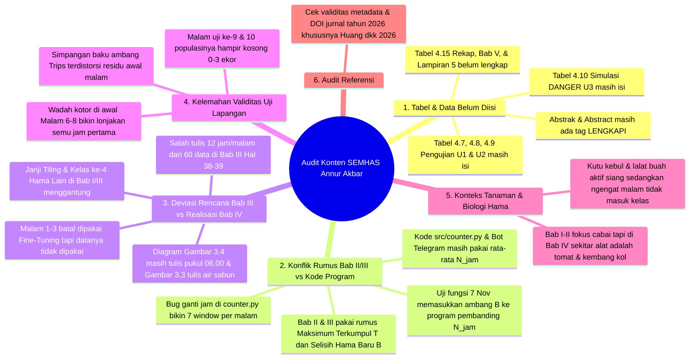

# 📋 LAPORAN AUDIT KONTEN & PANDUAN REVISI DRAF SEMINAR HASIL (SEMHAS)

**Mahasiswa Bimbingan:** Muhammad Annur Akbar  
**NIM:** 2309106110  
**Program Studi:** S1 Informatika, Fakultas Teknik, Universitas Mulawarman  
**Dosen Pembimbing I:** Anton Prafanto, S.Kom., M.T. (NIP: 199310222019031016)  
**Dosen Pembimbing II:** Ir. Novianti Puspitasari, S.Kom., M.Eng. (NIP: 198811062015042002)  
**Dosen Penguji I:** Awang Harsa Kridalaksana, S.Kom., M.Kom.  
**Dosen Penguji II:** Medi Taruk, M.Cs.  
**Judul Skripsi:** *Rancang Bangun Perangkap Hama Cahaya Berbasis Raspberry Pi 4 dengan Algoritma YOLOv5*  
**Dokumen yang Diaudit:** `Draf SEMHAS Muhammad Annur Akbar 2.pdf` -> Disalin ke `audit_mahasiswa/draft_semhas_annur_akbar.pdf` (116 Halaman PDF / 100 Halaman Bernomor)  
**Tanggal Evaluasi:** 12 November 2026  
**Fokus Audit:** Substansi & Konten Ilmiah (Alur Logika, Algoritma, Konsistensi Bab I–V, Pengolahan Data, dan Validitas Pengujian)  
**Status Evaluasi:** **BELUM ACC SEMHAS — WAJIB MELENGKAPI DATA U1–U3 & MENYINKRONKAN LOGIKA PROGRAM DENGAN RUMUS BAB II/III**

---

> [!IMPORTANT]
> **Pesan Dosen Pembimbing I untuk Muhammad Annur Akbar:**  
> Secara keseluruhan, kerja kerasmu di lapangan (10 malam pengambilan data di Balai Tani ECO-STEP Lapangan Semberah, wawancara berlapis dengan petani mitra, perakitan perangkat keras, dan kejujuran akademik dalam melaporkan kendala nyata di lapangan) **sangat kami apresiasi**. Alur bahasa penjelasanmu juga sangat runtut dan mudah dipahami.  
> Namun, sebelum draf ini dapat di-ACC untuk maju **Seminar Hasil (SEMHAS)**, terdapat **6 kelompok temuan konten** yang harus kamu selesaikan terlebih dahulu agar kamu aman dari cecaran penguji saat sidang. Ikuti panduan dan *checklist* di bawah ini langkah demi langkah.

---

## 🌟 1. Apresiasi Kekuatan Draf Saat Ini

1. **Bukti Empiris Lapangan Sangat Kuat:** Pengambilan data dilakukan langsung di lahan pertanian selama 10 malam penuh (240 citra terekam 100% tanpa putus), dilengkapi surat izin resmi dan 3 tahap wawancara tertulis bertanda tangan ketua kelompok tani (Lampiran 1 & 3).
2. **Kejujuran Ilmiah (*Scientific Integrity*):** Kamu tidak memanipulasi data ketika terjadi perbedaan kondisi di lapangan (seperti kutu kebul yang 0 deteksi karena aktif siang hari, penggantian air sabun menjadi minyak goreng, serta tanaman di sekitar perangkap yang sedang fase tumpang sari tomat dan kembang kol).
3. **Pengujian Keandalan Sistem & Perangkat Keras Lengkap:** Pengujian waktu inferensi ONNX Runtime (rata-rata 1,22 detik/citra), suhu CPU Raspberry Pi 4 (maksimal 62,8 °C), waktu tunda Telegram (12,8 detik), dan mekanisme *offline queueing* saat Wi-Fi terputus (U4–U7) sudah tuntas dan datanya sangat meyakinkan.

---

## 🚨 2. Ringkasan 6 Temuan Utama Konten (Yang Wajib Diperbaiki)



| No | Kategori Temuan | Lokasi Halaman | Tingkat Urgensi | Ringkasan Masalah |
| :---: | :--- | :---: | :---: | :--- |
| **1** | **Bagian Hasil Uji Masih Kosong (`[isi]`)** | Hal. v, vi, 63–65, 70, 75–76, 98 | 🚨 **Wajib Selesai (Blocker)** | Hasil pengujian inti **U1 (Deteksi Lapangan)**, **U2 (MAE Penghitungan)**, dan **U3 (Simulasi Peringatan DANGER)** masih berupa teks `[isi]` dan `[LENGKAPI]`. |
| **2** | **Ketidaksinkronan Rumus Bab II/III vs Kode `counter.py`** | Hal. 19, 38, 54, 62, 65–66, 93–94, 96 | 🚨 **Sangat Kritis** | Bab II & III merumuskan jumlah terkumpul $T_{h,c}$ dan hama baru $B_{h,c}$, tetapi kode `src/counter.py` dan tampilan Telegram masih menghitung rata-rata `N_jam`. Selain itu ada *bug* pergantian jam pada menit `:00` yang memecah 6 jam menjadi 7 *window*. |
| **3** | **Ketidaksinkronan Bab III vs Bab IV** | Hal. 5, 31, 34–39, 42, 53 | ⚠️ **Mayor** | (a) Malam 1–3 batal dipakai *fine-tuning* model; (b) Bab III hal. 38–39 salah menulis `12 nilai/malam` dan `60 nilai` (seharusnya `6 nilai/malam` dan `30 nilai`); (c) Gambar 3.4 masih tertulis `pukul 06.00` dan Gambar 3.3 tertulis `air bersabun`. |
| **4** | **Validitas Pemilihan Malam Uji & Bias Ambang** | Hal. 52, 54–56, 63–65, 97–98 | ⚠️ **Mayor** | (a) Malam ke-9 & 10 yang dipakai untuk uji U1–U3 kebetulan hampir kosong (0–3 ekor), sehingga tidak menguji kondisi padat/DANGER; (b) Lonjakan trips pada foto pertama pukul 18.15 di Malam 6–8 (akibat wadah belum bersih/hama masuk sore) mendistorsi nilai ambang $\mu + \sigma$. |
| **5** | **Keselarasan Konteks Tanaman & Biologi Hama** | Hal. 1–5, 10–12, 51, 72–74 | ⚠️ **Sedang** | Bab I–II hanya menyebut lahan cabai, baru di Bab IV dijelaskan bahwa di sekitar alat adalah tomat dan kembang kol. Perlu diselaraskan sejak Bab I. |
| **6** | **Verifikasi Sitasi 2026** | Hal. 10, 78 | ℹ️ **Minor** | Perlu cek ulang nomor *issue* dan keaktifan DOI pada pustaka `Huang, D. dkk. (2026)` di jurnal *Agronomy*. |

---

## 🔍 3. Penjelasan Detail & Cara Memperbaikinya

### Temuan 1: Tabel dan Narasi Hasil Pengujian U1, U2, dan U3 Masih Kosong (`[isi]`)
Pada draf saat ini, pembaca dan penguji belum bisa melihat hasil akhir dari Rumusan Masalah 2 dan 3 karena bagian-bagian berikut masih kosong:
* **Abstrak & Abstract (Hal. v & vi):** Masih ada kalimat `[LENGKAPI: hasil MAE penghitungan terhadap hitungan manual (U2) setelah data Raspberry Pi diolah.]`
* **Tabel 4.7, Tabel 4.8, dan Tabel 4.9 (Hal. 63–64):** Seluruh sel masih tertulis `[isi]`, diikuti catatan `[LENGKAPI: uraian hasil Tabel 4.8 dan 4.9 setelah hitungan manual dan arahan pembimbing tersedia.]`
* **Tabel 4.10 (Hal. 65):** Hasil simulasi 36 keputusan AMAN/DANGER masih `[isi]`.
* **Tabel 4.15 (Hal. 70), Bab V Kesimpulan (Hal. 75–76), & Lampiran 5 (Hal. 98):** Masih memuat placeholder `[isi]` dan `[LENGKAPI]`.

**👉 Cara Memperbaiki:**
1. Lakukan pelabelan/hitungan manual (*ground truth*) pada citra uji lapangan.
2. Hitung metrik deteksi lapangan (**Tabel 4.8**: *Precision, Recall, F1-score, mAP@0.5*) dan selisih hitung **MAE** (**Tabel 4.9**) menggunakan Persamaan (2.11).
3. Bandingkan keputusan AMAN/DANGER dari hitungan manual vs hitungan sistem untuk mengisi **Tabel 4.10** (berapa peringatan tepat, palsu, dan terlewat).
4. Salin angka hasil akhirnya ke **Tabel 4.15**, **Abstrak/Abstract**, **Bab V Kesimpulan**, dan lampirkan tabel rincian per fotonya di **Lampiran 5**.

---

### Temuan 2: Konflik Rumus di Bab II/III ($T_{h,c}$ & $B_{h,c}$) vs Program di Alat (`N_jam`) + *Bug* Jendela Jam

Di dalam naskah terdapat "dua sistem perhitungan yang berbeda":
1. **Menurut Bab II (Subbab 2.6.3, Hal. 19) & Bab III (Hal. 38):**  
   Karena wadah minyak goreng bersifat menumpuk (kumulatif), jumlah hama terkumpul sampai akhir jam ke-$h$ dihitung dengan nilai maksimum:
   $$T_{h,c} = \max_{k \le 4h} C_{k,c}$$
   dan jumlah hama baru pada jam ke-$h$ dihitung dari selisihnya:
   $$B_{h,c} = T_{h,c} - T_{h-1,c}$$
   Lalu status `DANGER` ditentukan jika $B_{h,c} > \text{Ambang}_c$.
2. **Menurut Kode Program `src/counter.py` (Lampiran 4, Hal. 93–94) & Bot Telegram (Gambar 4.8–4.10):**  
   Program yang berjalan di Raspberry Pi **belum di-update** ke rumus $T_{h,c}$ dan $B_{h,c}$. Program masih menggunakan rumus lama yaitu `N_jam` (rata-rata jumlah deteksi dari 4 foto dalam satu jam: $\text{N\_jam} = \frac{1}{K}\sum D_{k,c}$).
3. **Masalah Pencampuran Satuan pada Uji Fungsi 7 November 2026 (Hal. 65):**  
   Pada Tabel 4.5 (Hal. 55), kamu menghitung ambang menggunakan data **Hama Baru ($B_{h,c}$)** dan memperoleh ambang: Lalat buah = `2 ekor/jam`, Trips = `33 ekor/jam`, Kutu kebul = `1 ekor/jam`.  
   Namun pada 7 November 2026 (Hal. 65), kamu memasukkan angka `2.0`, `33.0`, dan `1.0` tersebut ke berkas `ambang.json` di Raspberry Pi yang masih membandingkannya dengan **`N_jam` (rata-rata kumulatif)**. Padahal nilai `N_jam` dan nilai $B_{h,c}$ berbeda arti:
   * Misalkan pada jam pertama masuk 35 ekor trips dan bertahan di wadah sampai jam ke-6 tanpa ada trips baru lagi.
   * Menurut rumus $B_{h,c}$ (hama baru), jam ke-2 s.d. jam ke-6 bernilai **0 ekor baru** (Status: **AMAN**).
   * Tetapi menurut `N_jam` (rata-rata isi wadah), jam ke-2 s.d. jam ke-6 tetap bernilai **35 ekor** (> 33), sehingga alat akan terus-menerus membunyikan alarm **DANGER palsu** sepanjang malam!
4. ***Bug* Pemotongan Jendela Waktu pada Menit `:00` di `src/counter.py` (Hal. 94 & Tabel L5.1 Hal. 96):**  
   Perhatikan **Tabel L5.1 (Hal. 96–97)**: setiap malam terpecah menjadi **7 jendela waktu**, yaitu:
   * `18.15–18.45` (hanya 3 citra)
   * `19.00–19.45` (4 citra)
   * ...
   * `24.00` (hanya 1 citra sendirian)  
   Hal ini terjadi karena pada `src/counter.py` baris:
   ```python
   elif waktu.hour != self._jam_berjalan:
       hasil_tertutup = self.tutup_window()
   ```
   Ketika foto ke-4 pada jam pertama diambil tepat pukul `19:00`, nilai `waktu.hour` sudah berubah dari `18` menjadi `19`. Akibatnya, foto pukul `19:00` tidak masuk ke jendela pertama (`18.15–19.00`), melainkan menutup jendela pertama (yang baru berisi 3 foto) dan masuk ke jendela kedua!

**👉 Cara Memperbaiki:**
1. **Perbarui kode `src/counter.py` dan format pesan `/report` di Raspberry Pi** agar langsung menghitung dan menampilkan **Jumlah Terkumpul ($T_{h,c}$)** dan **Hama Baru per Jam ($B_{h,c}$)** sesuai rancangan Gambar 3.5 dan Gambar 3.6, serta membandingkan ambang terhadap $B_{h,c}$.
2. **Perbaiki logika penutupan *window* 1 jam** di `counter.py` (misalnya tutup *window* ketika `len(self._buffer) == 4` atau gunakan penggeseran 1 menit `(waktu - timedelta(minutes=1)).hour` sehingga foto pukul `19:00` tetap dihitung sebagai foto ke-4 dari jam `18.00–19.00`, dan menghasilkan tepat **6 jendela waktu × 4 foto = 24 foto** per malam).
3. Setelah `counter.py` diperbaiki, jalankan ulang uji fungsi singkat untuk mengambil *screenshot* baru **Gambar 4.8, 4.9, dan 4.10** yang sudah menampilkan *Hama Baru* dan *Jumlah Terkumpul* (atau jika tetap mempertahankan cerita sejarah perbedaan `N_jam` di lapangan, pastikan kode di Lampiran 4 dan uji fungsi tanggal 7 November sudah menggunakan kode yang telah diperbaiki/disinkronkan).

---

### Temuan 3: Deviasi Rencana Metodologi (Bab III) vs Pelaksanaan (Bab IV)

Penguji selalu mencocokkan apa yang kamu janjikan di Bab III dengan apa yang kamu laporkan di Bab IV. Saat ini ada 4 ketidaksinkronan:

1. **Rencana Pelatihan Ulang (*Fine-Tuning*) Malam ke-1 s.d. ke-3 yang Tidak Dilakukan:**
   * Di **Tabel 3.5 (Hal. 35)** tertulis bahwa 48 foto Malam ke-1 & 2 diberi label untuk melatih ulang model, dan 24 foto Malam ke-3 untuk validasi lapangan.
   * Di **Bab IV (Hal. 53)** tertulis: *"Pelatihan ulang tersebut belum dilakukan, sehingga model yang dipakai selama sepuluh malam adalah model pada Tabel 4.2 yang hanya dilatih dengan data Roboflow Universe."*
   * **Opsi Penyelesaian (Pilih salah satu):**
     * **Opsi A (Paling Kuat Secara Ilmiah):** Ambil 72 foto dari Malam 1–3, beri anotasi kotak di Roboflow, lalu lakukan *fine-tuning* model YOLOv5n selama 50 epoch di laptopmu. Setelah itu, jalankan inferensi ulang (*re-run inference script*) menggunakan bobot baru tersebut terhadap rekaman foto Malam 4–10 yang sudah tersimpan di microSD/laptop! Karena seluruh 240 foto asli malam ke-1 s.d. ke-10 sudah tersimpan, kamu **tidak perlu turun ke lapangan lagi**, cukup mengolah ulang file citranya di laptop/Raspberry Pi. Ini akan membuat nilai *confidence* dan akurasi U1 & U2 melonjak drastis karena model sudah mengenali latar baki biru berlampu UV!
     * **Opsi B (Jika Tidak Sempat *Fine-Tuning*):** Ubah Tabel 3.5 di Bab III agar tidak menjanjikan pelatihan ulang yang batal dilakukan (misalnya Malam 1–3 digunakan sebagai *uji coba dan kalibrasi penempatan perangkat/penggantian media air sabun ke minyak goreng* atau digabung ke malam pengamatan), sehingga tidak ada janji metodologi yang dilanggar di Bab IV.
2. **Salah Tulis Jumlah Data Pengamatan Awal (*Baseline*) di Bab III (Hal. 38 & Tabel 3.6 Hal. 39):**
   * Pada **Hal. 38 paragraf terakhir** tertulis: *"Setiap malam menghasilkan 12 nilai hama baru per jam untuk setiap jenis hama, sehingga lima malam menghasilkan 60 nilai per jenis hama."*
   * Pada **Tabel 3.6 (Hal. 39)** kolom `Jumlah Data (Jam)` tertulis **`60`**.
   * Padahal operasi malam hanya **6 jam** (pukul 18.00–24.00), sehingga 5 malam menghasilkan **6 nilai/malam × 5 malam = 30 nilai per jenis hama** (sebagaimana sudah benar kamu tulis di **Bab IV Hal. 54 dan Tabel 4.4 Hal. 55**).
   * **Tindakan:** Ubah angka `12` menjadi **`6`** dan angka `60` menjadi **`30`** pada Hal. 38 dan Tabel 3.6 (Hal. 39).
3. **Gambar Bab III yang Belum Mengikuti Revisi Teks:**
   * **Gambar 3.3 (Hal. 31):** Keterangan nomor `3` di bawah gambar masih tertulis **`Wadah penampung berisi air bersabun`**, padahal di seluruh teks Bab II, III, dan IV sudah menggunakan **`minyak goreng`**. Edit teks keterangan pada gambar tersebut menjadi *"Wadah tangkapan berisi minyak goreng"*.
   * **Gambar 3.4 (UML Activity Diagram, Hal. 37):** Belah ketupat paling bawah masih tertulis **`Sudah pukul 06.00?`**, padahal di teks Hal. 38 butir 9 jam operasional berakhir pukul **`24.00`**. Ubah teks di dalam diagram menjadi **`Sudah pukul 24.00?`**.
   * **Gambar 3.6 (Hal. 42):** Kotak paling bawah (*Notifikasi susulan*) menulis contoh jam **`00.00-01.00`** dan **`01.00-02.00`**. Karena jam kerja alat adalah `18.00–24.00`, ganti contoh jam pada gambar tersebut menjadi misalnya **`19.00-20.00`** dan **`20.00-21.00`**.
4. **Janji *Tiling* dan Kelas `"hama lain"` di Bab I & III:**
   * Di **Hal. 36** tertulis: *"Apabila ketepatan deteksi trips dan kutu kebul masih rendah, diterapkan teknik tiling..."*, namun teknik *tiling* tidak diterapkan di Bab IV dan malah menjadi saran di Bab V (Hal. 76). Sebaiknya kalimat di Hal. 36 tidak ditulis sebagai janji pasti, melainkan dijelaskan bahwa *ukuran masukan diperbesar ke 1280 piksel untuk menjaga keterbacaan objek kecil tanpa membebani CPU dengan proses tiling*.
   * Di **Batasan Masalah butir 2 (Hal. 5)** dan **Subbab 3.3 (Hal. 34)** disebutkan penyiapan kelas ke-4 `"hama lain"`. Karena sampai akhir penelitian hanya digunakan 3 kelas (`fruit_fly`, `thrips`, `whitefly`), rapikan kalimat tersebut agar konsisten 3 kelas.

---

### Temuan 4: Strategi Mengatasi Kelemahan Data Malam Uji (Malam 9–10) dan Bias Wadah Awal Malam

1. **Masalah Malam ke-9 & ke-10 yang Terlalu Sepi Hama:**
   * Coba perhatikan **Tabel L5.2 (Hal. 98)**: pada Malam ke-9 dan ke-10, total deteksi sepanjang malam hanya **1–3 ekor**.
   * Jika kamu hanya menguji U1, U2, dan U3 pada Malam ke-9 dan ke-10:
     * Penguji akan mempertanyakan: *"Bagaimana kami tahu sistemmu akurat menghitung puluhan hama jika pada malam ujian yang dihitung hanya 0 sampai 3 ekor?"*
     * Selain itu, pada simulasi U3 (Tabel 4.10), tidak akan ada satu pun jam yang berstatus `DANGER` (0 kejadian positif dari 36 jam).
   * **👉 Solusi Cerdas:**  
     Susun ulang pembagian malam untuk evaluasi atau perluas sampel uji U1–U3! Misalnya, sertakan salah satu malam yang padat hama (seperti **Malam ke-5** yang memiliki variasi 35, 51, 11, dan 12 hama baru per jam, atau gunakan Malam 1–4 & 6 sebagai *baseline* 5 malam dan Malam 5 & 10 sebagai malam uji). Dengan menyertakan malam yang padat hama ke dalam pengujian U1, U2, dan U3:
     * Pengujian deteksi (U1) dan MAE (U2) menjadi sangat berbobot karena menguji kondisi hama sedikit sekaligus kondisi hama banyak.
     * Simulasi DANGER (U3 pada Tabel 4.10) akan memiliki kejadian `DANGER` nyata yang berhasil dideteksi oleh sistem!
2. **Masalah Lonjakan Semu pada Jam Pertama (`18.00–19.00`) di Malam ke-6, ke-7, dan ke-8:**
   * Pada **Tabel L5.2 (Hal. 98)**, terlihat pada Malam ke-6 (`B Trips = 79`), Malam ke-7 (`B Trips = 86`), dan Malam ke-8 (`B Trips = 22`) seluruh pertambahan hama terjadi di jam pertama (`18.00–19.00`), sedangkan jam ke-2 sampai ke-6 (`19.00–24.00`) nilainya `0, 0, 0, 0, 0`.
   * Sebagaimana kamu catat di Tabel 4.3 (Hal. 52), pada pukul 18.15 (foto pertama) jumlah trips di wadah memang sudah puluhan ekor (kemungkinan masuk antara pukul 17.00–18.00 saat wadah baru dipasang atau sisa kemarin yang belum bersih).
   * **👉 Solusi Analitis:**  
     Jika kamu mendefinisikan $T_{0,c}$ (jumlah awal pada pukul 18.00/18.15) sebagai jumlah serangga yang sudah ada pada foto pertama awal malam (atau membahas secara tajam di Subbab 4.1.3 dan 4.5 bahwa angka jam pertama mencakup tangkapan sore pukul 17.00–18.15 sejak wadah diletakkan petani), maka analisis statistikmu akan jauh lebih kuat dan tidak mudah diserang penguji.

---

### Temuan 5: Penyelarasan Narasi Tanaman (Cabai vs Tomat & Kembang Kol)

* Di **Bab I dan Bab II**, seluruh cerita berfokus pada **tanaman cabai**.
* Di **Bab IV (Hal. 51 & 74)**, kamu menjelaskan dengan jujur bahwa pada saat pengambilan data (11–21 Oktober 2026), titik perangkap L3 dikelilingi oleh tanaman **tomat dan kembang kol** yang sedang berbunga, sedangkan cabai baru dipindah tanam tanggal 14 Oktober 2026 di blok lahan sebelahnya.
* **👉 Cara Memperbaiki:**  
  Jangan biarkan informasi ini muncul mendadak di Bab IV seperti "kejutan". Tambahkan 2–3 kalimat penjelasan di **Bab I (Subbab 1.1 Latar Belakang & Subbab 1.3 Batasan Masalah butir 6)** dan **Bab III (Subbab 3.1/3.2)** bahwa lahan Balai Tani ECO-STEP merupakan lahan hortikultura cabai yang menerapkan pola rotasi/tumpang sari dengan tanaman sekeluarga (*Solanaceae*/hortikultura seperti tomat dan kembang kol) yang diserang oleh jenis hama sasaran yang sama. Dengan begitu, narasi dari Bab I sampai Bab V menjadi satu kesatuan yang utuh.

---

### Temuan 6: Verifikasi Daftar Pustaka Tahun 2026

* Periksa kembali Daftar Pustaka nomor 9 (Hal. 78):  
  `Huang, D., Lei, M., Zhang, Z., He, Z., Zhan, W., & Zhang, Y. (2026). Research on Thrips Object Detection and Counting Algorithms in Leaf Backgrounds. Agronomy, 16(17), 1709. https://doi.org/10.3390/agronomy16171709`
* Pastikan artikel dan tautan DOI tersebut benar-benar valid dan dapat dibuka (tidak *broken link* atau salah ketik tahun/volume, misalnya apakah terbit tahun 2024/2025/2026).

---

## ✅ 4. Checklist Urutan Pengerjaan Revisi untuk Annur Akbar

Gunakan daftar centang ini saat mengerjakan revisi agar tidak ada yang terlewat:

- [ ] **Langkah 1 (Data & Eksperimen):** Putuskan mengenai *fine-tuning* Malam 1–3 (Opsi A: *fine-tune* & olah ulang citra Malam 4–10, atau Opsi B: sesuaikan narasi Bab III).
- [ ] **Langkah 2 (Hitungan Manual Ground Truth):** Selesaikan penghitungan manual pada 48 foto uji, lalu hitung metrik U1 (*Precision, Recall, F1, mAP@0.5*), U2 (*MAE*), dan U3 (*Simulasi Keputusan AMAN/DANGER*).
- [ ] **Langkah 3 (Sinkronisasi Kode Program):** Perbaiki `src/counter.py` agar menghitung $T_{h,c}$ dan $B_{h,c}$ sesuai Persamaan (2.8)–(2.9) serta memperbaiki *bug* pergantian jam pada menit `:00`. Perbarui tampilan Lampiran 4.
- [ ] **Langkah 4 (Lengkapi Seluruh Tabel & Placeholder):** Isi seluruh bagian `[isi]` dan `[LENGKAPI]` pada:
  - [ ] Abstrak & Abstract (Hal. v–vi)
  - [ ] Tabel 4.7, Tabel 4.8, Tabel 4.9 + paragraf pembahasannya (Hal. 63–64)
  - [ ] Tabel 4.10 (Hal. 65)
  - [ ] Tabel 4.15 (Hal. 70)
  - [ ] Bab V Kesimpulan butir 2 & 3 (Hal. 75–76)
  - [ ] Lampiran 5 (Hal. 98)
- [ ] **Langkah 5 (Sinkronisasi Angka & Gambar Bab I–III):**
  - [ ] Ubah `12 nilai` menjadi `6 nilai` dan `60` menjadi `30` di Bab III (Hal. 38 & Tabel 3.6 Hal. 39).
  - [ ] Perbaiki keterangan nomor 3 pada **Gambar 3.3** (Hal. 31) dari `air bersabun` menjadi `minyak goreng`.
  - [ ] Perbaiki syarat berhenti pada **Gambar 3.4** (Hal. 37) dari `Sudah pukul 06.00?` menjadi `Sudah pukul 24.00?`.
  - [ ] Perbaiki contoh jam pada **Gambar 3.6** (Hal. 42) agar berada di dalam rentang `18.00–24.00`.
  - [ ] Selaraskan penjelasan rotasi/tumpang sari tanaman cabai, tomat, dan kembang kol di Bab I dan Bab III.
  - [ ] Pastikan *field* Daftar Tabel di MS Word (`TOC \h \z \t "JudulTabel,5"` yang bocor tercetak di awal Hal. x) dirapikan dan di-*update* (`Ctrl+A` lalu `F9`).

---

## 🎤 5. Simulasi Pertanyaan Penguji Saat Seminar Hasil (Persiapan Sidang)

Pelajari 5 pertanyaan kunci berikut yang kemungkinan besar akan ditanyakan oleh Pak Awang Harsa Kridalaksana (Penguji I) dan Pak Medi Taruk (Penguji II):

1. **Pertanyaan Algoritma Penghitungan:**  
   *"Di perangkapmu, serangga yang jatuh pukul 18.30 akan terus menempel di minyak goreng sampai pukul 24.00. Bagaimana caramu memastikan serangga yang sama tidak terhitung berkali-kali pada foto pukul 19.00, 20.00, dan seterusnya tanpa menggunakan algoritma Multi-Object Tracking (MOT)?"*  
   **💡 Poin Jawaban:** Jelaskan mekanisme Persamaan (2.8) dan (2.9): sistem mengambil nilai maksimum kumulatif $T_{h,c}$ dari 4 foto dalam satu jam untuk meredam fluktuasi deteksi (misal saat ada serangga yang sesaat tertutup bayangan/serangga lain), lalu mengurangi $T_{h,c}$ pada jam tersebut dengan $T_{h-1,c}$ pada jam sebelumnya untuk mendapatkan jumlah hama yang benar-benar baru datang ($B_{h,c}$).
2. **Pertanyaan Kinerja Model (Domain Shift):**  
   *"Mengapa nilai mAP@0.5 pada data uji Roboflow mencapai 72,8%, tetapi saat dipasang di lapangan nilai confidence untuk trips turun menjadi 0,27–0,40 dan gumpalan bangkai serangga sempat terbaca sebagai lalat buah?"*  
   **💡 Poin Jawaban:** Jelaskan perbedaan karakteristik visual (*domain shift*) antara dataset publik Roboflow Universe (yang mayoritas diambil pada pencahayaan terang atau *yellow sticky trap*) dengan citra lapangan yang diambil malam hari di bawah pendaran cahaya lampu UV biru pada baki biru berisi minyak goreng, serta ukuran fisik trips (~1 mm) yang hanya menempati beberapa piksel dari jarak kamera 30 cm.
3. **Pertanyaan Biologi Hama vs Efektivitas Alat:**  
   *"Mengapa kutu kebul tidak terdeteksi sama sekali (0 ekor) dan lalat buah sangat sedikit selama 10 malam, padahal petani mengeluhkan ketiga hama tersebut?"*  
   **💡 Poin Jawaban:** Jelaskan bahwa kutu kebul dan lalat buah bersifat *diurnal* (aktif pada siang hari dan lebih tertarik pada warna kuning atau atraktan aroma petrogenol), sedangkan *light trap* berlampu UV bekerja pada malam hari memanfaatkan sifat *fototaksis positif* serangga malam. Itulah sebabnya tangkapan didominasi oleh trips (dan ngengat malam), sesuai dengan pengamatan petani di lapangan.
4. **Pertanyaan Komputasi Edge (Raspberry Pi 4):**  
   *"Apakah Raspberry Pi 4 tanpa GPU diskrit dan tanpa akselerator (seperti Google Coral) sanggup menjalankan YOLOv5 dengan ukuran input 1280 piksel sepanjang malam tanpa mengalami overheat (thermal throttling)?"*  
   **💡 Poin Jawaban:** Tunjukkan hasil pengujian U6 (Tabel 4.13): karena sistem bersifat *time-lapse* (1 foto setiap 15 menit, bukan video *real-time* 30 FPS) dan model diekspor ke format **ONNX Runtime**, waktu inferensi hanya membutuhkan rata-rata **1,22 detik** (memakai ~294% dari 400% kapasitas 4 core CPU selama ~2 detik, lalu kembali *idle* 96% selama 14 menit 58 detik berikutnya). Suhu maksimum tercatat **62,8 °C**, masih jauh di bawah ambang *thermal throttling* Raspberry Pi 4 (80 °C).
5. **Pertanyaan Penetapan Ambang Peringatan:**  
   *"Mengapa kamu menggunakan rumus $\mu + \sigma$ dari pengamatan lapangan, bukan menggunakan angka Ambang Ekonomi dari buku pedoman pertanian?"*  
   **💡 Poin Jawaban:** Karena satuan Ambang Ekonomi pada pedoman PHT dinyatakan dalam jumlah populasi per tanaman atau per luas lahan (hektare) dengan puluhan perangkap, sedangkan sistem ini mengukur laju tangkapan per jam pada **satu titik perangkap sampel**. Oleh karena itu, pendekatan anomali statistik ($\mu + \sigma$ dari *baseline* lokasi) lebih tepat untuk mendeteksi lonjakan aktivitas hama di luar kebiasaan malam normal pada titik tersebut.

---
*Dokumen audit konten ini disusun oleh Dosen Pembimbing I (Anton Prafanto, S.Kom., M.T.) sebagai panduan penyelesaian revisi Seminar Hasil Muhammad Annur Akbar (NIM: 2309106110).*
