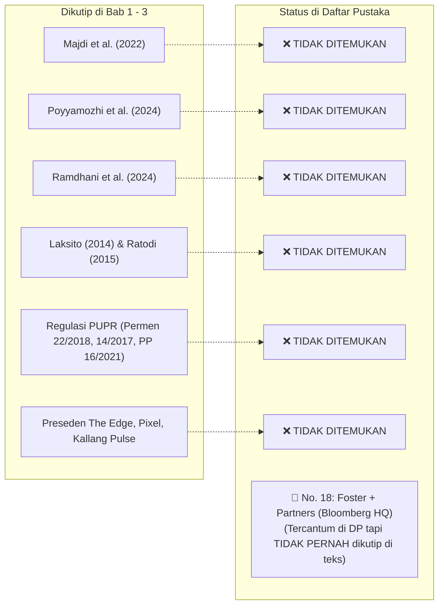
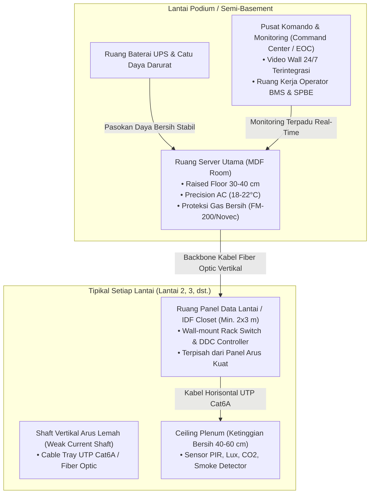

# 🏛️ LAPORAN AUDIT PARIPURNA & CATATAN KRITIS DOSEN PENGUJI II (BIDANG INFORMATIKA)
## Seminar Proposal Tugas Akhir Program Studi S1 Arsitektur – Fakultas Teknik Universitas Mulawarman

---

| Parameter Dokumen | Rincian Informasi |
| :--- | :--- |
| **Judul Naskah** | **Redesain Gedung Dinas Kesehatan Provinsi Kalimantan Timur dengan Pendekatan Arsitektur Smart Building** |
| **Nama Mahasiswa** | Arya Rizqi Putra Mahardika |
| **NIM** | 2309096042 |
| **Program Studi** | S1 Arsitektur, Jurusan Arsitektur, Fakultas Teknik Universitas Mulawarman |
| **Dosen Pembimbing I** | Kartika Tristanto, S.Ars., M.Arch. |
| **Dosen Pembimbing II** | Ir. Putri Nopianti, S.T., M.T. |
| **Dosen Penguji I** | Ratri Bodromulatsih, S.Ds., M.Ars. |
| **Dosen Penguji II** | **Anton Prafanto, S.Kom., M.T.** (Bidang Keahlian: *Internet of Things, Embedded Systems & Software Architecture*) |
| **Dokumen Draf** | [`SEMINAR ARSITEKTUR ARYA 3.pdf`](file:///C:/Users/anton/vibecoding/Bimbingan/audit_mahasiswa/draft_seminar_arsitektur_arya_rizqi.pdf) (59 Halaman) |
| **Status Audit** | **Audit Forensik Menyeluruh (Level 2: Tuntas Tanpa Celah)** |
| **Rekomendasi Ujian** | **Revisi Mayor Substantif TIK, Penyelarasan Bibliografi, & Pembersihan Integritas Naskah** |

---

## 📌 PENGANTAR PENGUJI: MENGAPA AUDIT INFORMATIKA SANGAT KRUSIAL?

Ketika tugas akhir arsitektur mengadopsi tema **"Smart Building"**, bangunan tersebut secara ontologis bertransformasi dari sekadar konstruksi fisik statis (balok, kolom, dan dinding) menjadi **Sistem Siber-Fisik (*Cyber-Physical Systems*)**. 

Peran dosen informatika sebagai Penguji II bertugas mengawal 4 pilar fundamental:
1. **Ketepatan Taksonomi & Logika Komputasi**: Memastikan mahasiswa tidak sekadar menempelkan istilah teknologi (*buzzword*) tanpa memahami prinsip kerja data, sensor, aktuator, dan jaringannya.
2. **Kebutuhan Ruang Fisik Arsitektural untuk TIK (*Spatial Requirements*)**: Setiap perangkat cerdas membutuhkan ruang fisik di denah bangunan (ruang server berpendingin presisi, *shaft* arus lemah terpisah, lemari kontroler lantai, dan ruang kendali terpusat).
3. **Kontekstualisasi Fungsi Bangunan Publik**: Memastikan teknologi cerdas yang dirancang relevan secara fungsional dengan tugas pokok dan fungsi (tusi) Dinas Kesehatan Provinsi (seperti pemantauan rantai dingin vaksin dan sistem komando tanggap darurat kesehatan).
4. **Integritas Akademik & Ketelitian Naskah**: Mengeliminasi residu naskah lain (*copy-paste*), format terputus, dan anomali sitasi ilmiah.

---

## 🚨 BAGIAN 1: AUDIT FORENSIK INTEGRITAS TEKS & ANOMALI REDAKSIONAL
*(Ditemukan bukti-bukti konkret ketidaktelitian naskah yang wajib segera diperbaiki sebelum seminar berlangsung).*

### 1.1. Kontaminasi Paragraf *Copy-Paste* Pasar Tradisional & UMKM (Bab 1, Hal. 3)
* **Kutipan Naskah (Bab 1 Hal. 3, Paragraf Terakhir):**
  > *"Redesain menjadi salah satu upaya yang dapat dilakukan untuk meningkatkan kualitas ruang dan mengoptimalkan fungsi kawasan perdagangan. Dahlima (2018), melalui penelitian mengenai redesain **Pasar Genteng Surabaya**, menunjukkan bahwa redesain dapat mempertahankan fungsi yang telah ada... Dalam konteks **Sentra UMKM Paras Perbatasan**, redesain diperlukan untuk mengoptimalkan fungsi kawasan, memperbaiki kualitas fasilitas, serta meningkatkan daya tarik ruang bagi **pedagang** dan pengunjung."*
* **Kritik Penguji**: Naskah ini merancang **Gedung Kantor Dinas Kesehatan Prov. Kaltim**, tetapi memuat paragraf utuh mengenai pasar rakyat di Surabaya dan sentra UMKM perbatasan. Ini membuktikan adanya teks dari tugas akhir lain yang disalin tanpa dibaca ulang.
* **Instruksi Tindakan**: **Hapus total paragraf ini**. Ganti dengan narasi urgensi redesain kantor dinas kesehatan tingkat provinsi dalam merespons transformasi digital daerah mitra IKN.

### 1.2. Residu Percakapan Chatbot AI yang Belum Dibersihkan (Bab 2, Hal. 25)
* **Kutipan Naskah (Subbab 2.6.4 Kallang Pulse, Paragraf 1):**
  > *"Kallang Pulse merupakan contoh yang sangat relevan dengan **penelitianmu** karena bangunan ini bukan dibangun dari awal sebagai smart building..."*
* **Kritik Penguji**: Kata ganti orang kedua *"penelitianmu"* merupakan pola keluaran (*output prompt*) dari asisten percakapan AI. Penulisan karya ilmiah wajib menggunakan sudut pandang orang ketiga yang objektif.
* **Instruksi Tindakan**: Ubah redaksi menjadi: *"Preseden Kallang Pulse relevan dengan penelitian ini karena..."*

### 1.3. Duplikasi Paragraf Utuh (*Word-for-Word Text Duplication*)
Ditemukan dua bagian naskah di mana teks tertempel dua kali berturut-turut persis:
1. **Bab 2 Hal. 14–15 (Subbab 2.4 - Dinkes Kaltim):**  
   Paragraf *"Aktivitas yang berlangsung di dalam Gedung Dinas Kesehatan Provinsi Kalimantan Timur melibatkan berbagai pengguna, seperti pegawai, pimpinan, tenaga teknis, tamu..."* tercetak **dua kali berturut-turut**.
2. **Bab 2 Hal. 25 (Subbab 2.6.4 - Kallang Pulse):**  
   Paragraf pembuka *"Kallang Pulse merupakan contoh yang sangat relevan..."* tercetak **dua kali berturut-turut**.
* **Instruksi Tindakan**: Hapus salah satu paragraf pada masing-masing subbab tersebut.

### 1.4. Kalimat Menggantung (*Hanging Sentence*) pada Batasan Masalah (Bab 1, Hal. 3)
* **Kutipan Naskah (Subbab 1.3 Butir 1):**
  > *"1. Perancangan difokuskan pada Gedung Dinas Kesehatan Provinsi Kalimantan Timur yang berada di Kota Samarinda, **dengan luasan**"*
* **Kritik Penguji**: Kalimat terputus tanpa nominal angka dan satuan, lalu langsung melompat ke nomor 2.
* **Instruksi Tindakan**: Lengkapi kalimat dengan menyertakan luas tapak dan luas lantai rancangan (misal: *"...dengan luas tapak 7.273 m² dan perkiraan luas lantai bangunan 3.950 m²"*).

### 1.5. Kerancuan Sistematika Penulisan Bab 3 vs Bab 4 (Bab 1, Hal. 5)
* **Kutipan Naskah (Subbab 1.7):**
  > *"BAB III METODELOGI PENELITIAN: Bab ini berisi hasil pengumpulan dan analisis data serta pembahasan konsep dan hasil perancangan... Bab ini diakhiri dengan **penyajian hasil redesain dalam bentuk gambar teknis, visualisasi tiga dimensi...**"*
* **Kritik Penguji**: Bab 3 adalah **Metodologi Perancangan** (prosedur dan alur berpikir). Gambar kerja teknis dan render visualisasi 3D adalah materi pokok **Bab 4 (Hasil dan Pembahasan)**. Deskripsi pada sistematika penulisan tertukar.
* **Instruksi Tindakan**: Perbaiki deskripsi isi Bab 3 dan Bab 4 agar sesuai kaidah penulisan proposal perancangan.

### 1.6. Inkonsistensi Identitas Pejabat, Gelar, dan Tanggal Lembar Pengesahan
* **Nama & Gelar Koordinator Prodi S1 Arsitektur:**
  * Di Lembar Pengesahan (Hal. III): Tertulis `Ir. Pandu K. Utomo, S.T., M.Sc., IPM`
  * Di Kata Pengantar (Hal. V No. 3): Tertulis `Ar. Pandu Kusumoputro Utomo, ST., M.Sc., IPM.`
  * *Temuan*: Terjadi inkonsistensi gelar profesi (`Ir.` vs `Ar.`), singkatan nama (`Pandu K.` vs `Pandu Kusumoputro`), dan format tanda titik gelar (`S.T.` vs `ST.`).
* **Koma Ganda pada Dosen Pembimbing I:**
  * Di Lembar Pengesahan (Hal. III) & Kata Pengantar (Hal. V No. 4): Tertulis `Kartika Tristanto, , S.Ars., M.Arch.` (terdapat spasi dan koma ganda).
* **Gelar Insinyur Dosen Pembimbing II Hilang:**
  * Di Lembar Pengesahan tertulis `Ir. Putri Nopianti, S.T., M.T.`, namun di Kata Pengantar tertulis `Ibu Putri Nopianti, S.T., M.T.` (gelar profesi insinyur tidak dicantumkan).
* **Tanggal Naskah Belum Lengkap:**
  * Di Kata Pengantar tertulis: *"Samarinda, November"* tanpa tanggal dan tahun. Padahal di Lembar Pernyataan tertulis *13 November 2026* dan Lembar Pengesahan *9 Desember 2026*.
* **Typo Judul Subbab:**
  * Subbab 3.4.1 (Daftar Isi Hal. VII dan Teks Hal. 31) tertulis: `3.4.1 Tahap Pra Perancagan` (kurang huruf 'n' pada kata *Perancangan*).
  * Judul Bab 3 tertulis `METODELOGI` (seharusnya bentuk baku adalah `METODOLOGI`).

---

## 📚 BAGIAN 2: AUDIT SILANG SITASI & BIBLIOGRAFI (*CROSS-REFERENCE FORENSICS*)

Pemeriksaan silang otomatis antara badan teks (Bab 1–3) dengan Daftar Pustaka (Hal. 47–48) mengungkap diskrepansi yang sangat masif:



### 2.1. Sumber Dikutip di Naskah tetapi HILANG dari Daftar Pustaka
1. **Majdi et al. (2022)** – Dikutip pada Tabel 2.1 (No. 4, Hal. 8).
2. **Poyyamozhi et al. (2024)** – Dikutip pada Tabel 2.1 (No. 7, Hal. 9).
3. **Lalu Gabrielle Ayub Ramdhani et al. (2024)** – Dikutip pada Tabel 2.1 (No. 10, Hal. 10).
4. **Laksito (2014)** – Dikutip sebagai dasar metodologi perancangan arsitektur di Bab 3 (Hal. 27 & 31).
5. **Ratodi (2015)** – Dikutip pada metode pengumpulan data di Bab 3 (Hal. 27).
6. **Dahlima (2018)** – Dikutip di Bab 1 Hal. 3.
7. **Peraturan Perundang-undangan PUPR**:
   * *Permen PUPR No. 22/PRT/M/2018* (Pedoman Gedung Negara)
   * *Permen PUPR No. 14/PRT/M/2017* (Persyaratan Kemudahan Gedung)
   * *Permen PUPR No. 21 Tahun 2021* (Bangunan Gedung Hijau)
   * *PP No. 16 Tahun 2021* (Peraturan Pelaksanaan UU Bangunan Gedung)  
   *(Semua regulasi ini dikutip di Subbab 2.3.1 Hal. 13, tetapi **tidak satu pun** masuk ke Daftar Pustaka).*
8. **Dokumentasi Resmi Preseden Arsitektur**:
   * *The Edge Amsterdam* (PLP Architecture / OVG Real Estate)
   * *Pixel Building Melbourne* (studio505)
   * *Kallang Pulse Singapura* (Schneider Electric)

### 2.2. Sitasi Hantu (*Ghost Citation*)
* **Nomor 18 di Daftar Pustaka (Hal. 48):**  
  > *Foster + Partners. (2017, 2 Oktober). Bloomberg’s new European headquarters rated world’s most sustainable office building.*
* **Kritik Penguji**: Sumber ini tertulis di daftar pustaka, namun **sama sekali tidak pernah disinggung dalam badan teks Bab 1, 2, maupun 3**. Jika gedung ini pernah dijadikan alternatif preseden lalu diganti, mahasiswa lalai menghapusnya dari daftar pustaka.

### 2.3. Anakronisme Rujukan Standar Nasional Indonesia (SNI)
* Di **Teks Bab 2 Subbab 2.3.2 (Hal. 13–14)**, mahasiswa mengutip standar versi usang:
  * SNI 03-6572-2001 (Ventilasi dan Tata Udara)
  * SNI 03-6197-2011 (Pencahayaan)
  * SNI 03-6389-2011 (Selubung Bangunan)
* Di **Daftar Pustaka (Hal. 47 No. 4, 5, 7)**, mahasiswa mencantumkan standar versi mutakhir:
  * SNI 6572-1:2024
  * SNI 6197:2020
  * SNI 6389:2020
* **Instruksi Tindakan**: Selaraskan teks di Bab 2 agar merujuk pada standar SNI edisi terbaru (2020 dan 2024), karena versi 2001 dan 2011 telah dinyatakan tidak berlaku lagi oleh BSN.

### 2.4. Kesalahan Penulisan Sitasi Mentah (Sitasi URL Domain)
* Pada **Bab 1 Halaman 2**, mahasiswa menulis sitasi: `...(dinkes.kaltimprov, n.d.)`.
* Mahasiswa mengutip nama domain situs web (*URL string*). Penulisan yang benar menurut kaidah ilmiah APA 7th adalah menyebutkan nama institusi pengarang dan tahun terbit: `(Dinas Kesehatan Provinsi Kalimantan Timur, 2025)`.

---

## 💻 BAGIAN 3: AUDIT SUBSTANTIF INFORMATIKA & SMART BUILDING

### 3.1. Disorientasi Definisi Konsep pada Tabel 3.1 (Hal. 35–37)
Tabel Parameter Konsep adalah inti metodologis perancangan. Terjadi kesalahan fatal penempatan istilah teknologi informasi yang didefinisikan secara keliru sebagai elemen tapak:

| Parameter Naskah | Definisi Mahasiswa Saat Ini (Keliru) | Koreksi Definisi Bidang Informatika & Smart Building |
| :--- | :--- | :--- |
| **Interoperabilitas Sistem** | *"Kemudahan pengguna mencapai dan memasuki kawasan serta mengakses fasilitas di dalamnya (menata akses masuk, jalur pejalan kaki, sirkulasi kendaraan, parkir)."* | **Interoperabilitas BUKAN jalur pedestrian / sirkulasi kendaraan!** Interoperabilitas adalah kemampuan perangkat dan sub-sistem gedung (chiller, lampu, sensor, CCTV) dari vendor berbeda untuk saling berkomunikasi dan bertukar data menggunakan protokol standar terbuka (*open protocols*) seperti BACnet/IP, Modbus TCP, MQTT, atau REST API. |
| **Smart Lighting** | *"Karakter visual yang membantu membentuk citra dan membedakan kawasan dari tempat lain (mengolah fasad, material, warna, penanda kawasan)."* | **Smart Lighting BUKAN branding fasad kawasan!** Smart Lighting adalah sistem penerangan adaptif berbasis sensor okupansi (*PIR*) dan fotosel (*daylight harvesting*), yang diatur secara terjadwal dan terintegrasi dengan pengontrol DALI/KNX menuju platform BMS. |
| **Monitoring Energi** | *"Kondisi ruang yang mendukung kenyamanan pengguna ketika beraktivitas (memperhatikan pencahayaan, keteduhan, tempat duduk, kebersihan)."* | **Monitoring Energi BUKAN tempat duduk santai dan kebersihan!** Monitoring energi adalah pemantauan konsumsi daya listrik (*power meter* digital) secara *real-time* per blok lantai/sistem untuk mendeteksi profil beban puncak (*peak load*) dan pemborosan energi. |

### 3.2. Celah Data Survei "Kendala Usaha" pada Tabel 3.2 (Hal. 42)
* Pada **Tabel 3.2 (Desain Survey, Hal. 42)**:
  * Variabel: *Potensi Penerapan Smart Building*
  * Subvariabel: *Sensor dan pemantauan kondisi ruang*
  * Data yang Dikumpulkan: **"Kendala usaha dan kebutuhan fasilitas"** ❌
* **Kritik Penguji**: Pertanyaan mengenai "kendala usaha" adalah instrumen survei untuk pedagang pasar / UMKM, bukan instrumen survei teknis gedung dinas kesehatan.
* **Koreksi Data**: Data yang wajib disurvei adalah tingkat iluminasi ruang kerja eksisting (Lux meter), fluktuasi temperatur dan kelembapan ruangan eksisting, kapasitas daya listrik terpasang PLN, dan ketersediaan jalur kabel data eksisting.

### 3.3. Janji "Smart Water" yang Menguap (*Missing Feature*)
* Pada **Bab 1 Subbab 1.3 Butir 4e (Hal. 4)**, mahasiswa menetapkan batasan masalah:  
  *Sistem Smart Building yang dibahas meliputi: a. Smart Lighting, b. Smart HVAC, c. Smart Energy, d. Smart Security, **e. Smart Water**, f. BMS.*
* **Fakta Lapangan**: Pada **Bab 2 Subbab 2.5.2** (Elemen Smart Building) dan **Bab 3 Tabel 3.1** (Parameter Konsep), **pembahasan mengenai Smart Water hilang sepenuhnya** tanpa jejak.
* **Instruksi Tindakan**: Mahasiswa harus konsisten: jika *Smart Water* (seperti sensor *water flow meter*, pemantauan tandon air bersih, dan otomatisasi air siram taman) dibahas, masukkan ke dalam kajian teori dan matriks konsep; jika ditiadakan, hapus dari Batasan Masalah.

### 3.4. ISO 52120-1:2021 Hanya Menjadi "Pemanis Sitasi" (*Citation Ornament*)
* Pada **Bab 3 Halaman 35**, mahasiswa mengutip standar internasional efisiensi energi otomasi gedung: *ISO 52120-1:2021*.
* Standar ISO 52120-1 mengklasifikasikan sistem otomasi gedung ke dalam 4 kelas efisiensi energi (*BACS Energy Performance Classes*):
  * **Class A**: Sistem BACS berkinerja tinggi (*networked room automation with demand-driven control*).
  * **Class B**: Sistem BACS lanjutan (*advanced BACS with some individual room control*).
  * **Class C**: Sistem standar (*standard reference BACS*).
  * **Class D**: Sistem tidak efisien energi (*non-energy-efficient BACS*).
* **Kritik Penguji**: Mahasiswa hanya menyebut nama standar ISO tanpa pernah menjelaskan kelas efisiensi mana yang ditargetkan untuk Gedung Dinas Kesehatan Kaltim. Standar ini harus dioperasionalkan ke dalam matriks perancangan utilitas cerdas.

---

## 🏢 BAGIAN 4: KEBUTUHAN RUANG FISIK ARSITEKTURAL UNTUK TIK (*SPATIAL REQUIREMENTS*)

Perangkat cerdas tidak beroperasi di ruang hampa. Seluruh sensor, jaringan kabel, dan kontroler membutuhkan wadah spasial arsitektural. Mahasiswa **wajib memasukkan kebutuhan ruang fisik berikut ke dalam Program Ruang (Bab 3) dan Denah Perancangan (Bab 4)**:



1. **Ruang Server Utama / MDF (*Main Distribution Frame*)**:
   * Menampung server database BMS, server aplikasi SPBE Dinas Kesehatan, dan *storage* CCTV.
   * *Persyaratan Arsitektural*: Terlindung dari banjir, tidak berada tepat di bawah kamar mandi/plumbing basah, memakai lantai berpanggung (*raised floor* 30–40 cm), berpendingin presisi (PAC) 18–22°C, sistem pemadam gas bersih (*FM-200 / Novec 1230*), dan pintu akses biometrik.
2. **Ruang Distribusi Lantai / IDF (*Intermediate Distribution Frame Closet*)**:
   * Setiap lantai gedung harus memiliki ruang utilitas arus lemah (minimal $2 \times 3\text{ meter}$) untuk kabinet saklar jaringan (*rack switch*) dan kontroler otomasi (*DDC Controller*).
3. **Shaft Arus Lemah Terpisah (*Weak Current Shaft*)**:
   * Jalur kabel data, kontrol BMS, dan telekomunikasi vertikal harus berada di *shaft* terpisah berjarak minimal $30\text{ cm}$ atau disekat logam dari kabel tegangan tinggi PLN untuk mencegah induksi dan gangguan interferensi elektromagnetik (*EMI*).
4. **Pusat Komando (*Command Center / Emergency Operations Center - EOC*)**:
   * Dinas Kesehatan Provinsi memerlukan ruang monitoring terpadu yang dilengkapi *video wall* untuk memantau data kesehatan masyarakat kabupaten/kota (seperti pemantauan stunting, wabah DBD/KLB, dan logistik obat) berdampingan dengan stasiun kerja (*workstation*) operator teknis BMS gedung.
5. **Ruang UPS & Catu Daya Cadangan (*Power Redundancy*)**:
   * Sistem *smart building* dan kontrol akses pintu gerbang tidak boleh padam seketika saat suplai PLN terputus. Harus tersedia ruang baterai UPS sebelum genset otomatis bekerja (*auto-transfer switch*).

---

## 💉 BAGIAN 5: KONTEKSTUALISASI KHUSUS DINAS KESEHATAN PROVINSI KALIMANTAN TIMUR

Gedung Dinas Kesehatan memiliki spesifikasi fungsi yang berbeda signifikan dengan gedung komersial sewa (seperti preseden *The Edge* atau *Wisma BCA*):

1. **Smart Cold-Chain Monitoring System (Gudang Vaksin & Logistik Farmasi)**:
   * Dinas Kesehatan Provinsi mengelola distribusi vaksin ke 10 kabupaten/kota di Kaltim.
   * *Fitur Smart*: Ruang penyimpanan vaksin wajib dirancang dengan sensor pemantau suhu presisi ultra-dingin (-80°C s/d +8°C) yang terhubung ke sistem alarm terpusat (*early warning notification via SMS/IoT alert*) dengan sistem pendingin cadangan ganda (*redundant cooling system*).
2. **Zonasi Keamanan Akses Fisik Bertingkat (*Tiered Access Control*)**:
   * Penataan denah harus membedakan hak akses secara arsitektural:
     * **Zona Publik**: Lobi, PTSP (Pelayanan Terpadu Satu Pintu), dan klinik pengaduan (akses bebas terkontrol).
     * **Zona Semi-Publik**: Ruang rapat koordinasi lintas sektoral kab/kota, aula rapat besar (akses registrasi resepsionis).
     * **Zona Privat**: Ruang kerja pegawai struktural, ruang kepala dinas (akses kartu RFID).
     * **Zona Restriksi Tinggi (*High Security*)**: Ruang Server Data Kesehatan, Gudang Cold Chain Vaksin, dan Ruang Arsip Medis (akses ganda biometrik sidik jari/wajah + pencatatan log kunjungan otomatis).

---

## 🛠️ BAGIAN 6: TEMPLATE REVISI MATRIKS PARAMETER KONSEP (TABEL 3.1)
*(Mahasiswa disarankan mengadopsi struktur tabel ini untuk menyempurnakan Bab 3).*

| Prinsip | Parameter Konsep | Definisi Operasional | Strategi Capaian Arsitektural & TIK |
| :--- | :--- | :--- | :--- |
| **Integrasi Sistem Bangunan** | **Interoperabilitas Protokol** | Kemampuan sub-sistem gedung (HVAC, lampu, proteksi api) untuk bertukar data secara seragam. | Menggunakan jaringan berbasis IP dengan protokol terbuka (BACnet/IP & MQTT) yang terpusat pada platform BMS terintegrasi. |
| | **Building Management System (BMS)** | Perangkat lunak dan keras terpusat untuk memantau dan mengontrol operasional seluruh gedung. | Merancang ruang *Command Center / BMS Workstation* di podium dan ruang server (MDF) sesuai standar keandalan. |
| **Efisiensi Energi** | **Pencahayaan Adaptif (*Smart Lighting*)** | Pengendalian intensitas lampu buatan berdasarkan okupansi dan penetrasi cahaya alami. | Mengombinasikan bukaan kaca jendela (*daylight harvesting*) dengan sensor fotosel (Lux) dan sensor PIR di plafon ruangan. |
| | **Tata Udara Pintar (*Smart HVAC*)** | Pendinginan udara yang modulasi kapasitasnya merespons beban termal ruangan dan jumlah orang. | Membagi zonasi VRF/Chiller per sayap lantai, dikendalikan sensor temperatur, kelembapan, dan sensor $\text{CO}_2$ ruang rapat. |
| | **Monitoring Sub-Meter Listrik** | Pengukuran konsumsi daya listrik secara terperinci per blok lantai dan kategori peralatan. | Memasang panel *Digital Power Meter* pada setiap panel distribusi lantai (IDF) yang mentransmisikan data konsumsi kWh ke server BMS. |
| **Keamanan & Perlindungan** | **Kontrol Akses Bertingkat (*Smart Security*)** | Pengendalian dan pembatasan hak masuk pengguna ke dalam zona ruang berdasarkan hierarki otoritas. | Memasang *tripod turnstile gate* di lobi, pintu magnetik RFID di ruang kantor, dan biometrik pada Ruang Server & Gudang Vaksin. |
| **Kesehatan Lingkungan** | **Kualitas Udara Dalam Ruangan (*IAQ Monitoring*)** | Pemantauan parameter kesehatan udara (partikulat $\text{PM}_{2.5}$, $\text{CO}_2$, kelembapan) di ruang kerja. | Menempatkan sensor kualitas udara yang terhubung ke katup udara segar otomatis (*fresh air damper*) untuk menjaga kesegaran ruang kerja. |

---

## 📑 BAGIAN 7: CACAT TATA LETAK TABEL 3.3 (JADWAL PENELITIAN)
* **Kondisi Naskah Saat Ini (Hal. 45–46 / PDF p.56–57):**
  * Di Halaman 45, terdapat judul `Tabel 3. 3 Jadwal Penelitian (penulis, 2026)` dan baris kepala tabel (`No | Kegiatan | Bulan...`).
  * Di bawah kepala tabel tersebut langsung disisipkan gambar peta `Gambar 3. 2 Lokasi Penelitian Gedung Dinas Kesehatan`.
  * Seluruh isi/badan Tabel 3.3 terlempar ke Halaman 46 **tanpa kepala tabel sama sekali**, sehingga halaman 46 menjadi tabel buta.
* **Instruksi Tindakan**: Tata ulang *layout* dokumen. Pindahkan gambar peta ke Subbab 3.8 (Gambaran Umum Lokasi), lalu satukan judul, kepala, dan badan Tabel 3.3 pada satu halaman utuh.

---

## 📋 BAGIAN 8: CHECKLIST ROADMAP PERBAIKAN MAHASISWA (STEP-BY-STEP)

```markdown
- [ ] 1. PEMBERSIHAN REDAKSIONAL & INTEGRITAS (BAB 1 & BAB 2)
      [ ] Hapus teks "Pasar Genteng", "Sentra UMKM", dan "pedagang" di Bab 1 Hal. 3.
      [ ] Lengkapi kalimat menggantung pada Batasan Masalah butir 1 di Hal. 3.
      [ ] Selaraskan isi deskripsi Sistematika Bab 3 dan Bab 4 di Bab 1 Hal. 5.
      [ ] Hapus kata "penelitianmu" di Subbab 2.6.4 (Hal. 25).
      [ ] Hapus paragraf kembar di Subbab 2.4 (Hal. 14–15) dan Subbab 2.6.4 (Hal. 25).
      [ ] Perbaiki tanda koma ganda pada nama Pembimbing I di Lembar Pengesahan & Kata Pengantar.
      [ ] Selaraskan penulisan nama dan gelar Koordinator Prodi S1 Arsitektur di Hal. III dan V.
      [ ] Perbaiki typo judul: "METODELOGI" -> "METODOLOGI" dan "Pra Perancagan" -> "Pra Perancangan".

- [ ] 2. REKONSTRUKSI METODOLOGI PERANCANGAN (BAB 3)
      [ ] Rombak Tabel 3.1 (Parameter Konsep) menggunakan template Bagian 6 di atas.
      [ ] Pada Tabel 3.2 (Desain Survey), ganti data "kendala usaha" dengan survei lux, suhu, beban okupansi, dan jalur kabel eksisting.
      [ ] Putuskan nasib "Smart Water": jika dipakai, masukkan ke bab 2 dan bab 3; jika tidak, hapus dari Batasan Masalah.
      [ ] Operasionalkan standar ISO 52120-1 ke dalam target kelas efisiensi BACS gedung rancangan.
      [ ] Rapikan layout Tabel 3.3 (Jadwal Penelitian) agar tidak terpotong buta antara halaman 45 dan 46.

- [ ] 3. PENYELARASAN SITASI & DAFTAR PUSTAKA
      [ ] Masukkan rujukan yang hilang: Majdi (2022), Poyyamozhi (2024), Ramdhani (2024), Laksito (2014), Ratodi (2015), serta seluruh Permen PUPR.
      [ ] Masukkan rujukan arsitek resmi untuk The Edge Amsterdam dan Pixel Melbourne.
      [ ] Hapus rujukan hantu: Foster + Partners (Bloomberg HQ) di No. 18.
      [ ] Mutakhirkan nomor standar SNI ventilasi dan pencahayaan ke versi 2020 dan 2024.
      [ ] Perbaiki sitasi domain mentah "(dinkes.kaltimprov, n.d.)" menjadi "(Dinas Kesehatan Provinsi Kalimantan Timur, 2025)".

- [ ] 4. INTEGRASI SPASIAL TIK MENUJU BAB 4 (STUDIO PERANCANGAN)
      [ ] Masukkan Ruang Server (MDF), Ruang Shaft Data (IDF) tiap lantai, dan Ruang Command Center ke program ruang.
      [ ] Pastikan gambar denah arsitektur memuat simbol/legenda titik sensor, kontrol akses, dan CCTV.
      [ ] Buat 1 lembar gambar arsitektur utilitas: "Diagram Skematik Arsitektur Sistem BMS & IoT Gedung".
```

---

## 🎯 BAGIAN 9: BANK PERTANYAAN KRITIS PENGUJI II (SIMULASI UJIAN SIDANG)

Pertanyaan-pertanyaan tajam yang dapat diajukan Dosen Penguji II pada saat sesi tanya-jawab:

1. **Uji Penguasaan Terminologi Teknologi:**
   > *"Saudara Arya, di Bab 3 Tabel 3.1 Anda mendefinisikan 'Interoperabilitas Sistem' sebagai kemudahan akses pejalan kaki dan tempat parkir. Bisakah Anda jelaskan apa makna interoperabilitas yang sebenarnya dalam arsitektur komputer dan otomasi gedung cerdas, serta protokol komunikasi apa yang Anda rencanakan untuk menghubungkan sensor AC dengan alarm kebakaran?"*

2. **Uji Konsekuensi Spasial Perancangan Arsitektur:**
   > *"Konsep smart building yang Anda ajukan mengandalkan ribuan sensor dan jaringan terintegrasi BMS. Di mana Anda menempatkan Ruang Server Utama (MDF), ruang shaft kabel data, dan ruang operator BMS pada gambar denah Anda? Apa alasan teknis Anda memilih lokasi tersebut terkait keamanan dari air dan interferensi elektromagnetik?"*

3. **Uji Relevansi Domain Objek (Dinas Kesehatan):**
   > *"Gedung Dinas Kesehatan Provinsi memiliki peran vital dalam distribusi vaksin ke seluruh kabupaten/kota di Kalimantan Timur. Bagaimana rancangan Smart Building Anda mampu menjamin keselamatan logistik vaksin melalui pemantauan rantai dingin (cold-chain), dan apa yang terjadi pada sistem kontrol akses pintu darurat Anda jika terjadi pemadaman listrik total di Samarinda?"*

4. **Uji Integritas & Keabsahan Pustaka:**
   > *"Di Bab 3 Anda mencantumkan standar ISO 52120-1:2021 mengenai efisiensi energi otomatisasi gedung. Dari 4 kelas efisiensi energi BACS (Class A sampai D) yang ada pada standar tersebut, kelas berapa yang menjadi target rancangan redesain Anda, dan bagaimana implementasi arsitekturalnya pada fasad serta tata ruang dalam?"*

---

> [!TIP]
> **Catatan Penutup untuk Mahasiswa:**  
> Audit mendalam ini bukan untuk menjatuhkan, melainkan untuk memperkuat bobot ilmiah dan kelayakan keteknikan skripsi Anda. Gagasan redesain gedung pemerintahan dengan pendekatan *Smart Building* adalah topik yang sangat prestisius dan relevan bagi kemajuan Kalimantan Timur. Selesaikan perbaikan ini dengan bimbingan dosen pembimbing Anda agar rancangan yang Anda hasilkan tidak hanya menarik secara visual, tetapi juga kokoh secara metodologi dan dapat dipertanggungjawabkan secara teknologi.
