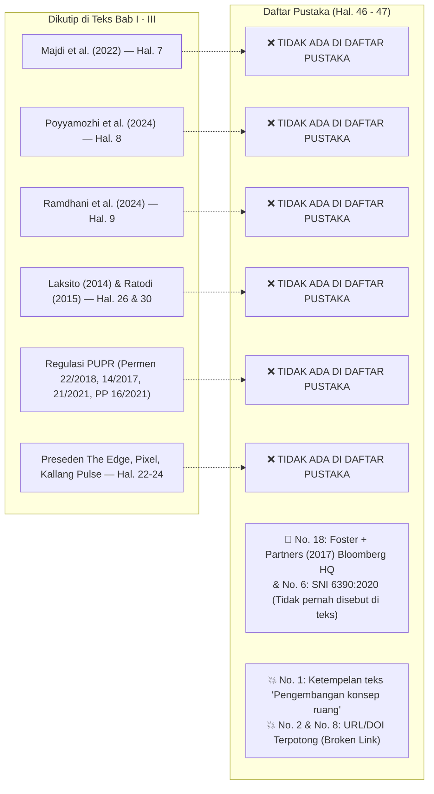
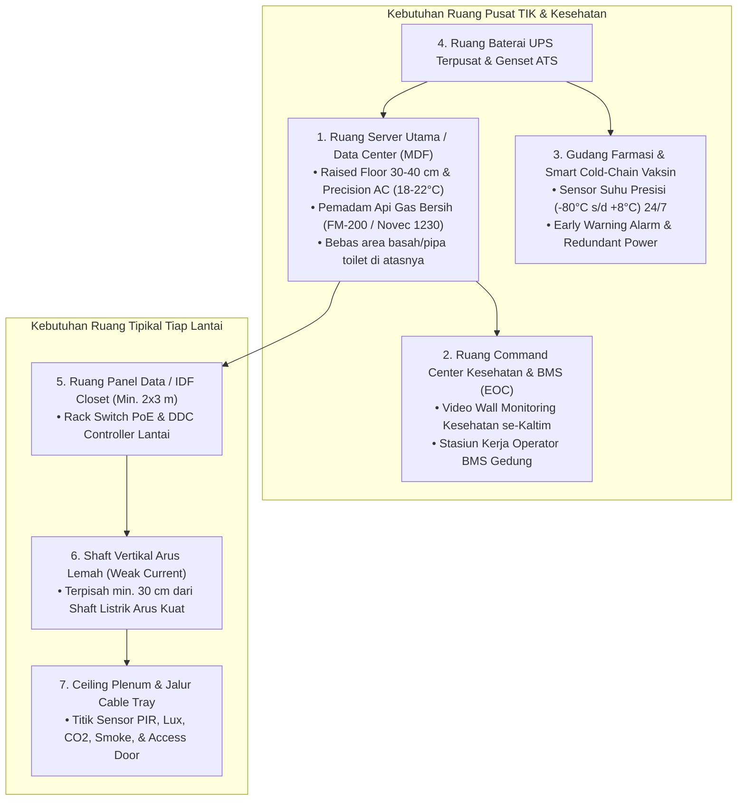

# 🏛️ LAPORAN AUDIT FORENSIK PARIPURNA & CATATAN KRITIS DOSEN PENGUJI II (BIDANG INFORMATIKA)
## Evaluasi Komprehensif Naskah Seminar Proposal Tugas Akhir S1 Arsitektur (`SEMINAR ARSITEKTUR ARYA FIX.pdf`)

---

| Parameter Dokumen | Rincian Informasi |
| :--- | :--- |
| **Judul Naskah** | **Redesain Gedung Dinas Kesehatan Provinsi Kalimantan Timur dengan Pendekatan Arsitektur Smart Building** |
| **Kode Berkas** | `102-ARS-26/27` (Revisi dari berkas sebelumnya `037-ARS-26/27`) |
| **Nama Mahasiswa** | Arya Rizqi Putra Mahardika |
| **NIM** | 2309096042 (Angkatan 2023, Semester 7) |
| **Program Studi** | S1 Arsitektur, Fakultas Teknik, Universitas Mulawarman |
| **Dosen Pembimbing I** | Kartika Tristanto, S.Ars., M.Arch. |
| **Dosen Pembimbing II** | Ir. Putri Nopianti, S.T., M.T. |
| **Dosen Penguji I** | Ratri Bodromulatsih, S.Ds., M.Ars. |
| **Dosen Penguji II** | **Anton Prafanto, S.Kom., M.T.** (NIP: 199310222019031016 — Bidang: *Internet of Things, Embedded Systems & Software Architecture*) |
| **Dokumen Draf Uji** | [`SEMINAR ARSITEKTUR ARYA FIX.pdf`](file:///C:/Users/anton/vibecoding/Bimbingan/audit_mahasiswa/draft_seminar_arsitektur_arya_rizqi_fix.pdf) (58 Halaman) • [Draf Lama (`ARYA 3.pdf`)](file:///C:/Users/anton/vibecoding/Bimbingan/audit_mahasiswa/draft_seminar_arsitektur_arya_rizqi.pdf) (59 Halaman) |
| **Dasar Rujukan Audit** | **Pedoman Standar & Format Penulisan Skripsi FT Unmul** ([`pedoman_skripsi_unmul.md`](file:///C:/Users/anton/vibecoding/Bimbingan/pedoman_skripsi_unmul.md)) & **Kaidah Rekayasa Cyber-Physical Systems (BACS / ISO 52120-1:2021)** |
| **Status Kelayakan** | **REVISI MAYOR MULTI-ASPEK (Hanya 5 Editan Minor dari Draf Lama; Seluruh Cacat Substantif TIK, Kuantifikasi SNI, Sitasi, & Format Masih Utuh)** |

---

## 🔍 RINGKASAN KOMPARASI FORENSIK: `ARYA 3.pdf` (59 Hal.) vs `ARYA FIX.pdf` (58 Hal.)

Berdasarkan pemeriksaan *diff* karakter demi karakter dan visual halaman demi halaman antara berkas lama ([`draft_seminar_arsitektur_arya_rizqi.pdf`](file:///C:/Users/anton/vibecoding/Bimbingan/audit_mahasiswa/draft_seminar_arsitektur_arya_rizqi.pdf)) dan berkas terbaru ([`draft_seminar_arsitektur_arya_rizqi_fix.pdf`](file:///C:/Users/anton/vibecoding/Bimbingan/audit_mahasiswa/draft_seminar_arsitektur_arya_rizqi_fix.pdf)), mahasiswa **hanya melakukan 5 perubahan kecil**, sementara **lebih dari 90% cacat fatal belum disentuh**:

### ✅ 5 Hal yang Sudah Diubah pada `SEMINAR ARSITEKTUR ARYA FIX.pdf`:
1. **Penghapusan Paragraf Copy-Paste "Pasar Genteng Surabaya & Sentra UMKM" (Bab I Hal. 3):** Paragraf nyasar mengenai pasar perdagangan dan pedagang UMKM yang mengutip Dahlima (2018) telah dihapus (menggeser seluruh halaman Bab II s.d. Daftar Pustaka maju 1 halaman dari 59 menjadi 58 halaman).
2. **Pelengkapan Kalimat Menggantung pada Batasan Masalah Butir 1 (Bab I Hal. 3):** Kalimat yang sebelumnya terpotong pada kata *"...dengan luasan"* kini dilengkapi menjadi *"...dengan luas bangunan gedung 3.950 m²."*
3. **Penomoran Bab I:** Judul `BAB 1` (angka Arab) telah diubah menjadi `BAB I` (angka Romawi) agar seragam dengan `BAB II` dan `BAB III`.
4. **Perubahan Kode Berkas & Warna Tabel:** Kode sudut kanan atas sampul berubah dari `037-ARS-26/27` menjadi `102-ARS-26/27`, serta warna *header* seluruh tabel dan balok *Gantt Chart* diubah dari biru/abu-abu menjadi **oranye**.
5. **Perbaikan 1 Tanda Titik Ganda:** Kata `pengelolaan..` pada Tabel 3.1 (Hal. 35) diperbaiki menjadi `pengelolaan.` (namun 3 tanda titik ganda lainnya di Hal. 18, 20, dan 36 tetap terlewat).

### ⚠️ Kesalahan Baru yang Muncul Akibat Editan di `ARYA FIX.pdf`:
* **Font Daftar Isi Berubah Menjadi *Calibri* (Hal. VI–VII / PDF Hal. 7–8):** Saat mahasiswa menekan *Update Table* pada *Table of Contents* otomatis MS Word, seluruh teks Daftar Isi berubah menjadi font **Calibri (Sans-Serif)** dengan *ligature* karakter yang rusak saat diekstrak (`PeneliƟan`, `SistemaƟka`, `BulliƩ`, `SeaƩle`), melanggar aturan wajib 100% **Times New Roman**!

---

## 🚨 BAGIAN 1: TEMUAN FATAL INTEGRITAS TEKS, STRUKTUR, & TATA LETAK DI `ARYA FIX.pdf`
*(Seluruh nomor halaman di bawah ini telah disesuaikan presisi dengan berkas `SEMINAR ARSITEKTUR ARYA FIX.pdf`).*

### 1.1. Jejak Prompt Percakapan AI Chatbot Masih Tertinggal (Bab II, Hal. 24 / PDF Hal. 35)
* **Kutipan Naskah (Subbab 2.6.4 Kallang Pulse, Paragraf 1):**
  > *"Kallang Pulse merupakan contoh yang sangat relevan dengan **penelitianmu** karena bangunan ini bukan dibangun dari awal sebagai smart building..."*
* **Kritik Penguji:** Penggunaan kata ganti orang kedua *"penelitianmu"* adalah bukti salinan mentah dari respon AI Chatbot yang belum disunting sama sekali.
* **Instruksi Tindakan:** Ubah menjadi kalimat ilmiah objektif: *"Preseden Kallang Pulse sangat relevan dengan penelitian ini karena..."*

### 1.2. Duplikasi Paragraf Kembar (*Word-for-Word Duplication*) di 2 Subbab
Terdapat dua bagian di Bab II di mana mahasiswa menempelkan paragraf yang persis sama dua kali berturut-turut:
1. **Bab II Hal. 13–14 (PDF Hal. 24–25, Subbab 2.4 - Gedung Dinkes Kaltim):**  
   Kalimat *"Aktivitas yang berlangsung di dalam Gedung Dinas Kesehatan Provinsi Kalimantan Timur melibatkan berbagai pengguna, seperti pegawai, pimpinan, tenaga teknis, tamu, serta masyarakat yang memiliki kepentingan terhadap pelayanan dan informasi kesehatan. Beragamnya pengguna dan aktivitas tersebut membutuhkan ruang kerja yang terorganisasi, hubungan antar-ruang yang jelas, serta fasilitas pendukung yang mampu menunjang kegiatan secara efektif dan efisien."* tercetak **dua kali berturut-turut**.
2. **Bab II Hal. 24 (PDF Hal. 35, Subbab 2.6.4 - Kallang Pulse):**  
   Kalimat *"Kallang Pulse merupakan contoh yang sangat relevan dengan penelitianmu karena bangunan ini bukan dibangun dari awal sebagai smart building. Bangunan yang telah berusia sekitar 25 tahun tersebut kemudian dimodernisasi pada 2018 menjadi kantor yang menerapkan teknologi digital, energi terbarukan, dan sistem pengelolaan bangunan pintar."* tercetak **dua kali berturut-turut**.

### 1.3. Kontradiksi Diagram Kerangka Pemikiran (`Gambar 3.1`, Hal. 33 / PDF Hal. 44) — Tidak Ada Cabang *Smart Building*!
* Pada **Gambar 3.1 Kerangka Pemikiran (Hal. 33)**, kotak **`ANALISIS`** hanya bercabang menjadi 3 kotak generik arsitektur murni:
  1. `KONTEKS` (*Tapak dan Lingkungan, Iklim dan Topografi, Aksesbilitas dan Sirkulasi*)
  2. `KEBUTUHAN` (*Kebutuhan Ruang, Fasilitas Pendukung, Pengguna dan Aktivitas*)
  3. `RUPA` (*Bentuk Ruang*)
* **Kritik Fatal:** Di mana cabang **Analisis Utilitas & Sistem Smart Building** yang sebelumnya sudah ditulis sendiri oleh mahasiswa pada Subbab 3.3 butir 5 dan 6 (Hal. 30)? Di dalam seluruh bagan `Gambar 3.1` (mulai dari *Analisis*, *Pra Rancang*, hingga *Hasil Rancangan*), **kata *Smart Building*, *BMS*, *IoT*, atau *Utilitas* hilang 100%!** Bagan ini tampak seperti *template* umum skripsi arsitektur biasa yang belum disesuaikan dengan topik *Smart Building*.
* **Kesalahan Redaksional di Dalam Gambar 3.1:**
  * Kotak `RUMUSAN MASALAH` diawali huruf kecil (`bagaimana merancang...`).
  * Kotak `TUJUAN` butir 2 tidak memiliki spasi setelah titik (`2.Merumuskan...`).
  * Kotak `KONTEKS` salah ketik kata `Aksesbilitas` (kurang huruf `i`).

### 1.4. Kekacauan Tata Letak Halaman 43–45: Gambar 3.2 Terlempar & Tabel 3.3 Terpotong Buta
* Pada **Halaman 43 (PDF Hal. 54)**, setelah teks pendek Subbab `3.8 Gambaran Umum Lokasi`, terdapat ruang kosong menganga di bagian bawah halaman karena ukuran `Gambar 3. 2 Lokasi Penelitian Gedung Dinas Kesehatan` terlalu besar sehingga terdorong ke **Halaman 44 (PDF Hal. 55)**.
* Akibatnya, di bagian paling bawah **Halaman 44**, `Tabel 3. 3 Jadwal Penelitian (penulis, 2026)` hanya muat menampilkan kepala tabel (`No | Kegiatan | Bulan (2026 – 2027) | Agt..Apr`) dan 1 baris kosong `I Tahapan Penelitian`.
* Seluruh rincian kegiatan jadwal penelitian terlempar ke **Halaman 45 (PDF Hal. 56) tanpa kepala kolom bulan sama sekali (*blind table*)**, sehingga pembaca tidak dapat membaca balok warna oranye tersebut jatuh pada bulan apa!
* Selain itu, pada kolom Kegiatan Tabel 3.3 (Hal. 44–45), ketiga fase utama (`I`, `II`, dan `III`) semuanya diberi judul yang sama persis: **`Tahapan Penelitian`** (seharusnya: *I. Tahap Persiapan*, *II. Tahap Pelaksanaan & Analisis*, *III. Tahap Perancangan & Pelaporan*).
* Seluruh sub-item kegiatan pada Tabel 3.3 juga diketik rapat tanpa spasi setelah titik (`1.Pembuatan Proposal`, `2.Seminar Proposal`, dst.).

### 1.5. 100% Gambar & Tabel Tidak Pernah Dirujuk di Teks Narasi (*Uncalled Figures & Tables*)
* Berdasarkan pemindaian teks otomatis pada seluruh bab, terdapat **7 Gambar** (`Gambar 2.1` s.d. `Gambar 3.2`) dan **4 Tabel** (`Tabel 2.1`, `Tabel 3.1`, `Tabel 3.2`, `Tabel 3.3`).
* **Tidak ada satu pun (`0%`) dari 7 gambar dan 4 tabel tersebut yang dipanggil menggunakan nomornya di dalam paragraf narasi!** (Misalnya: di Subbab 3.8 Hal. 43 sama sekali tidak ada kalimat *"Lokasi tapak ditunjukkan pada Gambar 3.2"*). Dalam penulisan karya ilmiah FT Unmul, setiap gambar dan tabel wajib dirujuk secara eksplisit di dalam teks sebelum gambar/tabel tersebut dimunculkan.

### 1.6. Kerancuan Deskripsi Sistematika Penulisan (Bab I, Hal. 5 / PDF Hal. 16)
* **BAB II TINJAUAN PUSTAKA:** Ditulis berisi *"eksisting data, tinjauan bangunan, tinjauan gaya bangunan, tinjauan warna, serta tinjauan data arsitektur dengan penekanan"*. Padahal isi Bab II sama sekali tidak membahas tinjauan warna atau gaya bangunan!
* **BAB III METODELOGI PENELITIAN:** Ditulis *"diakhiri dengan penyajian hasil redesain dalam bentuk gambar teknis, visualisasi tiga dimensi..."*. Padahal Bab III adalah Metodologi, sedangkan gambar teknis dan visualisasi 3D adalah isi **Bab IV**!

### 1.7. Halaman Kosong `DAFTAR LAMPIRAN` (Hal. X / PDF Hal. 11) & Cacat Halaman Persembahan (Hal. IV / PDF Hal. 5)
* **Halaman X (`DAFTAR LAMPIRAN`):** Hanya memuat judul `DAFTAR LAMPIRAN` di bagian atas dengan **halaman kosong melompong** tanpa satu pun daftar item lampiran, dan di bagian akhir naskah juga tidak terdapat lampiran apa pun.
* **Halaman IV (Halaman Persembahan):** Tidak memiliki judul halaman di bagian atas, terdapat tanda petik penutup (`titiknya”`) tanpa adanya tanda petik pembuka (`“`) di awal kalimat, menggunakan kata tidak baku `siapatau` (seharusnya `siapa tahu`), dan kalimat terakhir tidak diakhiri tanda titik.

### 1.8. Kontradiksi Kronologi Tanggal Pengesahan (Hal. II, III, V) & Distorsi Proporsi Waktu `Tabel 3.3` (Hal. 44–45)
* **Anomali Tanggal Maju-Mundur antar-Halaman Awal:**
  * **Halaman Pernyataan Keaslian (Hal. II):** Tertulis tanggal **`Samarinda, 13 November 2026`** dan mengklaim dokumen ini sebagai **`skripsi`** (padahal masih tahap proposal seminar, dan sebuah skripsi belum selesai pada saat seminar proposal).
  * **Halaman Pengesahan (Hal. III):** Baris konsultasi tertulis **`Telah dikonsultasikan pada 13 November`** (tanpa mencantumkan tahun), sedangkan baris pengesahan tertulis **`Samarinda, 9 Desember 2026`**.
  * **Kata Pengantar (Hal. V):** Hanya tertulis **`Samarinda, November`** (tanpa tanggal dan tanpa tahun).
* **Alokasi Waktu Tidak Logis pada *Gantt Chart* `Tabel 3.3` (Hal. 44–45):**
  * Seluruh pekerjaan inti penelitian dan perancangan arsitektur (`II.1 Pengumpulan Data`, `II.2 Mengolah Data dan Analisis`, serta `II.3 Konsep dan Rancangan`) hanya diberi porsi waktu **1,5 bulan (November–Desember 2026)**.
  * Sebaliknya, kegiatan **`III.2 Perbaikan Seminar Hasil`** justru diberi balok warna oranye terpanjang selama **3 BULAN PENUH (Januari, Februari, Maret 2027)**!
  * Selain itu, baris terakhir (`III.5`) tertulis **`5. Perbaikan Seminar Akhir`** (nomenklatur yang benar adalah *Perbaikan Skripsi / Ujian Akhir*).

### 1.9. Cacat Metodologi Pengumpulan Data Primer: Absennya Metode Wawancara (*Interview*) (Subbab 3.2.1 Hal. 27 vs Tabel 3.2 Hal. 38–42)
* Pada **Subbab 3.2.1 Data Primer (Hal. 27)**, mahasiswa menulis bahwa pengumpulan data primer **hanya dilakukan melalui 2 metode**, yaitu **`1. Observasi`** dan **`2. Dokumentasi`** (memotret). **Sama sekali tidak ada metode Wawancara (*Interview*)!**
* Padahal pada **Tabel 3.2 Desain Survey (Hal. 38–42)**, mahasiswa menargetkan pengumpulan data berupa: *jumlah aktual pegawai per bidang, pola koordinasi kerja antarbagian, keluhan/kendala kenyamanan dan privasi pengguna, serta kebutuhan operator dan biaya pemeliharaan BMS*.
* **Kritik Metodologi:** Data mengenai struktur kepegawaian, kendala operasional ruang rapat koordinasi, kapasitas daya PLN/genset eksisting, serta kesiapan operator IT **tidak mungkin diperoleh hanya dengan memotret (*dokumentasi*) dan mengamati secara visual (*observasi*)**, melainkan **wajib melalui Wawancara Terstruktur (*Structured Interview*)** dengan pihak Sekretariat, Kasubbag Umum/Rumah Tangga, dan teknisi gedung Dinas Kesehatan Provinsi Kalimantan Timur!

### 1.10. Kontradiksi Pembatasan Luas Bangunan $3.950\text{ m}^2$ (Hal. 3 & 4) vs Tahap Penyusunan Program Ruang (Hal. 29 & 31)
* Pada **Subbab 1.3 Batasan Masalah Butir 1 (Hal. 3)** dan **Subbab 1.6 (Hal. 4)**, mahasiswa telah membatasi secara kaku bahwa luas bangunan gedung yang dirancang adalah **$3.950\text{ m}^2$** di atas lahan seluas **$7.273\text{ m}^2$** (tanpa mencantumkan sumber resmi dokumen aset/KIB Dinkes Kaltim).
* Padahal pada **Subbab 3.3 Butir 4 (Hal. 29)** dan **Subbab 3.4.1 Butir 4 (Hal. 31)**, mahasiswa menyatakan akan melakukan *Analisis Kebutuhan Ruang* dan *Penyusunan Program Ruang* untuk mengakomodasi peningkatan aktivitas koordinasi provinsi serta ruang utilitas *Smart Building* baru (*Command Center, Ruang Server/MDF, IDF tiap lantai, dll.*).
* **Kritik Logika Perancangan:** Dalam redesain arsitektur, total luas lantai bangunan baru merupakan **output (hasil perhitungan)** dari *Program Ruang* yang dikontrol oleh batasan KDB dan KLB lahan ($7.273\text{ m}^2$), bukan dikunci mati pada angka luas bangunan lama ($3.950\text{ m}^2$) sebelum analisis ruang dilakukan! Sebaiknya di Batasan Masalah ditulis: *"berada pada tapak eksisting seluas $7.273\text{ m}^2$ (dengan luas bangunan eksisting saat ini $3.950\text{ m}^2$ yang akan dikembangkan sesuai hasil perhitungan program ruang dan regulasi KDB/KLB Kota Samarinda)."*

---

## 📋 BAGIAN 2: AUDIT KEPATUHAN PEDOMAN SKRIPSI FT UNMUL (`pedoman_skripsi_unmul.md`)
*(Terdapat 12 ketidakpatuhan terhadap standar format Fakultas Teknik Universitas Mulawarman).*

| No | Parameter Format FT Unmul | Ketentuan Resmi Pedoman FT Unmul | Fakta pada `SEMINAR ARSITEKTUR ARYA FIX.pdf` | Status |
| :---: | :--- | :--- | :--- | :---: |
| **1** | **Konsistensi Font (100% TNR)** | Wajib 100% **Times New Roman** di seluruh bagian naskah tanpa terkecuali. | Teks **Daftar Isi (Hal. VI–VII)** berubah menjadi font **Calibri (Sans-Serif)**. | ❌ **Pelanggaran Baru** |
| **2** | **Abstrak & Abstract** | Wajib ada sebelum Daftar Isi, memuat tabel header borderless 2 kolom, 200–300 kata, 1 spasi, 3–5 kata kunci. | **HILANG TOTAL (0 Halaman).** Langsung melompat dari Kata Pengantar ke Daftar Isi. | ❌ **Belum Diperbaiki** |
| **3** | **Daftar Singkatan & Istilah** | Wajib ada halaman khusus Daftar Singkatan/Istilah sebelum Bab I. | **HILANG TOTAL**, padahal terdapat puluhan singkatan teknis (BMS, BACS, IoT, PIR, HVAC, LoRaWAN, GLA, dll.). | ❌ **Belum Diperbaiki** |
| **4** | **Kuota Referensi Daftar Pustaka** | **Minimal 30 dan maksimal 50 rujukan** relevan. | **Hanya 23 entri pustaka** (dan 5 entri di antaranya adalah URL situs Bullitt Center yang dipecah-pecah, sehingga unik hanya 19 rujukan). | ❌ **Kurang dari Syarat Minimal** |
| **5** | **Format Daftar Pustaka APA** | Disusun alfabetis nama belakang dengan *hanging indent* **tanpa penomoran urut angka**. | Menggunakan **nomor urut angka 1 s.d. 23**, menyalahi kaidah APA Style. | ❌ **Belum Diperbaiki** |
| **6** | **Gaya Tabel Ilmiah (Booktabs)** | Wajib **Tabel Terbuka (Booktabs)** hitam-putih tanpa garis vertikal. | Seluruh tabel menggunakan **grid garis vertikal tertutup penuh** dengan blok warna **oranye** mencolok. | ❌ **Pelanggaran Format** |
| **7** | **Posisi & Format Judul Tabel** | Di **ATAS TABEL, Rata Tengah (Center), Bold**, format `Tabel X.X. Judul`. | Ditulis **Rata Kiri (Left)** pada Tabel 3.1 & 3.3, serta memiliki spasi janggal setelah titik: `Tabel 2. 1`, `Tabel 3. 1`, `Tabel 3. 2`, `Tabel 3. 3`. | ❌ **Belum Diperbaiki** |
| **8** | **Posisi & Format Judul Gambar** | Di **BAWAH GAMBAR, Rata Tengah (Center), Bold**, format `Gambar X.X. Judul`. | Penomoran memiliki spasi janggal setelah titik: `Gambar 2. 1` s.d. `Gambar 3. 2`. | ❌ **Belum Diperbaiki** |
| **9** | **Penomoran Halaman Awal** | Angka **Romawi Kecil (`i, ii, iii, ...`)** di tengah bawah; halaman judul dalam tidak dicetak nomornya. | Menggunakan **ROMAWI KAPITAL (`I, II, III, ...`)** dan halaman judul dalam dicetak nomor `I`. | ❌ **Belum Diperbaiki** |
| **10** | **Penomoran Halaman Isi Bab** | Angka Arab di **Kanan Atas**, kecuali halaman awal bab baru di **Tengah Bawah**. | **Seluruh halaman isi (Hal. 1 s.d. 47) dicetak di Tengah Bawah**. | ❌ **Belum Diperbaiki** |
| **11** | **Kategori Naskah pada Sampul** | Harus seragam antara sampul luar dan sampul dalam. | Sampul Luar (Hal. 1) tertulis **`TUGAS AKHIR`**, sedangkan Sampul Dalam (Hal. 2) tertulis **`SKRIPSI`**. | ❌ **Belum Diperbaiki** |
| **12** | **Klaim Sumber Peta Citra Satelit** | Sumber gambar saduran wajib mencantumkan pemilik asli peta/citra. | Pada `Gambar 3.2` (Hal. 44), tangkapan layar citra satelit Google Earth diklaim sebagai **`Sumber: penulis, 2026`** (seharusnya: *Sumber: Google Earth, diakses 2026, diolah penulis*). | ❌ **Klaim Sumber Keliru** |

---

## 📚 BAGIAN 3: AUDIT SILANG SITASI & KERUSAKAN ENTRI DAFTAR PUSTAKA (HAL. 46–47)

Pemeriksaan silang otomatis antara badan teks (Bab I–III) dan Daftar Pustaka pada `ARYA FIX.pdf` menemukan **4 kategori cacat bibliografi serius**:



### 3.1. Rujukan Dikutip di Teks tetapi HILANG dari Daftar Pustaka:
1. *Majdi et al. (2022)* / *(Ali Majdi et al., 2022)* – Tabel 2.1 No. 4 (Hal. 7).
2. *Poyyamozhi et al. (2024)* – Tabel 2.1 No. 7 (Hal. 8).
3. *Lalu Gabrielle Ayub Ramdhani et al. (2024)* – Tabel 2.1 No. 10 (Hal. 9). *(Catatan: Nama penulis juga hilang pada kolom Judul No. 10: tertulis `— (2024)` tanpa nama penulis!).*
4. *Laksito (2014)* – Dasar metodologi perancangan arsitektur di Bab III (Hal. 26 & 30).
5. *Ratodi (2015)* – Metode pengumpulan data di Bab III (Hal. 26).
6. *Peraturan Pemerintah & Permen PUPR*: PP No. 16 Tahun 2021 (dikutip di Hal. 1, 10, 12, 28), Permen PUPR No. 22/PRT/M/2018 (Hal. 10, 12, 28), Permen PUPR No. 14/PRT/M/2017 (Hal. 10, 12, 28), dan Permen PUPR No. 21 Tahun 2021 (Hal. 12).
7. *Sumber Resmi Studi Preseden*: The Edge Amsterdam (*PLP Architecture / OVG Real Estate*, Hal. 22), Pixel Building Melbourne (*studio505*, Hal. 23), dan Kallang Pulse Singapura (*Schneider Electric*, Hal. 24).

### 3.2. Sitasi Hantu (*Ghost Citations* — Ada di Daftar Pustaka, Absen di Teks):
1. **Pustaka No. 18 (Hal. 47):** *Foster + Partners. (2017, 2 Oktober). Bloomberg’s new European headquarters rated world’s most sustainable office building.* — Sama sekali tidak pernah disebut di Bab I, II, maupun III!
2. **Pustaka No. 6 (Hal. 46):** *Badan Standardisasi Nasional. (2020c). SNI 6390:2020: Konservasi energi sistem tata udara bangunan gedung.* — Tidak pernah disebut di Subbab 2.3.2 (Hal. 12–13).

### 3.3. Kerusakan Teks & *Broken Links* pada Entri Daftar Pustaka (Hal. 46–47):
1. **Pustaka No. 1 (`Arfa, A. F., & Sukandar, 2023`, Hal. 46):** Tertulis:  
   `Implementasi Building Management System (BMS) berbasis IoT untuk optimalisasi penggunaan energi pada gedung perkuliahan Pengembangan konsep ruang.`  
   Frasa **`Pengembangan konsep ruang`** di ujung judul adalah teks Subbab 3.4.2 yang tidak sengaja tertempel (*copy-paste*)! Selain itu, entri No. 1 ini **tidak mencantumkan nama jurnal/prosiding, volume, halaman, maupun tautan DOI/URL**.
2. **Pustaka No. 2 (`Azouz & Elariane, 2023`, Hal. 46):** Tautan DOI terpotong karakter terakhirnya: `https://doi.org/10.1186/s44147-023-00327-.` (sehingga menghasilkan *Error 404 Not Found*).
3. **Pustaka No. 8 (`Bank Central Asia Tbk., 2024`, Hal. 46):** URL terpotong di tengah kata pada akhir baris: `.../wisma-bca-foresta-raih-sertifikat-green` (kata *mark-super-low-energy-building* terpotong).
4. **Pustaka No. 21 (`Indahsari et al., 2023`, Hal. 47):** Tertulis `Internet of Thing` (kurang huruf `s`) dan tidak mencantumkan nomor halaman artikel jurnal setelah `9(3)`.

### 3.4. Kekacauan Format Sitasi *In-Text* & Anakronisme Tahun SNI:
* **Tabel 2.1 No. 2 (Hal. 7):** Kolom judul menulis `Arfa & Sukandar (2023)`, tetapi di kolom hasil dikutip sebagai `(Fuad Arfa, n.d.)`.
* **Tabel 2.1 No. 5 (Hal. 7–8):** Kolom judul menulis `Indahsari, Sendari & Irianto (2023)`, tetapi di kolom hasil dikutip sebagai `(Dewi et al., n.d.)` (menggunakan nama tengah `R. Dewi Indahsari` dan tanpa tahun).
* **Tabel 2.1 No. 1, 4, 8, 10:** Mengutip nama lengkap beserta nama depan di dalam kurung: `(Mohammed Ali Berawi & Amy A. Kim, 2023)`, `(Ali Majdi et al., 2022)`, `(Fatehi Karjou et al., 2024)`, `(Lalu Gabrielle Ayub Ramdhani et al., 2024)`. Kaidah APA hanya mencantumkan nama belakang (*surname*).
* **Bab I Hal. 2:** Sitasi ditulis menggunakan domain web `(dinkes.kaltimprov, n.d.)`, padahal di Daftar Pustaka No. 16 tertulis resmi `Dinas Kesehatan Provinsi Kalimantan Timur (2025)`.
* **Bab II Hal. 8 & Bab III Hal. 28:** Tertulis `(Garzia et al., 2023a)` dan `(Garzia et al., 2023b)`, padahal di Daftar Pustaka hanya ada **satu** artikel Garzia et al. (2023) (No. 19).
* **Anakronisme Tahun SNI (Hal. 12–13 vs Hal. 46):** Di Subbab 2.3.2 (Hal. 12–13) mahasiswa menulis standar lama yang sudah dicabut (`SNI 03-6572-2001`, `SNI 03-6197-2011`, `SNI 03-6389-2011`), padahal di Daftar Pustaka (Hal. 46 No. 4, 5, 7) tertulis versi pembaruan (`SNI 6197:2020`, `SNI 6389:2020`, `SNI 6572-1:2024`).

### 3.5. Kotak Siap Salin: Entri Daftar Pustaka yang Hilang & Perbaikan Entri Rusak (Format APA 7th Edition)
*(Mahasiswa dapat langsung menyalin daftar referensi yang telah diverifikasi metadata jurnal/bukunya di bawah ini ke dalam Daftar Pustaka tanpa nomor urut):*

```text
Azouz, M., & Elariane, S. (2023). Towards energy efficiency: Retrofitting existing office buildings using smart technologies. Journal of Engineering and Applied Science, 70(1), Article 147. https://doi.org/10.1186/s44147-023-00327-2

Kementerian Pekerjaan Umum dan Perumahan Rakyat Republik Indonesia. (2017). Peraturan Menteri Pekerjaan Umum dan Perumahan Rakyat Nomor 14/PRT/M/2017 tentang Persyaratan Kemudahan Bangunan Gedung.

Kementerian Pekerjaan Umum dan Perumahan Rakyat Republik Indonesia. (2018). Peraturan Menteri Pekerjaan Umum dan Perumahan Rakyat Nomor 22/PRT/M/2018 tentang Pembangunan Bangunan Gedung Negara.

Kementerian Pekerjaan Umum dan Perumahan Rakyat Republik Indonesia. (2021). Peraturan Menteri Pekerjaan Umum dan Perumahan Rakyat Nomor 21 Tahun 2021 tentang Penilaian Kinerja Bangunan Gedung Hijau.

Laksito, B. (2014). Metode perencanaan dan perancangan arsitektur. Griya Kreasi.

Majdi, A., Dwijendra, N. K. A., Muda, I., Chetthamrongchai, P., Sivaraman, R., & Hammid, A. T. (2022). A smart building with integrated energy management: Steps toward the creation of a smart city. Sustainable Energy Technologies and Assessments, 53, Article 102663. https://doi.org/10.1016/j.seta.2022.102663

Pemerintah Republik Indonesia. (2021). Peraturan Pemerintah Republik Indonesia Nomor 16 Tahun 2021 tentang Peraturan Pelaksanaan Undang-Undang Nomor 28 Tahun 2002 tentang Bangunan Gedung.

Poyyamozhi, M., Murugesan, B., Rajamanickam, N., Shorfuzzaman, M., & Aboelmagd, Y. (2024). IoT—A promising solution to energy management in smart buildings: A systematic review, applications, barriers, and future scope. Buildings, 14(11), Article 3446. https://doi.org/10.3390/buildings14113446

Ramdhani, L. G. A., dkk. (2024). Implementation of 4.0 technology in faculty offices at Telkom University Landmark Tower using PIR sensors and smart switches. Telkom University.

Ratodi, M. (2015). Metode perancangan arsitektur dasar (Modul Ajar Program Studi Arsitektur). UIN Sunan Ampel Surabaya.
```

---

## 💻 BAGIAN 4: AUDIT SUBSTANTIF INFORMATIKA, KUANTIFIKASI SNI, & REKAYASA SMART BUILDING

### 4.1. Disorientasi Definisi Konsep pada Tabel 3.1 (Hal. 34–36 / PDF Hal. 45–47)
Tabel Parameter Konsep adalah fondasi utama transformasi desain. Pada `ARYA FIX.pdf`, ketiga kesalahan definisi fatal ini **masih belum diubah sama sekali**:

| Parameter pada Tabel 3.1 | Definisi & Strategi Mahasiswa Saat Ini (Keliru Fatal) | Koreksi Definisi & Strategi Bidang Informatika |
| :--- | :--- | :--- |
| **Interoperabilitas Sistem** (Hal. 34) | **Definisi:** *"Kemudahan pengguna mencapai dan memasuki kawasan serta mengakses fasilitas di dalamnya."*<br>**Strategi:** *"Menata akses masuk, jalur pejalan kaki, sirkulasi kendaraan, area parkir, dan hubungan antarruang."* | **Interoperabilitas Sistem BUKAN sirkulasi parkir/pejalan kaki!** Interoperabilitas adalah kemampuan sub-sistem cerdas gedung (HVAC, pencahayaan, CCTV, akses pintu, meter energi) dari beragam vendor untuk saling berkomunikasi dan bertukar data melalui protokol terbuka (*BACnet/IP, Modbus TCP, KNX, MQTT, atau REST API*). |
| **Monitoring Energi** (Hal. 35) | **Definisi:** *"Kondisi ruang yang mendukung kenyamanan pengguna ketika beraktivitas."*<br>**Strategi:** *"Memperhatikan pencahayaan, penghawaan, keteduhan, tempat duduk, kebersihan, dan fasilitas pendukung."* | **Monitoring Energi BUKAN tempat duduk dan kebersihan!** Monitoring energi adalah akuisisi data pemakaian listrik secara *real-time* menggunakan *Smart Digital Power Meter / Sub-metering* per lantai/zona untuk memetakan *peak load*, mendeteksi anomali beban, dan mengaudit efisiensi daya ($\text{kWh/m}^2/\text{tahun}$). |
| **Smart Lighting** (Hal. 35) | **Definisi:** *"Karakter visual yang membantu membentuk citra dan membedakan kawasan dari tempat lain."*<br>**Strategi:** *"Mengolah fasad, material, warna, penanda kawasan, dan elemen desain yang sesuai dengan konteks lokal."* | **Smart Lighting BUKAN pengolahan citra/identitas fasad kawasan!** Smart Lighting adalah sistem pencahayaan adaptif otomatis berbasis sensor keberadaan (*PIR/Ultrasonic occupancy sensor*) dan sensor intensitas cahaya alami (*lux sensor / daylight harvesting*) yang dikontrol secara terpusat melalui protokol DALI/BMS. |

### 4.2. Kekosongan Parameter Kuantitatif & *Setpoint* Sensor pada Tinjauan SNI (Bab II Hal. 12–13)
* Di Subbab 2.3.2 (Hal. 12–13), mahasiswa menguraikan 4 Standar Nasional Indonesia (SNI) hanya dengan kalimat normatif tanpa **satu pun angka ambang batas (*threshold*) atau rumus teknis**!
* **Kritik Rekayasa Sistem Kontrol & Arsitektur:** Sistem otomasi gedung (*Building Automation and Control Systems* / DDC) bekerja berdasarkan logika komputasi **`IF sensor_value > setpoint THEN trigger_actuator`**. Tanpa parameter kuantitatif dari SNI, rancangan *Smart Building* tidak memiliki *setpoint* teknis! Mahasiswa wajib mencantumkan tolok ukur kuantitatif berikut di Bab II dan Bab III:
  1. **Selubung Bangunan (SNI 6389:2020):** Nilai Perpindahan Panas Menyeluruh atau **OTTV (*Overall Thermal Transfer Value*)** selubung bangunan wajib memenuhi syarat:
     $$\text{OTTV} \le 35\text{ W/m}^2$$
  2. **Pencahayaan & *Setpoint Lux Sensor* (SNI 6197:2020 & SNI 03-6575-2001):**
     * **Ruang Kerja Staf / Bidang:** Target iluminansi $= 300\text{--}350\text{ Lux}$ dengan Kepadatan Daya Pencahayaan (*Lighting Power Density* / LPD) maksimum $\le 12\text{ W/m}^2$.
     * **Ruang Rapat Koordinasi & Ruang Kepala Dinas:** Target iluminansi $= 300\text{ Lux}$ ($\text{LPD} \le 12\text{ W/m}^2$).
     * **Lobi, Koridor, & Tangga:** Target iluminansi $= 100\text{--}150\text{ Lux}$ ($\text{LPD} \le 5\text{--}8\text{ W/m}^2$).
     * **Gudang & Arsip:** Target iluminansi $= 100\text{--}150\text{ Lux}$.
  3. **Penghawaan, Termal, & *Setpoint Sensor HVAC/IAQ* (SNI 6572-1:2024 & SNI 6390:2020):**
     * **Temperatur Operasional Ruang Kerja:** $24^\circ\text{C}\text{--}26^\circ\text{C}$.
     * **Kelembapan Relatif (*Relative Humidity* / RH):** $50\%\text{--}60\%$.
     * **Ambang Batas Sensor $\text{CO}_2$ (*Demand-Controlled Ventilation*):** $< 800\text{--}1.000\text{ ppm}$ (apabila sensor $\text{CO}_2$ di ruang rapat mendeteksi $> 1.000\text{ ppm}$, BMS otomatis membuka *fresh air damper*).
  4. **Target Intensitas Konsumsi Energi (IKE) Gedung Perkantoran (Permen PUPR No. 21/2021):**
     * Standar IKE gedung kantor ber-AC: target kategori **Efisien / Sangat Efisien** ($\le 145\text{--}190\text{ kWh/m}^2/\text{tahun}$ atau $\le 12\text{--}15\text{ kWh/m}^2/\text{bulan}$).

### 4.3. Residu Instrumen Survei Pasar/UMKM pada Tabel 3.2 (Hal. 41 / PDF Hal. 52)
* Pada **Tabel 3.2 Desain Survey (Hal. 41)** baris variabel `Potensi Penerapan Smart Building` $\rightarrow$ subvariabel `Sensor dan pemantauan kondisi ruang`, kolom *Data yang Dikumpulkan* masih tertulis:
  > **`"Kendala usaha dan kebutuhan fasilitas"`** ❌
* Walaupun paragraf tentang Pasar Genteng & UMKM di Bab I sudah dihapus, **sisa instrumen survei pedagang pasar/UMKM ("Kendala usaha") di Tabel 3.2 Halaman 41 ini masih tertinggal!**
* Selain itu, pada baris di bawahnya (`Smart lighting dan Smart HVAC`), tertulis data yang dikumpulkan hanya `"Kebutuhan kenyamanan dan aktivitas pengunjung"` (padahal pengguna utama kantor Dinas Kesehatan setiap hari adalah **pegawai/ASN Dinkes**, bukan sekadar pengunjung).

### 4.4. Fitur "Smart Water" Dijanjikan di Bab I tetapi Hilang di Bab II & Bab III
* Pada **Bab I Subbab 1.3 Butir 4e (Hal. 4)**, mahasiswa membatasi sistem yang dibahas meliputi: `a. Smart Lighting, b. Smart HVAC/penghawaan, c. Smart Energy, d. Smart Security, e. Smart Water, f. Building Management System (BMS)`.
* Namun pada **Bab II Subbab 2.5.2 (Elemen Arsitektur Smart Building, Hal. 19–20)** maupun **Bab III Tabel 3.1 (Parameter Konsep, Hal. 34–36)**, **Smart Water tidak dibahas sama sekali**.

### 4.5. Standar ISO 52120-1:2021 Hanya Disebut Tanpa Penetapan Kelas BACS (Hal. 34)
* Di **Subbab 3.6 (Hal. 34)**, mahasiswa mengutip *ISO 52120-1:2021*, namun tidak menjelaskan 4 kelas efisiensi otomasi bangunan di dalamnya (**Class A, Class B, Class C, Class D**). Mahasiswa wajib menetapkan target minimal **BACS Class B (*Advanced BACS*)** atau **Class A (*High Energy Performance BACS*)**.

### 4.6. Ketiadaan Tabel Sintesis Studi Preseden & Kekosongan Parameter Regulasi Tapak (KDB, KLB, KDH, GSB)
1. **Studi Preseden Tanpa Tabel Komparasi & Adaptasi Iklim (Bab II Hal. 20–25):**  
   Lima bangunan preseden (*Wisma BCA Foresta, The Edge Amsterdam, Pixel Building Melbourne, Kallang Pulse Singapura, Bullitt Center Seattle*) hanya diuraikan terpisah tanpa **Tabel Matriks Komparasi & Sintesis Preseden**. Mahasiswa juga belum mengkritisi perbedaan iklim: *The Edge*, *Pixel Building*, dan *Bullitt Center* berada di **iklim subtropis/empat musim**, sedangkan Samarinda berada di **iklim tropis lembap khatulistiwa** dengan radiasi matahari dan kelembapan tinggi sepanjang tahun.
2. **Kekosongan Data Regulasi Tapak di Subbab 3.8 (Hal. 43):**  
   Pada Subbab `1.6` (Hal. 4) disebutkan luas lahan $7.273\text{ m}^2$ dan luas bangunan $3.950\text{ m}^2$, tetapi pada Subbab `3.8 Gambaran Umum Lokasi` (Hal. 43) angka tersebut justru tidak disebut, serta **sama sekali belum mencantumkan ketentuan tata ruang Kota Samarinda (RTRW/RDTR)** untuk Jl. A. Wahab Syahranie: berapa **KDB (*Koefisien Dasar Bangunan*)**, **KLB (*Koefisien Lantai Bangunan*)**, **KDH (*Koefisien Dasar Hijau*)**, **GSB (*Garis Sempadan Bangunan*)**, serta batas-batas fisik tapak (Utara, Selatan, Timur, Barat)!

---

## 🏢 BAGIAN 5: KEBUTUHAN SPASIAL ARSITEKTUR UNTUK INFRASTRUKTUR TIK & KONTEKS DINKES

Perangkat IoT dan BMS membutuhkan ruang fisik nyata di dalam gambar denah arsitektur. Dalam penyusunan **Program Ruang (Bab III menuju Bab IV)**, mahasiswa wajib mengakomodasi:



1. **Ruang Server Utama / MDF (*Main Distribution Frame*):** Wajib memiliki lantai panggung (*raised floor*), pendingin presisi (PAC) 24 jam, pemadam kebakaran gas bersih (*non-water fire suppression* agar server tidak rusak terkena air sprinkler), dan tidak boleh diletakkan di bawah toilet.
2. **Ruang Panel Data Lantai / IDF (*Intermediate Distribution Frame*):** Ruang kecil ($2 \times 3\text{ m}$) di setiap lantai untuk menampung *switch* jaringan (PoE untuk CCTV dan Access Point) serta panel kontroler DDC (*Direct Digital Controller*), terpisah dari shaft arus kuat PLN.
3. **Pusat Komando Kesehatan & BMS (*Command Center / Emergency Operations Center*):** Sesuai latar belakang mahasiswa di Hal. 2 bahwa Dinkes Kaltim mengoordinasikan RS, Puskesmas, dan Lab se-Kaltim, gedung ini sangat membutuhkan ruang *Command Center* terpadu yang menyatukan pemantauan krisis kesehatan provinsi dengan *dashboard* BMS gedung.
4. **Smart Cold-Chain Monitoring pada Gudang Vaksin/Obat:** Pemantauan suhu ruang penyimpanan vaksin secara *real-time* 24/7 dengan sensor IoT dan alarm darurat otomatis jika terjadi deviasi suhu.
5. **Zonasi Keamanan Akses Fisik Berjenjang (*Multi-Tier Access Control*):** Pemisahan tegas pada denah antara Zona Publik (lobi pelayanan), Semi-Publik (ruang rapat koordinasi), Privat (ruang kerja bidang), dan Restriksi Tinggi (Ruang Server, Gudang Vaksin/Farmasi, Arsip Rekam Kesehatan) menggunakan kartu RFID/Biometrik.

---

## 🔎 BAGIAN 6: DAFTAR LENGKAP KOREKSI EJAAN, HURUF KAPITAL, & TANDA BACA PER HALAMAN
*(Disusun berurutan dari Halaman II s.d. Halaman 47 pada berkas `SEMINAR ARSITEKTUR ARYA FIX.pdf`).*

| Halaman (`ARYA FIX`) | Lokasi Spesifik | Tertulis di Naskah Saat Ini | Koreksi Baku yang Benar |
| :---: | :--- | :--- | :--- |
| **Hal. I (PDF 2)** | Baris Fakultas & Universitas | `Fakultas Teknik , Universitas Mulawarman` & `UNIVERSITAS MULAW ARMAN` | Hapus spasi sebelum koma (`Fakultas Teknik, ...`) & rapatkan `MULAWARMAN`. |
| **Hal. III (PDF 4)** | Pembimbing I & Koorprodi | `Kartika Tristanto, , S.Ars., M.Arch` & `Ir. Pandu K. Utomo, S.T., M.Sc., IPM` | Hapus koma ganda; seragamkan gelar Koorprodi (`Ir.` vs `Ar.` di Hal. V). |
| **Hal. IV (PDF 5)** | Halaman Persembahan | `...siapatau nanti... menemukan titiknya” ...terselesainya skripsi ini` | Tambahkan judul `HALAMAN PERSEMBAHAN`, tanda petik pembuka `“`, ubah `siapa tahu`, dan beri titik di akhir kalimat. |
| **Hal. V (PDF 6)** | Butir 4, 5, & Tanggal | `arahan dan masukkan`, `saran dan masukkan`, `Samarinda, November` | Kata benda baku adalah **`masukan`** (satu `k`, bukan kata kerja *masukkan*); lengkapi tanggal & tahun `2026`. |
| **Hal. VI–VII (PDF 7–8)** | Seluruh Daftar Isi | Menggunakan font **Calibri** (`PeneliƟan`, `SistemaƟka`, `METODELOGI`, `Tahap Pra Perancagan`) | Ubah seluruh Daftar Isi ke **Times New Roman 12 pt**; perbaiki typo `METODOLOGI` & `Tahap Pra-Perancangan`. |
| **Hal. X (PDF 11)** | Daftar Lampiran | Halaman kosong hanya berisi judul `DAFTAR LAMPIRAN` | Hapus halaman Daftar Lampiran jika tidak ada lampiran, atau isi dengan daftar instrumen survei/peta dasar. |
| **Hal. 2 (PDF 13)** | Paragraf 1 akhir & Paragraf 2 awal | `...jenis aktivitas.(dinkes.kaltimprov, n.d.)` & `perkembangan teknologi memberikan peluang...` | Letakkan sitasi sebelum titik: `...aktivitas (Dinas Kesehatan Provinsi Kalimantan Timur, 2025).` & huruf kapital awal paragraf: **`Perkembangan** teknologi...` |
| **Hal. 3 (PDF 14)** | Subbab 1.2 Rumusan Masalah | `bagaimana merancang gedung dinas kesehatan dengan menggunakan konsep Arsitektur smart building?` | Awali kalimat dengan huruf kapital & kapitalisasi nama instansi: **`Bagaimana** merancang Gedung Dinas Kesehatan Provinsi Kalimantan Timur dengan pendekatan Arsitektur *Smart Building*?` |
| **Hal. 4 (PDF 15)** | Subbab 1.4 Tujuan Penelitian | `Penelitian dari redesain gedung dinas kesehatan provinsi kalimantan timur dengan pendekatan arsitektur smart building ,yaitu :` | Perbaiki kapitalisasi dan spasi koma: `Tujuan dari penelitian Redesain Gedung Dinas Kesehatan Provinsi Kalimantan Timur dengan Pendekatan Arsitektur Smart Building, yaitu:` |
| **Hal. 5 (PDF 16)** | Subbab 1.7 | `tinjauan bangunan,tinjauan gaya bangunan , tinjauan warna` & `BAB V Kesimpulan dan Saran` | Tulis ulang isi Bab II & Bab III sesuai naskah; seragamkan huruf kapital judul `BAB V KESIMPULAN DAN SARAN`. |
| **Hal. 6–9 (PDF 17–20)** | Tabel 2.1 Penelitian Terdahulu | 10 sitasi menempel setelah titik tanpa spasi: `bangunan.(Mohammed...`, `otomatis.(Fuad...`, `bangunan.(Azouz...`, `City.(Ali...`, `visual.(Dewi...`, `pengguna.(Garzia...`, `sistem.(Poyyamozhi...`, `95%.(Fatehi...`, `Building.(Lalu...` | Pindahkan seluruh tanda titik ke **setelah** kurung tutup sitasi dan gunakan hanya nama belakang penulis sesuai APA Style. |
| **Hal. 11 (PDF 22)** | Akhir Subbab 2.2.2 & 2.3 | `...evaluasi, dan administrasi` & `...bangunan gedung negara` | Tambahkan tanda titik (`.`) di akhir kedua paragraf tersebut. |
| **Hal. 13–14 (PDF 24–25)** | Subbab 2.4 | Kalimat *"Aktivitas yang berlangsung... efektif dan efisien."* tercetak 2 kali | Hapus duplikasi kalimat kedua. |
| **Hal. 16 (PDF 27)** | Paragraf 2 akhir | `...kinerja bangunan dan kenyamanan pengguna` | Tambahkan tanda titik (`.`) di akhir paragraf. |
| **Hal. 18 & 20 (PDF 29 & 31)** | Subbab 2.5.1g & 2.5.2g | `...fasilitas bangunan..` & `...lingkungan lainnya..` | Hapus tanda titik ganda (`..`) menjadi satu titik (`.`). |
| **Hal. 21 (PDF 32)** | Akhir Subbab 2.6 & Gambar 2.1 | `...retrofit sistem bangunan` (tanpa titik) & `(sumber:bca)` | Tambahkan tanda titik di akhir Subbab 2.6; perbaiki menjadi `(Sumber: Bank Central Asia Tbk., 2024)`. |
| **Hal. 22 (PDF 33)** | Baris paling atas | Terdapat tanda titik yatim (`.`) sendirian di baris paling atas halaman | Hapus tanda titik yatim tersebut. |
| **Hal. 23 (PDF 34)** | Subbab 2.6.3 Pixel Building | `1.136,4 m².Bangunan ini...`, `masuk ke dalam bangunan.Bangunan ini...`, & akhir bab `...lebih terintegrasi` | Beri spasi setelah titik (`m². Bangunan`, `bangunan. Bangunan`) dan tambahkan titik di akhir Subbab 2.6.3. |
| **Hal. 24 (PDF 35)** | Subbab 2.6.4 Kallang Pulse | Kata `penelitianmu` & paragraf pertama tercetak 2 kali berturut-turut | Ubah `penelitianmu` $\rightarrow$ `penelitian ini` dan hapus paragraf duplikat kedua. |
| **Hal. 26, 28, 30 (PDF 37, 39, 41)** | Bab III Judul & Subbab | `METODELOGI PENELITIAN`, `. (Garzia et al., 2023b)`, `...dokumen lain yang relevan` (tanpa titik), `3.4.1 Tahap Pra Perancagan` | Ubah ke `METODOLOGI PENELITIAN`, perbaiki sitasi Garzia, beri titik di akhir Subbab 3.2.2, dan ubah ke `3.4.1 Tahap Pra-Perancangan`. |
| **Hal. 36–37 (PDF 47–48)** | Tabel 3.1, Subbab 3.7, & Tabel 3.2 | `kebutuhan..` (titik ganda), `di kumpulkan`, `Data yang di Kumpulkan`, `di ubah`, `Aksesbilitas` | Hapus titik ganda; gabungkan awalan pasif **`dikumpulkan`**, **`Dikumpulkan`**, **`diubah`**; perbaiki ejaan **`Aksesibilitas`**. |

---

## 🛠️ BAGIAN 7: TEMPLATE PERBAIKAN TABEL 3.1 YANG SIAP DIADOPSI MAHASISWA
*(Mahasiswa dapat langsung mengganti isi Tabel 3.1 di Halaman 34–36 dengan tabel yang telah dikoreksi secara keilmuan ini).*

| Prinsip | Parameter Konsep | Definisi Operasional | Strategi Capaian Arsitektural & TIK |
| :--- | :--- | :--- | :--- |
| **Integrasi Sistem Bangunan** | **Interoperabilitas Sistem** | Kemampuan berbagai sub-sistem utilitas gedung (HVAC, lampu, keamanan, meter energi) untuk saling bertukar data secara terpadu. | Mengintegrasikan perangkat sensor dan aktuator menggunakan protokol komunikasi terbuka (*BACnet/IP, Modbus, MQTT*) menuju satu jaringan tulang punggung (*backbone*) gedung. |
| | **Building Management System (BMS)** | Sistem kendali terpusat berbasis perangkat lunak dan keras untuk memantau dan mengendalikan seluruh utilitas gedung. | Menyediakan **Ruang Kontrol BMS / Command Center**, **Ruang Server (MDF)**, serta **Ruang Panel Data (IDF)** dan *shaft* arus lemah di setiap lantai. |
| **Efisiensi Energi & Sumber Daya** | **Monitoring Energi & Air (*Smart Metering*)** | Pemantauan dan pencatatan konsumsi daya listrik dan air secara *real-time* dan terukur per zona/lantai. | Memasang *Digital Smart Power Meter* pada tiap panel lantai dan *Smart Water Flow Meter* pada pipa distribusi utama untuk mendeteksi pemborosan beban di *dashboard* BMS. |
| | **Pencahayaan Pintar (*Smart Lighting*)** | Sistem pencahayaan yang menyesuaikan intensitas lampu secara otomatis berdasarkan cahaya alami dan keberadaan pengguna. | Merancang bukaan fasad optimal (*daylight harvesting*) yang dipadukan dengan sensor cahaya (*lux sensor*, target $300\text{--}350\text{ Lux}$) dan sensor keberadaan (*PIR occupancy sensor*) per zona ruang kerja. |
| | **Tata Udara Pintar (*Smart HVAC*)** | Sistem pengkondisian udara yang mengatur suhu dan aliran udara secara dinamis sesuai beban termal dan jumlah penghuni. | Menerapkan sistem pendingin berbasis zonasi (*VRF/Chiller zoning*) yang dikendalikan oleh sensor suhu ($24\text{--}26^\circ\text{C}$), kelembapan ($50\text{--}60\%$), dan jadwal operasional kantor. |
| **Kenyamanan & Kualitas Lingkungan** | **Kenyamanan Termal & Kualitas Udara (*IAQ*)** | Kondisi temperatur, kelembapan, dan kadar $\text{CO}_2$ dalam ruang yang sehat serta nyaman bagi aktivitas kerja dan rapat. | Menempatkan sensor suhu, kelembapan, dan sensor $\text{CO}_2$ ($< 1.000\text{ ppm}$) pada ruang kerja komunal dan ruang rapat besar untuk memicu bukaan katup udara segar (*fresh air damper*) otomatis. |
| | **Kenyamanan Visual & Selubung Bangunan** | Tingkat pencahayaan ruang yang memenuhi standar SNI tanpa menimbulkan silau (*glare*) serta pengendalian beban panas fasad ($\text{OTTV} \le 35\text{ W/m}^2$). | Merancang *secondary skin / shading* fasad penangkal radiasi matahari langsung yang bekerja sinergis dengan peredupan lampu LED otomatis (*dimming control*). |
| **Keamanan & Keselamatan** | **Kontrol Akses & Pemantauan Keamanan** | Pengaturan hak akses masuk ruangan dan pengawasan visual untuk melindungi pegawai, data kesehatan, serta fasilitas gedung. | Menerapkan zonasi ruang berjenjang (publik, semi-publik, privat, restriksi tinggi) dengan *RFID access card*, kunci biometrik pada Ruang Server/Gudang Vaksin, CCTV, dan integrasi *fire alarm* (*fail-safe unlock* saat darurat). |

---

## ✅ BAGIAN 8: CHECKLIST REVISI LANGSUNG UNTUK MAHASISWA (BERDASARKAN HALAMAN `ARYA FIX.pdf`)

```markdown
- [ ] 1. PERBAIKAN CEPAT REDAKSIONAL & LAYOUT (BAB I - III)
      [ ] Hal. VI-VII: Ubah font Daftar Isi dari Calibri kembali menjadi Times New Roman 12 pt.
      [ ] Hal. II-X: Ubah nomor halaman Romawi Kapital (I, II, III...) menjadi Romawi kecil (i, ii, iii...), dan hapus/isi halaman Daftar Lampiran (Hal. X) yang kosong.
      [ ] Hal. III, IV, V: Hapus koma ganda pada "Kartika Tristanto, , S.Ars.", samakan gelar Koorprodi (Ir. vs Ar.), perbaiki kata "masukkan" -> "masukan", dan lengkapi tanggal Kata Pengantar.
      [ ] Hal. 2 & 3: Ubah huruf awal paragraf 2 Hal. 2 ("perkembangan...") dan Rumusan Masalah Hal. 3 ("bagaimana...") menjadi huruf kapital, serta ubah sitasi "(dinkes.kaltimprov, n.d.)" menjadi "(Dinas Kesehatan Provinsi Kalimantan Timur, 2025)".
      [ ] Hal. 4 & 19: Selaraskan "Smart Water" (tambahkan pembahasannya di Bab II Hal. 19 & Tabel 3.1 Hal. 35, atau hapus dari Batasan Masalah Hal. 4).
      [ ] Hal. 5: Perbaiki deskripsi Sistematika Penulisan BAB II dan BAB III agar sesuai isi sebenarnya.
      [ ] Hal. 13-14: Hapus paragraf duplikat (kembar) pada Subbab 2.4.
      [ ] Hal. 22: Hapus tanda titik yatim (.) di baris paling atas halaman 22.
      [ ] Hal. 24: Hapus kata "penelitianmu" DAN hapus paragraf duplikat (kembar) pada Subbab 2.6.4 Kallang Pulse.
      [ ] Hal. 26, 30, 37: Perbaiki ejaan "METODELOGI" -> "METODOLOGI", "Tahap Pra Perancagan" -> "Tahap Pra-Perancangan", "di kumpulkan" -> "dikumpulkan", "di ubah" -> "diubah", dan "Aksesbilitas" -> "Aksesibilitas".
      [ ] Hal. 43-45: Atur ulang ukuran Gambar 3.2 agar masuk di bawah Subbab 3.8 (dan ubah sumbernya menjadi Google Earth), pindahkan kepala Tabel 3.3 ke Halaman 45 agar tidak terpotong buta, serta perbaiki nama Tahap I, II, III.
      [ ] Seluruh Bab II & III: Tambahkan panggilan rujukan di dalam teks untuk seluruh gambar (Gambar 2.1 s.d. 3.2) dan seluruh tabel (Tabel 2.1 s.d. 3.3).

- [ ] 2. PERBAIKAN SUBSTANSI SMART BUILDING & PARAMETER ARSITEKTUR (BAB II & III)
      [ ] Hal. 12-13 (Subbab 2.3.2): Tambahkan angka standar kuantitatif SNI (OTTV <= 35 W/m2, iluminansi ruang kerja 300-350 Lux, suhu 24-26 C, RH 50-60%, CO2 < 1000 ppm) sebagai setpoint sensor Smart Building.
      [ ] Hal. 25 (Subbab 2.6): Tambahkan Tabel Matriks Komparasi & Sintesis ke-5 Studi Preseden beserta adaptasinya terhadap iklim tropis lembap Kota Samarinda.
      [ ] Hal. 33 (Gambar 3.1): Tambahkan cabang "Analisis Utilitas & Sistem Smart Building" pada bagan Kerangka Pemikiran.
      [ ] Hal. 34-36 (Tabel 3.1): Ganti definisi & strategi "Interoperabilitas Sistem", "Monitoring Energi", dan "Smart Lighting" yang salah kaprah menggunakan Template Bagian 7 di atas.
      [ ] Hal. 41 (Tabel 3.2): Ganti kalimat "Kendala usaha dan kebutuhan fasilitas" pada subvariabel Sensor dengan data teknis kondisi ruang dan jaringan eksisting.
      [ ] Hal. 30-32 & 43: Masukkan kebutuhan Ruang Server (MDF), Ruang Panel Data Lantai (IDF), Shaft Arus Lemah, dan Command Center ke dalam program ruang, serta lengkapi data regulasi tapak Samarinda (KDB, KLB, KDH, GSB) di Subbab 3.8.

- [ ] 3. PERBAIKAN DAFTAR PUSTAKA & FORMAT PEDOMAN FT UNMUL
      [ ] Hal. 46-47: Masukkan seluruh referensi yang dikutip di teks tapi belum ada di Daftar Pustaka (Majdi 2022, Poyyamozhi 2024, Ramdhani 2024, Laksito 2014, Ratodi 2015, PP 16/2021, Permen PUPR, serta sumber preseden The Edge, Pixel, dan Kallang Pulse).
      [ ] Hal. 46: Hapus kata "Pengembangan konsep ruang" yang nyasar di ujung Pustaka No. 1 (Arfa & Sukandar, 2023) dan lengkapi nama jurnalnya; perbaiki link DOI/URL yang terpotong pada Pustaka No. 2 dan No. 8.
      [ ] Hal. 47: Hapus referensi No. 18 (Foster + Partners / Bloomberg HQ) karena tidak pernah dikutip di teks.
      [ ] Hal. 12-13: Perbarui tahun SNI di teks Bab II agar sesuai dengan SNI 2020 dan 2024 di Daftar Pustaka.
      [ ] Hapus nomor urut 1-23 pada Daftar Pustaka (gunakan format alfabetis APA Style dengan hanging indent) dan lengkapi hingga minimal 30 referensi sesuai Pedoman FT Unmul.
```

---

## 🎯 BAGIAN 9: PERTANYAAN KUNCI PENGUJI II SAAT SIDANG SEMINAR
*(Sudah disesuaikan dengan halaman berkas `SEMINAR ARSITEKTUR ARYA FIX.pdf` yang dipegang mahasiswa):*

1. **Konfrontasi Tabel 3.1 (Buka Halaman 34–35):**
   > *"Saudara Arya, coba buka naskah FIX Anda halaman 34 dan 35 pada Tabel 3.1 Parameter Konsep. Di situ Anda menulis parameter **'Interoperabilitas Sistem'**, tetapi definisinya adalah kemudahan pengguna memasuki kawasan dan strateginya menata tempat parkir. Lalu di halaman 35 Anda menulis **'Monitoring Energi'**, tetapi strateginya menata tempat duduk dan kebersihan. Dan **'Smart Lighting'**, tetapi strateginya mengolah warna fasad dan penanda kawasan. Bisa Anda jelaskan mengapa tiga istilah inti teknologi Smart Building ini definisinya tertukar semua dengan penataan tapak arsitektur?"*

2. **Konfrontasi Tabel 3.2, Gambar 3.1, & Copy-Paste AI (Buka Halaman 24, 33, dan 41):**
   > *"Di Bab 1 halaman 3 Anda memang sudah menghapus paragraf tentang Pasar Genteng Surabaya dan UMKM. Tetapi coba buka **Halaman 41 pada Tabel 3.2** baris 'Sensor dan pemantauan kondisi ruang'—mengapa data yang dikumpulkan masih tertulis **'Kendala usaha dan kebutuhan fasilitas'**? Usaha dagang apa yang ada di kantor Dinas Kesehatan? Lalu coba buka **Halaman 33 Gambar 3.1 Kerangka Pemikiran**, mengapa di bawah kotak Analisis hanya ada Konteks, Kebutuhan, dan Rupa tanpa ada analisis Smart Building sama sekali? Dan di **Halaman 24 Subbab 2.6.4**, mengapa masih ada kalimat **'sangat relevan dengan penelitianmu'** yang tercetak dua kali berturut-turut?"*

3. **Uji Setpoint Kuantitatif SNI & Logika Otomasi Sensor (Buka Halaman 12–13):**
   > *"Di halaman 12 dan 13 Anda mencantumkan SNI Pencahayaan, SNI Selubung Bangunan, dan SNI Tata Udara, tetapi tidak ada satu pun angka di dalamnya. Dalam sistem Smart Building, mikrokontroler atau BMS tidak bisa bekerja tanpa angka setpoint. Berapa **nilai maksimum OTTV selubung bangunan (W/m²)**, berapa **target Lux sensor cahaya di ruang kerja kantor**, serta berapa **ambang batas ppm sensor $\text{CO}_2$ dan suhu derajat Celsius** yang akan memicu aktuator HVAC pada rancangan Anda?"*

4. **Uji Kebutuhan Ruang Infrastruktur TIK & Konteks Dinkes (Buka Halaman 29–32):**
   > *"Anda merancang gedung dengan pendekatan Smart Building menggunakan BMS, ribuan sensor IoT, dan kontrol akses untuk Dinas Kesehatan Provinsi yang mengoordinasikan RS dan Puskesmas se-Kaltim. Di mana Anda mengalokasikan **Ruang Server Utama (MDF)** dengan pemadam gas bersih, **Ruang Panel Data tiap lantai (IDF)**, **Shaft Arus Lemah**, **Ruang Operator Command Center Kesehatan & BMS**, serta **sistem pemantauan rantai dingin (cold-chain) gudang vaksin provinsi** di dalam program ruang Anda?"*
