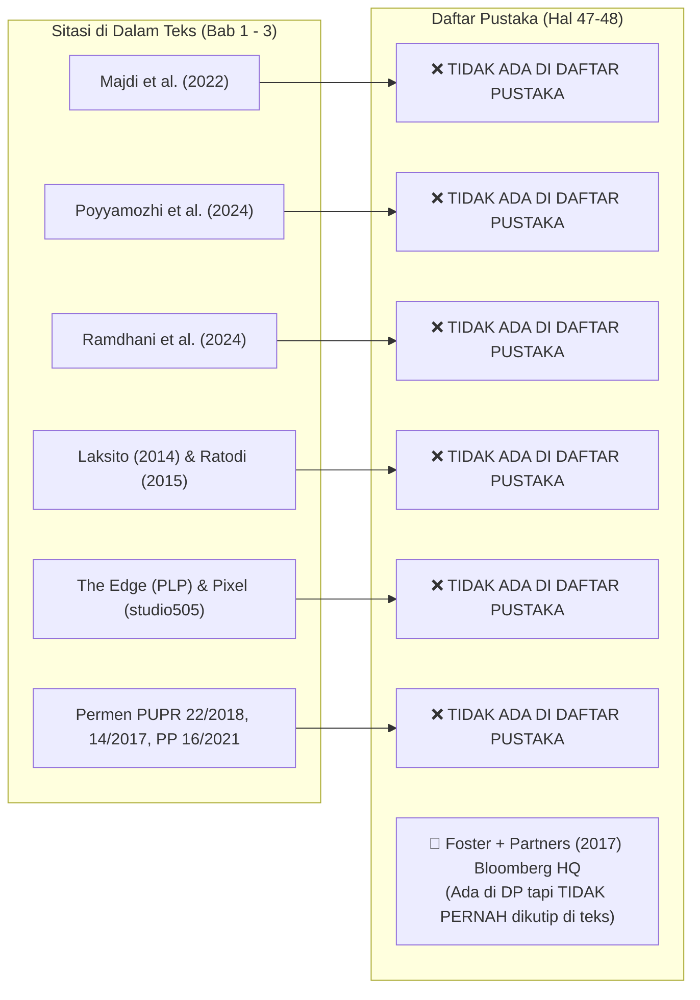
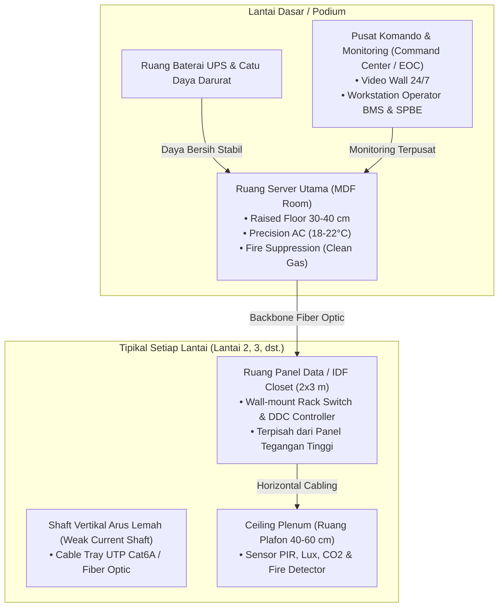

# 🏛️ LAPORAN AUDIT & CATATAN KRITIS DOSEN PENGUJI II (BIDANG INFORMATIKA)
## Seminar Proposal / Skripsi Program Studi S1 Arsitektur – Fakultas Teknik Universitas Mulawarman

---

| Parameter Dokumen | Rincian Informasi |
| :--- | :--- |
| **Judul Naskah** | **Redesain Gedung Dinas Kesehatan Provinsi Kalimantan Timur dengan Pendekatan Arsitektur Smart Building** |
| **Nama Mahasiswa** | Arya Rizqi Putra Mahardika |
| **NIM** | 2309096042 |
| **Program Studi** | S1 Arsitektur, Jurusan Arsitektur, Fakultas Teknik Universitas Mulawarman |
| **Dosen Pembimbing I** | Kartika Tristanto, S.Ars., M.Arch. |
| **Dosen Pembimbing II** | Ir. Putri Nopianti, S.T., M.T. |
| **Dosen Penguji I** | Ratri Bodromulatsih, S.Ds., M.Ars. |
| **Dosen Penguji II** | **Anton Prafanto, S.Kom., M.T.** (Bidang Keahlian: *Internet of Things, Embedded Systems & Software Architecture*) |
| **Dokumen Draf** | [`SEMINAR ARSITEKTUR ARYA 3.pdf`](file:///C:/Users/anton/vibecoding/Bimbingan/audit_mahasiswa/draft_seminar_arsitektur_arya_rizqi.pdf) (59 Halaman) |
| **Status Review** | **Revisi Mayor Substantif TIK & Perapian Integritas Naskah** |

---

## 📌 PENGANTAR PENGUJI: PERSPEKTIF INFORMATIKA PADA DESAIN ARSITEKTUR

Ketika judul skripsi arsitektur memuat frasa **"Pendekatan Arsitektur Smart Building"**, objek rancangan tidak lagi sekadar entitas fisik statis (balok, kolom, dan dinding), melainkan telah bertransformasi menjadi **Sistem Siber-Fisik (*Cyber-Physical System*)**. 

Dalam perspektif keilmuan Informatika:
1. **Gedung Pintar Memerlukan Ruang Fisik**: Sensor, kabel data, kontroler, panel otomasi, dan server membutuhkan ruang arsitektural (*spatial requirement*) yang spesifik (seperti ruang server berpendingin presisi, *shaft* vertikal kabel data, dan *cable tray*).
2. **Ketepatan Istilah & Logika**: Istilah teknologi seperti *Interoperabilitas*, *Building Management System (BMS)*, dan *Internet of Things (IoT)* memiliki definisi baku dalam rekayasa komputer. Tidak boleh terjadi pergeseran arti yang fatal.
3. **Kesesuaian Tipologi Objek**: Gedung Dinas Kesehatan Provinsi bukan sekadar gedung perkantoran umum, melainkan simpul logistik rantai dingin (*cold chain*) vaksin, data rekam kesehatan publik, dan pusat koordinasi tanggap darurat kesehatan daerah.

Catatan audit ini disusun secara menyeluruh dan terperinci agar mahasiswa dapat memahami **di mana letak kelemahan naskah saat ini** dan **bagaimana langkah konkret memperbaikinya**.

---

## 🚨 BAGIAN 1: TEMUAN FORENSIK KRITIS (*RED FLAGS* & KELALAIAN NASKAH)
*(Poin-poin berikut wajib dibersihkan terlebih dahulu karena berkaitan langsung dengan integritas akademik naskah).*

### 1.1. Kontaminasi Paragraf *Copy-Paste* Pasar & UMKM (Bab 1, Hal. 3)
* **Kutipan Naskah (Bab 1 Hal. 3, Paragraf Terakhir):**
  > *"Redesain menjadi salah satu upaya yang dapat dilakukan untuk meningkatkan kualitas ruang dan mengoptimalkan fungsi kawasan perdagangan. Dahlima (2018), melalui penelitian mengenai redesain **Pasar Genteng Surabaya**, menunjukkan bahwa redesain dapat mempertahankan fungsi yang telah ada... Dalam konteks **Sentra UMKM Paras Perbatasan**, redesain diperlukan untuk mengoptimalkan fungsi kawasan, memperbaiki kualitas fasilitas, serta meningkatkan daya tarik ruang bagi **pedagang** dan pengunjung."*
* **Masalah**: Naskah ini membahas **Gedung Dinas Kesehatan Provinsi Kalimantan Timur**, namun terdapat paragraf utuh yang membahas pasar rakyat, perdagangan, pedagang, dan UMKM di Surabaya/Perbatasan.
* **Instruksi Tindakan**: **Hapus seluruh paragraf tersebut**. Ganti dengan urgensi redesain fasilitas pemerintahan bidang kesehatan di Samarinda dalam menyongsong peran strategis sebagai daerah mitra Ibu Kota Nusantara (IKN).

### 1.2. Jejak Prompt Percakapan AI Chatbot yang Tertinggal (Bab 2, Hal. 25)
* **Kutipan Naskah (Subbab 2.6.4 Kallang Pulse, Paragraf 1):**
  > *"Kallang Pulse merupakan contoh yang sangat relevan dengan **penelitianmu** karena bangunan ini bukan dibangun dari awal sebagai smart building..."*
* **Masalah**: Penggunaan kata ganti orang kedua *"penelitianmu"* adalah indikasi kuat hasil *copy-paste* langsung dari *prompt output* asisten AI tanpa disunting (*proofread*).
* **Instruksi Tindakan**: Ubah redaksi menjadi bahasa ilmiah formal orang ketiga, misalnya: *"Preseden Kallang Pulse relevan dengan penelitian ini karena..."*

### 1.3. Duplikasi Paragraf Utuh (*Word-for-Word Duplication*)
Terdapat dua bagian naskah di mana mahasiswa menempelkan paragraf yang persis sama dua kali berturut-turut:
1. **Bab 2 Hal. 14–15 (Subbab 2.4 - Dinkes Kaltim):**  
   Paragraf *"Aktivitas yang berlangsung di dalam Gedung Dinas Kesehatan Provinsi Kalimantan Timur melibatkan berbagai pengguna, seperti pegawai, pimpinan, tenaga teknis, tamu..."* tertulis **dua kali berturut-turut**.
2. **Bab 2 Hal. 25 (Subbab 2.6.4 - Kallang Pulse):**  
   Paragraf *"Kallang Pulse merupakan contoh yang sangat relevan..."* tertulis **dua kali berturut-turut**.
* **Instruksi Tindakan**: Hapus salah satu paragraf kembar tersebut.

### 1.4. Kalimat Menggantung (*Unfinished Sentence*) pada Batasan Masalah (Bab 1, Hal. 3)
* **Kutipan Naskah (Subbab 1.3 Butir 1):**
  > *"1. Perancangan difokuskan pada Gedung Dinas Kesehatan Provinsi Kalimantan Timur yang berada di Kota Samarinda, **dengan luasan**"*
* **Masalah**: Kalimat terputus tanpa nominal angka dan satuan luas, kemudian langsung melompat ke nomor 2.
* **Instruksi Tindakan**: Lengkapi kalimat tersebut (misal: *"...dengan luas lahan 7.273 m² dan perkiraan luas lantai bangunan terbangun 3.950 m²"* sesuai data di Halaman 5).

### 1.5. Kerancuan Deskripsi Sistematika Bab 3 vs Bab 4 (Bab 1, Hal. 5)
* **Kutipan Naskah (Subbab 1.7):**
  > *"BAB III METODELOGI PENELITIAN: Bab ini berisi hasil pengumpulan dan analisis data serta pembahasan konsep dan hasil perancangan... Bab ini diakhiri dengan **penyajian hasil redesain dalam bentuk gambar teknis, visualisasi tiga dimensi...**"*
* **Masalah**: Bab 3 adalah **Metodologi Perancangan** (alur kerja/metode riset). Gambar kerja, denah, potongan, dan render 3D adalah isi dari **Bab 4 (Hasil dan Pembahasan)**. Deskripsi di Sistematika Penulisan Bab 3 tertukar dengan Bab 4.
* **Instruksi Tindakan**: Perbaiki deskripsi Sistematika Bab 3 agar berfokus pada metode perolehan data, kerangka berpikir, dan tahapan transformasi desain.

---

## 📚 BAGIAN 2: AUDIT SILANG SITASI & BIBLIOGRAFI (*CITATION & REFERENCE AUDIT*)

Pemeriksaan silang (*cross-examination*) antara teks di Bab 1–3 dengan Daftar Pustaka (Hal. 47–48) menemukan anomali berat:

### 2.1. Sumber Dikutip di Teks tetapi TIDAK ADA di Daftar Pustaka
1. **Majdi et al. (2022)** – Dikutip pada Tabel 2.1 (No. 4, Hal. 8).
2. **Poyyamozhi et al. (2024)** – Dikutip pada Tabel 2.1 (No. 7, Hal. 9).
3. **Lalu Gabrielle Ayub Ramdhani et al. (2024)** – Dikutip pada Tabel 2.1 (No. 10, Hal. 10).
4. **Laksito (2014)** – Dikutip sebagai landasan metodologi perancangan arsitektur di Bab 3 (Hal. 27 & 31).
5. **Ratodi (2015)** – Dikutip pada pengumpulan data di Bab 3 (Hal. 27).
6. **Dahlima (2018)** – Dikutip pada Bab 1 Hal. 3.
7. **Preseden 2.6.2 The Edge Amsterdam (PLP Architecture)** – Dokumen proyek/arsitek tidak dicantumkan di Daftar Pustaka.
8. **Preseden 2.6.3 Pixel Building Melbourne (studio505)** – Dokumen proyek/arsitek tidak dicantumkan di Daftar Pustaka.
9. **Preseden 2.6.4 Kallang Pulse (Schneider Electric)** – Dokumen resmi tidak dicantumkan di Daftar Pustaka.
10. **Seluruh Regulasi PUPR** (Permen PUPR 22/2018, Permen PUPR 14/2017, Permen PUPR 21/2021, PP 16/2021) yang dikutip di Subbab 2.3.1 (Hal. 13) **hilang dari Daftar Pustaka**.

### 2.2. Sitasi Hantu (*Ghost Citation*) di Daftar Pustaka
* **Nomor 18 di Daftar Pustaka (Hal. 48):**
  > *Foster + Partners. (2017, 2 Oktober). Bloomberg’s new European headquarters rated world’s most sustainable office building.*
* **Masalah**: Dokumen ini tercantum di daftar pustaka, tetapi **sama sekali tidak pernah disinggung atau dikutip di dalam teks naskah**.
* **Instruksi**: Hapus jika tidak dipakai, atau masukkan sebagai preseden pembanding di Bab 2.

### 2.3. Anakronisme Standar Nasional Indonesia (SNI)
* Di **Teks Subbab 2.3.2 (Hal. 13–14)** mahasiswa menulis acuan standar lama:
  * SNI 03-6572-2001 (Tata Cara Ventilasi dan Pengkondisian Udara)
  * SNI 03-6197-2011 (Konservasi Energi Sistem Pencahayaan)
  * SNI 03-6389-2011 (Konservasi Energi Selubung Bangunan)
* Namun di **Daftar Pustaka (Hal. 47)** mahasiswa mencantumkan versi pembaruan:
  * SNI 6572-1:2024
  * SNI 6197:2020
  * SNI 6389:2020
* **Instruksi Tindakan**: Selaraskan teks di Bab 2 agar merujuk pada standar SNI edisi mutakhir (2020 dan 2024), karena standar 2001 dan 2011 telah dinyatakan dicabut/direvisi oleh BSN.

---

## 💻 BAGIAN 3: AUDIT SUBSTANTIF INFORMATIKA PADA PARAMETER SMART BUILDING

### 3.1. Disorientasi Definisi Konsep pada Tabel 3.1 (Hal. 35–37)
Tabel Parameter Konsep adalah "kompas" perancangan. Terjadi kerancuan fatal antara peristilahan komputasi/IT dengan arsitektur tapak:

| Parameter Naskah | Definisi Mahasiswa Saat Ini (Keliru) | Koreksi Definisi Menurut Keilmuan Informatika & Smart Building |
| :--- | :--- | :--- |
| **Interoperabilitas Sistem** | *"Kemudahan pengguna mencapai dan memasuki kawasan serta mengakses fasilitas di dalamnya (menata akses masuk, jalur pejalan kaki, sirkulasi kendaraan, parkir)."* | **Interoperabilitas BUKAN sirkulasi pejalan kaki!** Interoperabilitas adalah kemampuan berbagai perangkat dan sub-sistem gedung (chiller, lampu, sensor, CCTV) dari vendor berbeda untuk berkomunikasi tanpa hambatan menggunakan protokol komunikasi terbuka (seperti BACnet/IP, Modbus TCP, MQTT, atau Web API). |
| **Smart Lighting** | *"Karakter visual yang membantu membentuk citra dan membedakan kawasan dari tempat lain (mengolah fasad, material, warna, penanda kawasan)."* | **Smart Lighting BUKAN branding fasad!** Smart Lighting adalah otomasi pencahayaan berbasis sensor keberadaan (*PIR sensor*) dan penginderaan intensitas cahaya alami (*daylight harvesting / lux sensor*), serta integrasi penjadwalan via controller DALI/KNX. |
| **Monitoring Energi** | *"Kondisi ruang yang mendukung kenyamanan pengguna ketika beraktivitas (memperhatikan pencahayaan, keteduhan, tempat duduk, kebersihan)."* | **Monitoring Energi BUKAN tempat duduk dan kebersihan!** Monitoring energi adalah pemantauan konsumsi daya listrik (*power meter* cerdas) secara *real-time* per blok/lantai untuk menganalisis beban puncak (*peak load*) dan kebocoran energi. |

### 3.2. Kesalahan Variabel Survei pada Tabel 3.2 (Hal. 42)
* Pada **Tabel 3.2 (Desain Survey, Hal. 42)**:
  * Variabel: *Potensi Penerapan Smart Building*
  * Subvariabel: *Sensor dan pemantauan kondisi ruang*
  * Data yang Dikumpulkan: **"Kendala usaha dan kebutuhan fasilitas"** ❌
* **Masalah**: Mengapa mahasiswa mengumpulkan data "kendala usaha" untuk sensor ruangan di kantor pemerintahan? Ini adalah bukti nyata residu survei pasar tradisional / UMKM yang terbawa ke draf.
* **Koreksi Data yang Harus Dikumpulkan**: Tingkat pencahayaan alami eksisting (Lux meter), fluktuasi suhu ruang kerja, pola hunian ruang rapat, dan keberadaan jalur instalasi kabel eksisting.

---

## 🏢 BAGIAN 4: KEBUTUHAN RUANG FISIK TIK (*SPATIAL REQUIREMENTS FOR IT INFRASTRUCTURE*)

Gedung berkonsep *Smart Building* **tidak bisa berdiri tanpa ruang penunjang teknologi**. Mahasiswa arsitektur sering lupa bahwa perangkat IT membutuhkan wadah fisik. 

Dalam Bab 3 (Program Ruang) dan Bab 4 (Perancangan), mahasiswa **wajib mengalokasikan ruang arsitektural berikut**:

1. **Ruang Server Utama / MDF (*Main Distribution Frame*)**:
   * Menampung server BMS, database rekam kesehatan dinas, dan server komunikasi antarbagian.
   * *Persyaratan Arsitektural*: Bebas banjir, bukan di bawah toilet/ruang basah, menggunakan lantai berpanggung (*raised floor*), pendingin presisi (PAC), proteksi kebakaran gas ramah lingkungan (*FM-200 / Novec 1230*), dan akses biometrik.
2. **Ruang Distribusi Lantai / IDF (*Intermediate Distribution Frame*)**:
   * Setiap lantai wajib memiliki ruang utilitas arus lemah (minimal $2 \times 3\text{ meter}$) untuk *rack switch*, kontroler DDC (*Direct Digital Controller*), dan terminasi kabel sensor lantai tersebut.
3. **Shaft Arus Lemah (*Low Voltage / Weak Current Shaft*)**:
   * Harus terpisah secara fisik minimal $30\text{ cm}$ atau diberi sekat logam dari *shaft* listrik tegangan menengah/tinggi untuk menghindari interferensi elektromagnetik (*EMI*).
4. **Ruang Pusat Kendali (*Command Center / Emergency Operations Center*)**:
   * Menjadi ruang monitoring operasional Dinas Kesehatan Prov. Kaltim (dashboard pemantauan status gizi/stunting, wabah penyakit, logistik vaksin se-Kaltim, serta dashboard konsumsi energi gedung).
5. **Jalur Distribusi Horisontal (*Ceiling Plenum / Raised Floor*)**:
   * Ketinggian bersih plafon (*clear height*) harus memperhitungkan ruang gantung pipa HVAC dan *cable tray* sensor cerdas.

---

## 💉 BAGIAN 5: KONTEKSTUALISASI DINKES PROVINSI KALIMANTAN TIMUR

Sebagai kantor dinas kesehatan tingkat provinsi, sistem *smart building* yang dirancang harus memiliki sentuhan kontekstual fungsional:

1. **Smart Cold-Chain Monitoring System**:
   * Dinas Kesehatan Provinsi bertanggung jawab menyimpan dan mendistribusikan vaksin ke seluruh kabupaten/kota di Kalimantan Timur.
   * *Fitur Smart*: Gudang Farmasi dan Ruang Cold Chain harus dilengkapi sensor suhu presisi tinggi (-80°C s/d +8°C) dengan sistem alarm otomatis (*early warning alert via SMS/IoT notification*) dan generator cadangan otomatis (*auto-transfer switch*) jika terjadi kegagalan pendingin.
2. **Sistem Keamanan Akses Berjenjang (*Multi-Tier Access Control*)**:
   * Pembagian zonasi fisik gedung:
     * **Zona Publik**: Lobi pelayanan informasi dan pengaduan (akses bebas).
     * **Zona Semi-Publik**: Ruang rapat koordinasi lintas sektoral, aula seminar (akses terdaftar).
     * **Zona Privat**: Ruang kerja pegawai, ruang pimpinan (akses RFID / Face Recognition).
     * **Zona Restriksi Tinggi**: Ruang Server Data Kesehatan, Gudang Vaksin, dan Ruang Arsip (akses Biometrik + CCTV analitik).

---

## 🛠️ BAGIAN 6: TEMPLATE PERBAIKAN MATRIKS PARAMETER KONSEP (TABEL 3.1)
*(Mahasiswa dipersilakan mengadopsi struktur tabel ini untuk merevisi naskah Bab 3).*

| Prinsip | Parameter Konsep | Definisi Operasional | Strategi Capaian Arsitektural & TIK |
| :--- | :--- | :--- | :--- |
| **Integrasi Sistem Bangunan** | **Interoperabilitas Protokol** | Kemampuan sub-sistem utilitas (HVAC, pencahayaan, proteksi) untuk bertukar data secara seragam. | Menggunakan arsitektur jaringan berbasis IP dengan protokol terbuka (BACnet/IP & MQTT) yang bermuara pada satu platform BMS terpadu. |
| | **Building Management System (BMS)** | Pusat kendali berbasis perangkat lunak untuk pemantauan dan kontrol terpusat seluruh operasional gedung. | Merancang ruang *Command Center / Ruang Kontrol BMS* di lantai podium dan ruang server (MDF) yang memenuhi standar keandalan. |
| **Efisiensi Energi** | **Pencahayaan Adaptif (*Smart Lighting*)** | Pengendalian intensitas lampu buatan yang menyesuaikan dengan kehadiran orang dan cahaya matahari. | Mengintegrasikan bukaan jendela alami (*daylight harvesting*) dengan sensor fotosel (Lux) dan sensor PIR pada plafon ruang kerja. |
| | **Tata Udara Pintar (*Smart HVAC*)** | Sistem pendingin dan sirkulasi udara yang modulasi kapasitasnya mengikuti beban termal dan okupansi. | Membagi zonasi VRF/Chiller per sayap gedung, dikendalikan oleh sensor suhu, kelembapan, dan sensor $\text{CO}_2$ ruang rapat. |
| | **Monitoring Sub-Meter Listrik** | Pengukuran konsumsi daya listrik secara terperinci per blok lantai dan kategori peralatan. | Menempatkan panel *Digital Power Meter* pada setiap panel distribusi lantai (IDF) yang mengirimkan data kWh ke server BMS. |
| **Keamanan & Perlindungan** | **Kontrol Akses Bertingkat (*Smart Security*)** | Pengendalian dan pembatasan hak masuk pengguna ke dalam zona ruang berdasarkan kewenangan. | Menempatkan *turnstile gate* kartu pintar di lobi utama, pintu magnetik RFID pada area kantor, dan pemindai biometrik pada Ruang Server & Cold Chain. |
| **Kesehatan Lingkungan** | **Kualitas Udara Dalam Ruangan (*IAQ Monitoring*)** | Pemantauan parameter kesehatan udara (partikulat, $\text{CO}_2$, kelembapan) di ruang kerja tertutup. | Menempatkan sensor kualitas udara terintegrasi dengan katup ventilasi udara segar otomatis (*fresh air damper*). |

---

## 📋 BAGIAN 7: ROADMAP AKSI & DAFTAR PERIKSA REVISI UNTUK MAHASISWA

Gunakan *checklist* ini sebagai panduan revisi sebelum maju ke seminar:

- [ ] **1. Pembersihan Naskah Bab 1:**
  - Hapus tuntas teks *Pasar Genteng*, *Sentra UMKM*, dan *pedagang* di Hal. 3.
  - Lengkapi kalimat yang menggantung pada Batasan Masalah butir 1 di Hal. 3.
  - Tambahkan luasan lahan ($7.273\text{ m}^2$) dan bangunan ($3.950\text{ m}^2$) pada batasan masalah.
  - Luruskan deskripsi Sistematika Penulisan Bab 3 dan Bab 4 di Hal. 5.

- [ ] **2. Pembersihan & Pemutakhiran Bab 2:**
  - Hapus kata *"penelitianmu"* di Subbab 2.6.4 (Hal. 25).
  - Hapus paragraf duplikat di Subbab 2.4 (Hal. 14–15) dan Subbab 2.6.4 (Hal. 25).
  - Mutakhirkan nomor standar SNI ventilasi dan pencahayaan ke tahun 2020/2024.
  - Lengkapi studi preseden (The Edge Amsterdam dan Pixel Melbourne) dengan literatur/dokumen arsiteknya.

- [ ] **3. Rekonstruksi Bab 3 (Metodologi):**
  - Ganti ejaan judul "METODELOGI" menjadi **METODOLOGI**.
  - Rombak **Tabel 3.1 (Parameter Konsep)** mengikuti template Bagian 6 di atas.
  - Pada **Tabel 3.2 (Desain Survey)**, buang data "kendala usaha", ganti dengan data fisik pencahayaan, suhu, okupansi, dan ketersediaan infrastruktur jaringan kabel/listrik eksisting.
  - Masukkan kebutuhan Ruang Server (MDF), Ruang Shaft Data (IDF), dan Ruang Kontrol BMS ke dalam program ruang.

- [ ] **4. Penyelarasan Daftar Pustaka:**
  - Masukkan seluruh pustaka yang dikutip di teks (Majdi, Poyyamozhi, Ramdhani, Laksito, Ratodi, peraturan PUPR).
  - Hapus referensi Foster + Partners (Bloomberg HQ) jika tidak dibahas di teks.
  - Satukan referensi situs Bullitt Center menjadi 1 entri yang rapi.
  - Format daftar pustaka menggunakan kaidah APA Style 7th Edition secara alfabetis.

- [ ] **5. Persiapan Gambar Kerja Studio (Menuju Bab 4):**
  - Pastikan pada gambar Denah terdapat simbol peletakan sensor utama, titik akses kontrol pintu, dan titik kamera CCTV.
  - Sertakan 1 lembar gambar **Diagram Skematik Sistem Utilitas Cerdas (BMS System Architecture)** yang memperlihatkan integrasi antar-perangkat.

---

## 🎯 BAGIAN 8: BANK PERTANYAAN DOSEN PENGUJI II (SIMULASI TANYA-JAWAB SIDANG)

Pertanyaan-pertanyaan ini dirancang untuk menguji kedalaman penguasaan mahasiswa terhadap konsep yang ditulisnya:

1. **Tentang Konsep & Definisi:**
   > *"Saudara Arya, di Bab 3 Tabel 3.1 Anda menuliskan parameter 'Interoperabilitas Sistem', namun definisinya mengenai kemudahan orang berjalan kaki dari tempat parkir ke gedung. Bisakah Anda jelaskan apa sebenarnya arti interoperabilitas dalam konteks smart building, dan protokol apa yang akan Anda gunakan untuk menghubungkan pendingin ruangan dengan sistem alarm kebakaran?"*

2. **Tentang Konsekuensi Spasial Teknologi:**
   > *"Jika gedung ini dirancang cerdas dengan ribuan sensor dan jaringan terintegrasi, di mana letak ruang server utama (MDF), shaft kabel data, dan ruang operator BMS pada konsep denah Anda? Apa pertimbangan teknis Anda dalam memilih posisi ruangan tersebut?"*

3. **Tentang Keandalan Sistem (*Fail-Safe* & Redundansi):**
   > *"Gedung pintar sangat rentan terhadap gangguan pasokan listrik. Bagaimana skema perancangan arsitektur dan utilitas Anda dalam memastikan sistem kontrol akses pintu darurat dan pendingin gudang vaksin tetap bekerja secara aman (*fail-safe*) saat terjadi pemadaman listrik total di Samarinda?"*

4. **Tentang Kebutuhan Spesifik Objek:**
   > *"Apa perbedaan mendasar antara penerapan Smart Building pada gedung perkantoran komersial sewa (seperti The Edge Amsterdam) dengan gedung kantor dinas kesehatan tingkat provinsi seperti objek rancangan Anda ini?"*

---

> [!NOTE]
> **Catatan Pembina:**  
> Catatan dan telaah ini ditujukan untuk membangun (*constructive feedback*) agar kualitas karya ilmiah mahasiswa Fakultas Teknik Universitas Mulawarman memiliki ketajaman argumentasi teknis, kematangan logika perancangan, dan nilai guna nyata bagi pembangunan daerah. Mahasiswa diharapkan berkonsultasi dengan Dosen Pembimbing untuk menindaklanjuti perbaikan ini.
