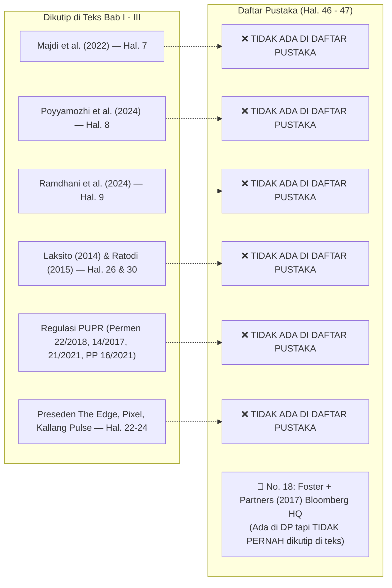
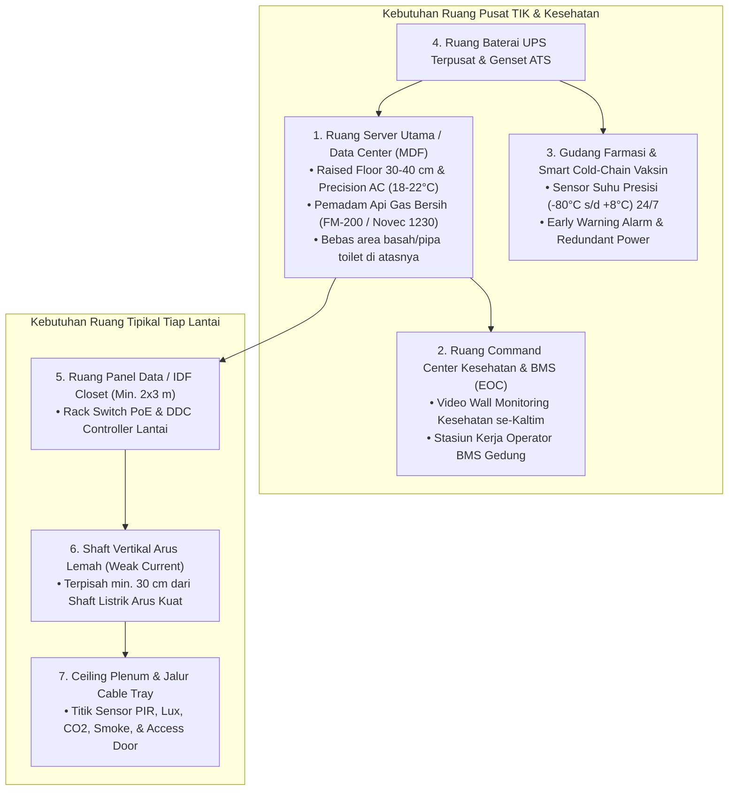

# 🏛️ LAPORAN AUDIT PARIPURNA & CATATAN KRITIS DOSEN PENGUJI II (BIDANG INFORMATIKA)
## Evaluasi Naskah Seminar Proposal Tugas Akhir S1 Arsitektur (`SEMINAR ARSITEKTUR ARYA FIX.pdf`)

---

| Parameter Dokumen | Rincian Informasi |
| :--- | :--- |
| **Judul Naskah** | **Redesain Gedung Dinas Kesehatan Provinsi Kalimantan Timur dengan Pendekatan Arsitektur Smart Building** |
| **Kode Berkas** | `102-ARS-26/27` (Revisi dari berkas sebelumnya `037-ARS-26/27`) |
| **Nama Mahasiswa** | Arya Rizqi Putra Mahardika |
| **NIM** | 2309096042 (Angkatan 2023, Semester 7) |
| **Program Studi** | S1 Arsitektur, Fakultas Teknik, Universitas Mulawarman |
| **Dosen Pembimbing I** | Kartika Tristanto, S.Ars., M.Arch. |
| **Dosen Pembimbing II** | Ir. Putri Nopianti, S.T., M.T. |
| **Dosen Penguji I** | Ratri Bodromulatsih, S.Ds., M.Ars. |
| **Dosen Penguji II** | **Anton Prafanto, S.Kom., M.T.** (Bidang: *Internet of Things, Embedded Systems & Software Architecture*) |
| **Dokumen Draf Uji** | [`SEMINAR ARSITEKTUR ARYA FIX.pdf`](file:///C:/Users/anton/vibecoding/Bimbingan/audit_mahasiswa/draft_seminar_arsitektur_arya_rizqi_fix.pdf) (58 Halaman) • [Draf Lama (`ARYA 3.pdf`)](file:///C:/Users/anton/vibecoding/Bimbingan/audit_mahasiswa/draft_seminar_arsitektur_arya_rizqi.pdf) (59 Halaman) |
| **Dasar Rujukan Audit** | **Pedoman Standar & Format Penulisan Skripsi FT Unmul** ([`pedoman_skripsi_unmul.md`](file:///C:/Users/anton/vibecoding/Bimbingan/pedoman_skripsi_unmul.md)) & **Kaidah Rekayasa Cyber-Physical Systems (BACS / ISO 52120-1)** |
| **Status Kelayakan** | **REVISI MAYOR MULTI-ASPEK (Hanya 2 Temuan Minor Bab I yang Diperbaiki; Seluruh Cacat Substantif TIK, Bibliografi, & Format Masih Utuh)** |

---

## 🔍 RINGKASAN KOMPARASI: APA YANG BERUBAH DARI `ARYA 3.pdf` KE `ARYA FIX.pdf`?

Berdasarkan pemeriksaan *diff* karakter demi karakter antara berkas lama (`SEMINAR ARSITEKTUR ARYA 3.pdf` – 59 halaman) dan berkas terbaru (`SEMINAR ARSITEKTUR ARYA FIX.pdf` – 58 halaman), mahasiswa **hanya melakukan 5 perubahan kosmetik kecil**, sementara **lebih dari 90% kesalahan fatal masih belum disentuh sama sekali**:

### ✅ Hal yang Sudah Diperbaiki pada `SEMINAR ARSITEKTUR ARYA FIX.pdf`:
1. **Penghapusan Paragraf Copy-Paste "Pasar Genteng Surabaya & Sentra UMKM" (Bab I Hal. 3):** Paragraf nyasar mengenai pasar perdagangan dan pedagang UMKM yang mengutip Dahlima (2018) telah dihapus (menyebabkan jumlah halaman berkurang 1 halaman dari 59 menjadi 58 halaman).
2. **Pelengkapan Kalimat Menggantung pada Batasan Masalah Butir 1 (Bab I Hal. 3):** Kalimat yang sebelumnya terpotong pada kata *"...dengan luasan"* kini telah dilengkapi menjadi *"...dengan luas bangunan gedung 3.950 m²."*
3. **Penomoran Bab I:** Penulisan judul `BAB 1` (angka Arab) telah diubah menjadi `BAB I` (angka Romawi) agar seragam dengan `BAB II` dan `BAB III`.
4. **Perubahan Kode Berkas & Warna Tabel:** Kode sudut kanan atas sampul berubah dari `037-ARS-26/27` menjadi `102-ARS-26/27`, serta warna *header* seluruh tabel dan balok *Gantt Chart* diubah dari biru/hitam menjadi **oranye**.
5. **Perbaikan 1 Tanda Titik Ganda:** Kata `pengelolaan..` pada Tabel 3.1 (Hal. 35) diperbaiki menjadi `pengelolaan.` (namun 3 tanda titik ganda lainnya di Hal. 18, 20, dan 36 tetap terlewat).

### ⚠️ Kesalahan Baru yang Muncul Akibat Editan di `ARYA FIX.pdf`:
* **Font Daftar Isi Berubah Menjadi *Calibri* (Hal. VI–VII / PDF Hal. 7–8):** Saat mahasiswa memperbarui *Table of Contents* otomatis di MS Word akibat bergesernya nomor halaman, seluruh isi Daftar Isi berubah jenis hurufnya menjadi **Calibri (Sans-Serif)**, melanggar aturan wajib 100% **Times New Roman**!

---

## 🚨 BAGIAN 1: TEMUAN FATAL INTEGRITAS TEKS & REDAKSIONAL YANG MASIH ADA DI `ARYA FIX.pdf`
*(Seluruh nomor halaman di bawah ini telah disesuaikan presisi dengan berkas `SEMINAR ARSITEKTUR ARYA FIX.pdf`).*

### 1.1. Jejak Prompt Percakapan AI Chatbot Masih Tertinggal (Bab II, Hal. 24 / PDF Hal. 35)
* **Kutipan Naskah (Subbab 2.6.4 Kallang Pulse, Paragraf 1):**
  > *"Kallang Pulse merupakan contoh yang sangat relevan dengan **penelitianmu** karena bangunan ini bukan dibangun dari awal sebagai smart building..."*
* **Kritik Penguji:** Penggunaan kata ganti orang kedua *"penelitianmu"* adalah bukti salinan mentah dari respon AI Chatbot yang belum disunting.
* **Instruksi Tindakan:** Ubah menjadi kalimat ilmiah objektif: *"Preseden Kallang Pulse sangat relevan dengan penelitian ini karena..."*

### 1.2. Duplikasi Paragraf Kembar (*Word-for-Word Duplication*) di 2 Subbab
Terdapat dua bagian di Bab II di mana mahasiswa menempelkan paragraf yang persis sama dua kali berturut-turut:
1. **Bab II Hal. 13–14 (PDF Hal. 24–25, Subbab 2.4 - Gedung Dinkes Kaltim):**  
   Kalimat *"Aktivitas yang berlangsung di dalam Gedung Dinas Kesehatan Provinsi Kalimantan Timur melibatkan berbagai pengguna, seperti pegawai, pimpinan, tenaga teknis, tamu, serta masyarakat yang memiliki kepentingan terhadap pelayanan dan informasi kesehatan. Beragamnya pengguna dan aktivitas tersebut membutuhkan ruang kerja yang terorganisasi, hubungan antar-ruang yang jelas, serta fasilitas pendukung yang mampu menunjang kegiatan secara efektif dan efisien."* tercetak **dua kali berturut-turut**.
2. **Bab II Hal. 24 (PDF Hal. 35, Subbab 2.6.4 - Kallang Pulse):**  
   Kalimat *"Kallang Pulse merupakan contoh yang sangat relevan dengan penelitianmu karena bangunan ini bukan dibangun dari awal sebagai smart building. Bangunan yang telah berusia sekitar 25 tahun tersebut kemudian dimodernisasi pada 2018 menjadi kantor yang menerapkan teknologi digital, energi terbarukan, dan sistem pengelolaan bangunan pintar."* tercetak **dua kali berturut-turut**.
* **Instruksi Tindakan:** Hapus pengulangan kalimat/paragraf kembar tersebut.

### 1.3. Kerancuan Deskripsi Sistematika Penulisan (Bab I, Hal. 5 / PDF Hal. 16)
* **Kutipan Naskah (Subbab 1.7):**
  * **BAB II TINJAUAN PUSTAKA:** Ditulis berisi *"eksisting data, tinjauan bangunan, tinjauan gaya bangunan, tinjauan warna, serta tinjauan data arsitektur dengan penekanan"*. Padahal isi Bab II yang sebenarnya sama sekali tidak membahas tinjauan warna atau gaya bangunan!
  * **BAB III METODELOGI PENELITIAN:** Ditulis *"diakhiri dengan penyajian hasil redesain dalam bentuk gambar teknis, visualisasi tiga dimensi, dan penjelasan penerapan pendekatan Arsitektur Smart Building pada bangunan"*. Padahal Bab III adalah Metodologi, sedangkan gambar teknis dan visualisasi 3D adalah isi **Bab IV (Hasil dan Pembahasan)**!
* **Instruksi Tindakan:** Tulis ulang Subbab 1.7 agar mencerminkan isi Bab II dan Bab III yang sebenarnya.

### 1.4. Cacat Tata Letak Tabel 3.3 Terpenggal Menjadi "Tabel Buta" (Bab III, Hal. 44–45 / PDF Hal. 55–56)
* Di bagian bawah **Halaman 44**, tercantum judul `Tabel 3. 3 Jadwal Penelitian (penulis, 2026)` beserta kepala tabel (`No | Kegiatan | Bulan (2026 – 2027)` dan baris `I Tahapan Penelitian`).
* Seluruh isi rincian kegiatan jadwal terlempar ke **Halaman 45 tanpa kepala kolom bulan sama sekali**, sehingga pembaca tidak dapat mengetahui kolom mana yang mewakili bulan Agustus s.d. April.
* Selain itu, ketiga fase utama pada kolom Kegiatan (Romawi `I`, `II`, dan `III`) semuanya diberi label yang sama persis: **"Tahapan Penelitian"** (seharusnya: *I. Tahap Persiapan*, *II. Tahap Pelaksanaan*, *III. Tahap Penyusunan Laporan*).

### 1.5. Anomali Identitas Pejabat, Gelar, dan Typo Judul yang Masih Utuh
* **Inkonsistensi Nama & Gelar Koordinator Prodi S1 Arsitektur:**
  * Lembar Pengesahan (Hal. III): `Ir. Pandu K. Utomo, S.T., M.Sc., IPM`
  * Kata Pengantar (Hal. V No. 3): `Ar. Pandu Kusumoputro Utomo, ST., M.Sc., IPM.`  
  *(Berbeda gelar profesi `Ir.` vs `Ar.`, singkatan nama, dan titik gelar `S.T.` vs `ST.`).*
* **Koma Ganda Dosen Pembimbing I:** Tertulis `Kartika Tristanto, , S.Ars., M.Arch` pada Hal. III dan Hal. V.
* **Gelar Insinyur (`Ir.`) Dosen Pembimbing II Hilang di Kata Pengantar:** Di Hal. III tertulis `Ir. Putri Nopianti, S.T., M.T.`, tetapi di Hal. V tertulis `Ibu Putri Nopianti, S.T., M.T.`.
* **Tanggal Kata Pengantar Kosong:** Di Hal. V hanya tertulis `Samarinda, November` (tanpa tanggal dan tahun 2026).
* **Tanda Titik Yatim & Tanda Titik Ganda:**
  * Terdapat tanda titik (`.`) sendirian di baris paling atas Halaman 22 (di atas judul `2.6.2 The Edge, Amsterdam`).
  * Kalimat akhir Subbab 2.2.2 (Hal. 11), Subbab 2.3 (Hal. 11), Subbab 2.6 (Hal. 21), Subbab 2.6.3 (Hal. 23), dan Subbab 3.2.2 (Hal. 28) **tidak diakhiri tanda titik**.
  * Terdapat tanda titik ganda (`..`) pada Hal. 18 (`fasilitas bangunan..`), Hal. 20 (`lingkungan lainnya..`), dan Hal. 36 (`sesuai kebutuhan..`).
* **Typo Judul Baku:**
  * Judul Bab III (Hal. VII & Hal. 26): Tertulis `METODELOGI PENELITIAN` (baku: **METODOLOGI PENELITIAN**).
  * Judul Subbab 3.4.1 (Hal. VII & Hal. 30): Tertulis `3.4.1 Tahap Pra Perancagan` (kurang huruf **'n'**, seharusnya **Pra-Perancangan**).

---

## 📋 BAGIAN 2: AUDIT KEPATUHAN PEDOMAN SKRIPSI FT UNMUL (`pedoman_skripsi_unmul.md`)
*(Terdapat 11 ketidakpatuhan terhadap standar format Fakultas Teknik Universitas Mulawarman).*

| No | Parameter Format FT Unmul | Ketentuan Resmi Pedoman FT Unmul | Fakta pada `SEMINAR ARSITEKTUR ARYA FIX.pdf` | Status |
| :---: | :--- | :--- | :--- | :---: |
| **1** | **Konsistensi Font (100% TNR)** | Wajib 100% **Times New Roman** di seluruh bagian naskah tanpa terkecuali. | Teks **Daftar Isi (Hal. VI–VII)** berubah menjadi font **Calibri (Sans-Serif)**. | ❌ **Pelanggaran Baru** |
| **2** | **Abstrak & Abstract** | Wajib ada sebelum Daftar Isi, memuat tabel header borderless 2 kolom, 200–300 kata, 1 spasi, 3–5 kata kunci. | **HILANG TOTAL (0 Halaman).** Langsung melompat dari Kata Pengantar ke Daftar Isi. | ❌ **Belum Diperbaiki** |
| **3** | **Daftar Singkatan & Istilah** | Wajib ada halaman khusus Daftar Singkatan/Istilah sebelum Bab I. | **HILANG TOTAL**, padahal terdapat puluhan singkatan teknis (BMS, BACS, IoT, PIR, HVAC, LoRaWAN, GLA, dll.). | ❌ **Belum Diperbaiki** |
| **4** | **Kuota Referensi Daftar Pustaka** | **Minimal 30 dan maksimal 50 rujukan** relevan. | **Hanya 23 entri pustaka** (dan 5 entri di antaranya adalah URL situs Bullitt Center yang dipecah-pecah, sehingga unik hanya 19 rujukan). | ❌ **Kurang dari Syarat Minimal** |
| **5** | **Format Daftar Pustaka APA** | Disusun alfabetis nama belakang dengan *hanging indent* **tanpa penomoran urut angka**. | Menggunakan **nomor urut angka 1 s.d. 23**, menyalahi kaidah APA Style. | ❌ **Belum Diperbaiki** |
| **6** | **Gaya Tabel Ilmiah (Booktabs)** | Wajib **Tabel Terbuka (Booktabs)** hitam-putih tanpa garis vertikal. | Seluruh tabel menggunakan **grid garis vertikal tertutup penuh** dengan blok warna **oranye** mencolok. | ❌ **Pelanggaran Format** |
| **7** | **Posisi & Format Judul Tabel** | Di **ATAS TABEL, Rata Tengah (Center), Bold**, format `Tabel X.X. Judul`. | Ditulis **Rata Kiri (Left)** (kecuali Tabel 2.1 & 3.2) dengan spasi janggal setelah titik: `Tabel 2. 1`, `Tabel 3. 1`, `Tabel 3. 3`. | ❌ **Belum Diperbaiki** |
| **8** | **Posisi & Format Judul Gambar** | Di **BAWAH GAMBAR, Rata Tengah (Center), Bold**, format `Gambar X.X. Judul`. | Penomoran memiliki spasi janggal setelah titik: `Gambar 2. 1` s.d. `Gambar 3. 2`. | ❌ **Belum Diperbaiki** |
| **9** | **Penomoran Halaman Awal** | Angka **Romawi Kecil (`i, ii, iii, ...`)** di tengah bawah; halaman judul dalam tidak dicetak nomornya. | Menggunakan **ROMAWI KAPITAL (`I, II, III, ...`)** dan halaman judul dalam dicetak nomor `I`. | ❌ **Belum Diperbaiki** |
| **10** | **Penomoran Halaman Isi Bab** | Angka Arab di **Kanan Atas**, kecuali halaman awal bab baru di **Tengah Bawah**. | **Seluruh halaman isi (Hal. 1 s.d. 47) dicetak di Tengah Bawah**. | ❌ **Belum Diperbaiki** |
| **11** | **Kategori Naskah pada Sampul** | Harus seragam antara sampul luar dan sampul dalam. | Sampul Luar (Hal. 1) tertulis **`TUGAS AKHIR`**, sedangkan Sampul Dalam (Hal. 2) tertulis **`SKRIPSI`**. | ❌ **Belum Diperbaiki** |

---

## 📚 BAGIAN 3: AUDIT SILANG SITASI & BIBLIOGRAFI (HAL. 46–47 / PDF HAL. 57–58)

Pemeriksaan silang otomatis antara badan teks (Bab I–III) dan Daftar Pustaka pada `ARYA FIX.pdf` menunjukkan anomali sitasi masih belum diperbaiki:



1. **Rujukan Dikutip di Teks tetapi HILANG dari Daftar Pustaka:**
   * *Majdi et al. (2022)* / *(Ali Majdi et al., 2022)* – Tabel 2.1 No. 4 (Hal. 7).
   * *Poyyamozhi et al. (2024)* – Tabel 2.1 No. 7 (Hal. 8).
   * *Lalu Gabrielle Ayub Ramdhani et al. (2024)* – Tabel 2.1 No. 10 (Hal. 9). *(Catatan: Nama penulis juga hilang pada kolom Judul No. 10).*
   * *Laksito (2014)* – Dasar metodologi perancangan arsitektur di Bab III (Hal. 26 & 30).
   * *Ratodi (2015)* – Metode pengumpulan data di Bab III (Hal. 26).
   * *Peraturan Pemerintah & Permen PUPR*: PP No. 16 Tahun 2021, Permen PUPR No. 22/PRT/M/2018, Permen PUPR No. 14/PRT/M/2017, dan Permen PUPR No. 21 Tahun 2021 (diuraikan di Subbab 2.3.1 Hal. 12, tetapi absen dari Daftar Pustaka).
   * *Sumber Resmi Studi Preseden*: The Edge Amsterdam (*PLP Architecture / OVG Real Estate*, Hal. 22), Pixel Building Melbourne (*studio505*, Hal. 23), dan Kallang Pulse Singapura (*Schneider Electric*, Hal. 24).
2. **Sitasi Hantu (*Ghost Citation*):**
   * Pustaka No. 18 (*Foster + Partners, 2017 – Bloomberg’s new European headquarters*, Hal. 47) tercantum di Daftar Pustaka tetapi **sama sekali tidak pernah disebut di dalam teks**.
   * Pustaka No. 6 (*SNI 6390:2020: Konservasi energi sistem tata udara bangunan gedung*, Hal. 46) tercantum di Daftar Pustaka tetapi **tidak pernah diuraikan di Subbab 2.3.2 (Hal. 12–13)**.
3. **Kekacauan Metadata Sitasi di Tabel 2.1 & Badan Teks:**
   * **Tabel 2.1 No. 2 (Hal. 7):** Kolom judul menulis `Arfa & Sukandar (2023)`, tetapi di dalam kolom hasil dikutip sebagai `(Fuad Arfa, n.d.)`.
   * **Tabel 2.1 No. 5 (Hal. 7–8):** Kolom judul menulis `Indahsari, Sendari & Irianto (2023)`, tetapi di dalam kolom hasil dikutip sebagai `(Dewi et al., n.d.)` (menggunakan nama depan/tengah penulis).
   * **Bab I Hal. 2:** Sitasi ditulis menggunakan alamat domain mentah `(dinkes.kaltimprov, n.d.)`, padahal di Daftar Pustaka No. 16 tertulis resmi `Dinas Kesehatan Provinsi Kalimantan Timur (2025)`.
   * **Bab II Hal. 8 (Tabel 2.1 No. 6) & Bab III Hal. 28:** Tertulis `(Garzia et al., 2023a)` dan `(Garzia et al., 2023b)`, padahal di Daftar Pustaka hanya ada **satu** artikel Garzia et al. (2023) (No. 19)!
4. **Anakronisme Tahun Standar Nasional Indonesia (SNI):**
   * Di **Subbab 2.3.2 (Hal. 12–13)** mahasiswa masih menulis standar versi lama yang sudah dicabut: `SNI 03-6572-2001`, `SNI 03-6197-2011`, dan `SNI 03-6389-2011`.
   * Padahal di **Daftar Pustaka (Hal. 46 No. 4, 5, 7)** tertulis versi pembaruan: `SNI 6197:2020`, `SNI 6389:2020`, dan `SNI 6572-1:2024`.

---

## 💻 BAGIAN 4: AUDIT SUBSTANTIF INFORMATIKA & REKAYASA SMART BUILDING

### 4.1. Disorientasi Definisi Konsep pada Tabel 3.1 (Hal. 34–36 / PDF Hal. 45–47)
Tabel Parameter Konsep adalah fondasi utama transformasi desain. Pada `ARYA FIX.pdf`, ketiga kesalahan definisi fatal ini **masih belum diubah sama sekali**:

| Parameter pada Tabel 3.1 | Definisi & Strategi Mahasiswa Saat Ini (Keliru Fatal) | Koreksi Definisi & Strategi Bidang Informatika |
| :--- | :--- | :--- |
| **Interoperabilitas Sistem** (Hal. 34) | **Definisi:** *"Kemudahan pengguna mencapai dan memasuki kawasan serta mengakses fasilitas di dalamnya."*<br>**Strategi:** *"Menata akses masuk, jalur pejalan kaki, sirkulasi kendaraan, area parkir, dan hubungan antarruang."* | **Interoperabilitas Sistem BUKAN sirkulasi parkir/pejalan kaki!** Interoperabilitas adalah kemampuan sub-sistem cerdas gedung (HVAC, pencahayaan, CCTV, akses pintu, meter energi) dari beragam vendor untuk saling berkomunikasi dan bertukar data melalui protokol terbuka (*BACnet/IP, Modbus TCP, KNX, MQTT, atau REST API*). |
| **Monitoring Energi** (Hal. 35) | **Definisi:** *"Kondisi ruang yang mendukung kenyamanan pengguna ketika beraktivitas."*<br>**Strategi:** *"Memperhatikan pencahayaan, penghawaan, keteduhan, tempat duduk, kebersihan, dan fasilitas pendukung."* | **Monitoring Energi BUKAN tempat duduk dan kebersihan!** Monitoring energi adalah akuisisi data pemakaian listrik secara *real-time* menggunakan *Smart Digital Power Meter / Sub-metering* per lantai/zona untuk memetakan *peak load*, mendeteksi anomali beban, dan mengaudit efisiensi daya (kWh/m²/tahun). |
| **Smart Lighting** (Hal. 35) | **Definisi:** *"Karakter visual yang membantu membentuk citra dan membedakan kawasan dari tempat lain."*<br>**Strategi:** *"Mengolah fasad, material, warna, penanda kawasan, dan elemen desain yang sesuai dengan konteks lokal."* | **Smart Lighting BUKAN pengolahan citra/identitas fasad kawasan!** Smart Lighting adalah sistem pencahayaan adaptif otomatis berbasis sensor keberadaan (*PIR/Ultrasonic occupancy sensor*) dan sensor intensitas cahaya alami (*lux sensor / daylight harvesting*) yang dikontrol secara terpusat melalui protokol DALI/BMS. |

### 4.2. Residu Instrumen Survei Pasar/UMKM pada Tabel 3.2 (Hal. 41 / PDF Hal. 52)
* Pada **Tabel 3.2 Desain Survey (Hal. 41)**:
  * Variabel: `Potensi Penerapan Smart Building`
  * Subvariabel: `Sensor dan pemantauan kondisi ruang`
  * Kolom Data yang Dikumpulkan: **`"Kendala usaha dan kebutuhan fasilitas"`** ❌
* **Kritik Penguji:** Walaupun paragraf tentang Pasar Genteng & UMKM di Bab I sudah dihapus oleh mahasiswa, **sisa instrumen survei pedagang pasar/UMKM ("Kendala usaha") pada Tabel 3.2 Halaman 41 ini lupa dihapus!** Kantor Dinas Kesehatan Provinsi bukanlah tempat usaha dagang.
* **Koreksi:** Ganti dengan: *"Titik buta pencahayaan alami (pengukuran Lux meter), profil fluktuasi suhu/kelembapan ruang kerja, kepadatan okupansi ruang rapat, serta ketersediaan jalur kabel data/listrik eksisting."*

### 4.3. Fitur "Smart Water" Dijanjikan di Bab I tetapi Hilang di Bab II & Bab III
* Pada **Bab I Subbab 1.3 Butir 4e (Hal. 4 / PDF Hal. 15)**, mahasiswa membatasi sistem yang dibahas meliputi: `a. Smart Lighting, b. Smart HVAC/penghawaan, c. Smart Energy, d. Smart Security, e. Smart Water, f. Building Management System (BMS)`.
* Namun pada **Bab II Subbab 2.5.2 (Elemen Arsitektur Smart Building, Hal. 19–20)** maupun **Bab III Tabel 3.1 (Parameter Konsep, Hal. 34–36)**, **Smart Water tidak dibahas sama sekali**.
* **Instruksi:** Tambahkan parameter *Smart Water Management* (sensor level tandon otomatis, *smart water flow meter* pendeteksi kebocoran pipa, otomatisasi *rainwater harvesting* & *greywater recycling*) ke Bab II dan Tabel 3.1, atau hapus dari Batasan Masalah jika tidak dirancang.

### 4.4. Standar ISO 52120-1:2021 Hanya Disebut Tanpa Dioperasionalkan (Hal. 34)
* Di **Subbab 3.6 (Hal. 34)**, mahasiswa mengutip standar internasional *ISO 52120-1:2021* tentang kontribusi sistem otomasi dan kontrol bangunan (BACS) terhadap kinerja energi.
* Dalam rekayasa *Smart Building*, ISO 52120-1 membagi tingkat kecerdasan otomasi gedung menjadi 4 kelas: **Class A** (*High energy performance BACS / demand-driven networked room automation*), **Class B** (*Advanced BACS*), **Class C** (*Standard BACS*), dan **Class D** (*Non-energy-efficient*).
* Mahasiswa wajib menetapkan kelas target (minimal **Class B** atau **Class A**) sebagai tolok ukur perancangan sistem utilitas cerdas gedung Dinas Kesehatan.

---

## 🏢 BAGIAN 5: KEBUTUHAN SPASIAL ARSITEKTUR UNTUK INFRASTRUKTUR TIK & KONTEKS DINKES

Perangkat IoT dan BMS membutuhkan ruang fisik nyata di dalam gambar denah arsitektur. Dalam penyusunan **Program Ruang (Bab III menuju Bab IV)**, mahasiswa wajib mengakomodasi:



1. **Ruang Server Utama / MDF (*Main Distribution Frame*):** Wajib memiliki lantai panggung (*raised floor*), pendingin presisi (PAC) 24 jam, pemadam kebakaran gas bersih (*non-water fire suppression* agar server tidak rusak terkena air sprinkler), dan tidak boleh diletakkan di bawah toilet.
2. **Ruang Panel Data Lantai / IDF (*Intermediate Distribution Frame*):** Ruang kecil ($2 \times 3\text{ m}$) di setiap lantai untuk menampung *switch* jaringan (PoE untuk CCTV dan Access Point) serta panel kontroler DDC (*Direct Digital Controller*), terpisah dari shaft arus kuat PLN.
3. **Pusat Komando Kesehatan & BMS (*Command Center / Emergency Operations Center*):** Sesuai latar belakang mahasiswa di Hal. 2 bahwa Dinkes Kaltim mengoordinasikan RS, Puskesmas, dan Lab se-Kaltim, gedung ini sangat membutuhkan ruang *Command Center* terpadu yang menyatukan pemantauan krisis kesehatan provinsi dengan *dashboard* BMS gedung.
4. **Smart Cold-Chain Monitoring pada Gudang Vaksin/Obat:** Pemantauan suhu ruang penyimpanan vaksin secara *real-time* 24/7 dengan sensor IoT dan alarm darurat otomatis jika terjadi deviasi suhu.
5. **Zonasi Keamanan Akses Fisik Berjenjang (*Multi-Tier Access Control*):** Pemisahan tegas pada denah antara Zona Publik (lobi pelayanan), Semi-Publik (ruang rapat koordinasi), Privat (ruang kerja bidang), dan Restriksi Tinggi (Ruang Server, Gudang Vaksin/Farmasi, Arsip Rekam Kesehatan) menggunakan kartu RFID/Biometrik.

---

## 🛠️ BAGIAN 6: TEMPLATE PERBAIKAN TABEL 3.1 YANG SIAP DIADOPSI MAHASISWA
*(Mahasiswa dapat langsung mengganti isi Tabel 3.1 di Halaman 34–36 dengan tabel yang telah dikoreksi secara keilmuan ini).*

| Prinsip | Parameter Konsep | Definisi Operasional | Strategi Capaian Arsitektural & TIK |
| :--- | :--- | :--- | :--- |
| **Integrasi Sistem Bangunan** | **Interoperabilitas Sistem** | Kemampuan berbagai sub-sistem utilitas gedung (HVAC, lampu, keamanan, meter energi) untuk saling bertukar data secara terpadu. | Mengintegrasikan perangkat sensor dan aktuator menggunakan protokol komunikasi terbuka (*BACnet/IP, Modbus, MQTT*) menuju satu jaringan tulang punggung (*backbone*) gedung. |
| | **Building Management System (BMS)** | Sistem kendali terpusat berbasis perangkat lunak dan keras untuk memantau dan mengendalikan seluruh utilitas gedung. | Menyediakan **Ruang Kontrol BMS / Command Center**, **Ruang Server (MDF)**, serta **Ruang Panel Data (IDF)** dan *shaft* arus lemah di setiap lantai. |
| **Efisiensi Energi & Sumber Daya** | **Monitoring Energi (*Smart Metering*)** | Pemantauan dan pencatatan konsumsi daya listrik dan air secara *real-time* dan terukur per zona/lantai. | Memasang *Digital Smart Power Meter* pada tiap panel lantai dan *Smart Water Flow Meter* pada pipa distribusi utama untuk mendeteksi pemborosan beban di *dashboard* BMS. |
| | **Pencahayaan Pintar (*Smart Lighting*)** | Sistem pencahayaan yang menyesuaikan intensitas lampu secara otomatis berdasarkan cahaya alami dan keberadaan pengguna. | Merancang bukaan fasad optimal (*daylight harvesting*) yang dipadukan dengan sensor cahaya (*lux sensor*) dan sensor keberadaan (*PIR occupancy sensor*) per zona ruang kerja. |
| | **Tata Udara Pintar (*Smart HVAC*)** | Sistem pengkondisian udara yang mengatur suhu dan aliran udara secara dinamis sesuai beban termal dan jumlah penghuni. | Menerapkan sistem pendingin berbasis zonasi (*VRF/Chiller zoning*) yang dikendalikan oleh sensor suhu, kelembapan, dan jadwal operasional kantor. |
| **Kenyamanan & Kualitas Lingkungan** | **Kenyamanan Termal & Kualitas Udara (*IAQ*)** | Kondisi temperatur, kelembapan, dan kadar $\text{CO}_2$ dalam ruang yang sehat serta nyaman bagi aktivitas kerja dan rapat. | Menempatkan sensor suhu, kelembapan, dan sensor $\text{CO}_2$ pada ruang kerja komunal dan ruang rapat besar untuk memicu bukaan katup udara segar (*fresh air damper*) otomatis. |
| | **Kenyamanan Visual** | Tingkat pencahayaan ruang yang memenuhi standar SNI tanpa menimbulkan silau (*glare*) berlebih. | Merancang *secondary skin / shading* fasad penangkal radiasi matahari langsung yang bekerja sinergis dengan peredupan lampu LED otomatis (*dimming control*). |
| **Keamanan & Keselamatan** | **Kontrol Akses & Pemantauan Keamanan** | Pengaturan hak akses masuk ruangan dan pengawasan visual untuk melindungi pegawai, data kesehatan, serta fasilitas gedung. | Menerapkan zonasi ruang berjenjang (publik, semi-publik, privat, restriksi tinggi) dengan *RFID access card*, kunci biometrik pada Ruang Server/Gudang Vaksin, CCTV, dan integrasi *fire alarm* (*fail-safe unlock* saat darurat). |

---

## ✅ BAGIAN 7: CHECKLIST REVISI LANGSUNG UNTUK MAHASISWA (BERDASARKAN HALAMAN `ARYA FIX.pdf`)

```markdown
- [ ] 1. PERBAIKAN CEPAT REDAKSIONAL & LAYOUT (BAB I - III)
      [ ] Hal. VI-VII: Ubah font Daftar Isi dari Calibri kembali menjadi Times New Roman 12 pt.
      [ ] Hal. II-X: Ubah nomor halaman Romawi Kapital (I, II, III...) menjadi Romawi kecil (i, ii, iii...).
      [ ] Hal. III & V: Hapus koma ganda pada "Kartika Tristanto, , S.Ars.", samakan gelar Koorprodi (Ir. vs Ar.), dan lengkapi tanggal Kata Pengantar.
      [ ] Hal. 2: Ubah sitasi "(dinkes.kaltimprov, n.d.)" menjadi "(Dinas Kesehatan Provinsi Kalimantan Timur, 2025)".
      [ ] Hal. 4 & 19: Selaraskan "Smart Water" (tambahkan pembahasannya di Bab II Hal. 19 & Tabel 3.1 Hal. 35, atau hapus dari Batasan Masalah Hal. 4).
      [ ] Hal. 5: Perbaiki deskripsi Sistematika Penulisan BAB II dan BAB III agar sesuai isi sebenarnya.
      [ ] Hal. 13-14: Hapus paragraf duplikat (kembar) pada Subbab 2.4.
      [ ] Hal. 22: Hapus tanda titik yatim (.) di baris paling atas halaman 22.
      [ ] Hal. 24: Hapus kata "penelitianmu" DAN hapus paragraf duplikat (kembar) pada Subbab 2.6.4 Kallang Pulse.
      [ ] Hal. 26 & 30: Perbaiki ejaan "METODELOGI" -> "METODOLOGI" dan "Tahap Pra Perancagan" -> "Tahap Pra-Perancangan".
      [ ] Hal. 44-45: Pindahkan kepala Tabel 3.3 ke Halaman 45 agar tabel tidak terpotong buta, dan perbaiki nama Tahap I, II, III.

- [ ] 2. PERBAIKAN SUBSTANSI SMART BUILDING (BAB III)
      [ ] Hal. 34-36 (Tabel 3.1): Ganti definisi & strategi "Interoperabilitas Sistem", "Monitoring Energi", dan "Smart Lighting" yang salah kaprah menggunakan Template Bagian 6 di atas.
      [ ] Hal. 41 (Tabel 3.2): Ganti kalimat "Kendala usaha dan kebutuhan fasilitas" pada subvariabel Sensor dengan data teknis kondisi ruang dan jaringan eksisting.
      [ ] Hal. 30-32: Masukkan kebutuhan Ruang Server (MDF), Ruang Panel Data Lantai (IDF), Shaft Arus Lemah, dan Command Center ke dalam analisis kebutuhan ruang.

- [ ] 3. PERBAIKAN DAFTAR PUSTAKA & FORMAT PEDOMAN FT UNMUL
      [ ] Hal. 46-47: Masukkan seluruh referensi yang dikutip di teks tapi belum ada di Daftar Pustaka (Majdi 2022, Poyyamozhi 2024, Ramdhani 2024, Laksito 2014, Ratodi 2015, PP 16/2021, Permen PUPR, serta sumber preseden The Edge, Pixel, dan Kallang Pulse).
      [ ] Hal. 47: Hapus referensi No. 18 (Foster + Partners / Bloomberg HQ) karena tidak pernah dikutip di teks.
      [ ] Hal. 12-13: Perbarui tahun SNI di teks Bab II agar sesuai dengan SNI 2020 dan 2024 di Daftar Pustaka.
      [ ] Hapus nomor urut 1-23 pada Daftar Pustaka (gunakan format alfabetis APA Style dengan hanging indent).
```

---

## 🎯 BAGIAN 8: PERTANYAAN KUNCI PENGUJI II SAAT SIDANG SEMINAR
*(Sudah disesuaikan dengan halaman berkas `SEMINAR ARSITEKTUR ARYA FIX.pdf` yang dipegang mahasiswa):*

1. **Konfrontasi Tabel 3.1 (Buka Halaman 34–35):**
   > *"Saudara Arya, coba buka naskah FIX Anda halaman 34 dan 35 pada Tabel 3.1 Parameter Konsep. Di situ Anda menulis parameter **'Interoperabilitas Sistem'**, tetapi definisinya adalah kemudahan pengguna memasuki kawasan dan strateginya menata tempat parkir. Lalu di halaman 35 Anda menulis **'Monitoring Energi'**, tetapi strateginya menata tempat duduk dan kebersihan. Dan **'Smart Lighting'**, tetapi strateginya mengolah warna fasad dan penanda kawasan. Bisa Anda jelaskan mengapa tiga istilah inti teknologi Smart Building ini definisinya tertukar semua dengan penataan tapak arsitektur?"*

2. **Konfrontasi Tabel 3.2 & Copy-Paste (Buka Halaman 24 dan Halaman 41):**
   > *"Di Bab 1 halaman 3 Anda memang sudah menghapus paragraf tentang Pasar Genteng Surabaya dan UMKM. Tetapi coba buka **Halaman 41 pada Tabel 3.2** baris 'Sensor dan pemantauan kondisi ruang'—mengapa data yang dikumpulkan masih tertulis **'Kendala usaha dan kebutuhan fasilitas'**? Usaha dagang apa yang ada di kantor Dinas Kesehatan? Dan coba buka **Halaman 24 Subbab 2.6.4**, mengapa masih ada kalimat **'sangat relevan dengan penelitianmu'** yang bahkan tercetak dua kali berturut-turut?"*

3. **Uji Kebutuhan Ruang Infrastruktur TIK (Buka Halaman 29–32):**
   > *"Anda merancang gedung dengan pendekatan Smart Building menggunakan BMS, ribuan sensor IoT, dan kontrol akses. Dalam arsitektur gedung pintar, perangkat keras IT tidak bisa melayang di udara. Di mana Anda mengalokasikan **Ruang Server Utama (MDF)**, **Ruang Panel Data tiap lantai (IDF)**, **Shaft Arus Lemah**, dan **Ruang Operator Command Center BMS** di dalam program ruang Anda?"*

4. **Uji Kontekstualisasi Objek Dinas Kesehatan Provinsi:**
   > *"Di halaman 2 Anda menyebutkan Dinas Kesehatan Provinsi mengoordinasikan rumah sakit, puskesmas, dan laboratorium se-Kalimantan Timur. Apa fitur spesifik Smart Building pada rancangan Anda yang membedakan kantor Dinas Kesehatan ini dari kantor bank atau kantor sewa biasa—khususnya terkait **pemantauan suhu rantai dingin (cold-chain) gudang vaksin provinsi** dan **keamanan akses ruang data kesehatan**?"*
