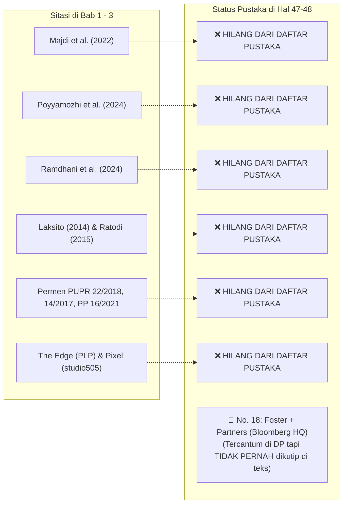
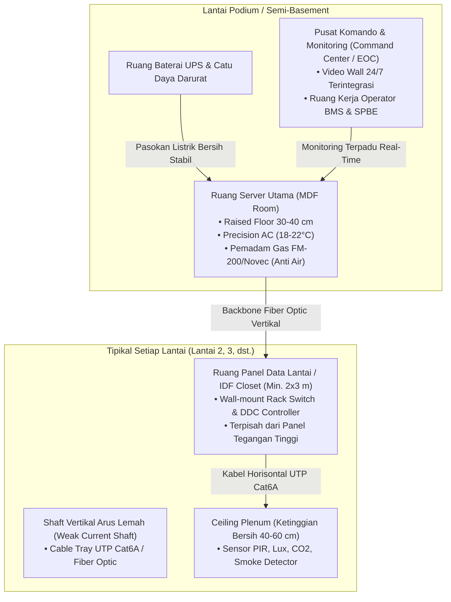

# 🏛️ LAPORAN AUDIT PARIPURNA & CATATAN KRITIS DOSEN PENGUJI II (BIDANG INFORMATIKA)
## Evaluasi Komprehensif Naskah Seminar Proposal Tugas Akhir S1 Arsitektur – Fakultas Teknik Universitas Mulawarman

---

| Parameter Dokumen | Rincian Informasi |
| :--- | :--- |
| **Judul Naskah** | **Redesain Gedung Dinas Kesehatan Provinsi Kalimantan Timur dengan Pendekatan Arsitektur Smart Building** |
| **Nama Mahasiswa** | Arya Rizqi Putra Mahardika |
| **NIM** | 2309096042 (Angkatan 2023, Semester 7) |
| **Program Studi** | S1 Arsitektur, Jurusan Arsitektur, Fakultas Teknik Universitas Mulawarman |
| **Dosen Pembimbing I** | Kartika Tristanto, S.Ars., M.Arch. |
| **Dosen Pembimbing II** | Ir. Putri Nopianti, S.T., M.T. |
| **Dosen Penguji I** | Ratri Bodromulatsih, S.Ds., M.Ars. |
| **Dosen Penguji II** | **Anton Prafanto, S.Kom., M.T.** (Bidang: *Internet of Things, Embedded Systems & Software Architecture*) |
| **Dokumen Draf** | [`SEMINAR ARSITEKTUR ARYA 3.pdf`](file:///C:/Users/anton/vibecoding/Bimbingan/audit_mahasiswa/draft_seminar_arsitektur_arya_rizqi.pdf) (59 Halaman) |
| **Dasar Rujukan Audit** | **Pedoman Standar & Format Penulisan Skripsi FT Unmul** ([`pedoman_skripsi_unmul.md`](file:///C:/Users/anton/vibecoding/Bimbingan/pedoman_skripsi_unmul.md)) & **Kaidah Rekayasa Cyber-Physical Systems (BACS)** |
| **Status Kelayakan** | **REVISI MAYOR MULTI-ASPEK (Integritas Naskah, Kepatuhan Format FT Unmul, & Substantif TIK)** |

---

## 🧭 PETA AUDIT KOMPREHENSIF (RINGKASAN EKSEKUTIF)

Sebagai Dosen Penguji II dari Program Studi S1 Informatika yang diamanatkan menguji proposal perancangan berfokus *Smart Building*, telaah kritis ini mengaudit **tiga dimensi utama**:
1. **Kepatuhan Administratif & Format Baku FT Unmul**: Pengujian terhadap kepatuhan naskah pada *Buku Pedoman Skripsi Fakultas Teknik Universitas Mulawarman*.
2. **Integritas Akademik & Forensik Teks**: Pengujian orisinalitas, pembersihan residu *copy-paste*, dan eliminasi cacat redaksional.
3. **Substansi Rekayasa Informatika & Spasial Arsitektur**: Pengujian ketepatan taksonomi IoT/BMS, kebutuhan ruang fisik TIK (*spatial requirements*), dan kesesuaian fungsional dengan Dinas Kesehatan Provinsi Kalimantan Timur.

---

## 📋 BAGIAN 1: AUDIT KEPATUHAN PEDOMAN SKRIPSI FT UNMUL (`pedoman_skripsi_unmul.md`)
*(Ditemukan 10 pelanggaran terhadap format baku Fakultas Teknik Universitas Mulawarman).*

| No | Parameter Format FT Unmul | Ketentuan Resmi Pedoman FT Unmul | Fakta pada Draf Naskah Arya | Status & Sanksi Format |
| :---: | :--- | :--- | :--- | :---: |
| **1** | **Abstrak & Abstract** | **Wajib ada** sebelum Daftar Isi, memuat tabel header borderless 2 kolom (Mahasiswa/NIM \| Pembimbing I/II), 200–300 kata, 1 spasi, 3–5 kata kunci. | **HILANG TOTAL (0 Halaman).** Langsung melompat dari Kata Pengantar ke Daftar Isi. | ❌ **Pelanggaran Berat** |
| **2** | **Daftar Singkatan & Istilah** | **Wajib ada** halaman khusus Daftar Singkatan/Istilah setelah Daftar Lampiran sebelum Bab I. | **HILANG TOTAL.** Padahal naskah memuat puluhan akronim (BMS, BACS, IoT, PIR, HVAC, DDC, PLC, RTRW, IKN, LoRaWAN, dll.). | ❌ **Pelanggaran Berat** |
| **3** | **Jumlah Entri Daftar Pustaka** | **Minimal 30 dan maksimal 50 rujukan** relevan. | **Hanya 23 entri pustaka** (dan 5 entri di antaranya adalah URL Bullitt Center yang dipecah-pecah). | ❌ **Tidak Memenuhi Kuota Minimal** |
| **4** | **Format Gaya Daftar Pustaka** | Wajib format **APA Style** (disusun alfabetis nama belakang, *hanging indent*, **DILARANG memakai penomoran angka**). | Mahasiswa memberi **nomor angka 1 s.d. 23**, menyalahi kaidah APA Style resmi. | ❌ **Format Salah** |
| **5** | **Gaya Tabel Ilmiah (Booktabs)** | **Wajib Tabel Terbuka (Booktabs)**: hanya garis horizontal atas, pembatas header, dan penutup bawah. **DILARANG KERAS menggunakan garis vertikal**. | **Semua tabel (Tabel 2.1, 3.1, 3.2, 3.3) menggunakan grid kotak penuh dengan garis vertikal**. | ❌ **Pelanggaran Mutlak** |
| **6** | **Tata Letak & Posisi Judul Tabel** | Judul tabel diletakkan di **ATAS TABEL, Rata Tengah (Center), Bold**, format: `Tabel X.X Judul`. | Judul tabel ditulis **Rata Kiri (Left)** dengan spasi janggal setelah titik: `Tabel 2. 1` dan `Tabel 3. 1`. | ❌ **Format Salah** |
| **7** | **Tata Letak & Posisi Judul Gambar** | Judul gambar diletakkan di **BAWAH GAMBAR, Rata Tengah (Center), Bold**, format: `Gambar X.X Judul`. | Judul gambar ditulis **Rata Kiri (Left)** dengan spasi janggal: `Gambar 2. 1`, `Gambar 2. 2`, dst. | ❌ **Format Salah** |
| **8** | **Penomoran Halaman Bagian Awal** | Menggunakan **Angka Romawi Kecil (`i, ii, iii, ...`) di tengah bawah**. Halaman cover dalam dihitung `i` tapi nomornya tidak dicetak. | Menggunakan **ROMAWI BESAR KAPITAL (`I, II, III, IV, ...`)**. Halaman cover dalam dicetak nomor `I`. | ❌ **Format Salah** |
| **9** | **Penomoran Halaman Tubuh Naskah** | Angka Arab (`1, 2, 3, ...`) di **Kanan Atas (*top right*)**. Khusus halaman pertama setiap bab baru di **Tengah Bawah**. | **Semua halaman isi naskah diletakkan di Tengah Bawah**. Tidak ada nomor halaman di kanan atas. | ❌ **Pelanggaran Page Setup** |
| **10** | **Kategori Naskah pada Sampul** | Harus konsisten antara cover luar dan dalam (`PROPOSAL SKRIPSI` atau `TUGAS AKHIR`). | **Cover Luar (Hal. 1) tertulis `TUGAS AKHIR`**, sedangkan **Cover Dalam (Hal. 2) tertulis `SKRIPSI`**. | ❌ **Inkonsistensi Sampul** |

---

## 🚨 BAGIAN 2: AUDIT FORENSIK INTEGRITAS NASKAH & CACAT REDAKSI

### 2.1. Kontaminasi Paragraf Copy-Paste Pasar Tradisional (Bab 1, Hal. 3)
* **Teks Naskah:**
  > *"Redesain menjadi salah satu upaya yang dapat dilakukan untuk meningkatkan kualitas ruang dan mengoptimalkan fungsi kawasan perdagangan. Dahlima (2018), melalui penelitian mengenai redesain **Pasar Genteng Surabaya**... Dalam konteks **Sentra UMKM Paras Perbatasan**, redesain diperlukan untuk mengoptimalkan fungsi kawasan, memperbaiki kualitas fasilitas, serta meningkatkan daya tarik ruang bagi **pedagang** dan pengunjung."*
* **Kritik:** Objek tugas akhir adalah kantor birokrasi pemerintahan kesehatan tingkat provinsi di Samarinda. Paragraf mengenai pasar rakyat, pedagang, dan UMKM ini adalah sisa salinan tugas akhir orang lain yang fatal jika dibiarkan saat sidang.
* **Tindakan:** Hapus total dan ganti narasi dengan urgensi fasilitas kesehatan modern di Kaltim.

### 2.2. Residu Chatbot AI yang Belum Bersih (Bab 2, Hal. 25)
* **Teks Naskah:**
  > *"Kallang Pulse merupakan contoh yang sangat relevan dengan **penelitianmu** karena bangunan ini bukan dibangun dari awal..."*
* **Kritik:** Penggunaan kata ganti orang kedua *"penelitianmu"* adalah bukti tak terbantahkan salinan mentah dari AI prompt.
* **Tindakan:** Ubah kalimat menjadi bahasa ilmiah baku orang ketiga.

### 2.3. Duplikasi Paragraf Utuh (*Word-for-Word Repetition*)
* **Subbab 2.4 (Dinkes Kaltim, Hal. 14–15):** Paragraf *"Aktivitas yang berlangsung di dalam Gedung Dinas Kesehatan Provinsi Kalimantan Timur melibatkan berbagai pengguna..."* tertulis **dua kali berturut-turut persis**.
* **Subbab 2.6.4 (Kallang Pulse, Hal. 25):** Paragraf pembuka *"Kallang Pulse merupakan contoh yang sangat relevan..."* tertulis **dua kali berturut-turut persis**.
* **Tindakan:** Hapus masing-masing paragraf duplikat tersebut.

### 2.4. Kalimat Menggantung (*Hanging Sentence*) pada Batasan Masalah (Bab 1, Hal. 3)
* **Teks Naskah:**
  > *"1. Perancangan difokuskan pada Gedung Dinas Kesehatan Provinsi Kalimantan Timur yang berada di Kota Samarinda, **dengan luasan**"* (terpotong tanpa angka/satuan).
* **Tindakan:** Lengkapi kalimat dengan luas tapak ($7.273\text{ m}^2$) dan luas bangunan ($3.950\text{ m}^2$).

### 2.5. Cacat Tata Letak Tabel 3.3 (Jadwal Penelitian, Hal. 45–46)
* Judul dan kepala tabel diletakkan di bagian bawah halaman 45, lalu disisipi gambar peta lokasi (Gambar 3.2).
* Seluruh isi baris tabel terlempar ke halaman 46 **tanpa kepala kolom sama sekali** (menjadi tabel buta tak terbaca).
* **Tindakan:** Satukan judul, kepala tabel, dan isi tabel dalam 1 halaman utuh di Halaman 46.

### 2.6. Anomali Gelar Pejabat & Tipografi Lembar Awal
* **Koordinator Prodi S1 Arsitektur:**
  * Di Lembar Pengesahan: `Ir. Pandu K. Utomo, S.T., M.Sc., IPM`
  * Di Kata Pengantar (No. 3): `Ar. Pandu Kusumoputro Utomo, ST., M.Sc., IPM.`  
  *(Tertukar gelar Insinyur `Ir.` dengan Arsitek `Ar.`, dan nama disingkat vs lengkap).*
* **Dosen Pembimbing I:** Terdapat koma ganda: `Kartika Tristanto, , S.Ars., M.Arch.` di Hal. 4 dan 6.
* **Dosen Pembimbing II:** Gelar `Ir.` tertulis di Hal. 4, tapi hilang di Hal. 6 (`Ibu Putri Nopianti, S.T., M.T.`).
* **Halaman Persembahan (Hal. IV):** Terdapat tanda kutip ganjil dan karakter teks rusak (*corrupted encoding*): `sungguhsungguh`.
* **Typo Judul Bab/Subbab:** Tertulis `BAB III METODELOGI` (seharusnya **METODOLOGI**) dan `3.4.1 Tahap Pra Perancagan` (kurang huruf **'n'**).

---

## 📚 BAGIAN 3: AUDIT SILANG SITASI & BIBLIOGRAFI



1. **Rujukan Dikutip di Naskah Tapi HILANG di Daftar Pustaka:**
   * *Majdi et al. (2022)* (Tabel 2.1 No. 4)
   * *Poyyamozhi et al. (2024)* (Tabel 2.1 No. 7)
   * *Lalu Gabrielle Ayub Ramdhani et al. (2024)* (Tabel 2.1 No. 10)
   * *Laksito (2014)* (Bab 3 Hal. 27 & 31)
   * *Ratodi (2015)* (Bab 3 Hal. 27)
   * *Dahlima (2018)* (Bab 1 Hal. 3)
   * Seluruh regulasi Kementerian PUPR (*Permen PUPR No. 22/2018, No. 14/2017, No. 21/2021, PP 16/2021* pada Subbab 2.3.1).
   * Rujukan arsitek resmi studi preseden: *The Edge Amsterdam* (PLP Architecture) dan *Pixel Melbourne* (studio505).
2. **Sitasi Hantu (*Ghost Citation*):**
   * Pustaka No. 18 (*Foster + Partners, 2017 – Bloomberg European Headquarters*) ada di daftar pustaka tetapi **tidak pernah dikutip satu kali pun di seluruh naskah**.
3. **Anakronisme Rujukan SNI:**
   * Teks Bab 2 mengutip standar kadaluarsa (*SNI 03-6572-2001, SNI 03-6197-2011, SNI 03-6389-2011*).
   * Daftar Pustaka mencantumkan standar versi mutakhir (*SNI 6572-1:2024, SNI 6197:2020, SNI 6389:2020*). Wajib diselaraskan ke versi terbaru.
4. **Sitasi Domain Mentah:**
   * Kutipan `...(dinkes.kaltimprov, n.d.)` di Bab 1 Hal. 2 harus diganti menjadi nama institusi dan tahun resmi: `(Dinas Kesehatan Provinsi Kalimantan Timur, 2025)`.

---

## 💻 BAGIAN 4: AUDIT SUBSTANTIF INFORMATIKA & SMART BUILDING

### 4.1. Disorientasi Definisi Konsep pada Tabel 3.1 (Hal. 35–37)
| Parameter Naskah | Definisi Mahasiswa Saat Ini (Salah) | Definisi Standar Bidang Informatika & Smart Building |
| :--- | :--- | :--- |
| **Interoperabilitas Sistem** | *"Kemudahan pengguna mencapai kawasan serta mengakses fasilitas (sirkulasi kendaraan, pejalan kaki, dan area parkir)."* | **BUKAN sirkulasi pejalan kaki!** Interoperabilitas adalah kemampuan perangkat utilitas berbeda merk (chiller, lampu, sensor, lift) untuk saling bertukar data menggunakan protokol standar terbuka (*open protocols*) seperti BACnet/IP, Modbus TCP, MQTT, atau Web API. |
| **Smart Lighting** | *"Karakter visual yang membantu membentuk citra dan membedakan kawasan dari tempat lain (fasad, warna, penanda kawasan)."* | **BUKAN branding fasad!** Smart Lighting adalah sistem penerangan adaptif berbasis sensor okupansi (*PIR*) dan sensor intensitas matahari (*daylight harvesting*), dikendalikan via controller DALI/KNX menuju BMS. |
| **Monitoring Energi** | *"Kondisi ruang yang mendukung kenyamanan beraktivitas (keteduhan, tempat duduk, kebersihan)."* | **BUKAN tempat duduk dan kebersihan!** Monitoring energi adalah pemantauan konsumsi daya listrik (*power meter* digital) secara *real-time* per blok/lantai untuk mengidentifikasi kebocoran beban dan profil beban puncak. |

### 4.2. Residu Instrumen Survei Pasar Tradisional pada Tabel 3.2 (Hal. 42)
* Subvariabel: *Sensor dan pemantauan kondisi ruang*
* Data yang dikumpulkan mahasiswa: **"Kendala usaha dan kebutuhan fasilitas"** ❌
* **Koreksi:** Data teknis yang wajib disurvei adalah tingkat pencahayaan eksisting (Lux meter), fluktuasi suhu/kelembapan, daya listrik terpasang PLN, dan ketersediaan ruang server/jalur kabel eksisting.

### 4.3. Hilangnya Janji Fitur "Smart Water"
* Pada **Batasan Masalah (Bab 1 Hal. 4 butir 4e)**, mahasiswa menjanjikan: *"Sistem Smart Building yang dibahas meliputi: e. Smart Water"*.
* Namun di **Kajian Teori (Bab 2 Subbab 2.5.2)** dan **Matriks Parameter Konsep (Bab 3 Tabel 3.1)**, **pembahasan Smart Water lenyap sepenuhnya**. Mahasiswa wajib konsisten: mengkaji otomatisasi air bersih/tandon atau menghapusnya dari batasan masalah.

### 4.4. Standar ISO 52120-1:2021 Hanya Menjadi "Pemanis Sitasi"
* Mahasiswa mengutip standar otomasi efisiensi energi gedung *ISO 52120-1:2021* pada Halaman 35.
* Standar ini mengklasifikasikan BACS menjadi 4 kelas: **Class A** (kinerja tertinggi/otomasi adaptif), **Class B** (lanjutan), **Class C** (standar), dan **Class D** (tidak efisien).
* Mahasiswa tidak pernah menjelaskan kelas mana yang ditargetkan untuk Gedung Dinkes Kaltim dan bagaimana implikasi fisiknya pada perancangan fasad serta tata ruang dalam.

---

## 🏢 BAGIAN 5: KEBUTUHAN RUANG FISIK ARSITEKTURAL TIK (*SPATIAL REQUIREMENTS*)

Teknologi cerdas memerlukan wadah fisik di denah bangunan. Mahasiswa **wajib mengalokasikan ruang-ruang arsitektural berikut pada Program Ruang Bab 3 dan Gambar Denah Bab 4**:



1. **Ruang Server Utama (MDF - Main Distribution Frame):** Terlindung dari banjir, tidak berada tepat di bawah area basah (toilet), menggunakan *raised floor* 30–40 cm, berpendingin presisi (PAC) 18–22°C, sistem pemadam gas bersih (*FM-200/Novec*), dan akses biometrik.
2. **Ruang Distribusi Data Lantai (IDF Closet):** Minimal $2 \times 3\text{ m}$ di setiap lantai untuk menampung panel switch dan kontroler DDC.
3. **Shaft Arus Lemah Terpisah:** Berjarak minimal 30 cm atau disekat logam dari kabel tegangan tinggi PLN untuk mencegah interferensi elektromagnetik (*EMI*).
4. **Pusat Komando (*Command Center / Emergency Operations Center - EOC*):** Ruang kendali pemantauan data kesehatan provinsi (wabah, stunting, vaksin) berdampingan dengan stasiun kerja operator BMS gedung.
5. **Smart Cold-Chain Monitoring System:** Ruang logistik farmasi dan gudang vaksin wajib dirancang dengan sensor suhu presisi tinggi (-80°C s/d +8°C) yang terhubung ke sistem alarm otomatis dan generator cadangan otomatis (*auto-transfer switch*).
6. **Zonasi Keamanan Akses Fisik (*Tiered Access Control*):** Zonasi denah berjenjang dari publik (lobi), semi-publik (ruang rapat koordinasi lintas instansi), privat (ruang kerja staf), hingga zona restriksi tinggi (ruang server & gudang vaksin berakses biometrik).

---

## 🛠️ BAGIAN 6: TEMPLATE PERBAIKAN MATRIKS PARAMETER KONSEP (TABEL 3.1)
*(Mahasiswa disarankan mengadopsi format ini untuk Bab 3).*

| Prinsip | Parameter Konsep | Definisi Operasional | Strategi Capaian Arsitektural & TIK |
| :--- | :--- | :--- | :--- |
| **Integrasi Sistem Bangunan** | **Interoperabilitas Protokol** | Kemampuan sub-sistem gedung (HVAC, lampu, proteksi api) untuk bertukar data secara seragam. | Menggunakan jaringan berbasis IP dengan protokol terbuka (BACnet/IP & MQTT) yang terpusat pada platform BMS terintegrasi. |
| | **Building Management System (BMS)** | Perangkat lunak dan keras terpusat untuk memantau dan mengontrol operasional seluruh gedung. | Merancang ruang *Command Center / BMS Workstation* di podium dan ruang server (MDF) sesuai standar keandalan. |
| **Efisiensi Energi** | **Pencahayaan Adaptif (*Smart Lighting*)** | Pengendalian intensitas lampu buatan berdasarkan okupansi dan penetrasi cahaya alami. | Mengombinasikan bukaan kaca jendela (*daylight harvesting*) dengan sensor fotosel (Lux) dan sensor PIR di plafon ruangan. |
| | **Tata Udara Pintar (*Smart HVAC*)** | Pendinginan udara yang modulasi kapasitasnya merespons beban termal ruangan dan jumlah orang. | Membagi zonasi VRF/Chiller per sayap lantai, dikendalikan sensor temperatur, kelembapan, dan sensor $\text{CO}_2$ ruang rapat. |
| | **Monitoring Sub-Meter Listrik** | Pengukuran konsumsi daya listrik secara terperinci per blok lantai dan kategori peralatan. | Memasang panel *Digital Power Meter* pada setiap panel distribusi lantai (IDF) yang mentransmisikan data konsumsi kWh ke server BMS. |
| **Keamanan & Perlindungan** | **Kontrol Akses Bertingkat (*Smart Security*)** | Pengendalian dan pembatasan hak masuk pengguna ke dalam zona ruang berdasarkan hierarki otoritas. | Memasang *tripod turnstile gate* di lobi, pintu magnetik RFID di ruang kantor, dan biometrik pada Ruang Server & Gudang Vaksin. |
| **Kesehatan Lingkungan** | **Kualitas Udara Dalam Ruangan (*IAQ Monitoring*)** | Pemantauan parameter kesehatan udara (partikulat $\text{PM}_{2.5}$, $\text{CO}_2$, kelembapan) di ruang kerja. | Menempatkan sensor kualitas udara yang terhubung ke katup udara segar otomatis (*fresh air damper*) untuk menjaga kesegaran ruang kerja. |

---

## 📋 BAGIAN 7: ROADMAP REVISI TERSTRUKTUR (ACTION CHECKLIST UNTUK MAHASISWA)

```markdown
- [ ] 1. KELENGKAPAN ADMINISTRATIF & FORMAT BUKU PEDOMAN FT UNMUL
      [ ] Tambahkan halaman Abstrak (Bahasa Indonesia) dan Abstract (Bahasa Inggris) lengkap dengan Tabel Header 2 Kolom.
      [ ] Tambahkan halaman khusus "Daftar Singkatan dan Istilah" setelah Daftar Lampiran.
      [ ] Samakan kategori naskah sampul: pilih salah satu ("PROPOSAL SKRIPSI" atau "TUGAS AKHIR") di cover luar dan cover dalam.
      [ ] Ubah penomoran halaman bagian awal menjadi romawi kecil (i, ii, iii, ...) di tengah bawah; hilangkan nomor pada cover dalam.
      [ ] Ubah penomoran halaman tubuh naskah menjadi angka arab di KANAN ATAS (kecuali halaman judul bab baru di tengah bawah).
      [ ] Ubah semua tabel menjadi gaya Tabel Terbuka (Booktabs) TANPA garis vertikal, judul di atas rata tengah bold.
      [ ] Ubah semua judul gambar menjadi di bawah gambar rata tengah bold.
      [ ] Hapus penomoran angka 1-23 pada Daftar Pustaka; susun alfabetis murni sesuai APA Style 6th Edition.
      [ ] Tambahkan referensi hingga memenuhi kuota minimal 30 sumber rujukan relevan.

- [ ] 2. PEMBERSIHAN NASKAH & INTEGRITAS REDAKSI
      [ ] Hapus teks "Pasar Genteng", "Sentra UMKM", dan "pedagang" di Bab 1 Hal. 3.
      [ ] Lengkapi kalimat menggantung pada Batasan Masalah butir 1 di Bab 1 Hal. 3.
      [ ] Selaraskan isi deskripsi Sistematika Bab 3 dan Bab 4 di Bab 1 Hal. 5.
      [ ] Hapus kata "penelitianmu" di Subbab 2.6.4 (Hal. 25).
      [ ] Hapus paragraf duplikat di Subbab 2.4 (Hal. 14–15) dan Subbab 2.6.4 (Hal. 25).
      [ ] Perbaiki tanda koma ganda pada nama Pembimbing I di Lembar Pengesahan & Kata Pengantar.
      [ ] Selaraskan penulisan nama dan gelar Koordinator Prodi S1 Arsitektur di Hal. III dan V.
      [ ] Perbaiki typo: "METODELOGI" -> "METODOLOGI" dan "Pra Perancagan" -> "Pra Perancangan".
      [ ] Tata ulang Tabel 3.3 (Jadwal) agar kepala tabel dan isi tabel menyatu di Halaman 46.

- [ ] 3. PENYELARASAN SITASI & PUSTAKA
      [ ] Masukkan rujukan yang hilang: Majdi (2022), Poyyamozhi (2024), Ramdhani (2024), Laksito (2014), Ratodi (2015), dan seluruh Permen PUPR.
      [ ] Masukkan rujukan arsitek resmi untuk The Edge Amsterdam dan Pixel Melbourne.
      [ ] Hapus rujukan hantu: Foster + Partners (Bloomberg HQ) di No. 18.
      [ ] Mutakhirkan nomor standar SNI ventilasi dan pencahayaan ke versi 2020 dan 2024.
      [ ] Perbaiki sitasi domain mentah "(dinkes.kaltimprov, n.d.)" menjadi "(Dinas Kesehatan Provinsi Kalimantan Timur, 2025)".

- [ ] 4. REKONSTRUKSI METODOLOGI PERANCANGAN (BAB 3)
      [ ] Rombak Tabel 3.1 (Parameter Konsep) menggunakan template Bagian 6 di atas.
      [ ] Pada Tabel 3.2 (Desain Survey), ganti data "kendala usaha" dengan survei lux, suhu, beban okupansi, dan jalur kabel eksisting.
      [ ] Tentukan status "Smart Water": jika dipakai, bahas di Bab 2 dan 3; jika tidak, hapus dari Batasan Masalah.
      [ ] Jelaskan target kelas efisiensi BACS berdasarkan standar ISO 52120-1:2021.

- [ ] 5. INTEGRASI SPASIAL TIK MENUJU BAB 4 (STUDIO PERANCANGAN)
      [ ] Masukkan Ruang Server (MDF), Ruang Shaft Data (IDF) tiap lantai, dan Ruang Command Center ke program ruang.
      [ ] Pastikan gambar denah arsitektur memuat simbol titik sensor, kontrol akses, dan CCTV.
      [ ] Buat 1 lembar gambar arsitektur utilitas: "Diagram Skematik Arsitektur Sistem BMS & IoT Gedung".
```

---

## 🎯 BAGIAN 8: BANK PERTANYAAN DOSEN PENGUJI II (SIMULASI UJIAN SIDANG)

1. **Uji Penguasaan Terminologi & Logika Sistem:**
   > *"Saudara Arya, di Bab 3 Tabel 3.1 Anda menuliskan parameter 'Interoperabilitas Sistem', namun definisinya mengenai penataan jalur pejalan kaki dan tempat parkir. Bisakah Anda jelaskan apa makna interoperabilitas yang sebenarnya dalam arsitektur komputer dan otomasi gedung cerdas, serta protokol komunikasi apa yang Anda rencanakan untuk menghubungkan sensor AC dengan alarm kebakaran?"*

2. **Uji Konsekuensi Spasial Perancangan Arsitektur:**
   > *"Konsep smart building yang Anda ajukan mengandalkan ribuan sensor dan jaringan terintegrasi BMS. Di mana Anda menempatkan Ruang Server Utama (MDF), ruang shaft kabel data, dan ruang operator BMS pada gambar denah Anda? Apa pertimbangan arsitektural Anda terkait keamanan dari air dan interferensi elektromagnetik?"*

3. **Uji Relevansi Karakteristik Objek (Dinas Kesehatan):**
   > *"Gedung Dinas Kesehatan Provinsi memiliki peran vital dalam distribusi vaksin ke seluruh kabupaten/kota di Kalimantan Timur. Bagaimana rancangan Smart Building Anda mampu menjamin keselamatan logistik vaksin melalui pemantauan rantai dingin (cold-chain), dan apa skema proteksi desain Anda jika terjadi pemadaman listrik total di Samarinda?"*

4. **Uji Standar Internasional & Target Kinerja:**
   > *"Di Bab 3 Anda mencantumkan standar ISO 52120-1:2021 mengenai efisiensi energi otomatisasi gedung. Dari 4 kelas efisiensi energi BACS (Class A sampai D) yang ada pada standar tersebut, kelas berapa yang menjadi target rancangan redesain Anda, dan bagaimana implementasi arsitekturalnya pada fasad serta tata ruang dalam?"*

---

> [!TIP]
> **Catatan Pembina:**  
> Laporan audit komprehensif ini disusun sebagai instrumen bimbingan dan pengujian yang konstruktif. Kelemahan pada draf naskah saat ini merupakan hal yang wajar pada tahapan seminar proposal. Dengan menyelesaikan poin-poin checklist di atas bersama Dosen Pembimbing, karya tugas akhir ini akan memiliki mutu keteknikan yang sangat tinggi dan siap dipertanggungjawabkan di hadapan dewan penguji.
