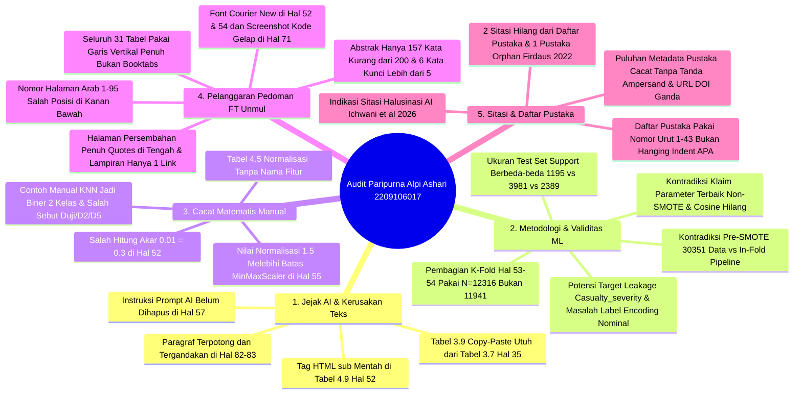

# 📋 LAPORAN AUDIT AKADEMIK FORENSIK & EVALUASI SKRIPSI PARIPURNA

**Mahasiswa Bimbingan:** Muhammad Alpi Ashari  
**NIM:** 2209106017  
**Program Studi:** S1 Informatika, Fakultas Teknik, Universitas Mulawarman  
**Dosen Pembimbing I:** Ramadiani, S.Pd., M.Si., M.Kom., Ph.D. (NIP: 197211012001122001)  
**Dosen Pembimbing II:** Anton Prafanto, S.Kom., M.T. (NIP: 199310222019031016)  
**Dosen Penguji I:** Medi Taruk, M.Cs.  
**Dosen Penguji II:** Ir. Novianti Puspitasari, S.Kom., M.Eng.  
**Koordinator Program Studi:** Awang Harsa Kridalaksana, S.Kom., M.Kom. (NIP: 19731229 200501 1 002)  
**Judul Naskah:** *Optimasi Model K-Nearest Neighbor (KNN) dalam Memprediksi Tingkat Keparahan Kecelakaan Lalu Lintas*  
**Dokumen yang Diaudit:** `C:\Users\anton\Downloads\SKRIPSI (1).pdf` -> Disalin ke `audit_mahasiswa/draft_skripsi_muhammad_alpi_ashari.pdf` (114 Halaman PDF / 95 Halaman Bernomor Arab)  
**Tanggal Evaluasi:** 2 November 2026  
**Status Evaluasi:** **BELUM ACC CETAK / REVISI MAYOR WAJIB (18 Temuan Kritis: Jejak Prompt AI, Inkonsistensi Test Set, Cacat Hitung Manual, Pelanggaran Pedoman FT Unmul, & Daftar Pustaka Bermasalah)**

---

> [!IMPORTANT]
> **Catatan Dosen Pembimbing II:** Dokumen audit forensik paripurna ini menyisir seluruh 114 halaman PDF naskah Skripsi Saudara Muhammad Alpi Ashari (NIM: 2209106017) berdasarkan standar keilmuan *Machine Learning / Data Science* dan **Buku Pedoman Penulisan Skripsi S1 Informatika Fakultas Teknik Universitas Mulawarman (Edisi Pembaruan Mei 2025)**. Tidak ada satu halaman, tabel, rumus, maupun sitasi pun yang dilewatkan.

---

## 🌟 1. Resume Evaluasi Akademik Umum & Nilai Positif Riset

Secara substansi eksperimen, penelitian Saudara **Muhammad Alpi Ashari** memiliki beberapa fondasi yang patut diapresiasi:
1. **Kesadaran Terhadap *Data Leakage* via *Pipeline*:** Merancang integrasi `SimpleImputer`, `MinMaxScaler`, `SMOTE`, dan `KNeighborsClassifier` ke dalam `Pipeline` agar transformasi dilakukan di dalam tiap lipatan (*fold*) validasi.
2. **Penggunaan *Dummy Baseline* & *Macro F1-Score* pada *Imbalanced Data*:** Menyadari bahwa metrik *Accuracy* menipu pada data timpang (di mana *Dummy Classifier* mencapai akurasi tertinggi 84,686% hanya dengan menebak kelas mayoritas), sehingga menggunakan **Macro F1-Score** dan **Macro Recall** sebagai tolok ukur utama.
3. **Eksperimen Komparatif & Visualisasi Interaktif:** Membandingkan *Manual Tuning* vs *GridSearchCV* pada skema *Non-SMOTE* vs *SMOTE*, serta menyajikannya dalam aplikasi web **Streamlit**.

---

## 🚨 2. Rangkuman 18 Temuan Kritis (*18 Critical Red Flags*)

Audit forensik menyeluruh menemukan **18 Temuan Kritis** yang mencakup aspek substansi *Machine Learning*, perhitungan matematis, jejak *copy-paste* AI, hingga pelanggaran format baku Pedoman Skripsi FT Unmul:

---

### Matriks Ringkasan 18 Temuan Kritis:

| No | Kategori Audit | Tingkat Urgensi | Lokasi Halaman | Deskripsi Temuan Kritis |
| :---: | :--- | :---: | :--- | :--- |
| **1** | **Jejak Prompt AI** | 🚨 **Sangat Fatal** | Hal. 57 (PDF 76) | **Kalimat Instruksi AI Ikut Ter-*Copy-Paste* ke Naskah:** Di akhir hal. 57 tertulis: *"...sehingga **pembahasan tabel sebaiknya tidak hanya menyebut “hasil jarak terkecil”, tetapi juga menjelaskan bahwa** label akhir ditentukan oleh mayoritas kelas tetangga terdekat dan kualitas konfigurasi model."* |
| **2** | **Kerusakan Paragraf** | 🚨 **Sangat Fatal** | Hal. 82–83 (PDF 101–102) | **Kalimat Terpotong & Disisipi Paragraf Duplikat:** Kalimat di akhir hal. 82 terputus di awal hal. 83 (*"mempertimbangkan kemampuan model dalam Berdasarkan Tabel 4.29..."*) lalu menyisipkan ulang satu paragraf utuh dari halaman sebelumnya hingga menempel tanpa spasi (*"...dalam penelitian ini.mengklasifikasikan seluruh kelas..."*). |
| **3** | **Validitas Komparasi ML** | 🚨 **Sangat Fatal** | Hal. 73–82 (PDF 92–101) | **Perbandingan Model Tidak *Apple-to-Apple* (Jumlah *Support / Test Set* Berbeda-beda):** • *Manual KNN Non-SMOTE* (Tabel 4.24): **Support = 1.195 data**. • *Manual KNN SMOTE* (Tabel 4.25): **Support = 1.195 data**. • *Dummy Baseline* (Tabel 4.28): **Support = 1.195 data**. • *GridSearchCV Non-SMOTE* (Tabel 4.26): **Support = 3.981 data**. • *GridSearchCV SMOTE* (Tabel 4.27): **Support = 2.389 data**. Membandingkan performa kelima model di Tabel 4.29 pada ukuran *test set* yang berbeda-beda (10% vs 33% vs 20%) tidak sah secara ilmiah. |
| **4** | **Konsistensi Alur SMOTE & K-Fold** | 🚨 **Sangat Fatal** | Hal. 51–54 & Hal. 64 | **Kontradiksi *Pre-SMOTE* vs *In-Fold Pipeline* & Salah Jumlah Data $N$:** Di Abstrak & Hal. 64 diklaim SMOTE hanya diterapkan pada *data latih di setiap fold* via Pipeline. Namun di Tabel 4.11 (Hal. 53), seluruh dataset di-SMOTE terlebih dahulu menjadi $10.117 \times 3 = 30.351$ data. Selain itu, perhitungan K-Fold di Hal. 53–54 memakai $N = 12.316$ (data kotor sebelum hapus 375 outlier), bukan $N = 11.941$. |
| **5** | **Kesalahan Aritmetika & HTML Mentah** | 🚨 **Sangat Fatal** | Hal. 52 (PDF 71) | **Salah Hitung Akar Kuadrat & Tag HTML Mentah:** Tertulis $\sqrt{0 + 0 + 0 + 0.01} = \sqrt{0.1} = 0.3$ (seharusnya $\sqrt{0.01} = \mathbf{0.1}$). Header Tabel 4.9 masih memuat tag HTML mentah `xtetangga (D5)` dan rumus berisi typo `0.0 + 0.5 × (0.0 – 00.) = 0`. |
| **6** | **Cacat Hitung Manual KNN** | ⚠️ **Mayor (Kritis)** | Hal. 54–57 (PDF 73–76) | **4 Cacat Logika pada Perhitungan Manual KNN:** 1. Hal. 54 menyebut label hanya 2 kelas (`0 = Cedera Berat`, `1 = Cedera Ringan`), padahal riset ini 3 kelas (`0, 1, 2`). 2. Tabel 4.13 (Hal. 55) baris `Uji` memiliki nilai *Pengalaman Mengemudi* = **`1,5`**, melanggar batas atas *MinMaxScaler* $[0, 1]$. 3. Hal. 54 menyebut `D1` sebagai data uji, tapi Tabel 4.13 memakai baris `Uji` tersendiri dan menghitung jarak terhadap `D1–D5` (+ typo `dU(jiD5)` di hal. 57). 4. Hal. 56 & 57 menyebut *"data uji D2 diklasifikasikan..."* dan *"data uji D5 diklasifikasikan..."* (dan di Tabel 4.10 hal. 53 data sintetis SMOTE dinamai `Duji`). |
| **7** | **Metodologi Fitur & Encoding** | ⚠️ **Mayor** | Hal. 31, 35, 47–49 | **1. Masalah *Label Encoding* pada Fitur Nominal untuk KNN:** Mengubah 30 fitur kategorikal nominal (seperti *Hari*, *Jenis Kendaraan*, *Penyebab Kecelakaan*) dengan `LabelEncoder` ($0, 1, \dots, k$) menciptakan urutan jarak semu pada Euclidean/Manhattan. **2. Potensi *Target Leakage* (`Casualty_severity`):** Memasukkan atribut `Casualty_severity` (Tingkat keparahan korban) dan `Number_of_casualties` untuk memprediksi `Accident_severity` (Tingkat keparahan kecelakaan) berisiko bocor target. **3. Tabel 4.5 Normalisasi Tanpa Nama Fitur:** Angka `1` berubah menjadi `0.16`, `0.1`, dan `0.5` tanpa keterangan berasal dari kolom atribut mana. |
| **8** | **Kontradiksi Parameter Terbaik & Metrik Cosine** | ⚠️ **Mayor** | Hal. 57–58, 64, 70–71, 88 | **Klaim Parameter Terbaik Tertukar-tukar:** Hal. 57 & 58 menulis parameter terbaik Non-SMOTE adalah `K=5, euclidean, distance`. Padahal di Tabel 4.22 (Hal. 70) & Kesimpulan (Hal. 88) hasil *Manual* Non-SMOTE terbaik adalah `K=5, euclidean, uniform`, sedangkan hasil *GridSearchCV* Non-SMOTE (Hal. 71) adalah `K=3, manhattan, distance`. Selain itu, Hal. 64 menyebut menguji metrik **Cosine**, namun tidak ada di tabel hasil. |
| **9** | **Tabel 3.9 Copy-Paste & Flowchart Salah Dataset** | ⚠️ **Mayor** | Hal. 35 & 36 (PDF 54 & 55) | **1. Tabel 3.9 Copy-Paste Utuh dari Tabel 3.7:** Isi Tabel 3.9 (*Fitur Kecelakaan / Accident Detail*) menyalin 100% isi Tabel 3.7 (*Fitur Jenis Kendaraan*). **2. Flowchart Gambar 3.2 Salah Nama Dataset:** Kotak pertama tertulis **`"Dataset US Accident"`**, padahal dataset berasal dari Addis Ababa, Ethiopia (*Road Traffic Severity Classification*). |
| **10** | **Rumus Bab II Kurang & Nomor Lompat** | ⚠️ **Mayor** | Hal. 21–28 (PDF 40–47) | **Rumus F1-Score, Macro F1, Min-Max, & Z-Score Absen di Bab II:** Metrik utama skripsi (**F1-Score** dan **Macro F1-Score**) sama sekali tidak ada rumusnya di Bab II! Rumus Recall typo `Recal = ...`, judul `2.10.1 Eucliedan Distance` typo, `Validarion` typo, dan nomor persamaan lompat dari `(2.2)` ke `(2.4)` serta `(2.5)` ke `(2.7)` (tidak sinkron dengan teks). |
| **11** | **Rujukan Silang & Header Tabel Rusak** | ⚠️ **Mayor** | Bab III & Bab IV | **Puluhan Salah Rujuk Nomor Tabel & Gambar:** • Hal. 34–35: Teks menulis *"Fitur Jarak dapat dilihat pada Tabel 3.6 / 3.7 / 3.8 / 3.9"* (semua meleset 1 nomor dari Tabel 3.5–3.10). • Hal. 61: Paragraf *Halaman Evaluasi Model* nyasar di akhir subbab *3. Halaman EDA*. • Hal. 66–67 (Tabel 4.18 & 4.19): Header kolom paling kanan tertulis **`K-Fold`** padahal isinya **Jumlah Tetangga K (3, 5, 7, 9)**. • Hal. 72–82: Nomor `Gambar 4.7` dan `Gambar 4.8` dipakai ganda; rujukan teks (`Gambar 4.4, 4.5, 4.6, 4.12, 4.29`) salah. • Hal. 81: Judul `Tabel 4.28 Confusion Matrix Dummy Baseline` salah (isinya *Classification Report*, format desimal `0,84686`). |
| **12** | **Audit Silang Sitasi & Indikasi Halusinasi AI** | 🚨 **Sangat Fatal** | Hal. 14, 26, 91–94 | **1. 2 Sitasi di Teks Hilang dari Daftar Pustaka:** `(Silvia & Wilandari, 2022)` dan `(Firmansyah et al., 2023)` di Hal. 14 tidak ada di Daftar Pustaka. **2. 1 Pustaka *Orphan* (Tidak Disitir di Teks):** Pustaka No. 10 `Firdaus, A. (2022)` tidak pernah disitir di Bab I–V. **3. Indikasi Kuat Sitasi Halusinasi AI (No. 14):** `Ichwani et al. (2026). Preventing Data Leakage in Classification via Integrated Machine Learning Pipelines: Preprocessing, Feature Transformation, and Hyperparameter Tuning. Jutif, 7(1)` (Hal. 26 & 92) — perlu bukti artikel asli. **4. Salah Tahun Terbit (No. 1):** `Abrori (2025)` di *JUTIF 2(1)* sebenarnya terbit tahun **2021**, bukan 2025. |
| **13** | **Format Daftar Pustaka & Sitasi APA** | ⚠️ **Mayor** | Hal. 2–3, 14, 91–94 | **Melanggar Format APA Pedoman FT Unmul:** • Daftar Pustaka menggunakan nomor urut `1.` s/d `43.` (seharusnya **tanpa nomor urut**, menggunakan *Hanging Indent* 1 cm). • Seluruh pustaka multi-penulis kehilangan tanda **`&`** sebelum penulis terakhir. • Pustaka No. 11 (`Hafid, 2023`) memuat URL DOI ganda `https://doi.org/https://doi.org/` dan judul kotor OJS. • Pustaka No. 20, 27, 34 memakai HURUF KAPITAL SEMUA pada judul artikel. • Pustaka No. 12 kehilangan nama prosiding/buku. • Sitasi naratif di Hal. 2–3 memakai tanda koma salah: `N. A. Salsabila, (2023)`, `Fauzan et al., (2024)`, `Sinaga et al., (2025)`, dan `Salsabila dan rekan` (tanpa tahun). |
| **14** | **Posisi Nomor Halaman (Seluruh Bab I–V)** | ⚠️ **Mayor (Pedoman)** | Hal. 1–95 (PDF 20–114) | **100% Nomor Halaman Arab Salah Posisi:** Seluruh nomor halaman `1` s/d `95` diletakkan di **kanan bawah (*bottom right*)**. Padahal sesuai Pedoman FT Unmul (Bab 1): halaman awal bab wajib di **tengah bawah (*bottom center*)**, dan halaman isi lainnya wajib di **kanan atas (*top right*)**! |
| **15** | **Gaya Tabel (Seluruh 31 Tabel)** | ⚠️ **Mayor (Pedoman)** | Tabel 2.1 s/d Tabel 4.29 | **100% Tabel Menggunakan Garis Vertikal Penuh (*Full Grid*):** Melanggar Pedoman FT Unmul (Bab 4.A poin 3) yang mewajibkan gaya **tabel terbuka (*booktabs*) tanpa garis vertikal**. Format judul tabel juga salah spasi dan kurang titik (`Tabel 2. 1 Judul`, seharusnya `Tabel 2.1. Judul`). |
| **16** | **Tipografi Font & Potongan Kode** | ⚠️ **Sedang (Pedoman)** | Hal. 52, 54, 71 (PDF 71, 73, 90) | **Pelanggaran Konsistensi Font Times New Roman:** • Pada Hal. 52 & 54, teks perhitungan manual diketik dengan font **`Courier New` (monospace)**. • Pada Hal. 71, konfigurasi `Pipeline` ditempel sebagai *screenshot* gambar berlatar hitam tanpa nomor/judul gambar. |
| **17** | **Abstrak & Halaman Persembahan** | ⚠️ **Sedang (Pedoman)** | Hal. v, vii, viii (PDF 5, 7, 8) | **1. Abstrak Terlalu Pendek (< 200 Kata) & 6 Kata Kunci (> 5):** Abstrak Indonesia hanya **157 kata** (syarat wajib: **200–300 kata**) dan tidak memiliki kalimat latar belakang di awal. Kata kunci berjumlah **6 item** (syarat: **3–5 kata kunci**), serta di Abstract Inggris masih tertulis `Klasifikasi`. **2. Halaman Persembahan Melanggar Aturan 25%:** Diisi 7 *quotes* rata tengah sepenuh halaman (syarat Pedoman FT Unmul: **maksimal 25% tinggi halaman di pojok kiri bawah**). |
| **18** | **Preliminaries & Lampiran Kosong** | ⚠️ **Sedang (Pedoman)** | Hal. ii–xi & Hal. 95 | **1. Preliminaries:** Tanggal Pernyataan Keaslian masih `Tgl bln thn`; Pengesahan typo `3 Sepetember 2026`; Riwayat Hidup typo `sebagai sebagai` & `prenah`; Kata Pengantar campur `kami`/`saya`, poin 4–7 tanpa sapaan *Bapak/Ibu*, typo `masukkan` (4x), tanggal `11 Juni 2026` terpisah di hal. `x`; Subbab `1.6 Kontribusi Penelitian` hilang dari Daftar Isi. **2. Lampiran Fisik Kosong (Hal. 95):** Halaman Lampiran hanya berisi 1 baris URL GitHub tanpa lampiran kode program, tabel data, atau lembar bimbingan. |

---

## 🔍 3. Panduan Revisi Terstruktur Bab demi Bab (Checklist Mahasiswa)

### A. Perbaikan Format Global & Bagian Awal (Preliminaries)
- [ ] **Posisi Nomor Halaman:** Ubah seluruh nomor halaman Arab (`1` s/d `95`) dari *kanan bawah* menjadi **tengah bawah** untuk halaman pertama setiap bab, dan **kanan atas** untuk halaman berikutnya. Pastikan Cover Dalam dihitung halaman `i` (tanpa nomor tercetak) sehingga Pernyataan Keaslian dimulai pada halaman `ii`.
- [ ] **Format Tabel (*Booktabs*):** Hilangkan seluruh garis vertikal pada **Tabel 2.1 s/d Tabel 4.29**. Gunakan hanya 3 garis horizontal utama (atas tabel, bawah header, bawah tabel). Rapikan penulisan judul tabel menjadi `Tabel X.Y. Judul Tabel` (tanpa spasi setelah titik pertama).
- [ ] **Pernyataan Keaslian (Hal. iii) & Pengesahan (Hal. iv):** Isi `Samarinda, Tgl bln thn` dengan tanggal sebenarnya; perbaiki typo `3 Sepetember 2026` menjadi **`3 September 2026`**.
- [ ] **Halaman Persembahan (Hal. v):** Pindahkan ke pojok kiri bawah dengan tinggi maksimal 25% halaman dan fokuskan pada kalimat persembahan skripsi (bukan kumpulan 7 *quotes* penuh satu halaman).
- [ ] **Riwayat Hidup (Hal. vi):** Hapus kata ganda `sebagai sebagai` dan perbaiki `prenah` menjadi **`pernah`**.
- [ ] **Abstrak & Abstract (Hal. vii–viii):**
  - Tambahkan 2–3 kalimat latar belakang masalah di awal abstrak dan 1–2 kalimat dampak/manfaat di akhir abstrak sehingga panjangnya mencapai **200–300 kata** (saat ini baru 157 kata).
  - Kurangi jumlah *Kata Kunci / Keywords* dari 6 menjadi **maksimal 5 kata kunci**, dan ubah `Klasifikasi` pada Abstract bahasa Inggris menjadi **`Classification`**.
  - Tambahkan awalan `NIM.` di depan `2209106017` pada blok header abstrak.
- [ ] **Kata Pengantar (Hal. ix–x):**
  - Konsistenkan kata ganti (`saya` atau `penulis`, jangan dicampur dengan `kami`).
  - Tambahkan sapaan penghormatan **Ibu** / **Bapak** di depan nama Dosen Pembimbing I, Pembimbing II, Penguji I, dan Penguji II (poin 4–7).
  - Ubah kata `masukkan` (4 kali) menjadi **`masukan`**.
  - Tarik blok tanda tangan `Samarinda, ... 2026 — Penulis` dari halaman `x` agar menyatu di halaman `ix`, dan sesuaikan tanggalnya (jangan `11 Juni 2026` jika sidang Agustus 2026).
- [ ] **Daftar Isi, Tabel, & Gambar (Hal. xi–xv):** Masukkan subbab `1.6 Kontribusi Penelitian` ke Daftar Isi, dan perbarui seluruh nomor halaman serta judul Tabel/Gambar secara otomatis setelah isi Bab III–IV diperbaiki.

### B. Perbaikan Bab I & Bab II
- [ ] **Sitasi Naratif Bab I (Hal. 2–3):** Hapus tanda koma sebelum kurung tahun dan hapus inisial nama depan pada `N. A. Salsabila, (2023)`, `Fauzan et al., (2024)`, dan `Sinaga et al., (2025)`. Tambahkan tahun pada `Salsabila dan rekan`.
- [ ] **Paragraf Penutup Latar Belakang (Hal. 3):** Sesuaikan paragraf terakhir Subbab 1.1 dengan redaksi baku Pedoman FT Unmul (*"Oleh sebab itu, penelitian ini mengangkat judul..."*).
- [ ] **Sitasi Bab II yang Hilang dari Daftar Pustaka (Hal. 14):** Tambahkan referensi `Silvia & Wilandari (2022)` dan `Firmansyah et al. (2023)` ke Daftar Pustaka, serta ubah `(Ahmet Yumak et al., 2025)` menjadi `(Yumak et al., 2025)`.
- [ ] **Rumus & Penomoran Persamaan Bab II (Hal. 21–28):**
  - Perbaiki typo `2.10.1 Eucliedan Distance` -> **`Euclidean Distance`**, `Validarion` -> **`Validation`**, dan `Recal` -> **`Recall`**.
  - Tambahkan rumus matematis untuk **F1-Score**, **Macro F1-Score**, **Min-Max Normalization**, dan **Z-Score Outlier**.
  - Urutkan ulang nomor persamaan dari `(2.1)` s/d selesai tanpa ada nomor yang melompat, dan sinkronkan dengan nomor yang disebut di dalam paragraf.

### C. Perbaikan Bab III Metodologi Penelitian
- [ ] **Gambar 3.1 (Hal. 29):** Perbaiki typo di dalam kotak flowchart (`Studi Litertur` -> **`Studi Literatur`**, `Evaluaasi Model` -> **`Evaluasi Model`**).
- [ ] **Subbab 3.3 Perancangan Data (Hal. 34–35):**
  - Ganti seluruh teks salah ketik *"Fitur Jarak dapat dilihat pada Tabel..."* pada poin 4, 5, 6, dan 7 menjadi nama fitur yang benar.
  - Perbaiki seluruh rujukan nomor tabel yang meleset 1 angka (`Tabel 3.5` s/d `Tabel 3.10`).
  - Perbaiki typo judul `Environtment` menjadi **`Environment`**.
  - **Rombak isi Tabel 3.9 (*Fitur Kecelakaan / Accident Detail*)** yang saat ini ter-*copy-paste* dari Tabel 3.7 (*Fitur Jenis Kendaraan*). Isi dengan atribut kecelakaan yang sebenarnya (`Type_of_collision`, `Number_of_casualties`, `Vehicle_movement`, `Pedestrian_movement`, `Cause_of_accident`).
- [ ] **Gambar 3.2 Flowchart Tahapan Proses (Hal. 36):** Ubah teks kotak pertama dari `"Dataset US Accident"` menjadi **`Dataset Road Traffic Severity Classification`**.
- [ ] **Subbab 3.6 Skenario Pengujian (Hal. 42):** Hapus penyebutan `K=2` dan *"keempat nilai K tersebut"* karena variasi K-Fold yang diuji hanya 3 nilai (`3, 5, dan 10`).

### D. Perbaikan Bab IV Hasil dan Pembahasan
- [ ] **Penjelasan Outlier & Tabel 4.5 Normalisasi (Hal. 47–49):** Jelaskan fitur numerik mana yang dikenai Z-Score, dan tambahkan kolom **Nama Atribut** pada Tabel 4.4 serta Tabel 4.5 agar jelas asal-usul angkanya.
- [ ] **Perhitungan Manual SMOTE & K-Fold (Hal. 52–54):**
  - Ubah font `Courier New` di Hal. 52 & 54 menjadi **Times New Roman 12 pt**.
  - Koreksi hasil akar kuadrat di Hal. 52: $\sqrt{0.01} = \mathbf{0.1}$ (bukan $\sqrt{0.1} = 0.3$).
  - Di Tabel 4.9 (Hal. 52), perbaiki `xtetangga (D5)` menjadi subscript $x_{\text{tetangga}}\text{ (D5)}$ dan perbaiki `00.` menjadi `0.0`.
  - Di Tabel 4.10 (Hal. 53), ganti label baris `Duji` menjadi **`Dsyn`** (data sintetis SMOTE).
  - Di Tabel 4.11 & Hal. 53–54: Luruskan penjelasan agar tidak bertentangan dengan klaim *Pipeline* (SMOTE hanya diterapkan pada *training fold*, bukan pada keseluruhan data sebelum K-Fold), dan gunakan jumlah data bersih **$N = 11.941$** (bukan $12.316$) saat menghitung pembagian *fold*.
- [ ] **Perhitungan Manual KNN & Hapus Prompt AI (Hal. 54–57):**
  - Di Hal. 54, ubah keterangan kelas agar konsisten 3 kelas (`0, 1, 2`), bukan 2 kelas.
  - Di Tabel 4.13 (Hal. 55), ganti angka **`1,5`** pada baris `Uji` dengan nilai $\le 1.0$ (sesuai rentang *MinMaxScaler*) dan hitung ulang jarak Euclidean & Manhattan di Hal. 55–57.
  - Perbaiki typo `dU(jiD5)` di Hal. 57 dan kalimat *"data uji D2 / D5 diklasifikasikan..."* di Hal. 56–57.
  - **HAPUS kalimat instruksi AI** di paragraf terakhir halaman 57 (*"...sehingga pembahasan tabel sebaiknya tidak hanya menyebut..."*).
- [ ] **Penataan Subbab 4.3 & 4.4 (Hal. 61–83):**
  - Pindahkan paragraf terakhir di Hal. 61 ke subbab *5. Halaman Evaluasi Model* (Hal. 63).
  - Hapus kata *"dan Cosine"* di Hal. 64.
  - Ubah header kolom paling kanan pada **Tabel 4.18 & Tabel 4.19 (Hal. 66–67)** dari `K-Fold` menjadi **`Nilai K (Tetangga)`**.
  - Ketik ulang blok `Pipeline` di Hal. 71 sebagai teks/kode berbingkai rapi (bukan gambar *screenshot* gelap).
  - Urutkan ulang nomor dan rujukan gambar di Hal. 72–82 (`Gambar 4.6` s/d `Gambar 4.11`) agar tidak ada nomor gambar ganda (`Gambar 4.7` dan `4.8` saat ini dipakai dua kali).
  - **Samakan ukuran *Support (Test Set)* pada Tabel 4.24 s/d Tabel 4.28** (jangan membandingkan *support* 1.195 vs 3.981 vs 2.389 di Tabel 4.29).
  - Perbaiki judul `Tabel 4.28` di Hal. 81 menjadi **`Classification Report Dummy Baseline`** dan ubah angkanya ke format persentase (`%`).
  - Hapus paragraf terpotong/duplikat di awal **Halaman 83**.

### E. Perbaikan Daftar Pustaka & Lampiran (Hal. 91 – 95)
- [ ] Hilangkan penomoran `1.` s/d `43.` pada Daftar Pustaka; gunakan format **Hanging Indent** sesuai APA Style.
- [ ] Tambahkan tanda **`&`** sebelum penulis terakhir pada seluruh referensi multi-penulis.
- [ ] Hapus referensi *orphan* No. 10 (`Firdaus, 2022`) jika tidak disitir di teks, dan verifikasi keaslian artikel No. 14 (`Ichwani et al., 2026`).
- [ ] Perbaiki tahun terbit No. 1 (`Abrori, 2021`), spasi judul No. 4 (`Anitasari et al., 2025`), URL DOI ganda No. 11 (`Hafid, 2023`), metadata prosiding hilang No. 12 (`Hariadhy et al., 2021`), serta judul huruf kapital penuh pada No. 20, 27, dan 34.
- [ ] Lengkapi **Lampiran (Hal. 95)** dengan lampiran fisik: kode sumber utama (*preprocessing*, *pipeline GridSearchCV*, dan *Streamlit*), hasil lengkap pengujian, serta lembar kendali bimbingan skripsi.
