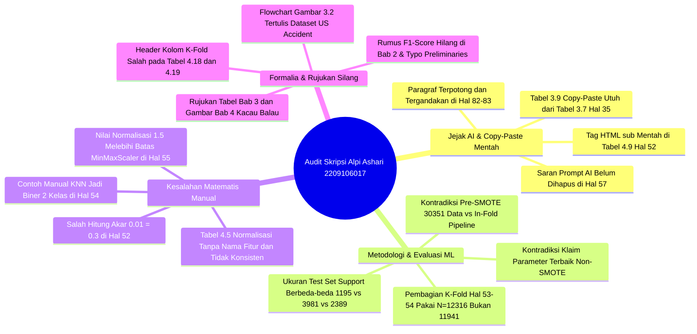

# 📋 LAPORAN AUDIT AKADEMIK FORENSIK & EVALUASI SKRIPSI

**Mahasiswa Bimbingan:** Muhammad Alpi Ashari  
**NIM:** 2209106017  
**Program Studi:** S1 Informatika, Fakultas Teknik, Universitas Mulawarman  
**Dosen Pembimbing I:** Ramadiani, S.Pd., M.Si., M.Kom., Ph.D. (NIP: 197211012001122001)  
**Dosen Pembimbing II:** Anton Prafanto, S.Kom., M.T. (NIP: 199310222019031016)  
**Dosen Penguji I:** Medi Taruk, M.Cs.  
**Dosen Penguji II:** Ir. Novianti Puspitasari, S.Kom., M.Eng.  
**Koordinator Program Studi:** Awang Harsa Kridalaksana, S.Kom., M.Kom. (NIP: 19731229 200501 1 002)  
**Judul Naskah:** *Optimasi Model K-Nearest Neighbor (KNN) dalam Memprediksi Tingkat Keparahan Kecelakaan Lalu Lintas*  
**Dokumen yang Diaudit:** `C:\Users\anton\Downloads\SKRIPSI (1).pdf` -> Disalin ke `audit_mahasiswa/draft_skripsi_muhammad_alpi_ashari.pdf` (114 Halaman PDF / 95 Halaman Bernomor Arab)  
**Tanggal Evaluasi:** 2 November 2026  
**Status Evaluasi:** **BELUM ACC CETAK / REVISI MAYOR WAJIB (Terdapat Jejak Prompt AI, Inkonsistensi Ukuran Test Set, & Cacat Perhitungan Manual)**

---

> [!IMPORTANT]
> **Catatan Dosen Pembimbing II:** Dokumen audit forensik akademik ini disusun secara menyeluruh terhadap naskah Skripsi lengkap (114 halaman PDF) Saudara Muhammad Alpi Ashari (NIM: 2209106017). Evaluasi mencakup keabsahan metodologi *Machine Learning* pada data tidak seimbang (*imbalanced multiclass*), konsistensi skema validasi silang (*K-Fold Cross Validation* & *Pipeline*), kebenaran perhitungan matematis manual (SMOTE, *Euclidean*, *Manhattan*, *Min-Max Normalization*), kebersihan naskah dari sisa instruksi *prompt* AI, rujukan silang (*cross-reference*) tabel/gambar/persamaan, serta kepatuhan terhadap Pedoman Penulisan Skripsi Fakultas Teknik Universitas Mulawarman.

---

## 🌟 1. Resume Evaluasi Akademik Umum & Nilai Positif Riset

Secara substansi, penelitian yang dikerjakan Saudara **Muhammad Alpi Ashari** sudah memiliki struktur eksperimen *Machine Learning* yang cukup baik:

### Aspek Positif yang Patut Diapresiasi:
1. **Kesadaran Terhadap *Data Leakage* & Penggunaan *Pipeline*:** Mahasiswa merancang integrasi `SimpleImputer`, `MinMaxScaler`, `SMOTE`, dan `KNeighborsClassifier` ke dalam satu `Pipeline` sehingga proses *oversampling* di dalam skema otomatis dilakukan di dalam tiap lipatan (*fold*) pelatihan.
2. **Evaluasi *Imbalanced Data* Menggunakan *Dummy Baseline* & *Macro F1-Score*:** Mahasiswa tidak terjebak pada metrik *Accuracy* semata (di mana *Dummy Classifier* mencapai akurasi tertinggi 84,686% hanya dengan menebak kelas mayoritas), melainkan menggunakan **Macro F1-Score** dan **Macro Recall** untuk menilai keadilan model terhadap kelas minoritas (*Fatal Injury* dan *Serious Injury*).
3. **Skenario Pengujian Komparatif yang Terstruktur:** Membandingkan secara bertahap antara *Manual Tuning* vs *GridSearchCV* pada dua kondisi data (*Non-SMOTE* vs *SMOTE*), serta memvisualisasikan hasilnya pada *dashboard* interaktif berbasis **Streamlit**.

---

## 🚨 2. Rangkuman 12 Temuan Kritis (*12 Critical Red Flags*)

Meskipun eksperimen kode program telah berjalan, audit forensik terhadap isi naskah menemukan **12 Kelemahan Kritis (*12 Critical Red Flags*)** yang wajib diperbaiki sebelum naskah disahkan:

---

### Tabel Ringkasan Temuan Kritis:

| No | Kategori | Tingkat Urgensi | Lokasi Naskah | Deskripsi Temuan Kritis |
| :---: | :--- | :---: | :--- | :--- |
| **1** | **Kebersihan Naskah (Jejak AI)** | 🚨 **Sangat Fatal** | Hal. 57 (PDF Hal. 76) | **Kalimat Instruksi/Saran AI Ikut Ter-*Copy-Paste* ke Naskah:** Pada paragraf terakhir halaman 57 tertulis: *"...sehingga **pembahasan tabel sebaiknya tidak hanya menyebut “hasil jarak terkecil”, tetapi juga menjelaskan bahwa** label akhir ditentukan oleh mayoritas kelas tetangga terdekat dan kualitas konfigurasi model."* Ini adalah kalimat instruksi dari AI/pembimbing yang belum dihapus. |
| **2** | **Kerusakan Struktur Paragraf** | 🚨 **Sangat Fatal** | Hal. 82–83 (PDF Hal. 101–102) | **Paragraf Terpotong di Tengah Kalimat & Disisipi Paragraf Ganda:** Di akhir hal. 82 ke awal hal. 83 tertulis: *"pada nilai accuracy, tetapi juga mempertimbangkan kemampuan model dalam Berdasarkan Tabel 4.29, model GridSearchCV Non-SMOTE dipilih... dalam penelitian ini.mengklasifikasikan seluruh kelas secara seimbang."* Satu paragraf utuh terduplikasi di tengah kalimat yang belum selesai. |
| **3** | **Validitas Komparasi Model** | 🚨 **Sangat Fatal** | Hal. 73–82 (PDF Hal. 92–101) | **Perbandingan Akhir Tidak *Apple-to-Apple* (Jumlah Data Uji / *Support* Berbeda-beda):** • *Manual KNN Non-SMOTE* (Tabel 4.24): **Support = 1.195 data**. • *Manual KNN SMOTE* (Tabel 4.25): **Support = 1.195 data**. • *Dummy Baseline* (Tabel 4.28): **Support = 1.195 data**. • *GridSearchCV Non-SMOTE* (Tabel 4.26): **Support = 3.981 data**. • *GridSearchCV SMOTE* (Tabel 4.27): **Support = 2.389 data**. Membandingkan kelima model di Tabel 4.29 menggunakan ukuran *test set* yang berbeda-beda (10% vs 33% vs 20%) tidak valid secara metodologis. |
| **4** | **Konsistensi Alur SMOTE & K-Fold** | 🚨 **Sangat Fatal** | Hal. 51–54 & Hal. 64 | **Kontradiksi *Pre-Oversampling* vs *In-Fold Pipeline* & Salah Nilai $N$:** Di Abstrak dan Hal. 64 diklaim SMOTE hanya dilakukan pada *data latih di setiap fold* via Pipeline. Namun di Tabel 4.11 (Hal. 53), seluruh dataset di-SMOTE terlebih dahulu menjadi $10.117 \times 3 = 30.351$ data. Selain itu, rumus pembagian K-Fold di Hal. 53–54 menggunakan $N = 12.316$ (data mentah sebelum hapus 375 outlier), bukan $N = 11.941$ (data setelah hapus outlier). |
| **5** | **Kesalahan Aritmetika Dasar** | 🚨 **Sangat Fatal** | Hal. 52 (PDF Hal. 71) | **Salah Hitung Akar Kuadrat pada Ilustrasi SMOTE:** Pada perhitungan jarak $d(D4, D5)$ tertulis: $\sqrt{0 + 0 + 0 + 0.01} = \sqrt{0.1} = 0.3$. Padahal $\sqrt{0.01} = 0.1$! Selain itu, pada Tabel 4.9 tertera tag HTML mentah `xtetangga (D5)` dan typo `0.0 + 0.5 × (0.0 – 00.) = 0`. |
| **6** | **Cacat Perhitungan Manual KNN** | ⚠️ **Mayor (Kritis)** | Hal. 54–57 (PDF Hal. 73–76) | **4 Kekeliruan Serius pada Ilustrasi Manual KNN:** 1. Di Hal. 54 diklaim label hanya terdiri dari 2 kelas (`0 = Cedera Berat` dan `1 = Cedera Ringan`), padahal penelitian ini 3 kelas (`0, 1, 2`). 2. Di Tabel 4.13 (Hal. 55), baris data `Uji` memiliki nilai fitur *Pengalaman Mengemudi* = **`1,5`**, yang mustahil terjadi pada data hasil *MinMaxScaler* $[0, 1]$. 3. Di Hal. 54 tertulis *"Data D1 digunakan sebagai data uji"*, padahal di Tabel 4.13 ada baris `Uji` tersendiri dan D1 ikut dihitung sebagai data latih. 4. Di Hal. 56 & 57 tertulis *"sehingga data uji D2 diklasifikasikan..."* dan *"data uji D5 diklasifikasikan..."* (seharusnya yang diklasifikasikan adalah **Data Uji**, bukan D2/D5). |
| **7** | **Kontradiksi Parameter Terbaik** | ⚠️ **Mayor** | Hal. 57–58 vs Hal. 70–71 & 88 | **Narasi Parameter Terbaik Tertukar-tukar:** Di Hal. 57 & 58 disebutkan konfigurasi terbaik Non-SMOTE adalah `K = 5, metric = euclidean, weight = distance`. Padahal di Tabel 4.22 (Hal. 70) dan Kesimpulan (Hal. 88), hasil *Manual Tuning* Non-SMOTE terbaik adalah `weight = uniform`, sedangkan hasil *GridSearchCV* Non-SMOTE (Hal. 71) adalah `K = 3, metric = manhattan, weight = distance`. Selain itu, di Hal. 64 disebut menguji metrik **Cosine**, tetapi tidak pernah ada di tabel hasil. |
| **8** | **Perancangan Data & Flowchart** | ⚠️ **Mayor** | Hal. 35 & 36 (PDF Hal. 54 & 55) | **1. Tabel 3.9 Copy-Paste Salah:** Isi Tabel 3.9 (*Fitur Kecelakaan / Accident Detail*) di Hal. 35 sama persis (100% *copy-paste*) dengan Tabel 3.7 (*Fitur Jenis Kendaraan*). Atribut `Type_of_collision`, `Cause_of_accident`, dan `Number_of_casualties` malah tidak masuk tabel. **2. Salah Nama Dataset di Flowchart:** Pada Gambar 3.2 (Hal. 36), blok pertama tertulis **`"Dataset US Accident"`**, padahal dataset yang dipakai berasal dari Addis Ababa, Ethiopia (*Road Traffic Severity Classification*). |
| **9** | **Penanganan Kategorikal & Outlier** | ⚠️ **Mayor** | Hal. 47–49 (PDF Hal. 66–68) | **1. Z-Score Outlier pada Fitur Numerik Terbatas:** Dataset memiliki 30 fitur kategorikal dan hanya 2 fitur numerik (`Number_of_vehicles_involved` dan `Number_of_casualties`). Tidak dijelaskan fitur mana yang dihitung Z-Score-nya dan apakah dilakukan sebelum atau sesudah *Label Encoding*. **2. Tabel 4.5 Normalisasi Membingungkan:** Angka `1` sebelum normalisasi berubah menjadi `0.16`, `0.1`, dan `0.5` setelah normalisasi tanpa mencantumkan kolom **Nama Atribut/Fitur**. |
| **10** | **Landasan Teori Bab II** | ⚠️ **Mayor** | Hal. 21–28 (PDF Hal. 40–47) | **Rumus F1-Score Tidak Ada & Penomoran Persamaan Lompat:** Metrik utama yang dijadikan dasar pemilihan model terbaik di Abstrak dan Bab V adalah **Macro F1-Score**, tetapi di Bab II (Hal. 27–28) hanya ada rumus *Accuracy*, *Precision*, dan *Recall* (`Recal`). Rumus *F1-Score* dan *Macro F1-Score* sama sekali belum ditulis! Selain itu, nomor persamaan melompat dari `(2.2)` ke `(2.4)` dan dari `(2.5)` ke `(2.7)`. |
| **11** | **Kesalahan Header Tabel & Rujukan Silang** | ⚠️ **Mayor** | Bab III & Bab IV | **Puluhan Salah Rujuk Nomor Tabel/Gambar:** • Hal. 34–35: Teks berulang kali menulis kalimat aneh *"Fitur Jarak dapat dilihat pada Tabel 3.6 / 3.7 / 3.8 / 3.9"* (semua nomor tabel meleset 1 angka). • Hal. 66–67 (Tabel 4.18 & 4.19): Header kolom paling kanan pada tabel pengujian K Tetangga tertulis **`K-Fold`** (seharusnya **`K / Jumlah Tetangga`**). • Hal. 72–82: Nomor `Gambar 4.7` dan `Gambar 4.8` dipakai ganda masing-masing dua kali; rujukan di teks (`Gambar 4.4, 4.5, 4.6, 4.12, 4.29`) salah semua. • Hal. 81: Judul `Tabel 4.28 Confusion Matrix Dummy Baseline` salah (isinya *Classification Report*, dan angkanya masih desimal `0,84686`, bukan `%`). |
| **12** | **Formalia Bagian Awal (Preliminaries)** | ⚠️ **Sedang** | Hal. iii–xi (PDF Hal. 3–11) | **Cacat Administratif & Ketidaklengkapan Daftar Isi:** • Hal. iii: Tanggal Pernyataan Keaslian masih template `Samarinda, Tgl bln thn`. • Hal. iv: Typo bulan pengesahan `3 Sepetember 2026`. • Hal. vi: Typo `sebagai sebagai mahasiswa` dan `prenah diikuti`. • Hal. viii: *Keywords* Abstract Inggris masih memuat kata bahasa Indonesia `Klasifikasi`. • Hal. ix–x: Kata ganti `kami` vs `saya` tercampur, poin 4–7 tanpa sapaan *Bapak/Ibu*, typo `masukkan` (4 kali), tanggal Kata Pengantar `11 Juni 2026` terpisah di halaman kosong sendiri. • Hal. xi: Subbab `1.6 Kontribusi Penelitian` (Hal. 4) hilang dari Daftar Isi. |

---

## 🔍 3. Bedah Detail Temuan Per Bagian & Instruksi Perbaikan

### A. Bagian Awal (Preliminaries: Hal. i – xix)
1. **Halaman Pernyataan Keaslian Skripsi (Hal. iii / PDF 3):**
   * **Temuan:** Tertulis `"Samarinda, Tgl bln thn"`.
   * **Instruksi:** Ganti dengan tanggal penandatanganan yang sebenarnya (misal: `Samarinda, Agustus 2026` atau sesuai tanggal ujian/pengesahan).
2. **Halaman Pengesahan (Hal. iv / PDF 4):**
   * **Temuan:** Tertulis `"Samarinda, 3 Sepetember 2026"`.
   * **Instruksi:** Perbaiki typo menjadi **`Samarinda, 3 September 2026`**.
3. **Riwayat Hidup (Hal. vi / PDF 6):**
   * **Temuan:** Tertulis `"sebagai sebagai mahasiswa"` (kata *sebagai* terulang dua kali) dan `"kegiatan organisasi yang prenah diikuti"`.
   * **Instruksi:** Hapus kata ganda dan perbaiki *prenah* menjadi **`pernah`**.
4. **Abstract Bahasa Inggris (Hal. viii / PDF 8):**
   * **Temuan:** Pada baris *Keywords* tertulis: `Keywords : K-Nearest Neighbors, SMOTE, K-Fold Cross Validation, Grid Search, Klasifikasi, Road Traffic Accidents`.
   * **Instruksi:** Ubah kata `Klasifikasi` menjadi **`Classification`**, dan cetak miring (*italic*) seluruh isi *Keywords* sesuai format bahasa Inggris.
5. **Kata Pengantar (Hal. ix–x / PDF 9–10):**
   * **Temuan:**
     * Kalimat pembuka menggunakan kata ganti jamak *"pada kesempatan ini **kami** ingin mengucapkan... membantu **saya**"*.
     * Poin 4, 5, 6, dan 7 (Pembimbing I, Pembimbing II, Penguji I, Penguji II) ditulis langsung nama tanpa sapaan penghormatan **Ibu / Bapak**, berbeda dengan poin 2 dan 3 yang menggunakan sapaan *Bapak*.
     * Kata benda `"masukkan"` ditulis salah sebanyak 4 kali (poin 4, 5, 6, 7).
     * Tempat, tanggal, dan tanda tangan `"Samarinda, 11 Juni 2026 — Penulis"` terlempar sendirian ke halaman `x` (halaman kosong), serta tanggalnya (`11 Juni 2026`) mendahului masa selesai skripsi di Riwayat Hidup (`20 Agustus 2026`).
   * **Instruksi:** Ganti *kami* menjadi *saya* atau *penulis*; tambahkan sapaan **Ibu/Bapak** di poin 4–7; ubah *masukkan* menjadi **`masukan`**; rapikan spasi agar tanda tangan masuk ke halaman `ix` dan sesuaikan tanggalnya.
6. **Daftar Isi, Daftar Tabel, & Daftar Gambar (Hal. xi–xv / PDF 11–15):**
   * **Temuan:**
     * Subbab **1.6 Kontribusi Penelitian** yang ada di halaman 4 tidak muncul di Daftar Isi (Hal. xi).
     * Di Daftar Gambar (Hal. xv), nomor gambar berhenti di `Gambar 4.8` lalu langsung `Gambar 4.9`, padahal di dalam Bab IV terdapat **10 gambar** (karena `Gambar 4.7` dan `Gambar 4.8` terpakai dua kali di Bab IV).
   * **Instruksi:** Perbarui *field* Daftar Isi, Daftar Tabel, dan Daftar Gambar secara otomatis setelah penomoran di Bab III dan Bab IV diperbaiki.

---

### B. Bab I & Bab II (Hal. 1 – 28)
1. **Penomoran Persamaan & Kelengkapan Rumus di Bab II (Hal. 21–28):**
   * **Temuan:**
     * Hal. 21: Judul subbab `2.10.1 Eucliedan Distance` typo (seharusnya **`Euclidean Distance`**).
     * Hal. 22–23: Setelah Persamaan `(2.1)` dan `(2.2)`, rumus SMOTE di halaman 23 langsung diberi nomor **`(2.4)`** (Persamaan `2.3` hilang).
     * Hal. 24: Typo `K-Fold Cross Validarion` (seharusnya **`Validation`**), dan nomor persamaan adalah `(2.5)`.
     * Hal. 27–28: Teks pengantar merujuk `persamaan 2.5` (untuk Accuracy), `persamaan 2.6` (untuk Precision), dan `persamaan 2.7` (untuk Recall), tetapi label di sebelah kanan rumus tertulis **`(2.7)`**, **`(2.8)`**, dan **`(2.9)`** (Persamaan `2.6` hilang!).
     * Hal. 28: Rumus Recall tertulis typo **`Recal = ...`** (kurang huruf *l*).
     * **Rumus F1-Score dan Macro F1-Score absen:** Padahal di Abstrak, Bab III, Bab IV, dan Bab V, pemilihan model terbaik didasarkan pada **Macro F1-Score** dan **rata-rata Accuracy & F1-Score**.
     * **Rumus Min-Max Normalization & Z-Score Outlier absen:** Kedua teknik ini digunakan secara intensif di Bab III dan Bab IV, tetapi landasan rumusnya belum ditulis di Bab II.
   * **Instruksi:** Tambahkan persamaan matematis untuk **F1-Score**, **Macro F1-Score**, **Z-Score**, dan **Min-Max Scaling** di Bab II, lalu urutkan ulang nomor persamaan dari `(2.1)` secara berurutan tanpa ada yang terlewat.

---

### C. Bab III Metodologi Penelitian (Hal. 29 – 44)
1. **Typo pada Diagram Alir Gambar 3.1 (Hal. 29):**
   * **Temuan:** Di dalam kotak diagram Gambar 3.1 tertulis `"Studi Litertur"` dan `"Evaluaasi Model"`.
   * **Instruksi:** Perbaiki menjadi **`Studi Literatur`** dan **`Evaluasi Model`**.
2. **Kesalahan Masif Rujukan Tabel & Istilah "Fitur Jarak" pada Subbab 3.3 (Hal. 34–35):**
   * **Temuan:**
     * Poin 4 (*Fitur Pengemudi*): tertulis *"Fitur Jarak dapat dilihat pada Tabel 3.6"* -> Padahal tabel di bawahnya adalah **Tabel 3.5** dan berisi Fitur Pengemudi, bukan Fitur Jarak!
     * Poin 5 (*Fitur Kondisi Jalan*): tertulis *"Fitur Jarak dapat dilihat pada Tabel 3.7"* -> Padahal tabelnya adalah **Tabel 3.6**!
     * Poin 6 (*Fitur Kendaraan*): tertulis *"Fitur Jarak dapat dilihat pada Tabel 3.8"* -> Padahal tabelnya adalah **Tabel 3.7**!
     * Poin 7 (*Fitur Lingkungan / Environtment*): judul typo (`Environtment`), dan tertulis *"Fitur Jarak dapat dilihat pada Tabel 3.9"* -> Padahal tabelnya adalah **Tabel 3.8**!
     * Poin 8 (*Fitur Kecelakaan / Accident Detail*): merujuk `Tabel 3.10` (padahal **Tabel 3.9**), dan **seluruh isi Tabel 3.9 salah karena menyalin ulang isi Tabel 3.7 (*Fitur Jenis Kendaraan*)**!
     * Poin 9 (*Fitur Korban / Casualty*): merujuk `Tabel 3.11` (padahal **Tabel 3.10**).
   * **Instruksi:**
     * Ganti seluruh frasa *"Fitur Jarak"* yang salah ketik pada poin 4–7 sesuai nama kelompok fiturnya.
     * Sesuaikan nomor rujukan tabel di teks agar cocok dengan nomor tabel (`Tabel 3.5` s/d `Tabel 3.10`).
     * Ganti isi **Tabel 3.9 (*Fitur Kecelakaan / Accident Detail*)** dengan atribut yang benar sesuai Tabel 3.1, yaitu: `Type_of_collision` (Jenis tabrakan), `Number_of_casualties` (Jumlah korban), `Vehicle_movement` (Pergerakan kendaraan), `Pedestrian_movement` (Pergerakan pejalan kaki), dan `Cause_of_accident` (Penyebab kecelakaan).
3. **Kesalahan Nama Dataset pada Flowchart Gambar 3.2 (Hal. 36):**
   * **Temuan:** Kotak pertama pada *Tahapan Proses* (Gambar 3.2) bertuliskan **`"Dataset US Accident"`**.
   * **Instruksi:** Ubah menjadi **`Dataset Road Traffic Severity Classification`** agar konsisten dengan naskah.
4. **Inkonsistensi Narasi Variasi K-Fold pada Subbab 3.6 (Hal. 42):**
   * **Temuan:** Pada halaman 42 poin 1 tertulis: *"Nilai K yang kecil, seperti K=2 dan K=3... Dengan membandingkan hasil dari keempat nilai K tersebut"*. Padahal penelitian hanya menguji **3 variasi K-Fold** ($K = 3, 5, 10$).
   * **Instruksi:** Hapus penyebutan $K=2$ dan ubah *"keempat nilai K"* menjadi *"ketiga nilai K-Fold"*.

---

### D. Bab IV Hasil dan Pembahasan (Hal. 45 – 87)
1. **Penjelasan Z-Score Outlier & Tabel Normalisasi (Hal. 47–49):**
   * **Temuan:**
     * Pada Tabel 4.3 (Hal. 47), 375 baris dihapus menggunakan *Z-Score* dengan *threshold* 3 pada fitur numerik. Perlu dijelaskan secara spesifik apakah Z-Score dihitung hanya pada 2 fitur numerik asli (`Number_of_vehicles_involved` dan `Number_of_casualties`) atau pada seluruh fitur setelah *Label Encoding*.
     * Pada Tabel 4.5 (Hal. 49), nilai sebelum normalisasi (`6, 1, 0, 3, 1, 0, 1`) ditransformasikan menjadi (`1.0, 0.16, 0.0, 0.6, 0.1, 0.0, 0.5`). Tanpa kolom **Nama Atribut**, pembaca/penguji akan bingung mengapa nilai `1` bisa menghasilkan tiga nilai normalisasi yang berbeda (`0.16`, `0.1`, dan `0.5`).
   * **Instruksi:** Tambahkan kolom **Nama Atribut** dan **Rentang Nilai (Min–Max)** pada Tabel 4.4 dan Tabel 4.5.
2. **Koreksi Perhitungan Manual SMOTE & K-Fold (Hal. 52–54):**
   * **Temuan:**
     * Di Hal. 52, perbaiki perhitungan $\sqrt{0 + 0 + 0 + 0.01} = \sqrt{0.01} = \mathbf{0.1}$ (bukan $\sqrt{0.1} = 0.3$).
     * Di Tabel 4.9 (Hal. 52), perbaiki header `xtetangga (D5)` menjadi $x_{\text{tetangga}}\text{ (D5)}$ dan perbaiki typo `00.` menjadi `0.0`.
     * Di Tabel 4.10 (Hal. 53), ubah nama baris `Duji` menjadi **`Dsyn`** atau **`Dbaru`** (karena itu data sintetis SMOTE, bukan data uji).
     * Di Tabel 4.11 (Hal. 53) & Pembagian K-Fold (Hal. 53–54): Luruskan penjelasan! Jika menggunakan `Pipeline` di dalam *Cross Validation*, maka pada $K=5$ dari $N = 11.941$ data bersih:
       * Data Uji per *fold* $= 11.941 / 5 \approx \mathbf{2.388\text{ data}}$ (tetap distribusi asli, tidak di-SMOTE).
       * Data Latih per *fold* $= 11.941 - 2.388 = \mathbf{9.553\text{ data}}$ (hanya data latih inilah yang di-SMOTE di dalam *fold*).
       * Jangan menghitung K-Fold menggunakan angka $12.316$ (data kotor sebelum hapus outlier)!
3. **Koreksi Perhitungan Manual KNN & Hapus Kalimat Prompt AI (Hal. 54–57):**
   * **Temuan:**
     * Di Hal. 54 paragraf bawah, perbaiki kalimat yang menyebut label hanya 0 dan 1 (sesuaikan dengan 3 kelas: 0, 1, 2).
     * Di Tabel 4.13 (Hal. 55), ubah nilai `1,5` pada baris `Uji` (kolom *Pengalaman Mengemudi*) menjadi nilai dalam rentang $[0, 1]$ (misal `0.5` atau `1.0`), lalu sesuaikan hasil hitung jarak Euclidean & Manhattan di Hal. 55–57.
     * Di Hal. 56 & 57, perbaiki kalimat *"sehingga data uji D2 diklasifikasikan..."* dan *"sehingga data uji D5 diklasifikasikan..."* menjadi **"sehingga data uji (`Uji`) diklasifikasikan ke dalam kelas 1"**.
     * **WAJIB HAPUS** kalimat instruksi AI di akhir halaman 57: *"...sehingga pembahasan tabel sebaiknya tidak hanya menyebut “hasil jarak terkecil”, tetapi juga menjelaskan bahwa..."*.
4. **Koreksi Tata Letak & Penomoran Bab 4.3 – 4.4 (Hal. 61 – 83):**
   * **Hal. 61:** Pindahkan paragraf terakhir (*"Halaman Evaluasi Model tidak hanya menampilkan..."*) dari subbab *3. Halaman EDA* ke subbab *5. Halaman Evaluasi Model* (Hal. 63).
   * **Hal. 64:** Hapus kata *"dan Cosine"* pada paragraf ke-3 karena metrik Cosine tidak diuji.
   * **Hal. 66 & 67 (Tabel 4.18 & Tabel 4.19):** Ganti judul kolom paling kanan dari **`K-Fold`** menjadi **`Nilai K (Tetangga)`**.
   * **Hal. 72–82:** Perbaiki seluruh nomor dan rujukan gambar di Bab IV:
     * Hal. 72: Teks merujuk `Gambar 4.4` -> seharusnya **`Gambar 4.6`**.
     * Hal. 74: Teks merujuk `Gambar 4.5` -> seharusnya **`Gambar 4.7`**.
     * Hal. 76: Teks merujuk `Gambar 4.6` -> seharusnya **`Gambar 4.8`**.
     * Hal. 78: Teks merujuk `Gambar 4.7` dan `Gambar 4.12`, sedangkan *caption* tertulis `Gambar 4.7` -> ubah *caption* dan rujukan teks menjadi **`Gambar 4.9`**.
     * Hal. 80: Teks dan *caption* tertulis `Gambar 4.8` -> ubah menjadi **`Gambar 4.10`**.
     * Hal. 82: Teks merujuk `Gambar 4.29` dan *caption* tertulis `Gambar 4.9` -> ubah keduanya menjadi **`Gambar 4.11`** (serta perbaiki rujukan `Gambar 4.7` di baris ke-12 halaman 83).
   * **Hal. 73–81 (Tabel 4.24 s/d Tabel 4.28):**
     * Jelaskan atau seragamkan mengapa *Support* (jumlah data uji) pada Tabel 4.24, 4.25, dan 4.28 berjumlah **1.195 data**, sedangkan Tabel 4.26 berjumlah **3.981 data** dan Tabel 4.27 berjumlah **2.389 data**. Sebaiknya gunakan skema evaluasi pada *test set* (atau *cross_val_predict* ukuran penuh) yang **sama ukurannya** agar perbandingan di Tabel 4.29 adil (*apple-to-apple*).
     * Ubah judul `Tabel 4.28 Confusion Matrix Dummy Baseline` (Hal. 81) menjadi **`Tabel 4.28 Classification Report Dummy Baseline`** dan ubah format angkanya menjadi persentase (`%`).
   * **Hal. 82–83:** Hapus duplikasi paragraf yang memotong kalimat di awal halaman 83.

---

## 🎯 4. Daftar Pertanyaan Uji Kelayakan Sidang (Untuk Dosen Pembimbing / Penguji)

Berikut adalah daftar pertanyaan kunci untuk menguji pemahaman mahasiswa saat bimbingan/sidang:

1. **Mengenai *Support* pada *Confusion Matrix* (Hal. 73–81):**
   * *"Mengapa jumlah sampel uji (Support) pada evaluasi Manual KNN (1.195 data), GridSearchCV Non-SMOTE (3.981 data), dan GridSearchCV SMOTE (2.389 data) berbeda-beda? Bagaimana kamu bisa membandingkan dua model di Tabel 4.29 jika diuji pada jumlah data uji yang berbeda?"*
2. **Mengenai *Label Encoding* pada Fitur Kategorikal Nominal (Hal. 48):**
   * *"Sebagian besar fiturmu adalah kategorikal nominal tanpa urutan (seperti Hari: Senin=6, Jumat=0; atau Jenis Kendaraan). Jika kamu menggunakan Label Encoding lalu menghitung jarak Euclidean/Manhattan pada KNN, bukankah KNN akan menganggap jarak hari Senin (6) ke Jumat (0) lebih jauh daripada Senin ke Selasa? Mengapa tidak menggunakan One-Hot Encoding atau metrik jarak khusus kategorikal (seperti Hamming/Gower)?"*
3. **Mengenai Fitur `Casualty_severity` terhadap Target `Accident_severity` (Hal. 31 & 35):**
   * *"Di dalam 31 fitur input terdapat atribut `Casualty_severity` (Tingkat keparahan korban) dan `Number_of_casualties` (Jumlah korban). Apakah informasi tingkat keparahan korban ini bukan merupakan bagian dari akibat kecelakaan itu sendiri (potensi Target Leakage)?"*
4. **Mengenai Performa Model Terbaik (Macro F1-Score 39,216%):**
   * *"Model terbaik yang kamu pilih (GridSearchCV Non-SMOTE) memiliki Macro F1-Score 39,216%, dengan Recall kelas Fatal (kelas 0) hanya 9,804% (dari 51 kecelakaan fatal, hanya 5 yang terdeteksi benar), sedangkan GridSearchCV SMOTE mampu mendeteksi 25,806% kelas Fatal dengan Macro F1-Score yang hampir sama (38,971%). Dalam konteks keselamatan lalu lintas, mana yang lebih berbahaya: salah memprediksi kecelakaan fatal sebagai ringan (False Negative pada Non-SMOTE) atau sebaliknya?"*

---

## ✅ 5. Kesimpulan & Rekomendasi Tindak Lanjut

1. **Status Saat Ini:** **REVISI MAYOR WAJIB SEBELUM TANDA TANGAN PENGESAHAN / SIDANG.**
2. **Prioritas Utama Mahasiswa:**
   * Bersihkan jejak *copy-paste* AI di **Halaman 57**, tag HTML di **Halaman 52**, dan paragraf rusak di **Halaman 82–83**.
   * Samakan ukuran *data uji (support)* pada evaluasi *Classification Report* & *Confusion Matrix* (**Tabel 4.24 – 4.28**).
   * Perbaiki perhitungan manual di **Bab IV (Hal. 49–57)** dan lengkapi rumus **F1-Score** di **Bab II**.
   * Perbaiki isi **Tabel 3.9**, *flowchart* **Gambar 3.2**, serta seluruh penomoran Tabel, Gambar, dan Persamaan.
